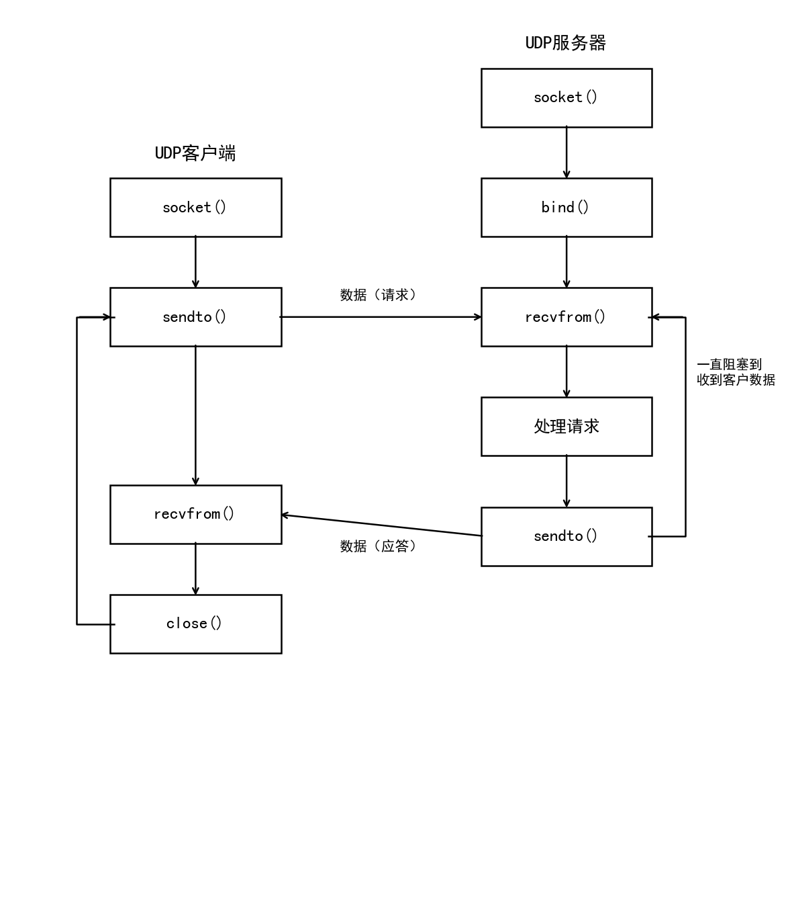
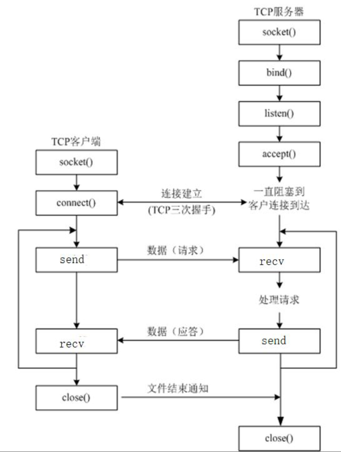
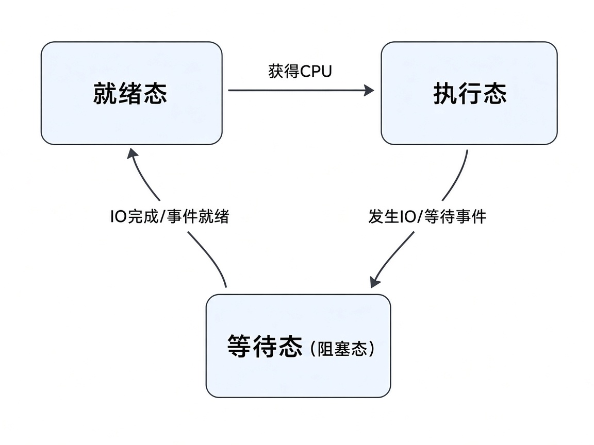

# Python 笔记

Python 是一门简洁、优雅的高级编程语言，由吉多·范·罗苏姆（Guido van Rossum）于 1989 年圣诞节期间创建，1991 年发布第一个公开版本。
本笔记以 **Python 3** 为基准，涵盖基础语法、运算符、数据类型、流程控制、容器、函数、迭代器与生成器、面向对象、异常处理、模块与包、文件操作、正则表达式、常用标准库、网络编程（UDP 与 TCP）等核心内容，适合系统性学习与日常查阅。

> **核心理念**：**一切皆对象、一切皆引用、一切皆模块**——数字、字符串、函数、类乃至模块，全部都是对象；所有变量都是引用（指针），指向内存中的对象。
> Python 是**动态强类型**语言：变量无需声明类型（弱类型写法），但类型不匹配时会报错而非隐式转换（强类型语义）。
> **内置函数**：无需导包即可使用的函数，如 `print()`、`len()`、`type()` 等。


| 章节  | 内容                                                    |
| --- | ----------------------------------------------------- |
| 一   | Python 概述：语言特点、编译型 vs 解释型、应用场景 |
| 二   | 环境配置：conda 与 venv 虚拟环境、pip 包管理与换源、SSH 远程连接、常用 IDE 与快捷键 |
| 三   | 基础语法：变量、命名规范（PEP8）、注释、print 输出（含格式化输出）、input 输入 |
| 四   | 运算符：算术、赋值、比较、逻辑、位运算、三目运算符 |
| 五   | 数据类型：数字型（int/float/bool）、类型转换、一切皆引用 |
| 六   | 流程控制：选择结构（if/elif/else）、循环结构（while/for）、break/continue |
| 七   | 容器：字符串、列表、元组、字典、集合、公共操作（运算符/公共函数/sorted）、推导式 |
| 八   | 函数：定义与调用、参数种类、变量作用域、高阶函数与 lambda、拆包、递归 |
| 九   | 迭代器与生成器：可迭代对象、iter/next、yield、生成器函数与生成器表达式 |
| 十   | 面向对象：类与对象、封装、继承、多态（抽象类与接口）、装饰器、单例模式、魔法方法、多继承与 MRO、类属性与三种方法、property 属性、魔法属性、面向对象设计（工厂模式） |
| 十一  | 异常处理：try/except/else/finally、常见异常类型、主动抛出异常、自定义异常 |
| 十二  | 模块与包：模块的导入方式与规范、`__name__`/`__file__`/`__all__`、包的结构与相对导入、搜索路径与 reload、多模块共享变量 |
| 十三  | 文件操作：文件分类与路径、打开与关闭、文件模式、读写操作、乱码问题、MD5 文件校验、with 与上下文管理器 |
| 十四  | 正则表达式：re 模块（match/search/findall/sub）、常用语法、re.compile、flags、finditer |
| 十五  | 常用标准库：os、sys、time、datetime、random、json、copy（深浅拷贝）、tqdm |
| 十六  | 网络编程：网络通信基础（IP/端口）、Socket、UDP 与 TCP 编程、编码转换、TCP 连接原理（三次握手/四次挥手）、TCP/IP 协议族、高级网络编程（epoll/粘包/C-S 与 B-S）、DDoS 简介、速查 |
| 十七  | 并发编程：并发基础概念、Linux 进程管理命令、多进程（multiprocessing）、多线程（threading，锁与死锁）、协程（greenlet/gevent）、选型与 GIL |


---


## 一、Python 概述


### 1.1 语言特点


| 特点   | 说明                                          |
| ---- | ------------------------------------------- |
| 简单易学 | 语法接近自然语言，33 个关键字，7 种基本数据类型，入门门槛极低           |
| 弱类型  | 定义变量时无需声明类型，解释器自动推断                         |
| 开源免费 | 完全开源，可自由阅读和修改源码                             |
| 可移植性 | 跨平台运行，代码无需修改即可在 Windows / Linux / macOS 上运行 |
| 解释执行 | 由解释器逐行翻译执行，无需预先编译；代码少，精确表达需求逻辑              |
| 丰富的库 | 标准库 + 第三方生态极其丰富，覆盖 IT 行业 70% 以上技术领域         |


> **编译型 vs 解释型**：
>
> - **编译型**（如 C/C++）：源代码先由编译器生成可执行文件，后续直接执行，效率高
> - **解释型**（如 Python）：解释器在运行时逐行翻译执行，每次运行都需要解释，速度相对慢；但 Python 的速度劣势随硬件性能提升逐渐被弥补
> Python 唯一的缺点是**执行效率慢**，这是解释型语言的通性


### 1.2 应用场景


| 方向        | 代表技术/框架                                           |
| --------- | ------------------------------------------------- |
| Web 开发    | Django、Flask、FastAPI                              |
| 数据分析      | NumPy、Pandas、Matplotlib                           |
| 人工智能/机器学习 | TensorFlow（Google）、PyTorch（Facebook）、Scikit-learn |
| 深度学习      | Paddle（百度）、MindSpore（华为）                          |
| 网络爬虫      | Requests、BeautifulSoup、Scrapy                     |
| 运维自动化     | Ansible、SaltStack                                 |
| 桌面软件      | PyQt、Tkinter                                      |


---


## 二、环境配置


### 2.1 conda 虚拟环境

conda 是 Anaconda 提供的包与环境管理工具，可以为不同项目创建相互隔离的 Python 环境。

```bash
# 创建虚拟环境
# -n 按名称管理，存在 conda 默认目录；-p 按路径管理，存在指定目录；两者互斥
$conda create -n 环境名 python=3.11
$conda create -p /path/to/env python=3.11

# 删除虚拟环境（--all 删除整个环境目录）
$conda env remove -n 环境名 --all
$conda env remove -p /path/to/env --all
```

```bash
# 列出所有已创建的虚拟环境
$conda env list

# 激活虚拟环境（-n 激活按名称创建的，-p 激活按路径创建的）
$conda activate 环境名
$conda activate /path/to/env

# 退出当前虚拟环境
$conda deactivate
```

```bash
# 将 conda 写入配置到 ~/.bashrc，使其在新终端中自动生效
$conda init

# 重新加载当前用户的 bash 配置文件，使其立即生效，无需重启终端
$source ~/.bashrc
```

> **conda 特点**：conda 中的包都是**编译后的包**（后缀 `.whl`），可以管理不同版本的 Python 本身；
> `venv` 只能在现有 Python 版本下创建环境，无法管理 Python 本身的版本


### 2.2 venv 虚拟环境（轻量级方案）

```bash
# 创建虚拟环境（.venv 是惯例名称，PyCharm 会自动识别）
# 必须使用 Git Bash 创建，否则虚拟环境不完整
$python -m venv 虚拟环境名

# 进入虚拟环境（先进入虚拟环境后 pip 安装包，才能把包安装到虚拟环境中）
$source ./虚拟环境名/Scripts/activate

# 退出虚拟环境
$deactivate
```

> **注意**：
>
> - 进入虚拟环境**后**再 pip 安装包，才能把包安装到虚拟环境中
> - 虚拟环境中有一套独立的 `python.exe` 和 `pip`
> - 不同的虚拟环境，可以安装不同版本的同一个库（如 transformers），互不影响
> - Python 版本一致才能通过 `requirements.txt` 安装依赖

```bash
# PyCharm 中为已有项目设置虚拟环境：
# 设置 → 项目 → Python 解释器 → 添加解释器 → 虚拟环境 → 选择虚拟环境文件夹中的 python.exe
```


### 2.3 pip 包管理

```bash
# 安装包（推荐先换源，速度更快）
pip install 包名
pip install 包名==版本号           # 安装指定版本
pip install -U 包名                # 安装或升级到最新版本（-U 即 --upgrade）
conda install 包名==版本号         # conda 安装（会自动检测并安装包的依赖）

# 卸载包
pip uninstall 包名

# 查看已安装的包
pip list                           # 列出所有已安装的包
pip show 包名                      # 查看某个包的详细信息
pip freeze                         # 快速查看当前环境安装了哪些包及其版本

# 导出/安装依赖清单（团队协作常用）
pip freeze > requirements.txt      # 导出当前环境所有依赖
pip install -r requirements.txt    # 根据清单安装依赖（python 版本需一致）
```


#### 2.3.1 pip 换源（国内加速）

```bash
# 永久设置阿里云镜像源（一次配置，永久生效）
pip config set global.index-url https://mirrors.aliyun.com/pypi/simple/

# 查看当前下载源
pip config get global.index-url

# 临时使用指定源（仅本次安装生效）
pip install 包名 -i https://mirrors.aliyun.com/pypi/simple/
```


| 常用镜像源 | 地址                                          |
| ----- | ------------------------------------------- |
| 阿里云   | `https://mirrors.aliyun.com/pypi/simple/`   |
| 清华大学  | `https://pypi.tuna.tsinghua.edu.cn/simple/` |
| 豆瓣    | `https://pypi.doubanio.com/simple/`         |


### 2.4 SSH 远程连接

```bash
# 拷贝公钥到远程主机（实现无密钥登录）
# -p 指定端口号
$ssh-copy-id -p 端口号 用户名@远程主机IP
```

在 `~/.ssh/config` 中配置 SSH 快捷别名，避免每次输入完整信息：

```
Host 远程主机名
    HostName 远程主机域名
    User     登录用户名
    Port     登录端口号
    IdentityFile 本机私钥路径
```

```bash
# 配置完成后，直接使用别名登录
$ssh 远程主机名
```


### 2.5 常用 IDE 与快捷键


| IDE                     | 特点                                |
| ----------------------- | --------------------------------- |
| **PyCharm**             | 专业 Python IDE，功能强大，适合大型项目开发       |
| **VS Code + Python 插件** | 轻量灵活，适合多语言开发                      |
| **Jupyter Notebook**    | 交互式执行，数据分析首选，支持可视化内联显示；依赖 IPython |
| **IPython**             | 增强型交互式 Shell，支持自动补全、语法高亮          |


```bash
# PyCharm 常用快捷键
Ctrl+Alt+L      # 按 PEP8 规范格式化代码
Ctrl+/          # 添加或解除注释（注释选中部分）
Ctrl+左键        # 跳转到函数/变量定义处
Alt+← 或 Alt+→  # 跳转回上一个/下一个位置
Shift+Tab       # 向前缩进（减少缩进）
Tab             # 向后缩进（增加缩进）
```

---


## 三、基础语法


### 3.1 变量

变量是存储数据的容器。Python 是**弱类型**（动态类型）语言，定义变量时无需声明类型。

```python
# 变量定义语法：变量名 = 变量值（= 两边各保留一个空格）
name = 'zhangsan'    # 字符串类型
age = 20             # 整型
height = 180.5       # 浮点型
is_student = True    # 布尔型

# 多变量同时赋值
i, j, k = 3, 4, 5

# 交换两个变量的值（Python 独有写法）
a, b = b, a

# 查看变量类型
print(type(name))    # <class 'str'>

# 判断变量类型（推荐，支持继承关系判断）
isinstance(name, str)           # True
isinstance(name, (str, int))    # True（判断是否是其中一种类型）
```

> **变量内存原理（一切皆引用）**：
>
> - 变量名是**指针**，指向内存中的数据对象；执行结束后，释放的是变量名（指针），而非数据本身
> - **不可变类型**（int/float/str/tuple）：相同值的对象可能共享同一地址（`id` 相同）；修改会导致变量指向一个新对象
> - **可变类型**（list/dict/set）：相同内容的列表是不同对象（`id` 不同）；修改不改变变量的指向

```python
a = 10
b = a             # b 和 a 指向同一个整数对象
print(id(a) == id(b))   # True

t1 = [1, 2, 3]
t2 = [1, 2, 3]
print(id(t1) == id(t2))  # False（可变类型，独立对象）
t3 = t2
t3.append(4)
print(t2)   # [1, 2, 3, 4]（t3 和 t2 指向同一对象，都被修改！）

del t3       # 释放变量名 t3，引用计数减1；引用计数为0时对象才被销毁
```


### 3.2 命名规范（PEP8）


| 类型        | 命名方式                     | 示例                      |
| --------- | ------------------------ | ----------------------- |
| 变量、函数、模块名 | 蛇形命名法（单词间下划线分隔）          | `my_name`, `get_age()`  |
| 类名、异常名    | 大驼峰命名法（每个单词首字母大写）        | `MyClass`, `ValueError` |
| 全局常量      | 全大写 + 下划线（没有常量关键字，靠命名识别） | `MAX_SIZE`, `PI`        |


**标识符命名规则**：

1. 由字母、数字、下划线组成，**不能以数字开头**
2. 区分大小写：`name` 和 `Name` 是不同变量
3. 不能与 Python 关键字重名（注意避免关键字覆盖）

```python
# 查看 Python 所有关键字（共 33 个）
import keyword
print(keyword.kwlist)

# 检查某个名称是否是关键字
keyword.iskeyword('for')   # True
```


### 3.3 注释

```python
# 这是单行注释，以 # 开头；注释与代码同行时，在代码右侧写

def my_func():
    # 这是在代码上方的注释
    pass

"""
这是多行注释（文档字符串）
单引号和双引号都可以，效果相同
"""

'''这也是多行注释，去掉双引号会进行类型转换，作为字符串类型在 IDE 内联想查看函数的注释'''
```


### 3.4 输出（print 函数）

```python
# 基本输出，默认自带换行（\n）
print("Hello World")

# 指定结束符（end 参数，消除默认换行）
print("Hello", end='')        # 末尾不换行
print("Hello", end=' ')       # 末尾用空格结束
print("Hello", end='@@')      # 末尾用自定义字符结束

# 格式化输出
name = '张三'
age = 20
score = 88.36

# 方式一：f-string（推荐，Python 3.6+，语法简洁、性能最高）
print(f'我叫{name}, 今年{age}岁, 成绩{score:.2f}')   # 带精度控制：.2f 保留2位小数

# 方式二：format 方法（兼容性好）
print('我叫{}, 今年{}岁'.format(name, age))
print("...{}，...{:.2f}".format(name, score))         # 带精度控制

# 方式三：% 占位符（旧式，了解即可）
print('我叫%s, 今年%d岁, 成绩%.2f' % (name, age, score))
# %s=字符串, %d=整型, %f=浮点型, %05d=5位整数不足补0

# 查看变量类型（输出前需知类型，必须先转换为原生类型）
print(type(name))     # <class 'str'>；类型本身是对象
```


| 格式符      | 含义            | 示例                            |
| -------- | ------------- | ----------------------------- |
| `%s`     | 字符串           | `'%s' % 'hello'`              |
| `%d`     | 整型            | `'%05d' % 12` → `'00012'`     |
| `%f`     | 浮点型           | `'%.2f' % 3.14159` → `'3.14'` |
| `{:.kf}` | f-string 精度控制 | `f'{pi:.4f}'`                 |


### 3.5 输入（input 函数）

```python
# input 函数从键盘读取输入，始终返回字符串类型（input 都按照字符串返回）
name = input('请输入您的姓名：')   # 返回 str

# 若需要数字类型，必须进行类型转换
age = int(input('请输入您的年龄：'))

# 注意：两行代码不能连写在一起（invalid syntax）
# print('hello')print('world')   # 报错
```

> **阻塞说明**：`input()` 本质上是从**标准输入缓冲区**（`stdin`）读取一行数据。
> - **缓冲区为空**：`input()` 阻塞，程序挂起，等待用户键盘输入并按下回车
> - **缓冲区有数据**：`input()` 直接读取，**不阻塞**，立即返回（例如通过管道或重定向提前写入数据时）
>
> ```python
> # 示例：通过管道向 stdin 传入数据，input() 不会阻塞
> # echo "Alice" | python script.py
> name = input()   # 直接读取管道中的 "Alice"，无需等待键盘
> print(name)      # 输出：Alice
> ```

---


## 四、运算符


### 4.1 算术运算符


| 运算符  | 描述               | 示例（a=10, b=3）                |
| ---- | ---------------- | ---------------------------- |
| `+`  | 加法               | `a+b = 13`                   |
| `-`  | 减法               | `a-b = 7`                    |
| `*`  | 乘法（也可用于字符串/列表重复） | `a*b = 30`；`'ab'*3='ababab'` |
| `/`  | 除法（结果为浮点型）       | `a/b ≈ 3.333`                |
| `//` | 取整除（返回商的整数部分）    | `a//b = 3`                   |
| `%`  | 取余（取模），非百分号      | `a%b = 1`                    |
| `**` | 指数（优先级最高）        | `a**b = 1000`（a 的 b 次方）      |


> **注意**：Python 中**没有** `++` 和 `--` 运算符；`**` 优先级最高


### 4.2 赋值运算符

```python
a = 10
a += 5    # a = a + 5  → 15
a -= 3    # a = a - 3  → 12
a *= 2    # a = a * 2  → 24
a /= 4    # a = a / 4  → 6.0
a //= 2   # a = a // 2 → 3
a %= 2    # a = a % 2  → 1
a **= 3   # a = a ** 3 → 1
```


### 4.3 比较运算符

比较运算符的结果为 `True` 或 `False`。


| 运算符         | 描述          |
| ----------- | ----------- |
| `==`        | 等于          |
| `!=`        | 不等于         |
| `>` / `<`   | 大于 / 小于     |
| `>=` / `<=` | 大于等于 / 小于等于 |


```python
# Python 支持连续比较（其他语言少见）
a = 5
print(0 < a < 10)    # True，等价于 0 < a and a < 10
```


### 4.4 逻辑运算符

> **逻辑运算符不一定返回 True/False，返回的是操作数本身**（0 以及非 0 值相当于 1）：


| 运算符        | 两边都真时               | 有假时         |
| ---------- | ------------------- | ----------- |
| `and`（逻辑与） | 返回**右边**的值          | 返回**第一个假**值 |
| `or`（逻辑或）  | 返回**左边**的值          | 返回**第一个真**值 |
| `not`（逻辑非） | 返回 `True` 或 `False` | —           |


```python
print(3 and 5)    # 5（两边都真，返回右边）
print(0 and 5)    # 0（左边为假，返回左边）
print(3 or 5)     # 3（两边都真，返回左边）
print(0 or 5)     # 5（左边为假，返回右边）
print(not 0)      # True
print(not 3)      # False

# 空容器为 False，非 0 数为 True
print(bool([]))   # False（空列表）
print(bool({}))   # False（空字典）
print(bool(1))    # True
```

> **短路求值**：`and` 左边为假时不再计算右边；`or` 左边为真时不再计算右边


### 4.5 位运算符（只能对整数类型运算）


| 运算符         | 描述                                                    |
| ----------- | ----------------------------------------------------- |
| `&`         | 按位与                                                   |
| `\|`        | 按位或                                                   |
| `~`         | 按位取反                                                  |
| `<<` / `>>` | 按位左移 / 右移（每移一位相当于 ×2 / ÷2）                            |
| `^`         | 按位异或：相同为0，不同为1；满足**交换律**；一个数与自身异或结果为 0；一个数与 0 异或结果为自身 |


### 4.6 三目运算符

```python
# 语法：表达式1 if 条件表达式 else 表达式2
# 条件为真时返回表达式1，否则返回表达式2
a, b = 10, 20
max_val = a if a > b else b    # 20
```

---


## 五、数据类型


### 5.1 数字型

```python
# 整型（int）：无溢出，可表示任意大整数
num = 100
big = 10 ** 100     # Python 整型无溢出

# 浮点型（float）：双精度，约 17 位精度（有效数字）
pi = 3.14159

# 布尔型（bool）：True/False 必须大写；True=1，False=0
is_ok = True        # 不能写 true（小写报错）

# 复数型（complex）：了解即可，主要用于科学计算
c = complex(2, 3)   # 2+3j
```

> **布尔值的真假规则**：
>
> - **假（False）**：`0`、`0.0`、`''`（空字符串）、`[]`（空列表）、`()`（空元组）、`{}`（空字典）、`None`
> - **真（True）**：任何非零数、任何非空容器


### 5.2 类型转换

```python
int('100')         # str → int：'100' → 100
int(3.14)          # float → int：截断小数部分，3.14 → 3
float('3.14')      # str → float：'3.14' → 3.14
float(100)         # int → float：100 → 100.0
str(100)           # int → str：100 → '100'
bool(0)            # 任意类型 → bool：0 → False
eval('10 + 5')     # 字符串作为代码执行：'10 + 5' → 15（去掉引号，是什么类型就是什么）
eval('[1,2,3]')    # '[1,2,3]' → [1, 2, 3]
```

> **类型转换注意事项**：类型转换**不能跨级**，如 `'3.14'` 不能直接转为 `int`，需先转 `float` 再转 `int`：
> `int(float('3.14'))` → `3`；原生类型才能转换，必须一步步转，不能跳跃


### 5.3 一切皆引用

> **结论总结**：
>
> - **变量名是指针（引用）**：变量保存的不是数据本身，而是指向数据对象的引用；`b = a` 只是让 `b` 和 `a` 指向同一个对象，两个变量名之间没有绑定关系，不会互相跟随变化
> - **不可变类型**（int/float/str/tuple）：修改会让变量名指向一个**新对象**，其他指向原对象的变量不受影响（如 `a += 1` 后 `a` 指向新对象，`b` 仍指向原对象）
> - **可变类型**（list/dict/set）：原地修改**不改变**变量名的指向，所有指向该对象的变量都能看到修改（如 `t2 = t1` 后 `t2.append(4)`，`t1` 也变化）
> - **`id` 相同 = 同一个对象**：同一个对象赋给多个变量名，`id` 相同；`id` 不同则一定是不同的对象
> - **内容相同不等于同一个对象**：
>   - **可变类型**：内容相同但分别初始化的对象，`id` **一定不同**（如分别初始化两个 `[1, 2, 3]`，得到的是两个独立的列表）
>   - **不可变类型**：内容相同但分别初始化的对象，`id` **不确定**，由解释器是否做了缓存优化决定（CPython 对小整数 -5~256、部分短字符串会复用同一对象），不能依赖，判断值是否相等应使用 `==`，而不是比较 `id` 或 `is`
> - **`del` 删除的是变量名**：引用计数减 1，引用计数为 0 时对象才会被销毁，而不是直接销毁数据

```python
# 实际是传递指针，指向同一个对象
# 相同的不可变类型数据对象（如同一个整数）赋给两个变量名，两个变量名的 id 相同
a = 10
b = a
print(id(a) == id(b))   # True

# 同一个可变类型数据对象（如同一个列表）赋给两个变量名，两个变量名的 id 相同
# 列表属于容器，详见 7.2 列表
t1 = [1, 2, 3]
t2 = t1                  # t2 和 t1 指向同一个列表对象
print(id(t1) == id(t2))  # True

# 内容相同但分别初始化的两个列表是不同的对象，id 不同
t3 = [1, 2, 3]
print(id(t1) == id(t3))  # False

# 对不可变类型数据对象的修改会导致变量名指向修改后的一个新的数据对象
a += 1                   # 整数不可变：a 指向新对象 11，原来的 10 不变
print(id(a) == id(b))    # False（b 仍指向 10）

# 对可变类型数据对象的修改不改变指向该数据对象的变量名的指向
t2.append(4)             # 原地修改列表对象，t1 和 t2 仍指向同一个对象
print(t1)                # [1, 2, 3, 4]（通过 t2 的修改，t1 也能看到）

# id() 查看变量指向的对象的内存逻辑地址
print(id(a))

# del 释放的是变量名（指针），而非数据本身：引用计数减 1，引用计数为 0 时对象才会被销毁
del t2  # 释放变量名 t2；t1 仍指向该列表对象，所以对象不会被销毁
```

---


## 六、流程控制


### 6.1 选择结构

```python
# 单分支
if 判断条件:
    执行代码     # 必须缩进（4个空格或1个Tab，不能混用）

# 双分支
if 判断条件:
    ...
else:            # else 必须和 if 对齐
    ...

# 多分支（elif 不能写成 else if）
score = int(input("请输入成绩："))
if score >= 90:
    grade = 'A'
elif score >= 80:    # 当判断条件1和条件2都成立时，只执行第一个成立的分支
    grade = 'B'
elif score >= 70:
    grade = 'C'
else:
    grade = 'D'
```

> **注意**：顶格书写的代码（与 if 同级）总会执行，与 if 无关；
> Python 使用**缩进**（而非大括号）表示代码层级


### 6.2 循环结构


#### 6.2.1 while 循环

```python
# 基本格式（必须更新循环变量，否则死循环）
i = 0
while i < 5:
    print(i)
    i += 1

# while...else：循环正常结束（未被 break 中断）时执行 else 块
i = 0
while i < 3:
    print(i)
    i += 1
else:
    print("循环正常结束")
```


#### 6.2.2 for 循环（增强 for）

```python
# for 遍历数据结构（增强 for 循环）
for i in 容器:
    函数体       # 对容器中的每一个元素做操作

# 遍历字符串
for ch in 'hello':
    print(ch)

# range() 返回一个包含元素的对象，左闭右开，类似列表
for i in range(5):            # 0,1,2,3,4
    print(i)
for i in range(1, 6):         # 1,2,3,4,5
    print(i)
for i in range(0, 10, 2):     # 0,2,4,6,8（步长为2）
    print(i)

# for...else：循环正常结束（未被 break 中断）时执行 else 块
for i in range(3):
    print(i)
else:
    print("for 循环结束")
```


#### 6.2.3 循环控制

```python
# break：立即跳出整个循环（同时跳过 while-else/for-else 的 else 块）
for i in range(10):
    if i == 5:
        break
    print(i)   # 输出 0 1 2 3 4

# continue：跳过当次循环，继续下一次
for i in range(5):
    if i == 2:
        continue
    print(i)   # 输出 0 1 3 4
```

---


## 七、容器

Python 中有五大内置（无需导包）容器：**字符串** `''`、**列表** `[]`、**元组** `()`、**字典** `{}`、**集合** `{}`。


| 容器         | 有序      | 可变  | 可重复 | 支持切片 | 下标   | 底层实现 |
| ---------- | ------- | --- | --- | ---- | ---- | ---- |
| 字符串 `str`  | ✅       | ❌   | ✅   | ✅    | ✅    | 连续内存 |
| 列表 `list`  | ✅       | ✅   | ✅   | ✅    | ✅    | 动态数组 |
| 元组 `tuple` | ✅       | ❌   | ✅   | ✅    | ✅    | 静态数组 |
| 字典 `dict`  | ✅（3.7+） | ✅   | 键唯一 | ❌    | ✅（键） | 哈希表  |
| 集合 `set`   | ❌       | ✅   | ❌   | ❌    | ❌    | 哈希表  |


> **合并+、复制、切片** `[:]`：都**不支持**字典和集合


### 7.1 字符串（str，不可变）


#### 7.1.1 定义与下标

```python
s1 = 'hello'            # 单引号
s2 = "world"            # 双引号（与单引号等价）
s3 = """多行
字符串"""                # 三引号，保留原有格式
s4 = 'I\'m a singer'    # 转义字符 \'；转义字符用 \

# ── 特殊前缀字符串 ──────────────────────────────────────────
# f 字符串（f-string）：格式化字符串，{} 内可直接嵌入变量或表达式，Python 3.6+
name, age = 'Tom', 18
s = f'我叫 {name}，今年 {age} 岁'       # '我叫 Tom，今年 18 岁'
s = f'{1 + 2}'                          # '3'，{} 内可写表达式
s = f'{3.14:.2f}'                       # '3.14'，支持格式规格说明符

# r 字符串（raw string）：原始字符串，反斜杠 \ 不转义，常用于正则表达式和路径
s = r'C:\Users\name\Desktop'            # 'C:\\Users\\name\\Desktop'，\ 不被转义
s = r'\n\t'                             # 字面量 '\n\t'，而非换行+制表符

# b 字符串（bytes literal）：字节串字面量，类型为 bytes 而非 str，用于网络/文件 IO
b = b'hello'                            # b'hello'，类型 bytes，只能包含 ASCII 字符
b = b'\xe4\xbd\xa0'                     # 十六进制字节值，表示 UTF-8 编码的 '你'
# b 字符串不能直接包含中文，需用 encode：'你好'.encode('utf-8') → bytes

# 下标（索引）：正向从 0 开始，逆向从 -1 开始
s = 'hello'
print(s[0])    # 'h'
print(s[-1])   # 'o'
print(len(s))  # 5（获取长度）

# 步长为负时，代表从右往左切，且起始位置在右边是负索引，结束位置在左边是负索引
```


#### 7.1.2 切片（非常重要）

```python
# 语法：字符串[起始位置:结束位置:步长]，左闭右开，不改变原字符串，返回临时对象
s = 'cskaoyan2025'
print(s[0:3])       # 'csk'（取索引 0,1,2）
print(s[:5])        # 'cskao'（从头开始，默认 0）
print(s[5:])        # 'yan2025'（到末尾）
print(s[-4:])       # '2025'（逆向索引）
print(s[::2])       # 隔一个取一个
print(s[::-1])      # '5202nayoaksc'（反转字符串，步长为-1从右往左）
print(s[-4:-12:-1]) # 逆序取：步长为负时，起始在右（负索引），结束在左（负索引）
```


#### 7.1.3 常用方法

```python
s = 'Hello, World, Python'

# 查找（find 未找到返回 -1，index 未找到报 ValueError）
s.find('World', 起始位置, 结束位置)   # 返回子串起始下标；未找到返回 -1
s.index('World')                     # 同 find，但未找到时报错
s.count('l')                         # 统计子串出现次数
s.startswith('Hello')                # 是否以指定字符串开头，返回 bool
s.endswith('.py')                    # 是否以指定字符串结尾，返回 bool

# 替换（num 是替换次数，返回替换后的临时字符串对象，原字符串不变）
s.replace(old_str, new_str, num)

# 分割与拼接
s.split(' ')                         # 按空格分割，返回 list；默认按空格分割
s.splitlines()                       # 按行分割字符串，返回列表
','.join(['a', 'b', 'c'])            # 用字符串连接可迭代对象 → 'a,b,c'
                                     # join 要求可迭代对象中每个元素都是字符串

# 大小写转换
s.upper()       # 全部大写
s.lower()       # 全部小写
s.capitalize()  # 首字母大写，其余小写
s.title()       # 每个单词首字母大写
s.swapcase()    # 大小写互换

# 去除空白（strip 默认去除空格、换行在内的"空白字符"）
s.strip()       # 去除两端空白（含 \n \t）
s.lstrip()      # 去除左端
s.rstrip()      # 去除右端

# 判断类型（is 系列，判断字符串中内容的类型，返回 True 或 False）
s.isdigit()     # 是否全是数字
s.isalpha()     # 是否全是字母
s.isalnum()     # 是否全是字母或数字
s.islower()     # 是否全是小写
s.isupper()     # 是否全是大写
s.isspace()     # 是否全是空白字符

# 对齐填充
s.ljust(width)   # 左对齐，用空格填充至宽度 width
s.rjust(width)   # 右对齐
s.center(width)  # 居中

# int 整型转为字符串，使得可以快速按位访问
str_num = str(12345)
print(str_num[2])   # '3'

# 编码与解码（网络传输必须用 bytes，不能直接传 str）
# encode(编码格式)：str → bytes；编码格式默认 'utf-8'
b = 'hello'.encode('utf-8')          # b'hello'，类型为 bytes
b = '你好'.encode('utf-8')           # b'\xe4\xbd\xa0\xe5\xa5\xbd'，中文每字 3 字节

# decode(编码格式)：bytes → str；编码格式须与 encode 一致，否则报 UnicodeDecodeError
s = b'\xe4\xbd\xa0\xe5\xa5\xbd'.decode('utf-8')  # '你好'
s = b'hello'.decode('utf-8')         # 'hello'
```


### 7.2 列表（list，可变）

```python
# 定义（可放不同类型元素）
name_list = ['tom', 'jerry', 'bob']
mixed = [1, 'hello', True, 3.14, [1, 2]]

# 切片与字符串相同
# 列表为空时不能使用下标赋值

# ── 增 ──────────────────────────────
name_list.append(元素)                    # 尾部追加单个元素，无返回值
name_list.insert(下标, 元素)              # 在指定下标前插入（传入的是插入后的下标）
name_list.extend([元素1, 元素2])          # 扩展（必须传入可迭代对象）
name_list[i:i] = [元素1]                  # 切片插入（单个）：起始=结束时为插入操作，传入的起始位置是插入后的第一个元素的下标（和 insert 的机制相同）；右边必须用[]包裹来赋值
name_list[i:i] = [元素1, 元素2, ...]     # 切片插入（多个）：同上，右边必须用[]包裹来赋值

# ── 删 ──────────────────────────────
name_list.pop()                           # 删除并返回最后一个元素
name_list.pop(i)                          # 删除并返回指定索引的元素
del name_list[i]                          # 按索引删除（无返回值）
del name_list[i:j:k]                      # 切片删除
name_list.remove(元素)                    # 删除第一个匹配的元素，不存在时报错
name_list.clear()                         # 清空列表

# 循环删除注意：迭代器失效问题，删除后 i 不需要自增（避免跳过元素）

# ── 查 ──────────────────────────────
name_list.index(元素)                     # 查找元素的下标，不存在时报错
元素 in name_list                         # 判断元素是否在列表中：True/False
name_list.count(元素)                     # 统计元素出现次数

# ── 改 ──────────────────────────────
name_list[i] = 元素                       # 按下标修改
name_list[i:j] = [元素1, 元素2]          # 切片修改：右边必须用[]包裹；自动适配长度
                                          # 赋值为空列表会删除元素

# ── 排序 ──────────────────────────────
name_list.sort()                          # 原地升序排序（list 的 sort 改变原列表，不返回新列表）
name_list.sort(reverse=True)              # 原地降序排序
name_list.reverse()                       # 原地反转
sorted(name_list)                         # 返回新的排序列表，不修改原列表

# ── 拷贝 ──────────────────────────────
new_list = name_list.copy()               # 浅拷贝，指向不同空间（copy 方法）
new_list = name_list[:]                   # 浅拷贝（切片方式）
```

> **字符串转为列表**：可用于按字符访问，`list('hello')` → `['h', 'e', 'l', 'l', 'o']`


### 7.3 元组（tuple，不可变）

```python
t1 = (1, 2, 3)
t2 = ('a', 'b')

# 注意：只有一个元素的"元组"不是元组，类型是元素的类型
# 只有一个元素且有逗号，才是元组
t_wrong = (1)     # int，类型是 int
t_right = (1,)    # tuple，单元素元组必须加逗号

# 下标与切片（与列表/字符串相同）
print(t1[0])      # 1
print(t1[1:])     # (2, 3)

# 元组拆包
a, b, c = t1      # a=1, b=2, c=3（字典的键值对是元组，可以元组拆包）
for key, value in {'a': 1, 'b': 2}.items():  # 元组拆包遍历
    print(key, value)
```


### 7.4 字典（dict）

```python
# 定义（键必须是不可变类型，键必须唯一，推荐字符串键）
person = {'name': '张三', 'age': 20}

# ── 增改 ──────────────────────────────
person['gender'] = 'male'       # 键不存在时添加，键存在时修改
person.setdefault('age', 25)    # 有键值的键值对不修改，无键值的键值对才添加（选择性插入）

# ── 删 ──────────────────────────────
del person['age']               # 删除指定键值对
person.pop('height')            # 删除并返回值；键不存在时若未提供默认值则报错
person.pop('xxx', None)         # 键不存在时返回 None，不报错
person.popitem()                # 随机删除并返回 (key, value)
person.clear()                  # 清空字典

# ── 查 ──────────────────────────────
person['name']                  # 直接访问，键不存在时报 KeyError
person.get('name')              # 安全访问，键不存在时返回 None
person.get('xxx', '默认值')     # 键不存在时返回指定默认值

person.keys()                   # 返回所有键的可迭代对象
person.values()                 # 返回所有值的可迭代对象
person.items()                  # 返回所有键值对（元组）的可迭代对象

# ── 遍历 ──────────────────────────────
for key in person:              # 默认遍历键（取出的是 key）
    print(key, person[key])

for key, value in person.items():
    print(f'{key}: {value}')
```

> **字典特性**：
>
> - Python 3.7+ 字典**有序**（按插入顺序），3.7 以前无序
> - 键必须是**不可变类型**（可哈希）；底层是**哈希表**
> - 尽量不用字典存储有重复键名的信息，否则会有丢失覆盖问题


### 7.5 集合（set）

```python
# 定义（无序、不重复；创建空集合必须用 set()，不能用 {}）
my_set = {1, 2, 3, 4}
empty_set = set()              # 正确（空集合）
empty_dict = {}                # 这是空字典！不是空集合

# 通过序列创建集合（自动去重，不保留原有顺序）
s = set([1, 2, 2, 3, 3])      # {1, 2, 3}

# ── 增 ──────────────────────────────
my_set.add(5)                  # 添加单个元素
my_set.update([6, 7, 8])       # 添加多个元素（传入可迭代对象）

# ── 删 ──────────────────────────────
my_set.remove(元素)            # 删除指定元素，不存在时报错
my_set.discard(元素)           # 删除指定元素，不存在时不报错（推荐）
my_set.pop()                   # 随机删除并返回一个元素

# ── 集合运算 ──────────────────────────
set1 = {1, 2, 3, 4}
set2 = {3, 4, 5, 6}
set1 | set2    # 并集：{1, 2, 3, 4, 5, 6}
set1 & set2    # 交集：{3, 4}
set1 - set2    # 差集：{1, 2}（在set1中但不在set2中）
set1 ^ set2    # 对称差集：{1, 2, 5, 6}

# 集合比较（比较的是子集关系）
{1, 2} < {1, 2, 3}    # True（是子集）

# 常见用途：列表去重（集合不支持下标，故不支持 del）
unique_list = list(set([1, 2, 2, 3, 3, 4]))
```


### 7.6 公共操作


#### 7.6.1 公共运算符

```python
# + 合并（字符串、列表、元组）
[1, 2] + [3, 4]         # [1, 2, 3, 4]

# * 复制（字符串、列表、元组）
[1, 2] * 3              # [1, 2, 1, 2, 1, 2]

# in / not in 判断元素是否存在（字典判断的是键）
3 in [1, 2, 3]          # True
'name' in {'name': 'zs'}  # True

# 字符串/列表的比较：按元素比较，取决于第一个不同的元素的大小
# 集合的比较：是否是子集
[1, 2, 3] > [1, 2]      # True（前缀更短的更小）
```


#### 7.6.2 公共函数


| 函数                        | 说明                                     | 支持容器                |
| ------------------------- | -------------------------------------- | ------------------- |
| `len(x)`                  | 获取元素数量                                 | 全部                  |
| `max(x)`                  | 获取最大值                                  | 全部                  |
| `min(x)`                  | 获取最小值                                  | 全部                  |
| `sum(x)`                  | 求和（元素须为数字）                             | list/tuple/set      |
| `sorted(x, key, reverse)` | 返回新排序列表，不修改原容器（无论传入的是可变还是不可变容器，都返回新列表） | 全部                  |
| `reversed(x)`             | 返回反转迭代器                                | str/list/tuple/dict |
| `enumerate(x, start=0)`   | 返回（下标, 元素）迭代器，下标从 start 开始             | 全部                  |
| `zip(a, b, ...)`          | 将多个可迭代对象对应元素组成元组，返回迭代器                 | 全部                  |


```python
# enumerate：把每个元素的位置取出来，返回 (pos, value) 元组
for i, val in enumerate(['a', 'b', 'c']):
    print(i, val)   # 0 a, 1 b, 2 c

# zip：返回的是迭代器（只能遍历一次，可转换为 list 接收）
# 迭代器中的每个元素是一个元组，每个元组是传入的多个可迭代对象对应下标的元素组成的
names = ['Alice', 'Bob']
scores = [88, 95]
for name, score in zip(names, scores):
    print(f'{name}: {score}')
```


#### 7.6.3 sorted 函数详解

```python
# sorted 基于归并排序，是稳定的（相同的元素的相对顺序不变）
nums = [3, 1, 4, 1, 5]
sorted(nums)                      # [1, 1, 3, 4, 5]，不修改原列表
sorted(nums, reverse=True)        # [5, 4, 3, 1, 1]

# 传入字符串：返回的是列表
sorted('hello')                   # ['e', 'h', 'l', 'l', 'o']

# 传入字典：默认传入字典相当于传入 keys，排序返回列表（键的排序）
d = {'b': 2, 'a': 1, 'c': 3}
sorted(d)                         # ['a', 'b', 'c']（按 key 排序）

# 传入 items 时（按 value 排序），排序返回的是元组列表
sorted(d.items(), key=lambda x: x[1])   # [('a',1),('b',2),('c',3)]

# 传入 values 时，排序返回值的列表
sorted(d.values())                # [1, 2, 3]

# key 参数：key 的函数对象的传入实参是可迭代对象的每一个元素
# key 绑定 lambda 时，手写的参数是形参，调用时机在比较环节
students = [('Alice', 88), ('Bob', 95), ('Charlie', 70)]
sorted(students, key=lambda s: s[1])        # 按成绩升序
sorted(students, key=lambda s: s[1], reverse=True)  # 按成绩降序

# 元组的比较规则：取决于第一个不同的元素
```


### 7.7 推导式（生成式）

```python
# 列表推导式（[]）
squares = [x**2 for x in range(1, 6)]

# 带过滤条件（过滤时 if 在循环的后面）
evens = [x for x in range(10) if x % 2 == 0]

# 带三目表达式（三目时 if 在循环的前面）
result = [x if x > 0 else -x for x in [-3, -1, 2, 4]]

# 字典推导式（{}）
d = {k: v**2 for k, v in {'a': 1, 'b': 2}.items()}

# 集合推导式（{}）
s = {x**2 for x in [1, 2, 2, 3]}    # {1, 4, 9}

# 生成器表达式（()，惰性求值，节省内存，只能遍历一遍）
gen = (x**2 for x in range(10))
```

---


## 八、函数


### 8.1 函数定义与调用

```python
# 函数定义（空函数的函数体为 pass）
def 函数名(形参列表):
    """
    函数说明文档（文档字符串，写在函数第一行）
    :param 形参1: 参数说明
    :return: 返回值说明
    """
    函数体
    return 返回值      # return 可省略（返回 None）

# 函数调用（必须先定义后调用；但函数的实现先后顺序可以任意，与调用顺序无关）
# 先预加载（放入内存），再执行
# 从上到下是：导包 → 全局变量 → 类 → 函数 → 调用执行
结果 = 函数名(实参列表)

# 注解函数返回值类型（仅用于提示，解释器不强制检查）
def 函数名() -> None:    # 无返回值注解
    pass
def 函数名() -> int:     # 返回 int 注解
    return 1
```

```python
# 函数说明文档的查看
help(函数名)          # 查看说明文档（ctrl+Q 在 PyCharm 中更常用）
```

> **关键要点**：
>
> - `return` 可以返回多个值（以元组形式）：`return a, b` → `(a, b)`
> - 函数也是对象，**函数名可以像变量名一样传递**（作为参数传入其他函数）
> - 匿名函数需要调用才能执行


### 8.2 参数种类

```python
# 1. 位置参数：按位置顺序一一对应（传实参时，位置参数必须在关键字参数前面）
def greet(name, age):
    print(f'{name}, {age}岁')

greet('张三', 20)            # 正确

# 2. 关键字参数：通过参数名传递，顺序可以不固定
greet(age=20, name='张三')   # 关键字参数可以乱序

# 3. 缺省参数（默认参数）：必须放在形参列表的最后，多个缺省参数时必须相邻
#    给缺省参数传实参时，需要使用关键字参数来传参
def greet2(name, age=18, city='北京'):
    print(f'{name}, {age}岁, {city}')

greet2('李四')                  # 使用默认值：李四, 18岁, 北京
greet2('李四', city='上海')     # 给缺省参数传实参

# 4. 不定长参数
# *args：接收任意数量的位置参数（打包为元组；顺序固定，使用有序容器元组访问）
def sum_all(*args):
    print(type(args))     # <class 'tuple'>
    return sum(args)

# **kwargs：接收任意数量的关键字参数（打包为字典；不固定顺序，使用字典访问）
def print_info(**kwargs):
    print(type(kwargs))   # <class 'dict'>
    for k, v in kwargs.items():
        print(f'{k}: {v}')

# 混合使用：形参列表中 *args 必须在 **kwargs 之前；形参不可以有重名
# 顺序：位置参数 → *args → 缺省参数 → **kwargs
def func(a, b, *args, key='default', **kwargs):
    pass
```


#### 8.2.1 参数的拆包与打包

```python
# 在传递实参时，*args 和 **kwargs 是拆包进行传递
# 元组实参传递 *args（加 * 后元组变为位置参数）
# 字典实参传递 **kwargs（加 ** 后字典变为关键字参数）
# 打包只能放在实参位置

def add(a, b, c):
    return a + b + c

nums = [1, 2, 3]
print(add(*nums))        # 等价于 add(1, 2, 3)

params = {'a': 1, 'b': 2, 'c': 3}
print(add(**params))     # 等价于 add(a=1, b=2, c=3)
```


### 8.3 变量作用域

```python
# 全局变量：定义在函数外，或用 global 关键字修饰；在堆中存储
gl_num = 100

def test_b():
    # 在函数内修改全局变量需要加 global，相当于声明修改全局变量而非定义局部变量，避免歧义
    global gl_num
    gl_num = 200

test_b()
print(gl_num)   # 200
```


| 类型   | 定义位置               | 内存  | 生命周期            | 规则      |
| ---- | ------------------ | --- | --------------- | ------- |
| 局部变量 | 函数内部 / 形参          | 栈帧  | 随函数调用创建，随函数返回销毁 | 函数外不可访问 |
| 全局变量 | 函数外部 / `global` 声明 | 堆   | 随 `.py` 加载而存在   | 全局可访问   |


> **就近原则（LEGB）**：查找变量时，先找局部（Local） → 闭包（Enclosing） → 全局（Global） → 内置（Built-in）；
> 全局变量和函数内定义的局部变量同名时，函数内优先使用函数内的局部变量，而非改变全局变量


### 8.4 高阶函数与 lambda

```python
# 函数作为参数传递（高阶函数）
def calculate(a, b, fn):
    """fn 是回调函数，传递函数名（不加括号）"""
    return fn(a, b)

print(calculate(10, 20, lambda a, b: a + b))   # 30

# lambda 匿名函数（适合简单逻辑；匿名函数需要调用才能执行）
# 语法：lambda 形参列表: 函数体（只能有一个表达式）
square = lambda x: x ** 2
add = lambda a, b: a + b

my_func = lambda 形参列表: 函数体    # 定义匿名函数
my_func(实参)                         # 调用匿名函数

# map（返回迭代器，只能遍历一遍；转为 list 后接收使得能重复遍历）
squared = list(map(lambda x: x**2, [1, 2, 3, 4, 5]))   # [1, 4, 9, 16, 25]

# filter（过滤）
evens = list(filter(lambda x: x % 2 == 0, [1, 2, 3, 4, 5]))  # [2, 4]
```


### 8.5 拆包（Unpacking）

拆包：对于函数中的多个返回数据，去掉元组、列表或字典，直接获取里面数据的过程。

```python
# 对元组拆包
my_tup = ('张三', 20, 88.5, '湖北武汉')
name, age, score, addr = my_tup    # 元素数必须一一对应

# 对函数的多个返回值拆包（return a, b 默认返回元组）
def sum_subtract(a, b):
    return a + b, a - b            # 返回元组

total, result = sum_subtract(10, 20)   # 直接对返回的元组拆包

# 对列表拆包
my_list = [1, 3.14, 'hello', True]
num, pi, s, flag = my_list

# 对字典拆包（获取到的是 key 值，不是 value）
dict1 = {'name': '李云龙', 'age': 20, 'gender': '男'}
key1, key2, key3 = dict1    # key1='name', key2='age', key3='gender'

# 利用拆包交换两个变量的值（Python 独有简洁写法）
a, b = 10, 20
a, b = b, a    # 原理：右边先打包为元组 (b, a)，再拆包同时赋值给左边，无需临时变量
```


### 8.6 递归（Recursion）

递归：函数在运行时调用自身，称为递归调用。

**递归的两要素**：

1. **递归体**：函数调用自身的代码
2. **递归出口**：终止递归的条件（必须有，否则无限递归导致栈溢出）

```python
# 案例1：自然数求和 1+2+...+n
def sum1(n):
    if n == 1:           # 递归出口
        return 1
    return n + sum1(n - 1)   # 递归体

print(sum1(100))    # 5050

# 案例2：n 的阶乘 n!
def factorial(n):
    if n == 1:           # 递归出口
        return 1
    return n * factorial(n - 1)   # 递归体

print(factorial(5))    # 120
```

> **注意**：
>
> - 递归深度不能超过栈空间大小，否则报 `RecursionError`（默认约 1000 层）
> - 可用 `sys.setrecursionlimit(调用次数 + 余量)` 提高递归深度限制
> - 有出口的递归也要注意深度限制

---


## 九、迭代器与生成器

> **可迭代对象的类型**：可迭代对象的类型是 `Iterable`，位于 `collections.abc` 模块中，可用 `isinstance(对象, Iterable)` 判断一个对象是否可迭代（实现了 `__iter__` 方法即返回 `True`）。例如：`isinstance([], Iterable)` 返回 `True`。使用前需先导入：`from collections.abc import Iterable`。

> **迭代器、生成器与可迭代对象的关系**：迭代器和生成器都属于可迭代对象，三者是包含关系：生成器 ⊂ 迭代器 ⊂ 可迭代对象。**迭代器同时实现了 `__iter__` 和 `__next__`，其 `__iter__` 返回自身，所以迭代器一定是可迭代对象**；生成器是迭代器的一种，因此也是可迭代对象。反过来不成立：列表、元组、字符串等是可迭代对象，但不是迭代器（没有 `__next__`），不能直接对其使用 `next()`。可分别用 `isinstance(对象, Iterable)`、`isinstance(对象, Iterator)`、`isinstance(对象, Generator)` 判断（均需从 `collections.abc` 导入）。

> **可迭代对象与 `__iter__` 方法**：可迭代对象是可以被逐个取出元素的对象（可用于 `for` 循环），如 `list`、`tuple`、`str`、`dict`、`set`、`range`、文件对象、迭代器和生成器等，**可迭代对象的判断标准是实现了 `__iter__` 方法**。**`__iter__` 的作用是返回一个迭代器**，`for` 循环和 `iter()` 内部都会调用它。**`for x in obj` 的执行过程：① 调用 `iter(obj)`（即 `obj.__iter__()`）得到迭代器；② 反复调用 `next(迭代器)`，每次取一个元素赋给 `x`；③ 迭代器抛出 `StopIteration` 时循环结束。**`__iter__` 有两种常见写法：返回新的迭代器（如列表、自定义可迭代对象），每次遍历都从头开始，可反复遍历；返回 `self`（迭代器、生成器），此时对象还必须实现 `__next__`，只能遍历一次。


### 9.1 迭代器（Iterator）

```python
# 可迭代对象：实现了 __iter__ 方法的对象，可用于 for 循环
# 迭代器：实现了 __iter__ 和 __next__ 方法的对象

# iter() 返回可迭代对象的迭代器
# 遍历可迭代对象相当于每次遍历时初始化一个迭代器进行遍历
a = iter([1, 2, 3])           # 返回指向第一个元素的迭代器

# next() 传入迭代器对象，返回迭代器指向的元素，然后偏移迭代器
print(next(a))                # 1（迭代器偏移）
print(next(a))                # 2
print(next(a))                # 3
# print(next(a))              # StopIteration（迭代器已到达末尾）

# 迭代器最远指向可迭代对象的最后一个元素的后一个位置
# iter(迭代器) 返回自身，还是迭代器

for i in a:                   # 相当于遍历可迭代对象
    print(i)

# 实现了 __iter__ 方法的类实例化的对象是可迭代对象
# __iter__ 使得对象可迭代，每次遍历返回的是 __iter__ 的返回值

# ── 自定义迭代器类 ──────────────────────────
# 自定义迭代器需要同时实现 __iter__（返回自身）和 __next__（返回下一个元素）
class Counter:
    """自定义迭代器：从 0 开始，依次返回到 n - 1 的整数

    参数:
        n (int): 遍历的上限（不含）
    """

    def __init__(self, n):
        # 保存遍历的上限
        self.n = n
        # 保存当前遍历进度（迭代器自己记录位置）
        self.current = 0

    def __iter__(self):
        # 迭代器的 __iter__ 返回自身，所以迭代器也是可迭代对象
        return self

    def __next__(self):
        # 已到达上限：抛出 StopIteration，通知 for 循环结束
        if self.current >= self.n:
            raise StopIteration
        # 取出当前值
        value = self.current
        # 进度后移一位
        self.current += 1
        # 返回当前值
        return value


c = Counter(3)                # 创建迭代器对象
print(next(c))                # 0（调用 __next__）
print(list(c))                # [1, 2]（接着上次的位置继续遍历）
print(list(c))                # []（迭代器已耗尽，只能遍历一遍）

# ── 自定义可迭代对象（基于上面的迭代器类 Counter）──────────────────────────
# 自定义可迭代对象只需要实现 __iter__，并在其中返回一个迭代器对象
class MyRange:
    """自定义可迭代对象：每次遍历都返回一个新的 Counter 迭代器

    参数:
        n (int): 遍历的上限（不含）
    """

    def __init__(self, n):
        # 保存遍历的上限（可迭代对象本身不保存遍历进度）
        self.n = n

    def __iter__(self):
        # 每次调用都创建并返回一个新的迭代器，进度保存在新迭代器里，所以每次遍历都从头开始
        return Counter(self.n)


r = MyRange(3)                # 创建可迭代对象
print(list(r))                # [0, 1, 2]（list() 内部调用 iter(r)，得到新的迭代器）
print(list(r))                # [0, 1, 2]（再次遍历得到另一个新迭代器，可以反复遍历）

# 可迭代对象不是迭代器：没有 __next__，不能直接对它使用 next()
# next(r)                     # TypeError: 'MyRange' object is not an iterator
it = iter(r)                  # 手动调用 iter()，拿到一个迭代器（Counter 对象）
print(next(it))               # 0（迭代器可以使用 next()）
```


### 9.2 生成器（Generator）

> **为什么要有生成器**：生成器用最少的代码实现**惰性、省内存、可表示无限序列**的迭代器。① **省内存**：列表一次性计算并存储所有元素，生成器每次只计算一个，用完即丢，占用内存与元素个数无关；② **可表示无限序列**：只在需要时才计算下一个值，如无限循环中 `yield` 自然数；③ **比手写迭代器简洁**：只需在函数中写 `yield`，Python 自动保存遍历进度并在结束时抛出 `StopIteration`，不用手写 `__iter__`、`__next__` 和进度变量；④ **边算边用**：适合处理大文件、数据流，读一行处理一行。**不适合的场景**：需要多次遍历同一份数据（生成器只能遍历一遍）、需要下标访问或 `len()`、数据量很小。

> **`yield` 的作用与是否阻塞**：`yield` 的作用是**返回一个值，并暂停函数、保存当前状态（局部变量和执行位置）**，下次 `next()` 时从暂停处继续往下执行；而 `return` 返回后函数就结束，局部变量被丢弃。**调用生成器函数不会执行函数体，只返回生成器对象，必须由 `next()` 或 `for` 驱动才会执行**。`yield` **不会阻塞线程**：整个过程始终在同一个线程里，只是代码执行的位置在“调用者”和“生成器函数”之间来回跳转，没有任何等待。以 `v = next(g)` 为例：① 执行到 `next(g)` 这一行时，程序跳进生成器函数，从上次暂停的位置继续往下运行；② 运行到下一个 `yield` 时，程序带着值跳回调用者，`next(g)` 返回该值并赋给 `v`，生成器函数在 `yield` 处暂停；③ 调用者继续执行 `next(g)` 的下一行代码，直到再次调用 `next(g)`。每一步都是立即执行的，没有谁在“等”谁，同一时刻只有一段代码在运行，只是两段代码轮流使用同一个线程。相比之下，`input()`、`time.sleep()` 会让整个线程停下来等待外部事件（键盘输入、时间到），等待期间线程什么都做不了，这才是阻塞。生成器里若有耗时操作，阻塞的是这些操作本身，而不是 `yield`。基于这一特性，多个生成器可以轮流暂停与恢复，这也是 17.5.1 基于 `yield` 的简单协程的基础。

> **生成器的底层实现（CPython）**：（初学阶段了解即可，不影响使用）生成器能“暂停后接着执行”，是因为状态被保存在生成器对象内部的一个**栈帧**里。
>
> - **栈帧（frame）**：函数运行时用来记录状态的一块数据，包含局部变量、运算的中间结果和**下一条要执行的位置**（`f_lasti`，字节码偏移量，即解释器执行到哪一步）
> - **保存位置**：这个栈帧存放在**堆**（程序中动态申请内存的区域）里，由生成器对象持有，**不在线程的调用栈上**
> - **与普通函数的区别**：普通函数 `return` 后栈帧立即销毁；生成器函数被调用时不执行函数体，只创建生成器对象并把栈帧装进去，`yield` 时栈帧被**保留**，函数彻底结束后才释放
>
> 执行过程：
>
> 1. `next(g)` 时，解释器把该栈帧放回当前线程的调用链上，从保存的位置继续执行
> 2. 执行到 `yield` 时，把值返回给调用者，同时保留栈帧并记录下次恢复的位置
> 3. 下一次 `next(g)` 从该位置继续
> 4. 函数执行完毕抛出 `StopIteration`，栈帧被释放
>
> 由于暂停的生成器不占用调用栈，同一线程里可以同时存在多个暂停的生成器，各自带着自己的状态，这也是协程能在单线程内切换的原因。可通过生成器对象的 `gi_frame` 属性观察：
>
> ```python
> def gen():
>     """演示生成器栈帧中保存的局部变量"""
>     x = 10                          # 局部变量，保存在生成器的栈帧里
>     yield x                         # 第一次暂停
>     x += 1                          # 恢复后修改局部变量
>     yield x                         # 第二次暂停
>
>
> g = gen()                           # 创建生成器对象，函数体尚未执行
> print(g.gi_frame.f_locals)          # {}（还没开始执行，x 不存在）
> next(g)                             # 执行到第一个 yield 暂停，返回 10
> print(g.gi_frame.f_locals)          # {'x': 10}（暂停时 x 被保存在栈帧里）
> next(g)                             # 从暂停处继续，x 变为 11，到第二个 yield 暂停
> print(g.gi_frame.f_locals)          # {'x': 11}（栈帧中的状态随执行更新）
> # g.gi_frame.f_lasti 是暂停位置（字节码偏移量），具体数值因 Python 版本而异
> ```

> **在 `__iter__` 中使用 `yield`**：自定义可迭代对象时，可以把 `__iter__` 写成**生成器函数（方法体内含有 `yield`）**。此时调用 `__iter__` 会返回一个新的生成器对象，而**生成器对象本身就是迭代器，Python 会自动为它提供 `__iter__` 和 `__next__`，无需手写迭代器类，也不用自己保存遍历进度或抛出 `StopIteration`（函数执行结束时会自动抛出）**。每次遍历都会重新调用 `__iter__`，得到一个全新的生成器对象；每个生成器对象各自只能遍历一遍，但新的生成器从头开始，所以这样定义的可迭代对象本身可以反复遍历（与列表同理：列表可反复遍历，而 `iter(列表)` 得到的迭代器只能遍历一遍）。这是自定义可迭代对象最简洁的写法（示例见下方代码块末尾）。

```python
# 生成器是含有 yield 的函数；生成器对象属于迭代器对象
# 通过函数创建生成器对象

def my_generator(n):
    """生成器函数"""
    i = 0
    while i < n:
        yield i              # yield 暂停并返回值，下次 next() 时继续执行
        i += 1

gen = my_generator(3)        # gen 是生成器对象（迭代器对象）
print(next(gen))             # 0
print(next(gen))             # 1
print(next(gen))             # 2

# 生成器表达式（()，惰性求值，只能遍历一遍）
gen_expr = (x**2 for x in range(10))
print(next(gen_expr))        # 0
for val in gen_expr:         # 继续遍历剩余值
    print(val)

# ── 在 __iter__ 中使用 yield：自定义可迭代对象 ──────────────────────────
class MyRange:
    """可迭代对象：__iter__ 写成生成器函数

    参数:
        n (int): 遍历的上限（不含）
    """

    def __init__(self, n):
        # 保存遍历上限
        self.n = n

    def __iter__(self):
        # 含 yield，每次调用都返回一个新的生成器对象
        for i in range(self.n):
            yield i


r = MyRange(3)                # 可迭代对象

# 每次 for / list 都会调用一次 r.__iter__()，得到全新的生成器
print(list(r))                # [0, 1, 2]
print(list(r))                # [0, 1, 2]（又是新的生成器，可反复遍历）

# 直接拿到生成器对象，它才是一次性的
g = iter(r)                   # 调用 r.__iter__()，返回生成器对象
print(list(g))                # [0, 1, 2]
print(list(g))                # []（这个生成器已耗尽，只能遍历一遍）
```

> **使用 `send()` 唤醒生成器**：除了 `next()`，还可以用生成器对象的 `send(value)` 方法唤醒生成器，好处是**唤醒的同时向断点处传入一个附加数据**。
>
> - **执行流程**：生成器暂停在 `temp = yield i` 处时，`send(value)` 会让 `yield i` 这个表达式的值变成 `value`（赋给 `temp`），然后继续往下执行，直到下一个 `yield`，并把该 `yield` 后面的值作为 `send()` 的返回值
> - **与 `next()` 的关系**：`next(g)` 等价于 `g.send(None)`，此时 `yield` 表达式的值是 `None`
> - **注意**：生成器刚创建、还没执行到第一个 `yield` 时，只能传 `None`（即 `next(g)` 或 `g.send(None)`），否则抛出 `TypeError: can't send non-None value to a just-started generator`

```python
def gen():
    """演示 send 的生成器：yield 既返回 i，又接收外部传入的值"""
    i = 0                           # 计数变量，保存在生成器栈帧中
    while i < 5:                    # 循环 5 次，i 从 0 到 4
        temp = yield i              # 暂停并返回 i；下次唤醒时，temp 接收 send() 传入的值（next() 唤醒则为 None）
        print(temp)                 # 打印接收到的值
        i += 1                      # 计数加 1


f = gen()                           # 创建生成器对象，函数体尚未执行
print(next(f))                      # 打印 0（首次唤醒，执行到第一个 yield，next 返回 0，由 print 打印）
print(f.send('haha'))               # 先打印 haha（temp='haha'），再打印 1（send 的返回值，即下一个 yield 后的 i）
print(next(f))                      # 先打印 None（next 等价于 send(None)），再打印 2
print(f.send('python'))             # 先打印 python，再打印 3

g = gen()                           # 新建一个生成器对象
# g.send('haha')                    # 报错：TypeError，刚创建的生成器只能 send(None)
print(g.send(None))                 # 0（等价于 next(g)）
```

> **生成器 vs 列表**：生成器惰性计算，每次只产生一个值，节省内存；列表一次性计算所有值，可重复遍历

---


## 十、面向对象


### 10.1 类与对象

```python
# 定义类：class 类名: 创建一个新的类对象（类名使用大驼峰命名）
class Dog:
    """
    狗类，描述狗的属性和行为
    """
    # 类属性：直接写在类体中，所有对象共享，内存中只有一份（类型 str）
    # 通过 类名. 的方式访问，避免与对象属性重名产生二义性
    species = '犬科动物'

    # 构造方法：对象实例化后自动调用，返回值必须是 None
    def __init__(self, name, age):
        """
        构造方法：对象实例化后自动调用
        self 相当于 this 指针，代表当前对象，在方法内部访问数据成员或方法要通过 self. 的方式
        :param name: 狗的名字（str）
        :param age: 狗的年龄（int）
        """
        # 对象属性：self.数据成员 = 形参，在构造函数中定义并初始化，每个对象独有、不共享
        self.name = name
        # 同上：保存年龄
        self.age = age

    # 对象方法：第一个参数必须是 self，由解释器自动传入调用它的对象
    def bark(self):
        """对象方法：第一个参数必须是 self，无返回值（None）"""
        # 通过 self.name 访问当前对象的名字，f-string 格式化后输出
        print(f'{self.name} 汪汪汪！')

    # 魔法方法 __str__：print(对象) 或 str(对象) 时自动调用
    def __str__(self):
        """print(对象) 时调用，必须返回 str 类型的对象描述"""
        # 返回拼接好的描述字符串
        return f'Dog(name={self.name}, age={self.age})'

# 创建对象（实例化）：类名() 创建对象时，解释器首先调用 __new__ 分配内存，再调用 __init__ 初始化
# 对象名 = 类名(实参)：实参依次传给 __init__ 中 self 之后的形参，返回 Dog 类型的对象
dog = Dog('旺财', 3)
# 数据成员可以直接通过 对象.属性名 访问，输出 '旺财'
print(dog.name)
# 类属性通过类名访问，输出 '犬科动物'
print(Dog.species)
# 调用对象方法：不用手动传 self，输出 旺财 汪汪汪！
dog.bark()
# 若类中未定义 __str__，print(dog) 输出的是对象的地址；定义后则调用 __str__
# 输出 Dog(name=旺财, age=3)
print(dog)

# 自定义对象都是可变数据类型（属性可以随时修改）
# 类之间的关系只有依赖和被依赖
```


### 10.2 封装

```python
# 访问权限控制（Python 通过命名约定实现，而不是关键字）
class BankAccount:
    # 构造方法：接收户主和余额，返回 None
    def __init__(self, owner, balance):
        # 公开属性：可被外部直接访问（对象.owner）
        self.owner = owner
        # 受保护属性：单下划线开头，约定仅内部使用（非强制）
        self._account_type = '储蓄'
        # 私有属性：被解释器重命名为 _BankAccount__balance，从而强制隐藏
        # 即使在派生类中定义了同名的私有属性，两个私有属性仍是独立的
        self.__balance = balance

    # getter：对外提供读取私有属性的公开接口
    def get_balance(self):
        # 返回私有属性 __balance 的值（数值类型）
        return self.__balance

    # setter：通过公开接口修改私有属性（读写分离，便于做校验）
    def set_balance(self, amount):
        # 校验：只有金额大于 0 才允许修改，否则忽略
        if amount > 0:
            # 校验通过后才真正修改私有属性
            self.__balance = amount
```

> **私有属性访问规则**：
>
> - 私有方法无法直接调用，通过公共方法调用
> - 私有类属性的访问通过类方法
> - 在派生类中访问基类的私有属性：通过继承的基类公开方法（getter）访问，不能通过 `self.__基类属性名` 访问
> - **子类中必须实现抽象类中的各种抽象方法**；类之间的关系只有**依赖**和**被依赖**，先实现被依赖的类，再实现依赖的类


#### 10.2.1 私有化与下划线命名规则

> Python 没有真正的访问控制关键字，而是通过**下划线命名约定**表达“公有 / 私有”的意图：
>
> ---

| 命名形式 | 名称 | 含义与效果 |
| --- | --- | --- |
| `xx` | 公有变量 | 公开属性或方法，任何位置都可以访问 |
| `_x` | 单前置下划线 | 私有化属性或方法（约定内部使用）；`from somemodule import *` 时**禁止导入**；类对象和子类可以访问 |
| `__xx` | 双前置下划线 | 避免与子类中的属性命名冲突；无法在外部直接访问（**名字重整**，Name Mangling）；子类不能访问父类的私有属性和方法 |
| `__xx__` | 双前后下划线 | 用户名字空间的魔法对象或属性，例如 `__init__`；**不要自己发明这样的名字** |
| `xx_` | 单后置下划线 | 用于避免与 Python 关键字冲突，例如 `class_`、`type_` |

> ---
>
> **名字重整（Name Mangling）**：解释器会把类中的 `__xx` 改写为 `_类名__xx`，目的是**防止子类意外重写基类的方法或属性**。
> 因此通过 `_类名__xx`（如 `_Person__taste`）仍然可以在外部访问到“私有”成员——Python 的私有只是“不方便访问”，并非真正的安全隔离。

```python
# coding=utf-8
class Person(object):
    """人类：演示公有、单下划线、双下划线三种命名的访问差异"""

    def __init__(self, name, age, taste):
        self.name = name              # 公有属性：外部可直接访问
        self._age = age               # 单下划线：约定为受保护属性，类与子类可以访问
        self.__taste = taste          # 双下划线：被重整为 _Person__taste，子类无法直接访问

    def showperson(self):
        """显示本类的三个属性（在 Person 内部访问 __taste 是合法的）"""
        print(self.name)              # 公有属性
        print(self._age)              # 受保护属性
        print(self.__taste)           # 私有属性：此处会被解释为 self._Person__taste

    def dowork(self):
        """在类内部调用单下划线与双下划线方法"""
        self._work()                  # 调用受保护方法
        self.__away()                 # 调用私有方法（被重整为 self._Person__away）

    def _work(self):
        print('my _work')             # 单下划线方法

    def __away(self):
        print('my __away')            # 双下划线方法


class Student(Person):
    """学生类：继承 Person，演示子类访问父类私有属性"""

    def construction(self, name, age, taste):
        """在子类中重新给三个属性赋值"""
        self.name = name              # 覆盖父类公有属性
        self._age = age               # 覆盖父类受保护属性
        self.__taste = taste          # 注意：这里被重整为 _Student__taste，是子类自己新定义的属性，与父类的 _Person__taste 互不影响

    def showstudent(self):
        """显示子类自己定义的三个属性"""
        print(self.name)              # 公有属性
        print(self._age)              # 受保护属性
        print(self.__taste)           # 访问的是 _Student__taste，必须先调用 construction() 才存在

    @staticmethod
    def testbug():
        """静态方法：调用模块内以单下划线开头的类 _Bug"""
        _Bug.showbug()


# 模块内可以访问；当其他模块使用 from cur_module import * 时，单下划线开头的名字不会被导入
class _Bug(object):
    @staticmethod
    def showbug():
        print('showbug')


s1 = Student('jack', 25, 'football')   # 创建学生对象：__init__ 来自 Person，赋值 name/_age/_Person__taste
s1.showperson()                         # jack、25、football（Person 的方法访问的是 _Person__taste）
print('*' * 20)                         # 分隔线
# s1.showstudent()                      # 报错：AttributeError，此时尚不存在 _Student__taste
s1.construction('rose', 30, 'basketball')  # 子类赋值：name、_age 被覆盖；_Student__taste 被新建
s1.showperson()                         # rose、30、football（父类的 _Person__taste 没有被改变）
print('*' * 20)                         # 分隔线
s1.showstudent()                        # rose、30、basketball（子类自己的 _Student__taste）
print('*' * 20)                         # 分隔线
Student.testbug()                       # showbug
```

> **总结**：
>
> - 父类中属性名为 `__名字` 的，子类不继承，子类不能访问
> - 如果在子类中向 `__名字` 赋值，那么会在子类中定义一个与父类相同名字的属性（实际名字为 `_子类名__名字`，两者互不影响）
> - `_名` 的变量、函数、类在使用 `from xxx import *` 时都不会被导入


### 10.3 继承

```python
# 单继承：class 子类(父类)，子类自动获得父类的属性和方法
class Animal:
    # 父类构造方法：接收动物名字
    def __init__(self, name):
        # 保存名字到对象属性
        self.name = name

    # 父类对象方法：描述吃东西的行为
    def eat(self):
        # 输出 "名字 在吃东西"
        print(f'{self.name} 在吃东西')

# 子类继承父类所有公开方法（包括 __init__），但不继承私有方法
# 可以继承私有属性，但不能通过 self.__继承的基类属性名 的形式访问
class Dog(Animal):
    # 子类新增的方法：父类中没有
    def bark(self):
        # self.name 来自父类的 __init__（子类没有重写 __init__，所以直接继承）
        print(f'{self.name} 汪汪叫')

    # 方法重写（覆盖基类同名方法；函数名相同、参数列表不同，也会重写覆盖，不是重载）
    def eat(self):
        # 子类自己的实现，调用 dog.eat() 时不再执行父类版本
        print(f'{self.name} 啃骨头')

# super()：匿名父类对象；不实际创建对象，只是调用父类的方法，传入的 self 仍是派生类对象
# 菱形继承的 __init__ 方法需要使用 super；super 只是执行代码（代码复用），不继承私有方法
class Poodle(Dog):
    # 子类重写构造方法：比父类多一个 color 参数
    def __init__(self, name, color):
        # 调用父类（Dog -> Animal）的 __init__ 初始化 name，不需要手动传 self
        super().__init__(name)
        # 子类自己新增的属性：毛色
        self.color = color

    # 重写 eat 方法，并在父类实现的基础上扩展
    def eat(self):
        # 调用父类 eat（复用基类代码，提高编程效率）
        super().eat()
        # 子类额外的行为
        print('还要喝牛奶')
```

```python
# 多继承（优先使用单继承，必要时才用多继承）
# class 子类(父类1, 父类2)：同时继承多个父类（此处 Flyable、Swimmable 是假设已定义的类）
class Duck(Flyable, Swimmable):
    # pass：占位，表示类体暂时为空
    pass

# 查看方法解析顺序（MRO，处理菱形继承问题），返回元组，元素是按查找顺序排列的类对象
print(Duck.__mro__)
# 从左到右，从继承图的下到上进行查找（C3算法）
# 子类优先于父类；同层级按继承顺序；祖父类只访问一次
```


### 10.4 多态（Polymorphism）

多态：不同子类对象调用同一方法时，表现出不同的行为。即**同一接口，多种实现**。

**多态实现的三个条件**：

1. 存在继承关系
2. 子类重写父类方法
3. 父类引用指向子类对象（用父类类型的变量接收子类对象）

```python
# 父类：只负责定义接口标准
class Animal:
    # 抽象方法：父类定义方法名，具体实现交给子类
    def make_sound(self):
        # pass：空实现，仅占位
        pass

# 子类 Dog：继承 Animal 并重写 make_sound
class Dog(Animal):
    # 重写父类方法，给出狗的具体实现
    def make_sound(self):
        print("汪汪叫")

# 子类 Cat：继承 Animal 并重写 make_sound
class Cat(Animal):
    # 重写父类方法，给出猫的具体实现
    def make_sound(self):
        print("喵喵叫")

# 子类 Duck：继承 Animal 并重写 make_sound
class Duck(Animal):
    # 重写父类方法，给出鸭的具体实现
    def make_sound(self):
        print("嘎嘎叫")

# 统一调用（父类引用指向子类对象）—— 无需区分具体类型
# 参数注解 animal: Animal 只是提示（不强制检查），表示期望传入 Animal 或其子类对象
def animal_sound(animal: Animal):
    # 同一行代码，传入不同对象会执行不同的 make_sound，这就是多态
    animal.make_sound()

# 传入 Dog 对象，输出 汪汪叫
animal_sound(Dog())
# 传入 Cat 对象，输出 喵喵叫
animal_sound(Cat())
# 传入 Duck 对象，输出 嘎嘎叫
animal_sound(Duck())
```

> **鸭子类型（Duck Typing）**：Python 是动态类型语言，多态更灵活。
> 不需要显式继承，只要对象有对应的方法就能调用——"如果一个东西走起来像鸭子，叫起来像鸭子，那它就是鸭子"

**多态的好处**：

- 提高代码**灵活性**：同一函数可处理不同类型对象
- 增强代码**扩展性**：新增子类无需修改原有调用代码（开闭原则）
- 降低**耦合度**：调用者只关注方法接口


#### 10.4.1 抽象类与接口

```python
# 抽象方法：方法体是空实现（pass）的方法
# 抽象类：含有抽象方法的类；子类中必须实现抽象类中的各种抽象方法
# 接口：仅包含抽象方法（无具体方法）的类，本质是"纯抽象类"

# Python 中通过 abc 模块实现标准抽象类：ABC 是抽象基类，abstractmethod 是抽象方法装饰器
from abc import ABC, abstractmethod

# 继承 ABC 标记为抽象类，抽象类不能被实例化
class Shape(ABC):
    # 抽象方法：用 @abstractmethod 修饰，子类必须重写
    @abstractmethod
    def area(self):
        # 抽象方法只定义接口，无需实现
        pass

    # 第二个抽象方法：周长
    @abstractmethod
    def perimeter(self):
        pass

# 具体子类：实现了全部抽象方法，才能被实例化
class Circle(Shape):
    # 构造方法：接收半径 r（int 或 float）
    def __init__(self, r):
        # 保存半径
        self.r = r

    # 必须实现所有抽象方法，否则实例化时报错
    def area(self):
        # 返回圆面积（float）：π * r²
        return 3.14 * self.r ** 2

    # 实现周长抽象方法
    def perimeter(self):
        # 返回圆周长（float）：2 * π * r
        return 2 * 3.14 * self.r

# 实例化抽象类会报错：TypeError: Can't instantiate abstract class
# Shape()
# 创建半径为 5 的圆
c = Circle(5)
# 调用 area 方法，输出 78.5
print(c.area())
```


### 10.5 魔法方法


| 方法                       | 触发时机                                                               |
| ------------------------ | ------------------------------------------------------------------ |
| `__init__(self, ...)`    | 对象实例化后，分配空间后自动调用，用于初始化属性                                           |
| `__new__(cls)`           | 类名() 创建对象时首先调用，分配内存，返回对象的引用（源码中是静态方法）                              |
| `__str__(self)`          | `print(obj)` 或 `str(obj)` 时调用，返回字符串；有了 `__str__` 后，print 对象时打印数据成员 |
| `__del__(self)`          | 对象被销毁时调用                                                           |
| `__call__(self, ...)`    | `obj()` 将对象当函数调用时触发（对象可以和函数一样调用）                                   |
| `__len__(self)`          | `len(obj)` 时调用                                                     |
| `__getitem__(self, key)` | `obj[key]` 下标访问时调用，得到 `__getitem__` 的返回值                           |
| `__enter__(self)`        | 进入 `with` 语句块时调用（有返回值需用 `as` 后的变量名接收）                              |
| `__exit__(self, ...)`    | 退出 `with` 语句块时调用                                                   |
| `__iter__(self)`         | 使对象可迭代（用于 `for` 循环），每次遍历返回的是 `__iter__` 的返回值                       |


> `str` **方法不具备嵌套结构**；对象方法内可以直接访问其他对象的数据成员


### 10.6 多继承与 MRO 顺序

> **多继承**：一个子类**同时继承多个父类**，写法是 `class 子类(父类1, 父类2, ...)`，子类可以同时拥有所有父类的属性和方法。
>
> - 当多个父类中有**同名方法**时，调用哪一个由 MRO 决定
> - 当多个父类又继承自同一个祖先类时，形成**菱形继承**（如下面的 `Grandson → Son1 / Son2 → Parent`），容易出现祖先类的方法被重复调用的问题
> - 实际开发中**优先使用单继承**，确有必要时才使用多继承

> **MRO（Method Resolution Order，方法解析顺序）**：Python 在查找属性或方法时，沿继承关系依次搜索类的**固定顺序**，由 **C3 线性化算法**计算得出。
>
> - 查看方式：`类名.__mro__`（返回元组）或 `类名.mro()`（返回列表），顺序最后一项总是 `object`
> - 规则：**子类优先于父类**（每个类都排在它所有父类之前）；多个父类按**继承列表中从左到右**的顺序；每个类在顺序中**只出现一次**
> - **口诀**：**从下到上，从左往右**——在继承图中从最下面的子类开始往上找，同一层级先左后右；共同的祖先类（如菱形继承中的 `Parent`）要等它下面所有的子类都查完之后才会轮到
> - `super()` 并不是简单地“调用父类”，而是按 `type(self)` 的 MRO 找到**当前类的下一个类**；只要各个类都用 `super()` 往后传递调用，每个类的方法就只会执行一次，从而避免菱形继承中祖先类被重复调用（见 10.6.2）

#### 10.6.1 多继承中使用 `类名.__init__` 单独调用父类的方法

```python
# coding=utf-8
print('******多继承使用类名.__init__ 发生的状态******')  # 打印开始标记，便于在输出中区分示例


class Parent(object):  # 定义祖先类，显式继承 object（Python 3 中可省略）
    """祖先类：只接收 name 一个参数"""

    def __init__(self, name):  # 构造方法：参数 name（str）为姓名，返回 None
        print('parent 的init 开始被调用')  # 输出 Parent 初始化开始，用来观察调用顺序
        self.name = name                    # 保存姓名
        print('parent 的init 结束被调用')  # 输出 Parent 初始化结束，用来观察调用顺序


class Son1(Parent):  # 定义子类 Son1，继承 Parent
    """子类 1：额外拥有 age 属性"""

    def __init__(self, name, age):  # 构造方法：参数 name（str）、age（int），返回 None
        print('Son1 的init 开始被调用')  # 输出 Son1 初始化开始
        self.age = age                      # 保存年龄
        Parent.__init__(self, name)         # 通过类名直接调用父类 __init__，self 必须手动传入
        print('Son1 的init 结束被调用')  # 输出 Son1 初始化结束


class Son2(Parent):  # 定义子类 Son2，继承 Parent
    """子类 2：额外拥有 gender 属性"""

    def __init__(self, name, gender):  # 构造方法：参数 name（str）、gender（str），返回 None
        print('Son2 的init 开始被调用')  # 输出 Son2 初始化开始
        self.gender = gender                # 保存性别
        Parent.__init__(self, name)         # 通过类名直接调用父类 __init__
        print('Son2 的init 结束被调用')  # 输出 Son2 初始化结束


class Grandson(Son1, Son2):  # 定义孙子类，同时继承 Son1、Son2（菱形继承）
    """孙子类：同时继承 Son1 和 Son2（菱形继承）"""

    def __init__(self, name, age, gender):  # 构造方法：参数 name（str）、age（int）、gender（str），返回 None
        print('Grandson 的init 开始被调用')  # 输出 Grandson 初始化开始
        Son1.__init__(self, name, age)      # 单独调用父类 Son1 的初始化方法
        Son2.__init__(self, name, gender)   # 单独调用父类 Son2 的初始化方法
        print('Grandson 的init 结束被调用')  # 输出 Grandson 初始化结束


gs = Grandson('grandson', 12, '男')         # 创建对象，触发整条初始化链
print('姓名：', gs.name)                     # grandson
print('年龄：', gs.age)                      # 12
print('性别：', gs.gender)                   # 男
print('******多继承使用类名.__init__ 发生的状态******\n\n')  # 打印结束标记，字符串末尾的 \n\n 表示额外输出两个换行（空行）
```

> 运行结果（`Parent` 的 `__init__` 被执行了 **2 次**）：

```
******多继承使用类名.__init__ 发生的状态******
Grandson 的init 开始被调用
Son1 的init 开始被调用
parent 的init 开始被调用
parent 的init 结束被调用
Son1 的init 结束被调用
Son2 的init 开始被调用
parent 的init 开始被调用
parent 的init 结束被调用
Son2 的init 结束被调用
Grandson 的init 结束被调用
姓名： grandson
年龄： 12
性别： 男
******多继承使用类名.__init__ 发生的状态******
```

#### 10.6.2 多继承中使用 `super().__init__` 按 MRO 依次调用所有父类的方法

```python
print('******多继承使用super().__init__ 发生的状态******')  # 打印开始标记


class Parent(object):  # 定义祖先类，显式继承 object（Python 3 中可省略）
    def __init__(self, name, *args, **kwargs):      # 为避免多继承报错，使用不定长参数接受多余参数
        print('parent 的init 开始被调用')  # 输出 Parent 初始化开始，用来观察调用顺序
        self.name = name                            # 保存姓名；多余的 args/kwargs 到此为止不再向上传递
        print('parent 的init 结束被调用')  # 输出 Parent 初始化结束，用来观察调用顺序


class Son1(Parent):  # 定义子类 Son1，继承 Parent
    def __init__(self, name, age, *args, **kwargs):  # 不定长参数：接收后续类需要的参数
        print('Son1 的init 开始被调用')  # 输出 Son1 初始化开始
        self.age = age                               # 保存年龄
        super().__init__(name, *args, **kwargs)      # 按 MRO 调用下一个类的 __init__（此时下一个是 Son2，而不是 Parent）
        print('Son1 的init 结束被调用')  # 输出 Son1 初始化结束


class Son2(Parent):  # 定义子类 Son2，继承 Parent
    def __init__(self, name, gender, *args, **kwargs):  # 不定长参数
        print('Son2 的init 开始被调用')  # 输出 Son2 初始化开始
        self.gender = gender                         # 保存性别
        super().__init__(name, *args, **kwargs)      # 调用 MRO 中的下一个类（Parent）
        print('Son2 的init 结束被调用')  # 输出 Son2 初始化结束


class Grandson(Son1, Son2):  # 定义孙子类，同时继承 Son1、Son2（菱形继承）
    def __init__(self, name, age, gender):  # 构造方法：参数 name（str）、age（int）、gender（str），返回 None
        print('Grandson 的init 开始被调用')  # 输出 Grandson 初始化开始
        # 多继承时，相对于使用类名.__init__ 要把每个父类全部写一遍
        # 而 super 只用一句话，执行了全部父类的方法，这也是为何多继承需要全部传参的一个原因
        # super(Grandson, self).__init__(name, age, gender)   # Python 2 写法，与下一行等价
        super().__init__(name, age, gender)  # 只写一句 super()，按 MRO 依次调用后续所有父类的 __init__，参数需全部传递
        print('Grandson 的init 结束被调用')  # 输出 Grandson 初始化结束


print(Grandson.__mro__)                              # 打印出来顺序是谁，将来调用的就是谁
gs = Grandson('grandson', 12, '男')  # 创建 Grandson 对象，触发整条初始化链，返回 Grandson 实例
print('姓名：', gs.name)  # 输出姓名：grandson
print('年龄：', gs.age)  # 输出年龄：12
print('性别：', gs.gender)  # 输出性别：男
print('******多继承使用super().__init__ 发生的状态******\n\n')  # 打印结束标记，字符串末尾的 \n\n 表示额外输出两个换行（空行）
```

> 运行结果（`Parent` 只被执行 **1 次**）：

```
******多继承使用super().__init__ 发生的状态******
(<class '__main__.Grandson'>, <class '__main__.Son1'>, <class '__main__.Son2'>, <class '__main__.Parent'>, <class 'object'>)
Grandson 的init 开始被调用
Son1 的init 开始被调用
Son2 的init 开始被调用
parent 的init 开始被调用
parent 的init 结束被调用
Son2 的init 结束被调用
Son1 的init 结束被调用
Grandson 的init 结束被调用
姓名： grandson
年龄： 12
性别： 男
******多继承使用super().__init__ 发生的状态******
```

> 相当于 `Son1` 的 `super()` 走到了 `Son2`，`Son2` 又走到 `Parent`。

> **注意**：Python 中只有**重写**（覆盖），没有 C++ 那样的**重载**（同名函数根据形参类型或个数的不同，调用不同版本）。
>
> - 同一个类中重复定义同名方法，后定义的会覆盖先定义的
> - 子类中定义与父类同名的方法，会覆盖从父类继承来的方法
> - 需要保留父类的行为时，用 `super().方法名()` 调用被覆盖的父类方法；例如子类重写 `__init__` 后，父类的初始化不会自动执行，必须通过 `super().__init__(...)` 调用

#### 10.6.3 单继承中使用 `super().__init__` 调用父类的方法

```python
print('******单继承使用super().__init__ 发生的状态******')  # 打印开始标记


class Parent(object):  # 定义祖先类，显式继承 object（Python 3 中可省略）
    def __init__(self, name):  # 构造方法：参数 name（str）为姓名，返回 None
        print('parent 的init 开始被调用')  # 输出 Parent 初始化开始，用来观察调用顺序
        self.name = name  # 保存姓名到对象属性
        print('parent 的init 结束被调用')  # 输出 Parent 初始化结束，用来观察调用顺序


class Son1(Parent):  # 定义子类 Son1，继承 Parent
    def __init__(self, name, age):  # 构造方法：参数 name（str）、age（int），返回 None
        print('Son1 的init 开始被调用')  # 输出 Son1 初始化开始
        self.age = age  # 保存年龄到对象属性
        super().__init__(name)              # 单继承：只能传父类 __init__ 所需的参数，不能提供全部参数
        print('Son1 的init 结束被调用')  # 输出 Son1 初始化结束


class Grandson(Son1):  # 定义孙子类，单继承 Son1
    def __init__(self, name, age, gender):  # 构造方法：参数 name（str）、age（int）、gender（str），返回 None
        print('Grandson 的init 开始被调用')  # 输出 Grandson 初始化开始
        super().__init__(name, age)         # 单继承：只传 Son1.__init__ 需要的 name、age
        print('Grandson 的init 结束被调用')  # 输出 Grandson 初始化结束


gs = Grandson('grandson', 12, '男')  # 创建 Grandson 对象，触发整条初始化链，返回 Grandson 实例
print('姓名：', gs.name)                     # grandson
print('年龄：', gs.age)                      # 12
# print('性别：', gs.gender)                 # 报错：gender 没有被保存到对象上
print('******单继承使用super().__init__ 发生的状态******\n\n')  # 打印结束标记，字符串末尾的 \n\n 表示额外输出两个换行（空行）
```

> **`super().__init__` 与 `类名.__init__` 的总结**：
>
> 1. `super().__init__` 相对于 `类名.__init__`，在**单继承**上用法基本无差
> 2. 但在**多继承**上有区别：只要继承链上的各个类都用 `super()` 往后调用，`super` 方法就能保证**每个父类的方法只会执行一次**；而在菱形继承中使用类名调用，公共父类的方法会被执行多次（尽量避免使用类名方法调用）
> 3. 多继承时，`super()` 会沿 MRO 把调用依次交给后面的每个类，而每个类只能通过自己的 `super().__init__(...)` 向后转发参数。因此**后面的类所需要的参数，必须由前面的类一路转发**（示例中用 `*args, **kwargs` 实现）；如果某个类的必需参数没有传到，会抛出 `TypeError`（缺少参数），若这些参数有默认值则不会报错
> 4. 单继承时，`super().__init__(...)` 只调用直接父类的 `__init__`，**只能传父类 `__init__` 能接收的参数**，传多了会抛出 `TypeError`（除非父类用 `*args, **kwargs` 接收）
> 5. 多继承时，相对于使用类名 `.__init__` 方法，要把每个父类全部写一遍，而使用 `super` 方法，只需写一句话，再由继承链上各个类依次调用 `super()`，便执行了全部父类的方法；这也是多继承时各个类通常用 `*args, **kwargs` 转发参数的原因

#### 10.6.4 类属性的继承与修改

```python
class Parent(object):  # 定义父类，显式继承 object（Python 3 中可省略）
    x = 1                                   # 父类的类属性


class Child1(Parent):  # 定义子类 Child1，继承 Parent
    pass                                    # 不定义 x，向上查找


class Child2(Parent):  # 定义子类 Child2，继承 Parent
    pass                                    # 不定义 x，向上查找


print(Parent.x, Child1.x, Child2.x)         # 1 1 1
Child1.x = 2                                # 给 Child1 自己新增类属性 x（不影响 Parent）
print(Parent.x, Child1.x, Child2.x)         # 1 2 1
Parent.x = 3                                # 修改父类的 x：未重写 x 的子类（Child2）受影响
print(Parent.x, Child1.x, Child2.x)         # 3 2 3
```

> **关键点**：在 Python 中，类变量在内部是作为**字典**处理的。如果一个变量的名字没有在当前类的字典中发现，将**搜索祖先类**（比如父类）直到被引用的变量名被找到（如果既没有在自己所在的类又没有在祖先类中找到，会引发一个 `AttributeError` 异常）。
>
> - 在父类中设置 `x = 1`，会使得类变量 `x` 在引用该类和其任何子类中的值为 1，所以第一个 `print` 输出 `1 1 1`
> - 如果任何子类重写了该值（如 `Child1.x = 2`），该值**仅仅在子类中被改变**，所以第二个 `print` 输出 `1 2 1`
> - 如果该值在父类中被改变（如 `Parent.x = 3`），这个改变会影响到任何**未重写该值**的子类（这里是 `Child2`），所以第三个 `print` 输出 `3 2 3`

> **通过对象访问与赋值**：如果改为创建对象，再通过对象读取和赋值 `x`，输出结果与通过类操作时不同：

```python
c1 = Child1()                               # 通过对象访问类属性
c2 = Child2()  # 创建 Child2 对象
p = Parent()  # 创建 Parent 对象
print(c1.x, c2.x, p.x)                      # 1 1 1（三个对象都没有实例属性 x，向上查找类属性）
c1.x = 2                                    # 给对象 c1 新增实例属性 x（不再是修改类属性）
print(c1.x, c2.x, p.x)                      # 2 1 1
p.x = 3                                     # 给对象 p 新增实例属性 x
print(c1.x, c2.x, p.x)                      # 2 1 3
```

> 对象上赋值 `对象.x = 值` 永远是**新增 / 修改实例属性**，不会改动类属性；读取时先找实例属性，找不到再找类属性、再找父类。


### 10.7 类属性、实例属性与三种方法

#### 10.7.1 类属性与实例属性

> 它们在定义和使用中有所区别，而最本质的区别是**内存中保存的位置不同**：
>
> - 实例属性属于**对象**
> - 类属性属于**类**

```python
class Province(object):  # 定义省份类
    # 类属性：属于类，所有对象共享
    country = '中国'  # 类属性（str）：所有对象共享，只保存一份

    def __init__(self, name):  # 构造方法：参数 name（str）为姓名，返回 None
        # 实例属性：属于对象，每个对象各有一份
        self.name = name  # 保存姓名到对象属性


# 创建一个实例对象
obj = Province('山东省')  # 创建实例对象，返回 Province 实例
# 直接访问实例属性：需要通过对象来访问
print(obj.name)                             # 山东省
# 直接访问类属性：通过类访问
print(Province.country)                     # 中国
```

```text
类对象 Province
┌──────────────────────────────┐
│ country = '中国'              │ ← 类属性：只保存 1 份
│ def __init__(self, name)     │ ← 方法：同样只保存 1 份
│ def other_func(self, ...)    │
└──────────────────────────────┘
        ▲                ▲
        │ __class__      │ __class__
┌───────┴────────┐ ┌─────┴──────────┐
│ 实例对象 obj1   │ │ 实例对象 obj2   │
│ name = '山东省' │ │ name = '山西省' │ ← 实例属性：每个对象各保存 1 份
└────────────────┘ └────────────────┘
```

> 由上图看出：
>
> - **类属性在内存中只保存一份**
> - **实例属性在每个对象中都要保存一份**（每个对象内部还有 `__class__` 指向所属的类对象）
>
> **应用场景**：通过类创建实例对象时，如果每个对象需要具有相同名字的属性，那么就使用类属性，用一份即可。

#### 10.7.2 实例方法、静态方法和类方法

> 方法包括：实例方法、静态方法和类方法，三种方法在内存中都归属于类，区别在于**调用方式不同**。
>
> ---

| 方法 | 装饰器 | 调用者 | 默认参数 |
| --- | --- | --- | --- |
| 实例方法 | 无 | 对象 | 至少一个 `self` 参数；执行时自动将调用该方法的对象赋值给 `self` |
| 类方法 | `@classmethod` | 类 | 至少一个 `cls` 参数；执行时自动将调用该方法的类赋值给 `cls` |
| 静态方法 | `@staticmethod` | 类 | 无默认参数 |

> ---

```python
class Foo(object):  # 定义类 Foo
    def __init__(self, name):  # 构造方法：参数 name（str）为姓名，返回 None
        self.name = name  # 保存姓名到对象属性

    def ord_func(self):  # 实例方法：至少一个 self 参数，由对象调用
        """定义实例方法，至少有一个 self 参数"""
        # print(self.name)
        print('实例方法')  # 输出提示，说明执行的是实例方法

    @classmethod  # 装饰器：声明下面的方法是类方法
    def class_func(cls):  # 类方法：至少一个 cls 参数，调用时自动传入当前类
        """定义类方法，至少有一个 cls 参数"""
        print('类方法')  # 输出提示，说明执行的是类方法

    @staticmethod  # 装饰器：声明下面的方法是静态方法
    def static_func():  # 静态方法：无默认参数，不依赖对象或类
        """定义静态方法，无默认参数"""
        print('静态方法')  # 输出提示，说明执行的是静态方法


f = Foo('中国')                              # 创建对象
f.ord_func()                                 # 调用实例方法（对象调用）
Foo.class_func()                             # 调用类方法（类调用）
Foo.static_func()                            # 调用静态方法（类调用）
```

> **对比**：
>
> - **相同点**：对于所有的方法而言，均属于类，所以在内存中也只保存一份
> - **不同点**：方法调用者不同、调用方法时自动传入的参数不同


### 10.8 property 属性

#### 10.8.1 property 属性概述

> property 属性是**一种用起来像是使用实例属性一样的特殊属性，可以对应于某个方法**。

```python
# ############### 定义 ###############
class Foo:  # 定义类 Foo
    def func(self):  # 普通实例方法：调用时需要括号
        pass  # 占位，什么也不做

    # 定义 property 属性
    @property  # 装饰器：把下面的方法变成 property 属性，访问时无需括号
    def prop(self):  # property 属性：只能有 self 一个参数；方法体省略
        pass  # 占位，什么也不做


# ############### 调用 ###############
foo_obj = Foo()  # 创建对象，返回 Foo 实例
foo_obj.func()                              # 调用实例方法：需要括号
foo_obj.prop                                # 调用 property 属性：无需括号
```

> property 属性的定义和调用要注意以下几点：
>
> - **定义时**，在实例方法的基础上添加 `@property` 装饰器；并且仅有一个 `self` 参数
> - **调用时**，无需括号：方法 `foo_obj.func()`；property 属性 `foo_obj.prop`

> **计算属性**：`property` 属性的方法体内可以进行一系列逻辑计算，并将计算结果返回，调用时像访问普通属性一样直接取值，因此常被称为**计算属性**。属性值不是预先存储的，而是在每次访问时根据其他数据实时计算得出。

#### 10.8.2 property 属性的两种定义方式

> **装饰器**：在方法上应用装饰器
> **类属性**：在类中定义值为 `property` 对象的类属性

**装饰器方式**

> 在类的实例方法上应用 `@property` 装饰器。
>
> Python 2 中的**经典类**只有一种 `@property` 装饰器（只读）；**新式类**具有三种。Python 3 中所有类都是新式类，因此下面三种访问方式都可使用。
>
> 具有三种 `@property` 装饰器：属性有三种访问方式，并分别对应了三个被 `@property`、`@方法名.setter`、`@方法名.deleter` 修饰的方法。
>
> 由于具有三种访问方式，可以根据它们的访问特点，分别将三个方法定义为对同一个属性：**获取、修改、删除**：

```python
class Goods(object):  # 定义商品类
    def __init__(self):  # 构造方法：初始化原价和折扣
        self.original_price = 100           # 原价
        self.discount = 0.8                 # 折扣

    @property  # 装饰器：把下面的方法变成 property 属性，访问时无需括号（getter）
    def price(self):  # 定义 price 方法（名字相同是为了让三个装饰器绑定到同一个属性）
        new_price = self.original_price * self.discount   # 实际价格 = 原价 * 折扣
        return new_price  # 返回实际价格（float）

    @price.setter  # 装饰器：声明下面的方法在 对象.price = 值 时执行（setter）
    def price(self, value):  # setter 方法：除 self 外必须有一个 value 参数，接收被赋的值
        self.original_price = value         # 修改商品原价

    @price.deleter  # 装饰器：声明下面的方法在 del 对象.price 时执行（deleter）
    def price(self):  # 定义 price 方法（名字相同是为了让三个装饰器绑定到同一个属性）
        del self.original_price             # 删除商品原价


obj = Goods()  # 创建商品对象，返回 Goods 实例
print(obj.price)                            # 自动执行 @property 修饰的 price 方法，并获取返回值：80.0
obj.price = 200                             # 自动执行 @price.setter 修饰的 price 方法，并将 200 赋值给 value 参数
print(obj.price)                            # 原价已改为 200，因此输出：160.0
del obj.price                               # 自动执行 @price.deleter 修饰的 price 方法，删除商品原价；之后再访问 obj.price 会报错
```

**类属性方式：创建值为 property 对象的类属性**

> 当使用类属性的方式创建 property 属性时，经典类和新式类无区别。
>
> `property(fget=None, fset=None, fdel=None, doc=None)` 有四个参数：
>
> ---

| 参数 | 类型 | 触发时机 |
| --- | --- | --- |
| 第一个（`fget`） | 方法名 | `对象.属性` 时自动触发执行该方法 |
| 第二个（`fset`） | 方法名 | `对象.属性 = XXX` 时自动触发执行该方法 |
| 第三个（`fdel`） | 方法名 | `del 对象.属性` 时自动触发执行该方法 |
| 第四个（`doc`） | 字符串 | `类.属性.__doc__` 时获取，是该属性的描述信息 |

> ---
>
> 可以用类属性方式将三个方法定义为对同一个属性的**获取、修改、删除**，`property()` 的四个参数含义如上表：

```python
class Goods(object):  # 定义商品类
    def __init__(self):  # 构造方法：初始化原价和折扣
        self.original_price = 100           # 原价
        self.discount = 0.8                 # 折扣

    def get_price(self):  # 定义 getter 方法，返回实际价格
        new_price = self.original_price * self.discount   # 实际价格 = 原价 * 折扣
        return new_price  # 返回实际价格（float）

    def set_price(self, value):  # 定义 setter 方法：除 self 外必须有一个 value 参数，接收被赋的值
        self.original_price = value  # 修改商品原价

    def del_price(self):  # 定义 deleter 方法：只有 self 参数
        del self.original_price  # 删除对象上的原价属性

    PRICE = property(get_price, set_price, del_price, '价格属性描述...')  # 创建 property 对象（fget, fset, fdel, doc）并赋给类属性 PRICE


obj = Goods()  # 创建商品对象，返回 Goods 实例
print(obj.PRICE)                            # 自动调用第一个参数 get_price，并获取返回值：80.0
obj.PRICE = 200                             # 自动调用第二个参数 set_price，并将 200 赋值给 value 参数
print(obj.PRICE)                            # 原价已改为 200，因此输出：160.0
print(Goods.PRICE.__doc__)                  # 自动获取第四个参数 doc 设置的值：价格属性描述...
del obj.PRICE                               # 自动调用第三个参数 del_price，删除商品原价；之后再访问 obj.PRICE 会报错
```

#### 10.8.3 property 属性的应用：为私有属性添加 getter 和 setter

> **方式一：普通 getter / setter 方法**：私有属性 `__money` 无法在类外直接访问，因此提供 `getMoney()` 和 `setMoney()` 两个方法来读取和设置，并在 `setMoney()` 中做边界判定（只允许整型）。缺点是调用时必须使用方法形式 `a.setMoney(100)`，不如直接属性赋值简洁。

```python
# 1. 私有属性添加 getter 和 setter 方法
class Money(object):  # 定义金额类
    def __init__(self):  # 构造方法：无额外参数，返回 None
        self.__money = 0                    # 私有属性

    def getMoney(self):  # getter 方法：读取私有属性
        return self.__money                 # getter：读取私有属性

    def setMoney(self, value):  # setter 方法：参数 value 为要设置的金额
        if isinstance(value, int):          # 边界判定：只允许整型
            self.__money = value  # 校验通过，保存到私有属性
        else:  # 否则（不满足条件）
            print('error:不是整型数字')  # 输出错误提示
```

> **方式二：使用 `property()` 升级**：在方式一的基础上，用类属性方式 `money = property(getMoney, setMoney)` 把 getter 和 setter 绑定到属性 `money`，之后即可像普通属性一样读写 `a.money`，同时保留边界判定。

```python
# 2. 使用 property 升级 getter 和 setter 方法
class Money(object):  # 定义金额类
    def __init__(self):  # 构造方法：无额外参数，返回 None
        self.__money = 0  # 私有属性：初始金额为 0（外部不能直接访问）

    def getMoney(self):  # getter 方法：读取私有属性
        return self.__money  # 返回私有属性的值

    def setMoney(self, value):  # setter 方法：参数 value 为要设置的金额
        if isinstance(value, int):  # 边界判定：isinstance 判断 value 是否为 int，返回 bool
            self.__money = value  # 校验通过，保存到私有属性
        else:  # 否则（不满足条件）
            print('error:不是整型数字')  # 输出错误提示

    # 定义一个属性，当对这个 money 设置值时调用 setMoney，当获取值时调用 getMoney
    money = property(getMoney, setMoney)  # 把 getter / setter 绑定到类属性 money，之后可像属性一样读写


a = Money()  # 创建对象，返回 Money 实例
a.money = 100                               # 调用 setMoney 方法
print(a.money)                              # 调用 getMoney 方法：100
```

> **方式三：使用 `@property` 装饰器**：用 `@property` 和 `@money.setter` 取代手动调用 `property()`，无需再单独定义 `getMoney`、`setMoney` 两个名称，代码更简洁，是实际开发中最常用的写法。

```python
# 3. 使用 @property 取代 getter 和 setter 方法（重新实现一个属性的设置和读取方法，可做边界判定）
class Money(object):  # 定义金额类
    def __init__(self):  # 构造方法：无额外参数，返回 None
        self.__money = 0  # 私有属性：初始金额为 0（外部不能直接访问）

    # 使用装饰器对 money 进行装饰，那么会自动添加一个叫 money 的属性，当调用获取 money 的值时，调用装饰的方法
    @property  # 装饰器：把下面的方法变成 property 属性，访问时无需括号
    def money(self):  # money 的 getter（被 @property 修饰后变成属性）
        return self.__money  # 返回私有属性的值

    # 使用装饰器对 money 进行装饰，当对 money 设置值时，调用装饰的方法
    @money.setter  # 装饰器：声明下面的方法是 money 的 setter
    def money(self, value):  # money 的 setter：对 money 赋值时调用，value 为被赋的值
        if isinstance(value, int):  # 边界判定：isinstance 判断 value 是否为 int，返回 bool
            self.__money = value  # 校验通过，保存到私有属性
        else:  # 否则（不满足条件）
            print('error:不是整型数字')  # 输出错误提示


a = Money()  # 创建对象，返回 Money 实例
a.money = 100                               # 触发 setter
print(a.money)                              # 触发 getter：100
```


### 10.9 魔法属性

> Python 的类属性中存在着一些具有特殊含义的属性（魔法属性），详情如下（`__init__`、`__del__`、`__call__`、`__str__`、`__getitem__` 等魔法方法的触发时机见 10.5 表格）：

#### 10.9.1 `__doc__`：类的描述信息

```python
class Foo:  # 定义类 Foo
    """描述类信息，这是用于看片的神奇"""

    def func(self):  # 普通实例方法：调用时需要括号
        pass  # 占位，什么也不做


print(Foo.__doc__)                          # 输出：描述类信息，这是用于看片的神奇
```

#### 10.9.2 `__module__` 和 `__class__`

> - `__module__`：表示当前操作的对象在哪个模块
> - `__class__`：表示当前操作的对象的类是什么

```python
# test.py
# -*- coding:utf-8 -*-
class Person(object):  # 定义人类
    def __init__(self):  # 构造方法：无额外参数，返回 None
        self.name = 'laowang'  # 初始化姓名属性
```

```python
# main.py
from test import Person  # 从 test 模块导入 Person 类

obj = Person()  # 创建对象，返回 Person 实例
print(obj.__module__)                       # 输出 test，即：输出模块
print(obj.__class__)                        # 输出 <class 'test.Person'>，即：输出类
```

#### 10.9.3 `__init__`：初始化方法

> 通过类创建对象时，**自动触发执行**。

```python
class Person:  # 定义人类
    def __init__(self, name):  # 构造方法：参数 name（str）为姓名，返回 None
        self.name = name  # 保存姓名到对象属性
        self.age = 18  # 年龄固定初始化为 18


obj = Person('laowang')                     # 自动执行类中的 __init__ 方法
```

#### 10.9.4 `__del__`：析构方法

> 当对象在内存中被释放时，**自动触发执行**。

> 此方法一般无须定义，因为 Python 是一门高级语言，程序员在使用时无需关心内存的分配和释放，因为此工作都是交给 Python 解释器来执行，所以 `__del__` 的调用是由解释器在进行垃圾回收时自动触发执行的。

```python
class Foo:  # 定义类 Foo
    def __del__(self):  # 析构方法：对象被回收时由解释器自动调用
        pass  # 占位，什么也不做
```

#### 10.9.5 `__call__`：对象后面加括号触发执行

> `__init__` 方法的执行是由**创建对象**触发的，即：`对象 = 类名()`；而 `__call__` 方法的执行是由**对象后加括号**触发的，即：`对象()` 或者 `类()()`。

```python
class Foo:  # 定义类 Foo
    def __init__(self):  # 构造方法：无额外参数，返回 None
        pass  # 占位，什么也不做

    def __call__(self, *args, **kwargs):  # 使对象可调用：args 为位置参数元组，kwargs 为关键字参数字典
        print('__call__')  # 输出提示：__call__ 被触发


obj = Foo()                                 # 执行 __init__
obj()                                       # 执行 __call__
```

#### 10.9.6 `__dict__`：类或对象中的所有属性

> 实例属性属于对象；类属性和方法等属于类，即：

```python
class Province(object):  # 定义省份类
    country = 'China'                       # 类属性

    def __init__(self, name, count):  # 构造方法：参数 name（str）、count（int）
        self.name = name                    # 实例属性
        self.count = count                  # 实例属性

    def func(self, *args, **kwargs):  # 定义实例方法 func，接收任意参数
        print('func')  # 输出提示


# 获取类的属性，即：类属性、方法
print(Province.__dict__)  # 输出类的 __dict__（dict）：包含类属性和方法
# 输出：{'__module__': '__main__', 'country': 'China', '__init__': <function Province.__init__ at 0x...>,
#        'func': <function Province.func at 0x...>, '__dict__': <attribute '__dict__' of 'Province' objects>,
#        '__weakref__': <attribute '__weakref__' of 'Province' objects>, '__doc__': None}

obj1 = Province('山东', 10000)  # 创建第一个对象
print(obj1.__dict__)                        # 获取对象 obj1 的属性：{'name': '山东', 'count': 10000}

obj2 = Province('山西', 20000)  # 创建第二个对象
print(obj2.__dict__)                        # 获取对象 obj2 的属性：{'name': '山西', 'count': 20000}
```

#### 10.9.7 `__str__`：打印对象时的输出

> 如果一个类中定义了 `__str__` 方法，那么在打印对象时，默认输出该方法的返回值。

```python
class Foo:  # 定义类 Foo
    def __str__(self):  # 定义 __str__：print(对象) 时调用，必须返回 str
        return 'laowang'  # 返回字符串，作为属性的值


obj = Foo()  # 创建对象，返回 Foo 实例
print(obj)                                  # 输出：laowang
```

#### 10.9.8 `__getitem__`、`__setitem__`、`__delitem__`（了解即可）

> 用于**索引操作**，如字典。以上分别表示获取、设置、删除数据。

```python
# -*- coding:utf-8 -*-
class Foo(object):  # 定义类 Foo
    def __getitem__(self, key):  # 下标取值：obj[key] 时触发，key 为下标 / 键
        print('__getitem__', key)  # 输出提示及键

    def __setitem__(self, key, value):  # 下标赋值：obj[key] = value 时触发
        print('__setitem__', key, value)  # 输出提示及键值

    def __delitem__(self, key):  # 下标删除：del obj[key] 时触发
        print('__delitem__', key)  # 输出提示及键


obj = Foo()  # 创建对象，返回 Foo 实例
result = obj['k1']                          # 自动触发执行 __getitem__
obj['k2'] = 'laowang'                       # 自动触发执行 __setitem__
del obj['k1']                               # 自动触发执行 __delitem__
```


### 10.10 面向对象设计

#### 10.10.1 工厂模式

> **工厂模式**：把“创建哪个类的对象”的判断封装到一个工厂类中，调用者只需传入参数，不必关心具体类。
>
> - 本例用**字典映射**（名称 → 类）代替 `if` 判断：新增动物只需在映射表中加一行，无需修改 `create_ani`
> - 名称不存在时主动抛出 `ValueError`，避免悄悄返回 `None` 导致后续调用才报错

```python
class Animal():  # 定义类 Animal，继承 
    """动物基类：定义统一接口"""

    def eat(self):  # 定义方法 eat，无额外参数
        pass  # 占位，什么也不做

    def voice(self):  # 定义方法 voice，无额外参数
        pass  # 占位，什么也不做


class Dog(Animal):  # 定义类 Dog，继承 Animal
    def eat(self):  # 定义方法 eat，无额外参数
        print('狗吃骨头')  # 输出狗的吃东西行为

    def voice(self):  # 定义方法 voice，无额外参数
        print('狗叫汪汪')  # 输出狗的叫声


class Cat(Animal):  # 定义类 Cat，继承 Animal
    def eat(self):  # 定义方法 eat，无额外参数
        print('猫吃鱼')  # 输出猫的吃东西行为

    def voice(self):  # 定义方法 voice，无额外参数
        print('猫叫喵喵')  # 输出猫的叫声


class FactoryMode():  # 定义类 FactoryMode，继承 
    """工厂类：用字典映射代替 if 判断，根据名称创建对应的动物对象"""

    # 类属性：名称 -> 类 的映射表，新增动物只需在这里加一行
    _animals = {  # 把 { 的结果保存到变量 _animals
        'dog': Dog,                         # 键为名称字符串，值为类本身（注意不加括号）
        'cat': Cat,  # 字典项：键 cat，值 Cat
    }

    def create_ani(self, animal_name):  # 定义方法 create_ani，参数：animal_name
        cls = self._animals.get(animal_name)    # 按名称查类，找不到返回 None
        if cls is None:                         # 名称不存在时给出明确错误
            raise ValueError(f'未知的动物类型：{animal_name}')  # 主动抛出 ValueError 异常，提示传入了未知名称
        return cls()                            # 调用类创建对象，返回 Animal 子类实例


f = FactoryMode()                           # 创建工厂对象
animal = f.create_ani('cat')                # 通过参数决定创建哪个对象
animal.eat()                                # 猫吃鱼
animal.voice()                              # 猫叫喵喵
```

> 运行程序，发现通过传入参数的不同，工厂对象分别创建出 `dog` 和 `cat` 对象，并执行了对应的方法，工厂模式创建对象测试成功。

#### 10.10.2 装饰器模式

> **装饰器模式**：在不修改原函数（或方法）代码的前提下，用 `@装饰器名` 语法为它附加额外功能，本质上是把被装饰的对象传给装饰器，再用装饰器的返回值替换原名字。本节演示 Python 内置的 3 个与类相关的装饰器：
>
> - `@property`：把方法变成属性来访问，配合 `@方法名.setter` 可以在赋值时加入校验
> - `@classmethod`：类方法，第一个参数是类本身 `cls`，可通过类名或实例调用，常用来访问类属性
> - `@staticmethod`：静态方法，不会自动传入 `self` 或 `cls`，相当于放在类命名空间里的普通函数

```python
# @ 开头的是装饰器
# @property：将方法变为属性访问（getter）
# @方法名.setter：定义 setter
class Circle:  # 定义类 Circle
    def __init__(self, radius):  # 定义方法 __init__，参数：radius
        self._radius = radius  # 保存 radius 到对象属性 _radius

    @property  # 装饰器：把下面的方法变成 property 属性，访问时无需括号
    def radius(self):  # 定义方法 radius，无额外参数
        return self._radius  # 返回 self._radius

    @radius.setter  # 装饰器：声明 radius 的 setter 方法
    def radius(self, value):  # 定义方法 radius，参数：value
        if value > 0:  # 条件判断：value > 0
            self._radius = value  # 保存 value 到对象属性 _radius

c = Circle(5)  # 把 Circle(5) 的结果保存到变量 c
print(c.radius)    # 像属性一样访问（不加括号）
c.radius = 10      # 像属性一样赋值

# @classmethod：类方法（通过类名调用，第一个参数是 cls）
# 私有类属性的访问通过类方法
class Dog:  # 定义类 Dog
    _count = 0      # 私有类属性

    @classmethod  # 装饰器：声明下面的方法是类方法
    def get_count(cls):  # 定义方法 get_count，无额外参数
        return cls._count  # 返回 cls._count

# @staticmethod：静态方法（不依赖实例或类，相当于普通函数）
class MathUtils:  # 定义类 MathUtils
    @staticmethod  # 装饰器：声明下面的方法是静态方法
    def add(a, b):  # 定义方法 add，参数：a、b
        return a + b  # 返回 a + b

print(MathUtils.add(1, 2))   # 3

```

#### 10.10.3 单例模式（Singleton）

> **单例模式**：保证一个类只有一个实例对象，每次 `类名()` 得到的都是同一个对象（内存地址相同）。
>
> - 实现思路：重写 `__new__`，用类属性保存唯一实例，首次调用时创建，之后直接返回
> - 适用场景：配置管理、日志记录、数据库连接池等只需要一份共享资源的场合
> - 注意：每次 `类名()` 仍会调用 `__init__`，因此 `__init__` 中的初始化会被重复执行

```python
# __new__：使用 类名() 创建对象时，Python 解释器首先调用 __new__ 为对象分配空间
# __new__ 是由 object 基类提供的内置静态方法，返回对象的引用
# 然后使用 __init__ 方法初始化对象属性

class Singleton:  # 定义类 Singleton
    """单例模式：通过重写 __new__ 实现"""
    _instance = None    # 类属性：保存唯一实例

    def __new__(cls):  # 定义方法 __new__，无额外参数
        if cls._instance is None:       # 首次创建：分配空间
            cls._instance = super().__new__(cls)  # 调用 object.__new__ 真正分配内存，得到新对象并保存到类属性
        return cls._instance            # 后续创建：直接返回已有实例

    def __init__(self):  # 构造方法：无额外参数，返回 None
        pass  # 占位，什么也不做

a = Singleton()  # 把 Singleton() 的结果保存到变量 a
b = Singleton()  # 把 Singleton() 的结果保存到变量 b
print(id(a) == id(b))    # True（同一个对象）
```

#### 10.10.4 参考实例：腾讯即时通信模块的初级封装

> 下面的实例展示了如何用**继承 + `@property` + 方法封装**来设计一组协议消息类：`Message` 表示一条消息请求，`MsgDict` 是各种消息体的基类，其子类 `TextMsg`、`LocationMsg` 等分别对应不同的消息类型。

```python
#! /usr/bin/env python
# coding: utf-8
import random  # 导入随机数模块，用于生成消息随机数
import time  # 导入时间模块，用于获取时间戳 / 当前时间


class Message(object):  # 定义类 Message，继承 object
    """一条消息：包含接收方、随机数与若干消息体"""

    def __init__(self, msgarr=[], toacc=''):  # 定义方法 __init__，参数：msgarr=[]、toacc=''
        self.msgbody = msgarr                               # MsgDict 对象实例的列表或者空列表
        self.toacc = toacc                                  # toacc 为字符串（单发）或者列表（批量发）
        self.msgrandom = random.randint(1, 1000000000)      # 消息随机数，由随机函数产生
        self.msgrequest = {  # 保存 { 到对象属性 msgrequest
            'To_Account': toacc,                            # 消息接收方账号
            'MsgRandom': self.msgrandom,                    # 消息随机数
            'MsgBody': [t.msg for t in msgarr]              # 每个消息体通过 @property msg 转成字典
        }

    def del_option(self, option):  # 定义方法 del_option，参数：option
        # 删除除了三个必填项之外的可选项
        if option in (set(self.msgrequest) - set(['To_Account', 'MsgRandom', 'MsgBody'])):  # 条件判断：option in (set(self.msgrequest) - set(['To_Account', 'MsgRandom', 'MsgBody']))
            self.__dict__.pop(option)  # 从对象的属性字典中删除该可选项（不存在会抛 KeyError）
            self.msgrequest.pop(option)  # 从请求字典中删除该可选项

    def append_msg(self, msg):  # 定义方法 append_msg，参数：msg
        self.msgbody.append(msg)  # 把消息体对象追加到列表末尾
        self.msgrequest['MsgBody'].append(msg.msg)  # 同步把消息体字典（msg 属性）追加到请求字典

    def insert_msg(self, index, msg):  # 定义方法 insert_msg，参数：index、msg
        self.msgbody.insert(index, msg)  # 在指定位置插入消息体对象
        self.msgrequest['MsgBody'].insert(index, msg.msg)   # 原稿此处漏写 index，应为 insert(index, msg.msg)

    def del_msg(self, index):  # 定义方法 del_msg，参数：index
        if index in range(len(self.msgbody)):  # 条件判断：index in range(len(self.msgbody))
            del self.msgbody[index]  # 删除指定位置的消息体对象
            del self.msgrequest['MsgBody'][index]  # 同步删除请求字典中对应位置的消息体

    def set_from(self, fromacc):  # 定义方法 set_from，参数：fromacc
        # 指定消息的发送方，默认为服务器发送
        self.fromacc = fromacc  # 保存 fromacc 到对象属性 fromacc
        self.msgrequest['From_Account'] = fromacc  # 同步更新 msgrequest 字典中的 From_Account 字段

    def set_to(self, toacc):  # 定义方法 set_to，参数：toacc
        # 指定消息的接收方，可以为 String（单发），可以为 List（批量发送）
        self.toacc = toacc  # 保存 toacc 到对象属性 toacc
        self.msgrequest['To_Account'] = toacc  # 同步更新 msgrequest 字典中的 To_Account 字段

    def refresh_random(self):  # 定义方法 refresh_random，无额外参数
        self.msgrandom = random.randint(1, 1000000000)  # 保存 random.randint(1, 1000000000) 到对象属性 msgrandom
        self.msgrequest['MsgRandom'] = self.msgrandom       # 原稿此处末尾多了一个逗号，会变成元组，应去掉

    def set_sync(self, sync):  # 定义方法 set_sync，参数：sync
        # 同步选项：1，把消息同步到 From_Account 在线终端和漫游上
        #           2，消息不同步至 From_Account
        #           若不填写，默认情况下会将消息同步；仅在单发单聊消息中可调用
        self.sync = sync  # 保存 sync 到对象属性 sync
        self.msgrequest['SyncOtherMachine'] = sync  # 同步更新 msgrequest 字典中的 SyncOtherMachine 字段

    def set_timestamp(self):  # 定义方法 set_timestamp，无额外参数
        # 设置消息时间戳，unix 时间，仅在单发单聊消息中可以调用
        self.timestamp = int(time.time())  # 保存 int(time.time()) 到对象属性 timestamp
        self.msgrequest['MsgTimeStamp'] = self.timestamp  # 同步更新 msgrequest 字典中的 MsgTimeStamp 字段

    def set_offlinepush(self, pushflag=0, desc='', ext='', sound=''):  # 定义方法 set_offlinepush，参数：pushflag=0、desc=''、ext=''、sound=''
        # 仅适用于 APNs 推送，不适用于安卓厂商推送
        self.msgrequest['OfflinePushInfo'] = {  # 同步更新 msgrequest 字典中的 OfflinePushInfo 字段
            'PushFlag': pushflag,  # 字典项：键 PushFlag，值 pushflag
            'Desc': desc,  # 字典项：键 Desc，值 desc
            'Ext': ext,  # 字典项：键 Ext，值 ext
            'Sound': sound  # 字典项：键 Sound，值 sound
        }


class MsgDict(object):  # 定义类 MsgDict，继承 object
    """所有消息体的基类：统一 msgtype / msgcontent，并提供 msg 属性"""

    def __init__(self, msgtype='', msgcontent={}):  # 定义方法 __init__，参数：msgtype=''、msgcontent={}
        self.msgtype = msgtype                              # 消息类型，如 TIMTextElem
        self.msgcontent = msgcontent                        # 消息内容（字典）

    @property  # 装饰器：把下面的方法变成 property 属性，访问时无需括号
    def msg(self):  # 定义方法 msg，无额外参数
        # 把消息体拼装成接口要求的字典，调用时像属性一样使用：obj.msg
        return {  # 返回 {
            'MsgType': self.msgtype,  # 字典项：键 MsgType，值 self.msgtype
            'MsgContent': self.msgcontent  # 字典项：键 MsgContent，值 self.msgcontent
        }

    def set_content(self, content):  # 定义方法 set_content，参数：content
        self.msgcontent = content  # 保存 content 到对象属性 msgcontent


class TextMsg(MsgDict):  # 定义类 TextMsg，继承 MsgDict
    """文本消息"""

    def __init__(self, text='', msgtype='TIMTextElem'):  # 定义方法 __init__，参数：text=''、msgtype='TIMTextElem'
        self.text = text  # 保存 text 到对象属性 text
        content = {'Text': text}  # 把 {'Text': text} 的结果保存到变量 content
        super(TextMsg, self).__init__(msgtype=msgtype, msgcontent=content)   # 调用父类初始化

    def set_text(self, text):  # 定义方法 set_text，参数：text
        self.text = text  # 保存 text 到对象属性 text
        self.msgcontent['Text'] = text                      # 属性与 msgcontent 保持同步


class LocationMsg(MsgDict):  # 定义类 LocationMsg，继承 MsgDict
    """地理位置消息"""

    def __init__(self, desc='', latitude=0, longitude=0, msgtype='TIMLocationElem'):  # 定义方法 __init__，参数：desc=''、latitude=0、longitude=0、msgtype='TIMLocationElem'
        self.desc = desc  # 保存 desc 到对象属性 desc
        self.latitude = latitude  # 保存 latitude 到对象属性 latitude
        self.longitude = longitude  # 保存 longitude 到对象属性 longitude
        content = {  # 把 { 的结果保存到变量 content
            'Desc': desc,                                   # 地理位置描述信息，String
            'Latitude': latitude,                           # 纬度，Number
            'Longitude': longitude                          # 经度，Number
        }
        super(LocationMsg, self).__init__(msgtype=msgtype, msgcontent=content)  # 调用父类 MsgDict 的构造方法，传入消息类型与内容字典

    def set_desc(self, desc):  # 定义方法 set_desc，参数：desc
        self.desc = desc  # 保存 desc 到对象属性 desc
        self.msgcontent['Desc'] = desc  # 同步更新 msgcontent 字典中的 Desc 字段

    def set_location(self, latitude, longitude):  # 定义方法 set_location，参数：latitude、longitude
        self.latitude = latitude  # 保存 latitude 到对象属性 latitude
        self.longitude = longitude  # 保存 longitude 到对象属性 longitude
        self.msgcontent['Latitude'] = latitude  # 同步更新 msgcontent 字典中的 Latitude 字段
        self.msgcontent['Longitude'] = longitude  # 同步更新 msgcontent 字典中的 Longitude 字段

    def set_latitude(self, latitude):  # 定义方法 set_latitude，参数：latitude
        self.latitude = latitude  # 保存 latitude 到对象属性 latitude
        self.msgcontent['Latitude'] = latitude  # 同步更新 msgcontent 字典中的 Latitude 字段

    def set_longitude(self, longitude):  # 定义方法 set_longitude，参数：longitude
        self.longitude = longitude  # 保存 longitude 到对象属性 longitude
        self.msgcontent['Longitude'] = longitude  # 同步更新 msgcontent 字典中的 Longitude 字段
```

> 其余消息类型的设计思路完全一致（子类构造时拼装 `content` 字典 → `super().__init__` → 为每个字段提供 `set_xxx` 方法并同步更新 `msgcontent`）：
>
> ---

| 子类 | `msgtype` | `msgcontent` 字段（`__init__` 参数） |
| --- | --- | --- |
| `FaceMsg` | `TIMFaceElem` | `Index`（表情索引，用户自定义，Number）、`Data`（额外数据，String） |
| `CustomMsg` | `TIMCustomElem` | `Data`（自定义消息数据，不作为 APNs payload 字段下发，String）、`Desc`（自定义消息描述，接收方为 iPhone 后台在线时做 iOS 离线 Push 的文本展示）、`Ext`（扩展字段，接收方为 iOS 且应用处于后台时作为 APNs 请求包 payload 的 ext 键值下发，协议格式由业务方确定，APNs 只做透传）、`Sound`（自定义 APNs 推送铃声） |
| `SoundMsg` | `TIMSoundElem` | `UUID`（语音序列号，后台用于索引语音的键值，String）、`Size`（语音数据大小，Number）、`Second`（语音时长，单位秒，Number） |
| `ImageMsg` | `TIMImageElem` | `UUID`（图片序列号，String）、`ImageFormat`（图片格式：BMP=1、JPG=2、GIF=3、其他=0，Number）、`ImageInfoArray`（原图、缩略图或大图下载信息，Array，元素来自 `ImageInfo.info`）；额外提供 `append_info`、`insert_info`、`del_info` |
| `FileMsg` | `TIMFileElem` | `UUID`（文件序列号，String）、`FileSize`（文件数据大小，Number）、`FileName`（文件名称 / 路径，String） |

> ---

```python
class ImageInfo(object):  # 定义类 ImageInfo，继承 object
    """图片下载信息：不继承 MsgDict，仅用 @property info 输出字典"""

    def __init__(self, itype=1, size=0, width=0, height=0, url=''):  # 定义方法 __init__，参数：itype=1、size=0、width=0、height=0、url=''
        self.itype = itype                  # 图片类型：1-原图，2-大图，3-缩略图，0-其他
        self.size = size                    # 图片数据大小，Number
        self.width = width                  # 图片宽度，Number
        self.height = height                # 图片高度，Number
        self.url = url                      # 图片下载地址，String

    @property  # 装饰器：把下面的方法变成 property 属性，访问时无需括号
    def info(self):  # 定义方法 info，无额外参数
        return {  # 返回 {
            'Type': self.itype,  # 字典项：键 Type，值 self.itype
            'Size': self.size,  # 字典项：键 Size，值 self.size
            'Width': self.width,  # 字典项：键 Width，值 self.width
            'Height': self.height,  # 字典项：键 Height，值 self.height
            'URL': self.url  # 字典项：键 URL，值 self.url
        }

    def set_type(self, itype):  # 定义方法 set_type，参数：itype
        self.itype = itype  # 保存 itype 到对象属性 itype

    def set_size(self, size):  # 定义方法 set_size，参数：size
        self.size = size  # 保存 size 到对象属性 size

    def set_width(self, width):  # 定义方法 set_width，参数：width
        self.width = width  # 保存 width 到对象属性 width

    def set_height(self, height):  # 定义方法 set_height，参数：height
        self.height = height  # 保存 height 到对象属性 height

    def set_url(self, url):  # 定义方法 set_url，参数：url
        self.url = url  # 保存 url 到对象属性 url
```

> **原稿中的几处笔误（学习时注意避免）**：
>
> - `FaceMsg.__init__` 中写成了 `super(TextMsg, self).__init__(...)`，应为 `super(FaceMsg, self)`
> - `ImageMsg.append_info` 中 `self.msgcontnet` 拼写错误，应为 `self.msgcontent`
> - `FileMsg.set_uuid` 中 `self.msgcontent['UUID'] = UUID`，应为 `= uuid`
> - 默认参数使用了可变对象（如 `msgarr=[]`、`msgcontent={}`、`imginfo=[]`），多个实例会**共享同一个默认对象**，更稳妥的写法是默认 `None` 后在函数体内新建

#### 10.10.5 参考实例：微信开发包（wechat_sdk）中的类设计

> 微信开发包（Python 实现）可用于学习类的设计，项目地址：
>
> - [doraemonext/wechat-python-sdk](https://github.com/doraemonext/wechat-python-sdk)（几年前的版本）
> - [wechatpy/wechatpy](https://github.com/wechatpy/wechatpy)（最新）

> 截取其中的配置类 `WechatConf`，该类存储所有和微信开发相关的配置信息，同时维护配置信息的有效性。核心设计：**双下划线私有属性 + `@property` 读取 + `@xxx.setter` 修改并联动更新**。

```python
from __future__ import unicode_literals  # 兼容 Python 2：让字符串字面量默认为 unicode
import time  # 导入时间模块，用于获取时间戳 / 当前时间

from wechat_sdk.lib.crypto import BasicCrypto  # 导入加解密基础类
from wechat_sdk.lib.request import WechatRequest  # 导入封装 HTTP 请求的类
from wechat_sdk.exceptions import NeedParamError  # 导入缺少必要参数时抛出的异常类
from wechat_sdk.utils import disable_urllib3_warning  # 导入关闭 urllib3 警告的工具函数


class WechatConf(object):  # 定义类 WechatConf，继承 object
    """WechatConf 配置类

    该类将会存储所有和微信开发相关的配置信息，同时也会维护配置信息的有效性。
    """

    def __init__(self, **kwargs):  # 定义方法 __init__，参数：**kwargs
        """
        :param kwargs: 配置信息字典，可用字典 key 值及对应解释如下：
            'token': 微信 Token
            'appid': App ID
            'appsecret': App Secret
            'encrypt_mode': 加解密模式（'normal': 明文模式，'compatible': 兼容模式，'safe': 安全模式（默认））
            'encoding_aes_key': EncodingAESKey 值（传入此值必须保证同时传入 token、appid，否则抛出异常）
            'access_token_getfunc' / 'access_token_setfunc' / 'access_token_refreshfunc':
                access token 的获取 / 写入 / 刷新函数（用于单机及分布式环境下）
            'access_token' / 'access_token_expires_at':
                直接导入的 access token 值及过期日期，需在上一次实例化之后手动缓存并在此处传入；
                不传入则在需要时自动重新获取（传入 getfunc 和 setfunc 后将自动忽略此处的传入值）
            'jsapi_ticket_getfunc' / 'jsapi_ticket_setfunc' / 'jsapi_ticket_refreshfunc':
                jsapi ticket 的获取 / 写入 / 刷新函数
            'jsapi_ticket' / 'jsapi_ticket_expires_at': 直接导入的 jsapi ticket 值及过期日期（规则同 access token）
            'partnerid': 财付通商户身份标识，支付权限专用
            'partnerkey': 财付通商户权限密钥 Key，支付权限专用
            'paysignkey': 商户签名密钥 Key，支付权限专用
            'checkssl': 是否检查 SSL，默认不检查（False），可避免 urllib3 的 InsecurePlatformWarning 警告
        """
        self.__request = WechatRequest()                    # 私有属性：封装 HTTP 请求
        if kwargs.get('checkssl') is not True:  # 条件判断：kwargs.get('checkssl') is not True
            disable_urllib3_warning()                       # 可解决 InsecurePlatformWarning 警告

        self.__token = kwargs.get('token')  # 从 kwargs 取出 token 保存到属性 __token，未传入则为 None
        self.__appid = kwargs.get('appid')  # 从 kwargs 取出 appid 保存到属性 __appid，未传入则为 None
        self.__appsecret = kwargs.get('appsecret')  # 从 kwargs 取出 appsecret 保存到属性 __appsecret，未传入则为 None
        self.__encrypt_mode = kwargs.get('encrypt_mode', 'safe')  # 从 kwargs 取出 encrypt_mode 保存到属性 __encrypt_mode，未传入时默认 'safe'
        self.__encoding_aes_key = kwargs.get('encoding_aes_key')  # 从 kwargs 取出 encoding_aes_key 保存到属性 __encoding_aes_key，未传入则为 None
        self.__crypto = None  # 保存 None 到对象属性 __crypto
        self._update_crypto()                               # 根据当前配置更新加解密对象

        self.__access_token_getfunc = kwargs.get('access_token_getfunc')  # 从 kwargs 取出 access_token_getfunc 保存到属性 __access_token_getfunc，未传入则为 None
        self.__access_token_setfunc = kwargs.get('access_token_setfunc')  # 从 kwargs 取出 access_token_setfunc 保存到属性 __access_token_setfunc，未传入则为 None
        self.__access_token_refreshfunc = kwargs.get('access_token_refreshfunc')  # 从 kwargs 取出 access_token_refreshfunc 保存到属性 __access_token_refreshfunc，未传入则为 None
        self.__access_token = kwargs.get('access_token')  # 从 kwargs 取出 access_token 保存到属性 __access_token，未传入则为 None
        self.__access_token_expires_at = kwargs.get('access_token_expires_at')  # 从 kwargs 取出 access_token_expires_at 保存到属性 __access_token_expires_at，未传入则为 None

        self.__jsapi_ticket_getfunc = kwargs.get('jsapi_ticket_getfunc')  # 从 kwargs 取出 jsapi_ticket_getfunc 保存到属性 __jsapi_ticket_getfunc，未传入则为 None
        self.__jsapi_ticket_setfunc = kwargs.get('jsapi_ticket_setfunc')  # 从 kwargs 取出 jsapi_ticket_setfunc 保存到属性 __jsapi_ticket_setfunc，未传入则为 None
        self.__jsapi_ticket_refreshfunc = kwargs.get('jsapi_ticket_refreshfunc')  # 从 kwargs 取出 jsapi_ticket_refreshfunc 保存到属性 __jsapi_ticket_refreshfunc，未传入则为 None
        self.__jsapi_ticket = kwargs.get('jsapi_ticket')  # 从 kwargs 取出 jsapi_ticket 保存到属性 __jsapi_ticket，未传入则为 None
        self.__jsapi_ticket_expires_at = kwargs.get('jsapi_ticket_expires_at')  # 从 kwargs 取出 jsapi_ticket_expires_at 保存到属性 __jsapi_ticket_expires_at，未传入则为 None

        self.__partnerid = kwargs.get('partnerid')  # 从 kwargs 取出 partnerid 保存到属性 __partnerid，未传入则为 None
        self.__partnerkey = kwargs.get('partnerkey')  # 从 kwargs 取出 partnerkey 保存到属性 __partnerkey，未传入则为 None
        self.__paysignkey = kwargs.get('paysignkey')  # 从 kwargs 取出 paysignkey 保存到属性 __paysignkey，未传入则为 None

    @property  # 装饰器：把下面的方法变成 property 属性，访问时无需括号
    def token(self):  # 定义方法 token，无额外参数
        """获取当前 Token"""
        self._check_token()  # 调用 self._check_token（本类方法），无参数
        return self.__token  # 返回 self.__token

    @token.setter  # 装饰器：声明 token 的 setter 方法
    def token(self, token):  # 定义方法 token，参数：token
        """设置当前 Token"""
        self.__token = token  # 保存 token 到对象属性 __token
        self._update_crypto()                               # 改动 Token 需要重新更新 Crypto

    @property  # 装饰器：把下面的方法变成 property 属性，访问时无需括号
    def appid(self):  # 定义方法 appid，无额外参数
        """获取当前 App ID"""
        return self.__appid  # 返回 self.__appid

    @property  # 装饰器：把下面的方法变成 property 属性，访问时无需括号
    def appsecret(self):  # 定义方法 appsecret，无额外参数
        """获取当前 App Secret"""
        return self.__appsecret  # 返回 self.__appsecret

    def set_appid_appsecret(self, appid, appsecret):  # 定义方法 set_appid_appsecret，参数：appid、appsecret
        """设置当前 App ID 及 App Secret"""
        self.__appid = appid  # 保存 appid 到对象属性 __appid
        self.__appsecret = appsecret  # 保存 appsecret 到对象属性 __appsecret
        self._update_crypto()                               # 改动 App ID 后需要重新更新 Crypto

    @property  # 装饰器：把下面的方法变成 property 属性，访问时无需括号
    def encoding_aes_key(self):  # 定义方法 encoding_aes_key，无额外参数
        """获取当前 EncodingAESKey"""
        return self.__encoding_aes_key  # 返回 self.__encoding_aes_key

    @encoding_aes_key.setter  # 装饰器：声明 encoding_aes_key 的 setter 方法
    def encoding_aes_key(self, encoding_aes_key):  # 定义方法 encoding_aes_key，参数：encoding_aes_key
        """设置当前 EncodingAESKey"""
        self.__encoding_aes_key = encoding_aes_key  # 保存 encoding_aes_key 到对象属性 __encoding_aes_key
        self._update_crypto()                               # 改动 EncodingAESKey 需要重新更新 Crypto

    @property  # 装饰器：把下面的方法变成 property 属性，访问时无需括号
    def encrypt_mode(self):  # 定义方法 encrypt_mode，无额外参数
        return self.__encrypt_mode  # 返回 self.__encrypt_mode

    @encrypt_mode.setter  # 装饰器：声明 encrypt_mode 的 setter 方法
    def encrypt_mode(self, encrypt_mode):  # 定义方法 encrypt_mode，参数：encrypt_mode
        """设置当前加密模式"""
        self.__encrypt_mode = encrypt_mode  # 保存 encrypt_mode 到对象属性 __encrypt_mode
        self._update_crypto()  # 调用 self._update_crypto（本类方法），无参数

    @property  # 装饰器：把下面的方法变成 property 属性，访问时无需括号
    def crypto(self):  # 定义方法 crypto，无额外参数
        """获取当前 Crypto 实例"""
        return self.__crypto  # 返回 self.__crypto

    @property  # 装饰器：把下面的方法变成 property 属性，访问时无需括号
    def access_token(self):  # 定义方法 access_token，无额外参数
        """获取当前 access token 值，本方法会自行维护 access token 有效性"""
        self._check_appid_appsecret()  # 调用 self._check_appid_appsecret（本类方法），无参数
        if callable(self.__access_token_getfunc):  # 条件判断：callable(self.__access_token_getfunc)
            self.__access_token, self.__access_token_expires_at = self.__access_token_getfunc()  # 调用用户提供的获取函数，同时得到 access token 及其过期时间戳（元组解包）
        if self.__access_token:  # 条件判断：self.__access_token
            now = time.time()  # 把 time.time() 的结果保存到变量 now
            if self.__access_token_expires_at - now > 60:   # 距离过期还有 60 秒以上则直接使用缓存
                return self.__access_token  # 返回 self.__access_token
        self.grant_access_token()                           # 从腾讯服务器获取 access token 并更新
        return self.__access_token  # 返回 self.__access_token

    @property  # 装饰器：把下面的方法变成 property 属性，访问时无需括号
    def jsapi_ticket(self):  # 定义方法 jsapi_ticket，无额外参数
        """获取当前 jsapi ticket 值，本方法会自行维护 jsapi ticket 有效性"""
        self._check_appid_appsecret()  # 调用 self._check_appid_appsecret（本类方法），无参数
        if callable(self.__jsapi_ticket_getfunc):  # 条件判断：callable(self.__jsapi_ticket_getfunc)
            self.__jsapi_ticket, self.__jsapi_ticket_expires_at = self.__jsapi_ticket_getfunc()  # 调用用户提供的获取函数，同时得到 jsapi ticket 及其过期时间戳（元组解包）
        if self.__jsapi_ticket:  # 条件判断：self.__jsapi_ticket
            now = time.time()  # 把 time.time() 的结果保存到变量 now
            if self.__jsapi_ticket_expires_at - now > 60:  # 条件判断：self.__jsapi_ticket_expires_at - now > 60
                return self.__jsapi_ticket  # 返回 self.__jsapi_ticket
        self.grant_jsapi_ticket()                           # 从腾讯服务器获取 jsapi ticket 并更新
        return self.__jsapi_ticket  # 返回 self.__jsapi_ticket

    @property  # 装饰器：把下面的方法变成 property 属性，访问时无需括号
    def partnerid(self):  # 定义方法 partnerid，无额外参数
        """获取当前财付通商户身份标识"""
        return self.__partnerid  # 返回 self.__partnerid

    @property  # 装饰器：把下面的方法变成 property 属性，访问时无需括号
    def partnerkey(self):  # 定义方法 partnerkey，无额外参数
        """获取当前财付通商户权限密钥 Key"""
        return self.__partnerkey  # 返回 self.__partnerkey

    @property  # 装饰器：把下面的方法变成 property 属性，访问时无需括号
    def paysignkey(self):  # 定义方法 paysignkey，无额外参数
        """获取商户签名密钥 Key"""
        return self.__paysignkey  # 返回 self.__paysignkey

    def grant_access_token(self):  # 定义方法 grant_access_token，无额外参数
        """获取 access token 并更新当前配置

        :return: 返回的 JSON 数据包（传入 access_token_refreshfunc 参数后返回 None）
        """
        self._check_appid_appsecret()  # 调用 self._check_appid_appsecret（本类方法），无参数
        if callable(self.__access_token_refreshfunc):  # 条件判断：callable(self.__access_token_refreshfunc)
            self.__access_token, self.__access_token_expires_at = self.__access_token_refreshfunc()  # 调用用户提供的刷新函数，更新 access token 及其过期时间戳
            return  # 提前结束方法，返回 None
        response_json = self.__request.get(  # 把 self.__request.get( 的结果保存到变量 response_json
            url='https://api.weixin.qq.com/cgi-bin/token',  # 关键字参数 url：获取 access token 的接口地址
            params={  # 关键字参数 params：请求查询参数（dict），下面逐项列出
                'grant_type': 'client_credential',  # 字典项：键 grant_type，值 'client_credential'
                'appid': self.__appid,  # 字典项：键 appid，值 self.__appid
                'secret': self.__appsecret,  # 字典项：键 secret，值 self.__appsecret
            },
            access_token=self.__access_token  # 关键字参数 access_token：当前已有的 token（可能为 None）
        )
        self.__access_token = response_json['access_token']  # 保存 response_json['access_token'] 到对象属性 __access_token
        self.__access_token_expires_at = int(time.time()) + response_json['expires_in']  # 保存 int(time.time()) + response_json['expires_in'] 到对象属性 __access_token_expires_at
        if callable(self.__access_token_setfunc):  # 条件判断：callable(self.__access_token_setfunc)
            self.__access_token_setfunc(self.__access_token, self.__access_token_expires_at)  # 调用 self.__access_token_setfunc（保存的回调函数），参数：self.__access_token, self.__access_token_expires_at
        return response_json  # 返回 response_json

    def grant_jsapi_ticket(self):  # 定义方法 grant_jsapi_ticket，无额外参数
        """获取 jsapi ticket 并更新当前配置

        :return: 返回的 JSON 数据包（传入 jsapi_ticket_refreshfunc 参数后返回 None）
        """
        self._check_appid_appsecret()  # 调用 self._check_appid_appsecret（本类方法），无参数
        if callable(self.__jsapi_ticket_refreshfunc):  # 条件判断：callable(self.__jsapi_ticket_refreshfunc)
            self.__jsapi_ticket, self.__jsapi_ticket_expires_at = self.__jsapi_ticket_refreshfunc()  # 调用用户提供的刷新函数，更新 jsapi ticket 及其过期时间戳
            return  # 提前结束方法，返回 None
        response_json = self.__request.get(  # 把 self.__request.get( 的结果保存到变量 response_json
            url='https://api.weixin.qq.com/cgi-bin/ticket/getticket',  # 关键字参数 url：获取 jsapi ticket 的接口地址
            params={'type': 'jsapi'},  # 关键字参数 params：指定获取 jsapi 类型的 ticket
            access_token=self.access_token,  # 关键字参数 access_token：通过 property 获取有效的 access token
        )
        self.__jsapi_ticket = response_json['ticket']  # 保存 response_json['ticket'] 到对象属性 __jsapi_ticket
        self.__jsapi_ticket_expires_at = int(time.time()) + response_json['expires_in']  # 保存 int(time.time()) + response_json['expires_in'] 到对象属性 __jsapi_ticket_expires_at
        if callable(self.__jsapi_ticket_setfunc):  # 条件判断：callable(self.__jsapi_ticket_setfunc)
            self.__jsapi_ticket_setfunc(self.__jsapi_ticket, self.__jsapi_ticket_expires_at)  # 调用 self.__jsapi_ticket_setfunc（保存的回调函数），参数：self.__jsapi_ticket, self.__jsapi_ticket_expires_at
        return response_json  # 返回 response_json

    def get_access_token(self):  # 定义方法 get_access_token，无额外参数
        """获取 Access Token 及 Access Token 过期日期，仅供缓存使用

        如果希望得到原生的 Access Token 请求数据请使用 grant_access_token。
        仅为兼容 v0.6.0 以前版本使用，自行维护 access_token 请使用 access_token_setfunc 和 access_token_getfunc 进行操作。

        :return: dict 对象，key 包括 access_token 及 access_token_expires_at
        """
        self._check_appid_appsecret()  # 调用 self._check_appid_appsecret（本类方法），无参数
        return {  # 返回 {
            'access_token': self.access_token,  # 字典项：键 access_token，值 self.access_token
            'access_token_expires_at': self.__access_token_expires_at,  # 字典项：键 access_token_expires_at，值 self.__access_token_expires_at
        }

    def get_jsapi_ticket(self):  # 定义方法 get_jsapi_ticket，无额外参数
        """获取 Jsapi Ticket 及 Jsapi Ticket 过期日期，仅供缓存使用（用法同 get_access_token）

        :return: dict 对象，key 包括 jsapi_ticket 及 jsapi_ticket_expires_at
        """
        self._check_appid_appsecret()  # 调用 self._check_appid_appsecret（本类方法），无参数
        return {  # 返回 {
            'jsapi_ticket': self.jsapi_ticket,  # 字典项：键 jsapi_ticket，值 self.jsapi_ticket
            'jsapi_ticket_expires_at': self.__jsapi_ticket_expires_at,  # 字典项：键 jsapi_ticket_expires_at，值 self.__jsapi_ticket_expires_at
        }

    def _check_token(self):  # 定义方法 _check_token，无额外参数
        """检查 Token 是否存在

        :raises NeedParamError: Token 参数没有在初始化的时候提供
        """
        if not self.__token:  # 条件判断：not self.__token
            raise NeedParamError('Please provide Token parameter in the construction of class.')  # 缺少 Token 时抛出 NeedParamError 异常

    def _check_appid_appsecret(self):  # 定义方法 _check_appid_appsecret，无额外参数
        """检查 AppID 和 AppSecret 是否存在

        :raises NeedParamError: AppID 或 AppSecret 参数没有在初始化的时候完整提供
        """
        if not self.__appid or not self.__appsecret:  # 条件判断：not self.__appid or not self.__appsecret
            raise NeedParamError('Please provide app_id and app_secret parameters in the construction of class.')  # 缺少 app_id / app_secret 时抛出 NeedParamError 异常

    def _update_crypto(self):  # 定义方法 _update_crypto，无额外参数
        """根据当前配置内容更新 Crypto 类"""
        if self.__encrypt_mode in ['compatible', 'safe'] and self.__encoding_aes_key is not None:  # 条件判断：self.__encrypt_mode in ['compatible', 'safe'] and self.__encoding_aes_key is not None
            if self.__token is None or self.__appid is None:  # 条件判断：self.__token is None or self.__appid is None
                raise NeedParamError('Please provide token and appid parameters in the construction of class.')  # 缺少 token / appid 时抛出 NeedParamError 异常
            self.__crypto = BasicCrypto(self.__token, self.__encoding_aes_key, self.__appid)  # 保存 BasicCrypto(self.__token, self.__encoding_aes_key, self.__appid) 到对象属性 __crypto
        else:  # 否则（不满足条件）
            self.__crypto = None  # 保存 None 到对象属性 __crypto
```

> **从 `WechatConf` 学到的类设计要点**：
>
> - 配置全部保存在 `__xxx` 私有属性中，外部只能通过 `@property` 读取，关键属性通过 `@xxx.setter` 修改（**封装**）
> - 修改影响其他状态的配置时（如 `token`、`appid`、`encoding_aes_key`），在 setter 中联动调用 `_update_crypto()` 保持一致性
> - `access_token` 属性内部封装了“读缓存 → 判断是否临近过期（< 60 秒）→ 重新向服务器获取”的逻辑，**调用者只需 `conf.access_token`，无需关心细节**（property 的价值）
> - 以单下划线开头的 `_check_token`、`_update_crypto` 等是内部辅助方法（受保护约定）

---


## 十一、异常处理


### 11.1 基本语法

```python
# try-except-else-finally
try:
    num = int(input('请输入数字：'))
    result = 10 / num
except ValueError:
    print('输入格式错误！')
except ZeroDivisionError:
    print('除数不能为零！')
except Exception as e:               # 不知道异常名时，给异常名取别名
    print(f'发生未知错误：{e}')
    print(e.__traceback__.tb_lineno)  # 获取当前文件异常发生的行数
    print(e.__traceback__.tb_frame.f_globals['__file__'])  # 获取文件名
else:
    # 没有发生异常时执行（可选）
    print(f'计算结果：{result}')
finally:
    # 无论是否发生异常都会执行（常用于资源清理）
    # finally 会在 else 的 return 执行之前执行
    print('程序执行完毕')
```

> **异常处理机制**：异常也是对象；异常会打断程序正常的执行流；有 `except`，一定有 `try`，必须成对出现；
> `print(e)` 时如果自定义异常的 `__init__` 中调用了基类的 `__init__`，可以实现 `__str__` 的效果


### 11.2 常见异常类型


| 异常类型                | 触发场景                        |
| ------------------- | --------------------------- |
| `ValueError`        | 传入正确类型但值不合法（如 `int('abc')`） |
| `TypeError`         | 操作数类型不匹配（如 `1 + '2'`）       |
| `IndexError`        | 下标越界                        |
| `KeyError`          | 字典中键不存在                     |
| `AttributeError`    | 对象没有该属性或方法                  |
| `ZeroDivisionError` | 除数为零                        |
| `FileNotFoundError` | 文件不存在                       |
| `ImportError`       | 导入模块失败                      |
| `NameError`         | 变量或函数名未定义                   |
| `RecursionError`    | 递归超出最大深度                    |
| `StopIteration`     | 迭代器耗尽                       |


### 11.3 主动抛出异常

```python
# raise：需要抛出异常对象
def set_age(age):
    if not isinstance(age, int):
        raise TypeError('年龄必须是整数')
    if age < 0 or age > 150:
        raise ValueError('年龄必须在 0~150 之间')

# assert：需要抛出字符串的错误信息；表达式为假时才会抛出；不需要写 if 判断，代码更简短
def divide(a, b):
    assert b != 0, '除数不能为零'    # 条件为假时才抛出，逗号后是错误信息
    return a / b
```


### 11.4 自定义异常

自定义异常：让异常类继承 `Exception`（直接或间接），即可定义符合业务需求的异常类型。

```python
# 自定义异常类（继承 Exception）
class UsernameError(Exception):
    def __init__(self):
        super().__init__('用户名长度不合法，必须在3-8位之间')

class PasswordError(Exception):
    def __init__(self, length, min_len=8, max_len=10):
        self.length = length
        # 调用父类 __init__ 设置异常描述信息（print(e) 时可以正常显示）
        super().__init__(f'密码长度不合法，长度必须在{min_len}~{max_len}之间，当前{length}位')

# 使用自定义异常
def login():
    username = input("请输入用户名：")
    password = input("请输入密码：")
    if len(username) < 3 or len(username) > 8:
        raise UsernameError()
    if len(password) < 8 or len(password) > 10:
        raise PasswordError(len(password))

if __name__ == '__main__':
    try:
        login()
    except UsernameError as e:
        print(e)    # 用户名长度不合法，必须在3-8位之间
    except PasswordError as e:
        print(e)    # 密码长度不合法，长度必须在8~10之间
    except Exception as e:
        print(e)    # 兜底：捕获其他所有异常
    else:
        print("校验通过！")
```

> **说明**：在 `except` 中，针对不同异常类型执行针对性处理；自定义异常的 `__init__` 中调用 `super().__init__()` 可以实现 `__str__` 的效果，使 `print(e)` 正常显示错误信息

---


## 十二、模块与包


### 12.1 模块（Module）

每个 `.py` 文件是一个**模块**，模块名即文件名（不含 `.py`）。

```python
# ── 导入方式 ──────────────────────────

# 方式一：import 模块名（使用时需加前缀；无命名冲突）
import math
print(math.pi)

# 方式二：import 模块名 as 别名（给模块起别名时，使用大驼峰命名法）
import datetime as Dt

# 方式三：from 模块名 import 功能名（直接使用，有 from 时无需加前缀；可能命名冲突）
from math import pi, sqrt

# 方式四：from 模块名 import 功能名 as 别名
from math import sqrt as sq

# 方式五：from 模块名 import *（导入所有公开功能，不推荐）
# 当导入不同模块中有同名功能时，后导入的会覆盖先导入的
```

> **导入规范**：
>
> 1. 导入语句放在文件**最顶部**（放在所有代码的最上面）
> 2. 每个导入语句**占一行**
> 3. 当前文件夹下的模块会覆盖解释器中的同名模块（同名模块的覆盖），注意起别名避免


#### 12.1.1 `__name__` 属性

```python
# 模块的 __name__ 属性：
# - 被导入的模块的 __name__ 是模块名
# - 被运行的当前模块的 __name__ 是 '__main__'
# 用于本模块的测试代码（防止模块中的测试代码被引用的模块执行）
if __name__ == '__main__':
    # 只有直接运行该文件时才执行，测试代码中定义的变量也是全局变量，但对引用的模块不可见
    print('测试代码...')

# __file__：查看模块的路径
# __all__：限制本模块被导入时能访问的实体（只会限制 from 模块 import * 的形式）
__all__ = ['func_a', 'ClassA']
```


#### 12.1.2 import 搜索路径

> `import` 导入模块时，解释器会**按 `sys.path` 列表中的目录依次查找**要导入的模块文件：

```python
import sys                                  # sys 模块：提供与解释器交互的功能

# sys.path：list[str]，模块搜索路径列表
# '' 表示当前路径；列表中路径的先后顺序，代表了 Python 解释器在搜索模块时的先后顺序
print(sys.path)
# ['', '/usr/local/bin', '/usr/local/Cellar/python3/3.6.0/.../lib/python36.zip',
#  '/usr/local/.../lib/python3.6', '/usr/local/.../lib/python3.6/lib-dynload',
#  '/usr/local/lib/python3.6/site-packages', ... , '/Users/dongge/.ipython']
```

> **程序执行时添加新的模块路径**：
>
> - 这种方式**只在本次运行中生效**：`sys.path` 是解释器启动后保存在内存中的列表，修改只作用于当前进程；程序结束后修改随之消失，下次运行需要重新添加。

```python
import sys

# append(path)：把新路径追加到列表末尾（优先级最低，其他目录找不到时才搜索它）
sys.path.append('/home/lisirui/xxx')
# insert(0, path)：把新路径插入列表开头（优先级最高），可以确保先搜索这个路径
sys.path.insert(0, '/home/lisirui/xxx')     # 可以确保先搜索这个路径

# 在 IPython 中的实际效果
# In [37]: sys.path.insert(0, '/home/lisirui/xxx')
# In [38]: sys.path
# Out[38]:
# ['/home/lisirui/xxx',                     ← 新插入的路径排在最前面
#  '',
#  '/usr/bin',
#  '/usr/lib/python35.zip',
#  '/usr/lib/python3.5',
#  '/usr/lib/python3.5/plat-x86_64-linux-gnu',
#  '/usr/lib/python3.5/lib-dynload',
#  '/usr/local/lib/python3.5/dist-packages',
#  '/usr/lib/python3/dist-packages',
#  '/usr/lib/python3/dist-packages/IPython/extensions',
#  '/home/python/.ipython']
```

#### 12.1.3 重新导入模块（reload）

> 模块被导入后，再次 `import module` **不能重新导入**模块（模块只会被导入一次，已缓存在 `sys.modules` 中），重新导入需用 `reload`。

```python
# reload_test.py（第一次的内容）
def test():
    print('---1---')
```

```python
# 在 IPython / 交互式终端中
import reload_test                          # 第一次导入
reload_test.test()                          # ---1---

# 此时保持当前交互式会话不关闭，用编辑器把磁盘上的 reload_test.py 中 test() 的内容修改为：print('---2---')
import reload_test                          # 再次 import：模块只会导入一次，修改不会生效
reload_test.test()                          # 仍然是 ---1---

# 如果用 reload 则可以重新导入
from importlib import reload                # Python 3.4+ 推荐写法：从 importlib 模块导入 reload 函数
reload(reload_test)                         # reload(module)：参数为已导入的模块对象，返回重新加载后的模块对象：<module 'reload_test' from '/Users/dongge/Desktop/reload_test.py'>
reload_test.test()                          # ---2---
```

> **版本说明**：Python 3.4+ 推荐使用 `from importlib import reload`（`reload(module)`；参数为已导入的**模块对象**，返回重新加载后的模块对象）。旧写法 `from imp import reload` 自 Python 3.4 起已被弃用，在 Python 3.12 中已被移除，新代码不要再使用。

#### 12.1.4 多模块开发时的注意点

> 下面用三个模块共同配合，演示 `from 模块 import 变量` 与 `import 模块` 在**修改共享变量**时的区别。

> **背后的原理**：这是 [5.3 一切皆引用](#53-一切皆引用) 在多模块场景下的具体应用，下面各模块代码中的现象都可以用它解释：
>
> ---

| 12.1.4 中的现象 | 对应 5.3 的知识点 |
|---|---|
| `from common import HANDLE_FLAG` 只拿到导入瞬间的值，之后 `common` 里改了也感知不到 | **变量名是指针**：`from ... import` 相当于 `HANDLE_FLAG = common.HANDLE_FLAG`，本模块多了一个名字，指向当时的 `False` 对象 |
| `HANDLE_FLAG = True` 只改了本模块的名字，`common` 里依然是 `False` | **不可变类型**（`bool`）：`True`、`False` 是两个不同的对象，赋值是让本模块的名字改为指向 `True`，并没有修改原来的 `False` 对象，其他指向 `False` 的名字不受影响，与 5.3 中 `a += 1` 后 `b` 仍指向原对象同理 |
| `from common import RECV_DATA_LIST` 后，`append` 在两个模块里都能看到 | **可变类型**：原地修改不改变指向，所有指向该对象的名字都能看到变化，与 5.3 中 `t2.append(4)` 后 `t1` 也变化同理 |
| `import common` 后用 `common.HANDLE_FLAG = True`，所有模块都能看到 | 修改的是 `common` 模块对象的属性，各模块都通过同一个模块对象访问，取到的始终是最新的值 |

> ---
>
> **一句话概括**：`from 模块 import 变量` 是在自己模块里新建了一个名字，指向当时的对象，之后任何一方**重新赋值**，另一方的名字都不会跟着变（但如果对象是可变类型，原地修改仍然共享）；`import 模块` 是通过模块对象访问属性，每次都读取最新值。
>
> **注意**：即使是列表这样的可变类型，如果导入后在本模块写 `RECV_DATA_LIST = []`（**重新赋值**而不是 `append`），本模块的名字就改为指向一个新列表，与 `common` 里的列表脱钩，其他模块也看不到后续的修改。要保持共享，只能原地修改（如 `append`、`clear`），不要重新赋值。

> **补充：模块本身是一个对象，属性存放在它的命名空间里**
>
> - **模块是对象**：`import common` 执行后，Python 会创建一个类型为 `module` 的**模块对象**，并让当前模块里的名字 `common` 指向它；模块文件里定义的变量、函数、类，都是这个模块对象的**属性**。
> - **属性存放在命名空间里**：每个模块对象都有自己的**命名空间**，本质是一个字典，可通过 `模块名.__dict__` 查看（类和对象的 `__dict__` 见 10.9.6），键是名字（`str`），值是名字指向的对象。模块里写 `HANDLE_FLAG = False`，就是在这个字典里添加了键 `'HANDLE_FLAG'`。
> - **模块只会被导入一次**：导入后的模块对象缓存在 `sys.modules` 中（见 12.1.3），所以不同模块里的 `import common` 拿到的是**同一个模块对象**，改了它的属性，所有模块都能看到。
> - **`from common import X` 做了什么**：先拿到 `common` 模块对象，再把 `X` 在其命名空间里指向的对象，绑定到**当前模块自己的命名空间**里。此后当前模块的 `X` 和 `common` 里的 `X` 是两个独立的名字，只是恰好指向同一个对象。
> - **函数里的 `global X`**：表示函数里对 `X` 的赋值作用于**函数所在模块**的全局命名空间，也就是当前模块自己命名空间里的名字，不会影响 `common` 里的 `X`，这就是示例中“错误写法”无效的原因。
>
> ```python
> import sys                                  # sys 模块：sys.modules 是已导入模块的缓存字典
> import common                               # 导入 common 模块，名字 common 指向模块对象
>
> print(type(common))                         # <class 'module'>：模块本身是一个对象
> print(type(common.__dict__))                # <class 'dict'>：模块的命名空间就是一个字典
> print(common.__dict__['HANDLE_FLAG'])       # False：属性就存放在这个字典里，等价于 common.HANDLE_FLAG
> print(sys.modules['common'] is common)      # True：缓存中的模块对象就是 common 指向的那个对象
>
> import common as c2                         # 再次导入：不会重新执行模块，而是从缓存里取同一个模块对象
> print(c2 is common)                         # True：两个名字指向同一个模块对象
>
> common.HANDLE_FLAG = True                   # 通过模块对象修改属性，即修改了模块命名空间字典里的值
> print(c2.HANDLE_FLAG)                       # True：通过另一个名字访问，看到的是同一个模块对象的最新值
> ```

> `common.py` 模块：存放多个模块共享的变量

```python
RECV_DATA_LIST = []                         # 接收到的数据列表
HANDLE_FLAG = False                         # 数据是否处理完成的标志
```

> `recv_msg.py` 模块：接收数据

```python
from common import RECV_DATA_LIST           # 导入列表：列表是可变类型，后面是原地 append，所以共享有效
# from common import HANDLE_FLAG            # 错误写法：只拿到导入瞬间的值（False），之后无法感知 common 中的变化
import common                               # 正确写法：导入模块对象，通过 common.HANDLE_FLAG 每次都访问最新的值


def recv_msg():
    """模拟接收到数据，然后添加到 common 模块中的列表中"""
    print('--->recv_msg')
    for i in range(5):
        RECV_DATA_LIST.append(i)            # 原地修改同一个列表对象，handle_msg 里同样可见


def test_recv_data():
    """测试接收到的数据"""
    print('--->test_recv_data')
    print(RECV_DATA_LIST)                   # [0, 1, 2, 3, 4]


def recv_msg_next():
    """已经处理完成后，再接收另外的其他数据"""
    print('--->recv_msg_next')
    # if HANDLE_FLAG:                       # 错误：HANDLE_FLAG 永远是导入时的 False
    if common.HANDLE_FLAG:
        print('------发现之前的数据已经处理完成，这里进行接收其他的数据(模拟过程...)----')
    else:
        print('------发现之前的数据未处理完，等待中....------')
```

> `handle_msg.py` 模块：处理数据

```python
from common import RECV_DATA_LIST           # 同一个列表对象
# from common import HANDLE_FLAG            # 错误写法（见下方图解）
import common


def handle_data():
    """模拟处理 recv_msg 模块接收的数据"""
    print('--->handle_data')
    for i in RECV_DATA_LIST:
        print(i)
    # 既然处理完成了，那么将变量 HANDLE_FLAG 设置为 True，意味着处理完成
    # global HANDLE_FLAG
    # HANDLE_FLAG = True                    # 错误：只是修改了本模块名字空间里的 HANDLE_FLAG，common 里依然是 False
    common.HANDLE_FLAG = True               # 正确：修改 common 模块对象的属性，所有模块都能看到


def test_handle_data():
    """测试处理是否完成，变量是否设置为 True"""
    print('--->test_handle_data')
    # if HANDLE_FLAG:
    if common.HANDLE_FLAG:
        print('=====已经处理完成====')
    else:
        print('=====未处理完成====')
```

> `main.py` 模块：入口

```python
from recv_msg import *                      # 导入 recv_msg 中的公开名字
from handle_msg import *                    # 导入 handle_msg 中的公开名字


def main():
    recv_msg()                              # 1. 接收数据
    test_recv_data()                        # 2. 测试是否接收完毕
    recv_msg_next()                         # 3. 判断如果处理完成，则接收其它数据（此时尚未处理 → 等待中）
    handle_data()                           # 4. 处理数据（把 common.HANDLE_FLAG 设为 True）
    test_handle_data()                      # 5. 测试是否处理完毕（已经处理完成）
    recv_msg_next()                         # 6. 判断如果处理完成，则接收其它数据（发现已处理完成 → 接收其他数据）


if __name__ == '__main__':
    main()
```

> **`from common import HANDLE_FLAG` 的问题**：

```text
common.py        HANDLE_FLAG = False  ←──────────────┐
                                                    │ 导入瞬间复制了引用（值 False）
recv_msg.py      from common import HANDLE_FLAG ────┘   名字 HANDLE_FLAG → False（此后不再变化）
handle_msg.py    from common import HANDLE_FLAG
                 HANDLE_FLAG = True      ✗ 只让 handle_msg 自己的名字指向 True，common 里仍是 False
```

> `from common import HANDLE_FLAG` 相当于在本模块中**新建了一个名字 `HANDLE_FLAG`，指向导入瞬间 `common.HANDLE_FLAG` 的值（False）**。`handle_msg.py` 中执行 `HANDLE_FLAG = True` 只是让 `handle_msg` 自己的名字指向 `True`，`common.py` 里的值和 `recv_msg.py` 里的名字都没有改变，所以 `recv_msg` 永远发现不了“已处理完成”。

> **`import common` 的正确做法**：

```text
common.py        HANDLE_FLAG = False → True  ←─┐（模块对象的属性被修改）
                                               │
recv_msg.py      import common                 ├─ 都指向同一个模块对象 common
                 common.HANDLE_FLAG 此时为 True │
handle_msg.py    import common                 │
                 common.HANDLE_FLAG = True ────┘  ✓ 直接修改模块对象的属性
```

> `recv_msg.py` 与 `handle_msg.py` 都导入的是**同一个模块对象 `common`**，`common.HANDLE_FLAG = True` 直接修改模块对象的属性，因此 `recv_msg.py` 通过 `common.HANDLE_FLAG` 访问时就能看到最新值 `True`。
>
> **经验总结**：
>
> - 多个模块需要共享并**重新赋值**的变量，使用 `import 模块` + `模块.变量` 的方式访问和修改
> - 共享的**可变对象**（如列表）原地修改（`append` 等）时，`from 模块 import 变量` 也能共享，因为大家引用的是同一个对象；但一旦**重新赋值**（`=`），就会断开共享

### 12.2 包（Package）

包是包含 `__init__.py` 文件的文件夹（只要有一个 `__init__.py` 文件，就是包）。

```
my_package/                  ← 包目录
├── __init__.py              ← 包的初始化文件，控制对外暴露的模块
├── module_a.py
└── sub_package/
    ├── __init__.py
    └── module_c.py
```

```python
# __init__.py 中控制对外暴露（使用相对导入对外暴露模块或模块中的实体）
# . 代表当前目录，是不可或缺的，指定了模块的搜索路径（包内搜索）
from . import module_a                         # 暴露模块
from .module_a import func_a                   # 暴露模块中的实体（使依赖包的 py 文件可以直接从包导入）
from .. import module_b                        # 上级目录

__all__ = ['module_a']                         # 配合 from 包名 import * 使用
```

```python
# 包内的模块支持相对导入指定搜索路径
# 普通文件内的模块不支持相对导入，只能通过修改 sys.path 修改搜索路径

import my_package.module_a                     # 使用：my_package.module_a.func_a()
from my_package import module_a                # 使用：module_a.func_a()
from my_package.module_a import func_a         # 直接使用：func_a()
```

---


## 十三、文件操作


### 13.1 文件分类与路径

```
文本文件：存储字符流（.txt, .py, .csv 等）
二进制文件：存储字节流（图片、音视频、Excel 等；内存中是什么，磁盘中就是什么）；使用 rb 打开二进制文件进行复制粘贴、上传等；通信使用字节流

编码：UTF-8 编码中，一个汉字占 3B，一个英文字母占 1B

路径写法：
  - Windows：\ 分隔且绝对路径从盘符出发
  - Linux：/ 分隔；win 风格路径在 Python 接口中使用需要双转义（\\ 作为分隔符）
  - Python 中 win 风格路径也可以使用 / 分隔（推荐）
  - . 代表当前目录；相对路径相对于当前进程/当前 py 文件的路径
  - win 系统中换行在磁盘中是 \r\n，占两个字节
```


### 13.2 打开与关闭

```python
# open(文件路径, 模式, encoding=编码)
# open 函数返回的是文件对象，且是上下文管理器对象（文件对象有 __enter__ 与 __exit__ 魔法方法）
# 文件对象的 __enter__ 魔法方法返回自身，__exit__ 魔法方法执行 close 方法

# 推荐使用 with 语句（自动关闭，安全）
with open('data.txt', 'r', encoding='utf-8') as f:
    content = f.read()
# with 块结束后自动调用 f.close()，释放资源
```


### 13.3 文件模式


| 模式     | 含义                                  |
| ------ | ----------------------------------- |
| `'r'`  | 只读（默认），文件不存在时报错                     |
| `'w'`  | 只写，文件存在时**覆盖**，不存在时创建               |
| `'a'`  | 追加写入，文件不存在时创建                       |
| `'r+'` | 读写（从文件头）                            |
| `'r+'` | 文本读写（从文件头开始）；文件不存在则报错；写操作从文件开头覆盖    |
| `'w+'` | 文本读写；文件不存在则创建，存在则清空；先清空再读写，慎用       |
| `'a+'` | 文本读写；写在末尾；默认指针在末尾，读前需先 `seek(0)` 归位 |
| `'rb'` | 二进制只读（图片、音视频等）；b 模式可以打开一切文件         |
| `'wb'` | 二进制只写                               |
| `'ab'` | 二进制追加写                              |


```python
# a+ 模式：默认指针在文件末尾，直接读会读不到内容，需先 seek(0) 归位
with open('test.txt', 'a+', encoding='utf-8') as f:
    f.write('追加一行\n')
    f.seek(0)           # 移动指针到文件开头（0=开头基准，偏移0字节）
    content = f.read()  # 读取全部内容
    print(content)
```

> **文本模式 vs 二进制模式**：
>
> - 文本模式：Windows 下 `\r\n` 自动转为 `\n`；`seek` 的 `offset` 只能为 0 或正值
> - 二进制模式：不做任何转换；`offset` 才能是负值


### 13.4 读写操作

```python
# 读操作
with open('data.txt', 'r', encoding='utf-8') as f:
    content = f.read()                   # 读取全部内容（一次性读入内存，适合小文件）
    line = f.readline()                  # 读取一行（含 \n）
    lines = f.readlines()                # 读取所有行，返回列表（每行含 \n）
    # 文本文件读和写的 line 一般都带换行 \n；文本文件的 read 方法返回的是字符串

    # 光标在文件末尾时，读取会得到空字符串，空字符串是假
    # 推荐：逐行迭代（大文件内存友好）
    f.seek(0)                            # 读写前注意先用 seek 归位读写指针
    for line in f:
        print(line.strip())              # strip() 去除换行符

# 写操作
with open('output.txt', 'w', encoding='utf-8') as f:
    f.write('Hello World\n')
    f.writelines(['line1\n', 'line2\n'])

# 使用 rb 打开二进制文件（图片、音乐、视频）进行复制粘贴、上传等
with open('source.png', 'rb') as src:
    data = src.read()                    # 读取字节流对象（bytes 类型）
with open('copy.png', 'wb') as dst:
    dst.write(data)

# bytes 字节流对象（内置类）
b_data = b'hello'          # b'' 前缀转换为字节流（字节流字面量）
file_bytes = src.read()    # 二进制读取得到 bytes 对象

# seek 与 tell
# seek(offset, whence)：offset=偏移量（字节），whence=基准位置（0=开头，1=当前，2=末尾）
# 注意：偏移量是字节量；UTF-8下一个中文占3字节，汉字偏移要是3的倍数
with open('data.txt', 'r+', encoding='utf-8') as f:
    f.seek(0, 0)       # 移到文件开头（基准0=开头，偏移0）
    f.seek(0, 2)       # 移到文件末尾（基准2=末尾）
    pos = f.tell()     # 获取当前读写指针位置（字节数）
```


### 13.5 乱码问题

**核心原则**：读文件的编码必须和写文件的编码一致，否则会出现乱码。

```python
# 常用编码：utf-8（通用，支持中文）、gbk（Windows 默认中文编码）

# 错误示范：用 gbk 写、用 utf-8 读 → 乱码
with open('gbk_file.txt', 'w', encoding='gbk') as f:
    f.write('这是GBK编码的文件')
with open('gbk_file.txt', 'r', encoding='utf-8') as f:
    # print(f.read())  # 报错或乱码

# 正确示范：编码保持一致
with open('gbk_file.txt', 'r', encoding='gbk') as f:
    print(f.read())    # 正确输出：这是GBK编码的文件
```

### 13.6 MD5 文件校验

**MD5**（Message Digest Algorithm 5）是一种单向哈希算法，将任意长度数据映射为固定 128 位（32 个十六进制字符）的摘要值。Python 通过内置的 `hashlib` 模块即可计算 MD5，常用于：

- **文件完整性验证**：对比下载前后的 MD5 值，确认文件未损坏或被篡改
- **文件去重**：对比两个文件的 MD5 值，相同则内容完全一致

> ⚠️ MD5 存在碰撞漏洞，**不适用于密码存储等安全场景**，仅用于完整性校验和去重。

```python
import hashlib  # Python 内置哈希库，支持 md5、sha256 等算法

# ── 计算字符串的 MD5 ─────────────────────────────────────────────
# hashlib.md5()：创建并返回一个 MD5 哈希对象（HASH 类型），初始状态为空
md5_obj = hashlib.md5()
# update(data: bytes)：将 data 追加到哈希对象的内部状态，无返回值（None）
# 字符串不能直接传入，需先调用 encode() 转为 bytes
md5_obj.update("hello".encode("utf-8"))
# hexdigest()：根据当前内部状态计算摘要，返回 str，固定为 32 位十六进制字符串
print(md5_obj.hexdigest())  # 5d41402abc4b2a76b9719d911017c592

# hashlib.md5(data: bytes) 也可以在创建时直接传入初始数据（与上方等价）
md5_obj = hashlib.md5("hello".encode("utf-8"))
print(md5_obj.hexdigest())  # 5d41402abc4b2a76b9719d911017c592

# ── 计算文件的 MD5 ────────────────────────────────────────────────
md5_obj = hashlib.md5()
with open("data.txt", "rb") as f:  # rb：以二进制只读模式打开，兼容任意文件类型
    # iter(callable, sentinel)：内置函数，重复调用无参 callable
    # 当其返回值 == sentinel 时停止迭代；此处 sentinel=b"" 表示文件已读完
    for chunk in iter(lambda: f.read(8192), b""):  # 每次读 8192 字节（8 KB），避免大文件撑爆内存
        md5_obj.update(chunk)  # 逐块追加到哈希状态，update() 可多次调用，效果等同于一次性传入全部数据
# hexdigest() 在所有 update() 完成后调用，返回完整文件的 32 位十六进制摘要字符串
print(md5_obj.hexdigest())

# ── 验证文件完整性 ────────────────────────────────────────────────
# 将 hexdigest() 的结果与官方提供的参考 MD5 值对比，相同则文件完整未被篡改
expected = "d41d8cd98f00b204e9800998ecf8427e"  # 官方或下载页面给出的参考值（str）
# str.lower()：统一转小写，防止大小写不同导致误判；== 返回 bool
print(md5_obj.hexdigest() == expected.lower())  # True 表示完整，False 表示损坏或被篡改
```

**命令行方式（`md5sum` 命令，Linux/macOS/Git Bash）：**

```bash
# 计算单个文件的 MD5 值，输出格式为：<哈希值>  <文件名>
$ md5sum filename.txt

# 同时计算多个文件的 MD5 值，逐行输出每个文件的哈希值
$ md5sum file1.txt file2.txt file3.txt

# 将多个文件的 MD5 值保存到校验文件（> 重定向输出）
$ md5sum *.zip > checksums.md5

# -c：逐行读取校验文件，对比实际 MD5；输出 OK 表示完整，FAILED 表示被篡改或损坏
$ md5sum -c checksums.md5

# --quiet：配合 -c 使用，仅输出校验失败的文件，忽略 OK 行，减少噪音
$ md5sum --quiet -c checksums.md5

# -b（--binary）：以二进制模式读取文件，跨平台校验时推荐使用，避免换行符差异
$ md5sum -b archive.zip

# 管道用法：直接校验字符串的 MD5（echo -n 不输出末尾换行符，避免影响结果）
$ echo -n "hello" | md5sum
# 输出：5d41402abc4b2a76b9719d911017c592  -
```

### 13.7 with 与上下文管理器

> 对于系统资源如**文件、数据库连接、socket** 而言，应用程序打开这些资源并执行完业务逻辑之后，必须做的一件事就是要**关闭（断开）该资源**：
>
> - 打开文件写完内容后不关闭，极端情况下会出现 `Too many open files` 的错误，因为系统允许打开的最大文件数量是有限的
> - 数据库连接过多而没有及时关闭，就可能会出现 `Can not connect to MySQL server Too many connections`，因为数据库连接是一种非常昂贵的资源，不可能无限制地被创建

#### 13.7.1 正确关闭文件的三种写法

```python
# 普通版：写入过程中一旦抛出异常，close() 不会被调用，资源会一直被占用
def m1():
    f = open('output.txt', 'w')             # 打开文件，返回文件对象
    f.write('python 之禅')                   # 若这里出现异常，下一行不会执行
    f.close()                               # 关闭文件


# 进阶版：try/finally 保证无论是否异常，finally 中的 close() 一定执行
def m2():
    f = open('output.txt', 'w')
    try:
        f.write('python 之禅')
    except IOError:
        print('oops error')                 # 捕获 IO 异常
    finally:
        f.close()                           # 无论如何都会关闭文件


# 高级版：with 语句，离开 with 代码块时系统自动调用 f.close()
def m3():
    with open('output.txt', 'w') as f:      # 原稿示例用 'r' 模式写入会报错，写入应使用 'w'
        f.write('Python 之禅')
```

> **说明**：`with` 的作用和使用 `try/finally` 语句是一样的。`open()` 的返回值赋值给变量 `f`，当离开 `with` 代码块的时候，系统会自动调用 `f.close()` 方法。其实现原理建立在**上下文管理器（Context Manager）**之上。

#### 13.7.2 什么是上下文（context）

> 上下文在不同的地方表示不同的含义，要感性理解。`context` 和文章的上下文是一个意思，通俗一点叫**环境**更好：
>
> - 一篇文章摘录一段，没前没后，读不懂，因为有**语境**（语言环境）存在，一段话说了什么，要通过上下文（文章的上下文）来推断
> - App 点击一个按钮进入一个新的界面，也要保存你是从哪个屏幕跳过来的等信息，以便点击返回的时候能正确跳回，如果不存肯定就无法正确跳回了

> 上下文虽然叫“上下文”，但程序里面一般都只有“上文”而已。进程中断在操作系统中是有上有下的，这个问题不必深究，理解成**环境**即可。

#### 13.7.3 上下文管理器

> **定义**：任何实现了 `__enter__()` 和 `__exit__()` 方法的对象都可称之为**上下文管理器**，上下文管理器对象可以使用 `with` 关键字。显然，文件（file）对象也实现了上下文管理器。

> 我们可以模拟实现一个自己的文件类，让该类实现 `__enter__()` 和 `__exit__()` 方法：

```python
class File():
    """自定义文件类：实现上下文管理器协议"""

    def __init__(self, filename, mode):
        self.filename = filename            # 文件名
        self.mode = mode                    # 打开模式

    def __enter__(self):
        """进入 with 时调用：打开资源并返回资源对象（赋给 as 后的变量）"""
        print('entering')
        self.f = open(self.filename, self.mode)
        return self.f

    def __exit__(self, *args):
        """退出 with 时调用（无论是否发生异常）：处理清理工作
        args：(异常类型, 异常值, 追踪信息)，没有异常时都是 None
        """
        print('will exit')
        self.f.close()


# 因为 File 类实现了上下文管理器，现在就可以使用 with 语句了
with File('out.txt', 'w') as f:             # 先执行 __enter__，其返回值赋给 f
    print('writing')
    f.write('hello, python')                # with 块结束（或中途异常）后自动执行 __exit__
```

> `__enter__()` 方法**返回资源对象**，这里就是你将要打开的那个文件对象；`__exit__()` 方法**处理一些清除工作**。
> 这样就无需显式地调用 `close` 方法了，由系统自动去调用，**哪怕中间遇到异常 `close` 方法也会被调用**。

#### 13.7.4 `@contextmanager`：实现上下文管理器的另外方式

> Python 还提供了 `contextlib.contextmanager` 装饰器，更进一步简化了上下文管理器的实现方式：通过 `yield` 将函数分割成两部分，**`yield` 之前的语句在 `__enter__` 方法中执行，`yield` 之后的语句在 `__exit__` 方法中执行**，紧跟在 `yield` 后面的值是函数的返回值（即 `as` 后的变量）。

```python
from contextlib import contextmanager       # 导入装饰器


@contextmanager
def my_open(path, mode):
    f = open(path, mode)                    # yield 之前：相当于 __enter__ 中的代码
    yield f                                 # yield 的值会赋给 with ... as 后的变量
    f.close()                               # yield 之后：相当于 __exit__ 中的代码


# 调用
with my_open('out.txt', 'w') as f:
    f.write('hello , the simplest context manager')
```

> **注意**：如果 `with` 块内抛出异常，异常会在 `yield` 处重新抛出，其后的 `f.close()` 不会执行；生产环境中建议写成 `try: yield f` + `finally: f.close()`，才能保证异常时同样关闭资源。

> **总结**：Python 提供了 `with` 语法用于简化资源操作的后续清除操作，是 `try/finally` 的替代方法，实现原理建立在**上下文管理器**之上。此外，Python 还提供了一个 `contextmanager` 装饰器，更进一步简化上下文管理器的实现方式。

---


## 十四、正则表达式


### 14.1 re 模块

```python
import re

text = 'email: abc@example.com, phone: 13812345678'

# re.search：搜索第一个匹配，不强制从开头开始；成功返回 match 对象，失败返回 None
match = re.search(r'\d{11}', text)
if match:
    print(match.group())    # '13812345678'（提取匹配到的字符串）
    print(match.span())     # 起始和结束位置元组

# re.match：强制从字符串开头匹配（不强制则用 search）
m = re.match(r'\d+', '123abc')    # 成功

# re.findall：找到所有匹配，返回字符串列表；匹配失败返回空列表
# 有 () 分组时返回分组内容，group(1) 为不含包围字符的且被包围的字符串
emails = re.findall(r'[\w.]+@[\w.]+', text)

# re.finditer：返回迭代器，每个元素是 match 对象（指向 matches 对象的第一个）
for m in re.finditer(r'\d+', text):
    print(m.group(), m.span())

# re.sub：替换匹配内容，返回字符串；sub 返回的是字符串
# repl 字符串支持正则分组选择以及函数（回调函数）
result = re.sub(r'\d{11}', '***', text)

# re.split：按正则分割，返回字符串列表；split 返回字符串列表
parts = re.split(r'[,\s]+', 'one, two,  three')

# re.escape(str)：告知正则引擎按普通字符处理，不按正则表达式翻译
```


#### 14.1.1 match 对象的方法

```python
m = re.search(r'(\d{4})-(\d{2})-(\d{2})', '2025-10-21')
m.group(0)    # '2025-10-21'（完整匹配，group(0) 即 pattern 中完整的字符串）
m.group(1)    # '2025'（第1组，即 pattern 中第一个()分组；k 从0开始）
m.group(2)    # '10'
m.span()      # 返回元组，子串的起始与结束位置
```


### 14.2 常用正则语法


| 符号             | 含义                       | 备注                          |
| -------------- | ------------------------ | --------------------------- |
| `.`            | 匹配任意单个字符（除换行符）           | 固定字符可以直接打，`.` 可能要转义：`r'\.'` |
| `\d`           | 匹配数字（`[0-9]`）            | **d**=decimal（十进制数字）        |
| `\w`           | 匹配字母/数字/下划线（可匹配汉字）       | **w**=word（单词字符）            |
| `\s`           | 匹配空白字符（空格/`\t`/`\n`）     | **s**=space（空白）             |
| `\D` `\W` `\S` | 对应的非匹配                   |                             |
| `\b`           | 单词边界                     |                             |
| `^`            | 匹配字符串开头（用于严格匹配）          |                             |
| `$`            | 匹配字符串结尾（用于严格匹配）          |                             |
| `[abc]`        | 匹配 a、b 或 c 之一            |                             |
| `[^abc]`       | 匹配不是 a、b、c 的字符           |                             |
| `[a-zA-Z]`     | 匹配字母范围                   |                             |
| `*`            | 前一项重复 0 或多次（**贪婪**）      | 前面必须有基本单位                   |
| `+`            | 前一项重复 1 或多次（贪婪）          |                             |
| `?`            | 前一项重复 0 或 1 次            |                             |
| `{n,m}`        | 前一项重复 n 到 m 次            |                             |
| `*?` `+?`      | **非贪婪**匹配（量词后加 `?`，尽可能短） | 默认是贪婪匹配                     |
| `(...)`        | 分组，`group(1)` 提取         |                             |
| `a             | b`                       | 匹配 a 或 b                    |


```python
# 使用原始字符串 r'' 作为 pattern（正则字符串用 r''，不转义，推荐）
# r 字符串：'\'没有转义的含义，作为普通字符；用于正则表达式的 pattern
pattern = r'\d{3}-\d{4}-\d{4}'    # 匹配电话号码如 010-1234-5678

# 贪婪 vs 非贪婪
text = '<div>内容1</div><div>内容2</div>'
re.findall(r'<div>.*</div>', text)    # 贪婪：整个字符串
re.findall(r'<div>.*?</div>', text)   # 非贪婪：['<div>内容1</div>', '<div>内容2</div>']

# sub 配合回调函数实现复杂替换
def add_prefix(ret):       # 参数 ret 是 match 对象，由 re.sub 自动传入
    num = ret.group()
    new_num = int(num) + 8
    return ' ' + str(new_num)     # 返回值为 repl

re.sub(r'\d+', add_prefix, '价格 10 和 20')  # 函数不可加()，传递的是回调函数名
```


### 14.3 re 进阶


#### 14.3.1 re.compile 预编译

```python
import re

# re.compile(pattern)：预编译正则规则为 Pattern 对象
# 适用场景：同一正则规则需要匹配多次（避免重复解析，提升效率）
pattern = re.compile(r'1[34578]\d{9}')   # 只编译一次

texts = ['文本1：13812345678', '文本2：13987654321', '文本3：abc123']
for text in texts:
    result = pattern.search(text)          # 直接用 Pattern 对象调用方法
    if result:
        print(f'{text}：提取到手机号：{result.group()}')
```


#### 14.3.2 flags 匹配模式控制


| flags           | 简写     | 说明                                 |
| --------------- | ------ | ---------------------------------- |
| `re.IGNORECASE` | `re.I` | 忽略大小写匹配                            |
| `re.DOTALL`     | `re.S` | 让 `.` 匹配换行符 `\n`（默认 `.` 不匹配 `\n`）  |
| `re.MULTILINE`  | `re.M` | 让 `^` 和 `$` 匹配每行的开头和结尾（默认只匹配整个字符串） |


```python
text = 'Hello HELLO hello'
pattern = r'hello'

re.findall(pattern, text)         # ['hello']（区分大小写）
re.findall(pattern, text, re.I)   # ['Hello', 'HELLO', 'hello']（忽略大小写）

# 使用 | 组合多个 flags
re.findall(pattern, text, re.I | re.M)
```


#### 14.3.3 查找第二个匹配（finditer + next）

```python
# search 只能查找第一个；查找第二个需要 finditer + next 组合
def find_second(pattern, text):
    matches = re.finditer(pattern, text)
    try:
        next(matches)              # 跳过第一个
        return next(matches).group()   # 获取第二个
    except StopIteration:
        return None

text = 'abc123def456ghi789'
print(find_second(r'\d+', text))   # '456'
```

---


## 十五、常用标准库


### 15.1 os 模块

```python
import os

os.getcwd()                           # 获取当前工作目录（Python 进程的工作目录）
os.chdir('/path/to/dir')              # 修改当前工作目录（修改的是当前进程，不修改 shell 的工作目录）
os.listdir('.')                       # 列出目录内容，返回列表；listdir 针对的是工作目录
os.mkdir('new_dir')                   # 创建单层目录
os.makedirs('a/b/c')                  # 递归创建多层目录
os.remove('file.txt')                 # 删除文件
os.rmdir('empty_dir')                 # 删除空目录
os.rename('old.txt', 'new.txt')       # 重命名

# os.path 路径操作（isdir 需要完整的路径）
os.path.exists('path')                # 路径是否存在，返回 bool
os.path.isfile('path')                # 是否是文件
os.path.isdir('path')                 # 是否是目录
os.path.join('dir', 'file')           # 跨平台拼接路径
os.path.basename('/a/b/c.txt')        # 'c.txt'
os.path.dirname('/a/b/c.txt')         # '/a/b'
os.path.splitext('a.txt')             # ('a', '.txt')
os.path.getsize('file.txt')           # 文件大小（字节）

# eval 是把配置文件中的字符串（file.read()）变为代码，把配置文件中的字符串变为字典
```


### 15.2 sys 模块

```python
import sys

sys.path                              # 模块搜索路径列表（前面的优先级高；可插入自定义路径）
sys.path.insert(0, '...')             # 设置优先搜索的路径；默认第一位是当前进程的所在目录；只对当前进程生效
sys.argv                              # 命令行传递的参数列表；第一个元素是进程的目录，后续是参数
                                      # 用于 python 文件名 来传递参数
sys.stdin                             # 标准输入（可迭代对象，读取输入）
sys.setrecursionlimit(调用次数+余量)   # 提高递归栈深度（默认约 1000）

# sys.argv 在 shell 中通过 python 文件名 参数 传递
# python 进程是子进程，shell 进程是父进程
```

**`sys.exit()` / `exit()` 结束进程**：

```python
import sys

# ── sys.exit(status) ──────────────────────────────────────────
# 功能：立即终止当前 Python 进程
# 参数 status : int 或 str
#   0          → 正常退出（表示程序运行成功，shell 中 $? 为 0）
#   非 0 整数  → 异常退出（表示程序出错，约定 1 表示通用错误）
#   字符串     → 将字符串打印到 stderr，然后以退出码 1 退出
# 原理：sys.exit() 实际上是抛出 SystemExit 异常；
#       若外层有 try/except Exception 则不会被拦截（SystemExit 继承自 BaseException）
#       若外层有 try/except BaseException 或 try/except SystemExit 则会被拦截
sys.exit(0)    # 正常退出
sys.exit(1)    # 异常退出（通用错误码）
sys.exit('发生致命错误，程序终止')   # 打印错误信息到 stderr 并以退出码 1 退出

# ── exit() / quit() ──────────────────────────────────────────
# exit() 和 quit() 是交互式解释器（REPL）的便捷函数，
# 本质上也是抛出 SystemExit，效果与 sys.exit() 相同，
# 但不推荐在正式脚本中使用（依赖 site 模块，部分精简环境不可用）
exit(0)    # 等价于 sys.exit(0)，但仅建议在交互式环境中使用

# ── os._exit(status) ──────────────────────────────────────────
# 功能：直接调用底层 C 函数 _exit()，立即终止进程，不抛出异常
# 与 sys.exit() 的区别：
#   sys.exit() → 抛出 SystemExit → 会执行 finally 块、with __exit__、atexit 注册的回调
#   os._exit() → 直接杀进程   → 跳过所有清理操作，缓冲区也不会刷新
# 使用场景：多进程编程中子进程退出时使用，避免子进程执行父进程的清理逻辑
import os
os._exit(0)   # 子进程中使用；慎用，不做任何清理
```

> **退出码约定（Exit Code）**：
> - `0` → 成功
> - `1` → 通用错误
> - `2` → 命令行参数错误
> - `非 0` → 失败（Shell 脚本可通过 `$?` 获取退出码判断程序是否成功）


### 15.3 time 模块

```python
import time

now = time.time()              # 获取当前时间戳（浮点数，从 1970-01-01 至今的秒数）

cur = time.ctime(now)          # 将时间戳转换为年月日周时分秒字符串；秒只有两位；需要自行处理格式，原始格式是乱的

gm_now = time.gmtime(now)      # 转换为 UTC 时间的 struct_time 对象
mon = gm_now.tm_mon            # 从 UTC 时间的 struct_time 访问成员获得月份
# struct_time 成员：tm_year, tm_mon, tm_mday, tm_hour, tm_min, tm_sec, tm_wday

# time.sleep(secs)：阻塞当前线程 secs 秒，本质是将当前线程挂起放入 OS 等待队列，
# 计时器到期后才重新放回就绪队列等待调度，期间不占用 CPU
# 参数 secs : float，休眠秒数，支持小数（如 0.5 表示 500ms）
# 单线程程序中等同于阻塞整个进程；多线程程序中只阻塞调用线程，其他线程继续运行
# Python 多线程中 sleep() 期间会释放 GIL，其他 Python 线程可获得执行权
# 阻塞类型对比：
#   sleep()  → 定时器阻塞：等待固定时长，时间到自动唤醒，不响应外部事件
#   recv()   → 事件阻塞  ：等待外部事件（网络数据到来），事件发生立即唤醒
time.sleep(1)                  # 阻塞当前线程 1 秒
```


### 15.4 datetime 模块

```python
import datetime

cur = datetime.datetime.now()         # 获得年月日时分秒微秒时间（datetime 对象）
print(cur)                            # 2025-10-21 10:30:00.123456
print(cur.year, cur.month, cur.day)   # 年月日

# 格式化输出
print(cur.strftime('%Y-%m-%d %H:%M:%S'))

# 字符串解析为 datetime
dt = datetime.datetime.strptime('2025-10-21', '%Y-%m-%d')

# 时间差
delta = datetime.timedelta(days=7)
next_week = cur + delta
```


### 15.5 random 模块

```python
import random

random.randint(a, b)             # 得到一个 [a,b] 范围内的随机整数（左闭右闭）
random.random()                  # [0.0, 1.0) 范围内的随机浮点数
random.uniform(1.0, 5.0)         # [a, b] 范围内的随机浮点数
random.choice([1, 2, 3, 4])      # 从序列中随机取一个元素
random.choices([1,2,3], k=3)     # 随机取 k 个（有放回）
random.sample([1,2,3,4,5], 3)    # 随机取 3 个（无放回）
random.shuffle(lst)              # 原地随机打乱列表
```


### 15.6 json 模块

```python
import json

# Python 对象 → JSON 字符串（序列化）
data = {'name': '张三', 'age': 20}
json_str = json.dumps(data, ensure_ascii=False)    # ensure_ascii=False 保留中文

# JSON 字符串 → Python 对象（反序列化）
obj = json.loads(json_str)

# 写入/读取 JSON 文件
with open('data.json', 'w', encoding='utf-8') as f:
    json.dump(data, f, ensure_ascii=False, indent=2)
with open('data.json', 'r', encoding='utf-8') as f:
    loaded = json.load(f)
```

> **序列化说明**：序列化是将内存中的对象转换为可存储或传输格式的过程；
> Python 对象变为 JSON 对象是序列化，反之是反序列化；JSON 格式和字典几乎相同，web 前端语言使用 JSON


### 15.7 copy 模块

```python
import copy

original = [[1, 2], [3, 4], 5]

# 浅拷贝：外层容器是新对象，但内层可变元素仍共享引用（深拷贝和浅拷贝只用于可变数据类型）
shallow = copy.copy(original)
shallow[0].append(99)
print(original[0])    # [1, 2, 99]（内层列表被修改，浅拷贝未完全隔离）

# 深拷贝：完全独立的副本，所有嵌套对象都新建（对象一般深拷贝）
# 可变类型中嵌套可变类型时，分离需要深拷贝
deep = copy.deepcopy(original)
deep[0].append(100)
print(original[0])    # [1, 2, 99]（不受影响）
```

#### 15.7.1 浅拷贝与深拷贝的概念

| 类型 | 含义 | 通俗理解 |
| --- | --- | --- |
| 浅拷贝 | 对于一个对象的**顶层拷贝** | 拷贝了**引用**，并没有拷贝**内容** |
| 深拷贝 | 对于一个对象**所有层次**的拷贝（递归） | 内外层的可变对象都重新创建一份 |

#### 15.7.2 浅拷贝与深拷贝的对比演示

```python
import copy                                 # copy 模块：提供 copy()（浅拷贝）与 deepcopy()（深拷贝）

a = [11, 22]                                # 内层列表 1
b = [33, 44]                                # 内层列表 2
c = [a, b]                                  # 外层列表：保存的是 a、b 两个列表的引用，c = [[11, 22], [33, 44]]

# ── 浅拷贝 ───────────────────────────────────
d = copy.copy(c)                            # 顶层拷贝：新建外层列表 d，但 d 里的元素仍然是 a、b 的引用
print(id(d) == id(c))                       # False：外层是两个不同的对象
a[0] = 12                                   # 通过 a 修改内层列表（a 与 c[0]、d[0] 是同一个对象）
print(c)                                    # [[12, 22], [33, 44]]
print(d)                                    # [[12, 22], [33, 44]]：d 也跟着变了（浅拷贝没有拷贝内层）
print(id(c[0]) == id(a) == id(d[0]))        # True：c[0]、a、d[0] 指向同一个内层列表

# ── 深拷贝 ───────────────────────────────────
a[0] = 11                                   # 先还原
d = copy.deepcopy(c)                        # 递归拷贝：内层列表也重新创建
print(id(d) == id(c))                       # False：外层不同
print(id(d[0]) == id(c[0]))                 # False：内层也不同
a[0] = 18                                   # 再次修改 a
print(c)                                    # [[18, 22], [33, 44]]：c 随之变化
print(d)                                    # [[11, 22], [33, 44]]：d 不受影响（完全独立）
```

> 浅拷贝：`id(d) != id(c)`，但 `id(d[0]) == id(c[0])`，**内层对象共用**，修改内层会互相影响；
> 深拷贝：`id(d) != id(c)` 且 `id(d[0]) != id(c[0])`，**所有层次都独立**，修改互不影响。

#### 15.7.3 拷贝的其他方式

> 字典的 `copy` 方法可以拷贝一个字典（同样是**浅拷贝**）：

```python
d = dict(name='zhangsan', age=27)           # 创建字典
co = d.copy()                               # 字典的 copy 方法：浅拷贝，返回新字典
print(id(d) == id(co))                      # False：是两个不同的字典对象
print(d, co)                                # {'name': 'zhangsan', 'age': 27} 两者内容相同

d = dict(name='zhangsan', age=27, children_ages=[11, 22])   # 值中含有可变的列表
co = d.copy()                               # 浅拷贝：co['children_ages'] 与 d['children_ages'] 是同一个列表
d['children_ages'].append(9)                # 通过 d 修改列表
print(d)                                    # {'name': 'zhangsan', 'age': 27, 'children_ages': [11, 22, 9]}
print(co)                                   # {'name': 'zhangsan', 'age': 27, 'children_ages': [11, 22, 9]}：co 也变了
```

```text
d  ──→ {'name': ─┐   'age': ─┐   'children_ages': ─┐}
                 ▼           ▼                      ▼
             'zhangsan'      27                 [11, 22, 9]   ← 值对象只有一份
                 ▲           ▲                      ▲
co ──→ {'name': ─┘   'age': ─┘   'children_ages': ─┘}
```

> 如上所示 `d` 与 `co` 是两个字典，但相同的键指向**同一个值对象**（`'zhangsan'`、`27`、`[11, 22]`），所以修改可变的值会同时影响两者。

> **思考：下面两种创建字典的方式，哪一种效率更高？**

```python
d = dict(name='zhangsan', age=20)           # 方式一：调用 dict 类（需要先查找名字 dict、再调用函数、再处理关键字参数）
d = {'name': 'zhangsan', 'age': 20}         # 方式二：字典字面量（直接由字节码 BUILD_MAP 创建）
```

> **答案**：方式二（字面量 `{}`）效率更高，因为它不需要名字查找和函数调用的开销；可以用 `timeit` 实测验证。

```python
import timeit                               # timeit：测量小段代码的执行时间

# timeit.timeit(stmt, number)：执行 stmt number 次，返回总耗时（float，单位秒）
print(timeit.timeit("dict(name='zhangsan', age=20)", number=1_000_000))   # 方式一：耗时更长
print(timeit.timeit("{'name': 'zhangsan', 'age': 20}", number=1_000_000)) # 方式二：耗时更短
```

#### 15.7.4 注意点：不可变类型与可变类型的 copy 不同

> 1. `copy.copy` 对于**可变类型**，会进行**浅拷贝**（创建新的对象）
> 2. `copy.copy` 对于**不可变类型**，**不会拷贝**，仅仅是指向（返回的是同一个对象）

```python
import copy

# ── 可变类型（列表）：copy.copy 产生新对象 ──
a = [11, 22, 33]
b = copy.copy(a)
print(id(a) == id(b))                       # False：两个不同的列表对象
a.append(44)                                # 修改 a
print(a)                                    # [11, 22, 33, 44]
print(b)                                    # [11, 22, 33]：b 不受影响

# ── 不可变类型（元组）：copy.copy 不拷贝，只是指向同一个对象 ──
a = (11, 22, 33)
b = copy.copy(a)
print(id(a) == id(b))                       # True：同一个对象（不可变对象内容不会改变，无需拷贝）
```

> 补充：`copy.deepcopy` 对只包含不可变元素的元组同样直接返回原对象；若元组中嵌套了可变对象（如 `([1, 2], 3)`），深拷贝会创建新的元组与新的内层列表。


### 15.8 tqdm 进度条

```python
# pip install tqdm
from tqdm import tqdm

# 第一种方法：使用 tqdm 包裹可迭代对象，每次循环进度条前进一格
for elem in tqdm(可迭代对象):
    ...

# 第二种方法：自定义进度条前进的时机
with tqdm(total=总步数) as pbar:
    ...
    pbar.update(前进步数)    # 手动更新进度
```

---


## 十六、网络编程

网络编程的目的是让运行在**不同电脑**上的程序能够互相传递数据，即**进程间通信**。
核心三要素：`协议 + IP地址 + 端口号`，三者共同唯一标识网络中的一个进程。

> **通信模型类比**：
>
> - **UDP** 类似写信——无需建立连接，直接发送，速度快但不保证可达
> - **TCP** 类似打电话——必须先建立连接，可靠传输，但有额外开销


### 16.1 网络通信基础


#### 16.1.1 IP 地址


| 类别    | 范围                                       | 说明           |
| ----- | ---------------------------------------- | ------------ |
| A 类   | `1.0.0.1` ~ `126.255.255.254`            | 网络位 1 字节     |
| B 类   | `128.1.0.1` ~ `191.255.255.254`          | 网络位 2 字节     |
| C 类   | `192.0.1.1` ~ `223.255.255.254`          | 网络位 3 字节     |
| 私有 IP | `10.x.x.x`、`172.16-31.x.x`、`192.168.x.x` | 局域网使用，不在公网路由 |
| 回环地址  | `127.0.0.1` ~ `127.255.255.255`          | 代表本机，用于本地测试  |


```bash
$ifconfig          # 查看网卡信息（Linux/macOS）
$ping 192.168.1.1  # 测试目标主机连通性
$netstat -an       # 查看端口占用状态
$route -n          # 查看内核 IP 路由表（-n 以数字形式显示，不做 DNS 解析）
```

**Ubuntu 固定 IP 设置（netplan）**：

```bash
$sudo vim /etc/netplan/01-network-manager-all.yaml   # 编辑网络配置文件
```

```yaml
network:
  version: 2
  # renderer: NetworkManager   # GUI 环境（桌面版）使用
  renderer: networkd            # 服务器/命令行环境使用
  ethernets:
    ens33:                      # 网卡名称（用 ifconfig 查看实际名称）
      dhcp4: no                 # 关闭 DHCP 动态分配，改为静态 IP
      addresses:
        - 192.168.19.128/24     # 本机静态 IP 地址/子网掩码前缀长度（24 = 255.255.255.0）
      routes:
        - to: default           # 默认路由（所有流量）
          via: 192.168.19.2     # 网关地址
      nameservers:
        addresses:
          - 192.168.19.2        # DNS 服务器地址（通常与网关相同）
```

```bash
$sudo netplan apply   # 使配置立即生效（无需重启）
```

> **IP 地址的作用**：在网络中**唯一标识一台主机**；`IP地址 + 端口号` 唯一标识该主机上的一个进程


#### 16.1.2 端口（Port）

端口是进程与外界通信的"门"，每个需要收发网络数据的程序都需要一个端口。

- 端口号范围：`0` ~ `65535`（共 2¹⁶ 个）
- **知名端口**（Well Known Ports）：`0` ~ `1023`，使用需要 root 权限


| 端口号 | 对应服务   |
| --- | ------ |
| 80  | HTTP   |
| 443 | HTTPS  |
| 21  | FTP    |
| 22  | SSH    |
| 23  | Telnet |


- **动态端口**（Dynamic Ports）：`1024` ~ `65535`，程序向系统申请，关闭后自动释放；自定义端口号通常要大于 1024

```bash
# 查看端口占用
$netstat -an                    # 查看所有端口状态
$sudo lsof -i [tcp/udp]:端口号  # 查看占用指定端口的进程；tcp/udp 二选一，需 root 权限
$sudo lsof -i tcp:22            # 示例：查看哪个进程占用了 tcp 22 端口（SSH） 
$ps -elf | grep udp_server      # 查看某进程是否还在运行

# 端口被占用时，先查出进程 PID 再杀掉
$ps -elf                        # 查看所有进程及其 PID
$kill -9 进程id                 # 强制杀掉占用端口的进程
```

---


### 16.2 Socket 简介

**Socket**（套接字）是进程间通信的一种方式，能够实现**不同主机**之间的进程通信。
浏览网页、QQ 聊天、收发邮件等网络服务，底层都是基于 Socket 完成的。

```python
import socket

# 创建 TCP 套接字（流式套接字，面向连接）
tcp_socket = socket.socket(socket.AF_INET,   # AF_INET：IPv4 网络通信（常用）
                            socket.SOCK_STREAM)  # SOCK_STREAM：TCP 协议

# 创建 UDP 套接字（数据报套接字，无连接）
udp_socket = socket.socket(socket.AF_INET,   # AF_INET：IPv4 网络通信（常用）
                            socket.SOCK_DGRAM)   # SOCK_DGRAM：UDP 协议

# 套接字使用流程（与文件使用流程类似）
# 1. 创建套接字
# 2. 使用套接字收/发数据
# 3. 关闭套接字（关闭后端口会释放）
udp_socket.close()
tcp_socket.close()
```

---


### 16.3 UDP 编程（User Datagram Protocol）

UDP 是**无连接、不可靠**的传输协议，发送前不需要建立连接，速度快，适合实时性要求高的场景。

创建一个基于 UDP 的网络程序流程很简单，具体步骤如下：

1. 创建客户端套接字
2. 发送 / 接收数据
3. 关闭套接字



> **提示**：UDP 中客户端和服务器**都可以调用 `sendto()` 发送数据**，但两者的顺序有本质区别：
>
> - **客户端**：知道服务器的固定地址，可以随时主动 `sendto()`
> - **服务器**：必须**先 `recvfrom()`**，才能从返回的 `addr` 中得到客户端的地址，然后才能 `sendto()` 回传应答——如果服务器先发，它根本不知道要发给谁
>
> 因此"客户端先发、服务器先收再发"是协议逻辑上的**强制约束**，而非惯例。与 TCP 的区别仅在于：UDP 每次 `sendto()` 都需要显式指定目标地址，而 TCP 建立连接后无需重复指定。

#### 16.3.1 UDP 发送与接收数据

```python
import socket

# ── 客户端（发送方）──────────────────────────────
client = socket.socket(socket.AF_INET, socket.SOCK_DGRAM)  # 创建 UDP 套接字

dest_addr = ('192.168.5.7', 7788)                          # 目标 IP 和端口号（元组）；必须与服务器 bind() 的端口一致

# sendto(数据, 目标地址)：发送数据；数据必须是 bytes 类型，字符串需 encode
client.sendto('hello'.encode('utf-8'), dest_addr)          # 发送编码后的字节串

# recvfrom(缓冲大小)：接收数据，返回 (data_bytes, sender_addr) 元组
data, addr = client.recvfrom(1024)   # 1024 = 本次最大接收字节数；addr 是发送方地址
print(data.decode('utf-8'))          # bytes → str：decode 解码
print(addr)                          # ('192.168.3.28', 51404)：发送方的 IP 和端口

client.close()                       # 关闭套接字，释放端口
```

> **注意**：UDP 是**数据报协议**，每次 `sendto()` 发出一个独立数据包，每次 `recvfrom()` 只读取一个数据包。因此**同一传输方向上**，发送方调用 `sendto()` n 次，接收方就必须调用 `recvfrom()` n 次才能完整收到所有数据——少调一次就永久丢一个包（两个传输方向各自独立计数，互不影响）。此外，`recvfrom` 缓冲大小若小于发送字节数，Windows 会报错，Linux 会丢弃多余数据。

**`sendto()` 单次数据大小限制**：

受 IP 总长度字段（16 bit，最大 65535 B）约束，单次可发送的数据上限推导如下：

```
IP 总长度上限        = 65535 B
减去 IP 头（最小）   =    20 B
减去 UDP 头          =     8 B
─────────────────────────────
UDP 数据硬性上限     = 65507 B   ← 超出此值操作系统直接报错
```

但实际上还受 **MTU（最大传输单元）** 限制：

| 场景 | 限制值 | 说明 |
|------|--------|------|
| 硬性上限 | **65507 B** | IP 协议约束，超出报 `Message too long` |
| 不触发 IP 分片（以太网） | **1472 B** | MTU 1500 − IP 头 20 − UDP 头 8 |
| 安全推荐值 | **512 \~ 1472 B** | 超过 MTU 会被 IP 层拆分，丢包概率大增 |

> 超过 MTU 时，IP 层会将大数据报**拆成多个分片**发送，接收方 IP 层重组后再交给 UDP。但任意一个分片丢失整个数据报即作废（UDP 不重传），且很多路由器/防火墙会直接丢弃分片包。因此实践中应用层需自行分包，每包控制在 **1472 B 以内**。


#### 16.3.2 UDP 绑定端口（服务器端）

客户端通常不绑定端口（系统随机分配），**服务器端需要绑定固定端口**，否则客户端无法找到它。

```python
from socket import *

udp_socket = socket(AF_INET, SOCK_DGRAM)   # 创建 UDP 套接字

# bind((ip, port))：绑定本地 IP 和端口；ip 填空字符串表示绑定本机所有 IP
local_addr = ('', 7788)                    # ip 为空 = 本机任意网卡；端口固定
udp_socket.bind(local_addr)               # 绑定；若端口已被占用则抛出 OSError

# 等待接收（recvfrom 会阻塞直到有数据到达）
recv_data = udp_socket.recvfrom(1024)      # recvfrom 返回元组
print(recv_data[0].decode('utf-8'))        # 取索引 0 = 数据内容，解码为字符串
print(recv_data[1])                        # 取索引 1 = 发送方地址元组（ip, port）

# sendto(数据, 目标地址)：向客户端回传应答
# recv_data[1] 即 recvfrom 返回的发送方地址，服务器只有先收到才能知道对方地址
udp_socket.sendto('已收到'.encode('utf-8'), recv_data[1])

udp_socket.close()
```

> **端口绑定原则**：
>
> - 客户端程序一般**不绑定**，系统随机分配；重启后端口可能变化
> - 服务器程序**必须绑定**端口
> - 端口被占用报错：`OSError: [Errno 98] Address already in use`

#### 16.3.3 UDP 通信模型：多对多与接收缓冲区

**UDP 是多对多通信模型**：一个 UDP 套接字可以同时与**任意多个**不同地址的对端收发数据，不像 TCP 那样一条连接只对应一对端点。

```
客户端 A ──┐
客户端 B ──┼──► UDP 服务器套接字（单个端口）
客户端 C ──┘
```

**接收缓冲区是 UDP 的关键缓冲区**，每一方只有一个：

- 操作系统为每个 UDP 套接字维护**一个**接收缓冲区（FIFO 队列）。
- 无论来自多少个不同的发送方，所有到达的数据报都**混入同一个缓冲区**排队等待读取。
- `recvfrom()` 每次从队头取出**一个**完整数据报，同时返回该数据报的发送方地址，由应用层自行区分来源。

UDP 也存在发送缓冲区，但意义很小——数据写入后**立即交给 IP 层发出并丢弃副本**（无需等待 ACK），对应用层几乎透明；而 TCP 的发送缓冲区需要保留未确认数据以备重传，是影响吞吐量的关键。

| | TCP 发送缓冲区 | UDP 发送缓冲区 | TCP/UDP 接收缓冲区 |
|--|--|--|--|
| 是否存在 | ✅ 存在且重要 | ✅ 存在但瞬间清空 | ✅ 存在且重要 |
| 作用 | 保留未确认数据，用于重传 | 仅作临时中转，发完即丢 | 缓存到达但未被读取的数据 |
| 积压风险 | 有（对端窗口小时积压） | 几乎无 | 有（读取慢时积压，满了丢包） |

> **注意事项**：
>
> - 缓冲区满后，新到达的数据报会被**直接丢弃**（UDP 不重传）
> - 多个发送方并发写入时，数据报在缓冲区中的顺序取决于到达时间，**不保证与发送顺序一致**
> - 与 TCP 不同，UDP 没有"连接"概念，因此不存在"连接数"限制，理论上可接受无限多个来源的数据报

**如何区分不同客户端？**

`recvfrom()` 返回的 `addr`（IP + 端口）是**唯一的来源标识**，应用层需自行维护字典来区分：

```python
# recvfrom 返回值：(数据内容, 发送方地址)
data, addr = udp_socket.recvfrom(1024)
# addr = ('192.168.x.x', port)，IP + 端口共同唯一标识一个客户端
```

```python
from socket import *

server = socket(AF_INET, SOCK_DGRAM)          # 创建 UDP 套接字
server.bind(('', 7788))                       # 绑定本地端口

clients = {}  # 字典：{addr: [历史消息列表]}，用于记录各客户端状态

while True:
    data, addr = server.recvfrom(1024)        # 阻塞等待，addr 唯一标识来源客户端
    if addr not in clients:
        clients[addr] = []                    # 第一次收到该客户端消息，初始化列表
    clients[addr].append(data.decode())       # 追加消息到对应客户端的历史记录
    print(f'来自 {addr}：{data.decode()}')    # 打印来源地址和消息内容
    server.sendto('已收到'.encode(), addr)    # 按 addr 定向回复，不会发错客户端
```

与 TCP 区分客户端方式的对比：

| | TCP | UDP |
|--|--|--|
| 区分客户端的方式 | 每个连接有独立 `conn` socket，天然隔离 | 只有一个 socket，靠 `recvfrom` 返回的 `addr` 手动区分 |
| 区分层级 | 操作系统层面自动隔离 | 应用层手动维护 `{addr: 状态}` 字典 |
| 误混风险 | 无 | `addr` 相同才是同一客户端（IP + 端口均相同） |

> **注意**：UDP 客户端每次重启后系统会随机分配新端口，导致 `addr` 变化，服务器会把它当成**新客户端**。若需稳定标识客户端，要么让客户端也 `bind()` 固定端口，要么在数据包内自带业务层 ID（如用户名、token）。


---


### 16.4 TCP 编程（Transmission Control Protocol）

TCP 是**面向连接、可靠**的传输协议。通信前必须先建立连接（三次握手），通信后断开连接（四次挥手）。

**TCP 可靠性保证机制**：

- **发送应答（ACK）**：每个报文段都必须得到接收方 ACK 确认
- **超时重传**：发送后启动定时器，超时未收到 ACK 则重发
- **序列号**：保证报文按序到达，接收方可排序重组
- **错误校验**：发送和接收都计算校验和
- **流量控制**：滑动窗口机制，防止发送过快压垮接收方



#### 16.4.1 TCP 客户端

```python
import socket  # 导入 socket 标准库模块

# socket.socket(地址族, 套接字类型)：创建套接字对象
# AF_INET  = IPv4 地址族；AF_INET6 = IPv6
# SOCK_STREAM = 流式套接字（TCP）；SOCK_DGRAM = 数据报套接字（UDP）
tcp_client_socket = socket.socket(socket.AF_INET, socket.SOCK_STREAM)

server_ip   = input('请输入服务器ip:')               # 读取服务器 IP，字符串类型
server_port = int(input('请输入服务器port:'))         # 读取服务器端口，必须转为整型

# connect((ip, port))：向服务器发起 TCP 连接（三次握手在此完成，阻塞直到连接成功或超时）
# 客户端不需要 bind，操作系统会自动分配一个临时端口
tcp_client_socket.connect((server_ip, server_port))  # 参数为 (ip, port) 元组

send_data = input('请输入要发送的数据：')              # 读取要发送的字符串
# send(bytes)：发送数据；TCP 已建立连接，无需每次指定目标地址
# encode('utf-8')：将 str 编码为 bytes，网络传输只能传 bytes
tcp_client_socket.send(send_data.encode('utf-8'))

# recv(bufsize)：从连接的对端接收数据，返回 bytes 类型
# bufsize = 1024：本次最多接收 1024 字节；TCP 是流式协议，大数据可能需多次 recv
recv_data = tcp_client_socket.recv(1024)
print('接收到的数据为:', recv_data.decode('utf-8'))    # decode：bytes → str

# close()：关闭连接，触发 TCP 四次挥手，释放端口和资源
tcp_client_socket.close()
```

> **TCP 客户端 vs UDP 客户端**：
>
> - TCP 用 `connect` 建立连接，之后用 `send`/`recv`（无需每次指定地址）
> - UDP 用 `sendto`/`recvfrom`（每次都需指定目标地址，无需建立连接）


#### 16.4.2 TCP 服务器

```python
import socket  # 导入 socket 标准库模块

# 1. 创建 TCP 套接字
# SOCK_STREAM = 流式套接字（TCP）；刚创建时默认是"主动套接字"（可主动发起连接）
tcp_server_socket = socket.socket(socket.AF_INET, socket.SOCK_STREAM)

# 2. bind((ip, port))：绑定本地地址和端口
# ip 为空字符串 '' 表示监听本机所有网卡（0.0.0.0）；服务器必须绑定固定端口
address = ('', 7788)                         # 绑定地址元组：(ip, port)
tcp_server_socket.bind(address)

# 3. listen(backlog)：将主动套接字转为被动套接字，开始监听连接请求
# backlog = 128：操作系统内核排队等待的最大全连接数（ESTABLISHED 状态、等待 accept() 取走的连接数）
# listen 之后服务器才能接受客户端的 connect 请求
tcp_server_socket.listen(128)

# 4. accept()：从全连接队列中取出一个已完成三次握手的连接，返回新套接字和客户端地址
# TCP 服务器内核维护两个队列：
#   半连接队列（SYN_RECV）：收到客户端 SYN 但握手未完成的连接
#   全连接队列（ESTABLISHED）：三次握手已完成、等待 accept() 取走的连接
# accept() 每次从全连接队列取走一个连接，队列随即腾出一个槽位供新连接进入
# 若全连接队列为空，调用 accept() 的进程进入阻塞状态，直到有客户端完成三次握手才被唤醒
# 若全连接队列已满，新连接会被内核丢弃（客户端触发超时重传）
# listen(backlog) 中的 backlog 影响全连接队列的最大容量
# 返回值：(client_socket, client_addr)
#   client_socket：专为该客户端创建的新套接字，用于后续收发数据
#   client_addr  ：客户端的 (ip, port) 元组
# tcp_server_socket 只负责"接电话"（等待新连接），不直接传输数据
client_socket, client_addr = tcp_server_socket.accept()
print(f'客户端 {client_addr} 已连接')         # client_addr 格式：('ip字符串', port整型)，如 ('10.0.0.5', 52341)

# 5. recv(bufsize)：通过 client_socket 接收该客户端发来的数据，返回 bytes
# TCP 是流式协议：数据是连续字节流，内核不保留发送时的消息边界
# 例：对方 send("hello") + send("world")，recv(3) 可能只拿到 "hel"，下次才拿 "low"/"orld"
# 因此若数据量大于 bufsize，需多次调用 recv 才能读完；若需区分消息边界须在应用层自定义协议
recv_data = client_socket.recv(1024)
print('接收到的数据为:', recv_data.decode('utf-8'))  # bytes → str

# send(bytes)：通过 client_socket 向该客户端回复数据
# 只有先 recv 拿到 client_socket 后才能 send，否则不知道发给谁
client_socket.send('thank you !'.encode('utf-8'))

# 6. close()：关闭与该客户端的连接（四次挥手），client_socket 释放
# tcp_server_socket 未关闭，仍可继续 accept() 接受下一个客户端
client_socket.close()

# 关闭监听套接字：之后新客户端无法再连接
tcp_server_socket.close()
```

> **两个套接字的分工**：
>
> - `tcp_server_socket`（监听套接字/被动套接字）：只用于接受新连接，`listen` 后不发数据
> - `client_socket`（通信套接字）：`accept` 返回，专门负责与某个客户端收发数据，关闭后该客户端服务结束


#### 16.4.3 TCP 注意事项


| 注意点                       | 说明                                              |
| ------------------------- | ----------------------------------------------- |
| 服务器必须绑定端口                 | 否则客户端找不到它                                       |
| 客户端不需要绑定端口                | 系统自动随机分配                                        |
| `listen` 必须在 `accept` 前调用 | 将主动套接字变为被动套接字                                   |
| 客户端必须 `connect`           | TCP 必须先建立连接才能通信                                 |
| `accept` 返回的是新套接字         | 每个客户端对应一个独立的通信套接字                               |
| 关闭监听套接字                   | 新客户端无法再连接，已连接的客户端不受影响                           |
| 关闭 `accept` 返回的套接字        | 表示该客户端服务结束                                      |
| 客户端 `close` 后             | 服务端 `recv` 解除阻塞，返回长度为 **0** 的数据；服务端可借此判断客户端是否下线 |


---


### 16.5 编码转换（bytes 与 str）

网络传输的数据必须是**字节流（bytes）**，Python 字符串需要编码后才能发送，接收到的字节流需要解码还原。

```python
text = '我是文本'           # str 类型（Python 内部用 Unicode 存储）

# str → bytes：encode 编码（发送前）
bytes_text = text.encode('utf-8')   # 返回 bytes 对象：b'\xe6\x88\x91...'
bytes_text = text.encode()          # 默认 utf-8

# bytes → str：decode 解码（接收后）
text_back = bytes_text.decode('utf-8')  # 返回 str 对象：'我是文本'
text_back = bytes_text.decode()         # 默认 utf-8

# 编码方案说明
# encode(encoding='utf-8', errors='strict')：errors 指定错误处理方案
# decode(encoding='utf-8', errors='strict')：编解码方案必须一致，否则乱码
```

> **编码规则**：编码方案必须**收发两端一致**；常用 `utf-8`（支持中文），旧代码常见 `gbk`（Windows 默认中文编码）

---


### 16.6 TCP 连接原理


#### 16.6.1 三次握手（建立连接）

三次握手**必须由客户端主动发起**，服务器被动等待。三次握手确保双方的发送和接收能力正常，并同步初始序列号（ISN）。

```
客户端 (A)                          服务器 (B)
   |                                    |
   |── SYN(SEQ=x) ──────────────────→  |  第1次：A 请求连接，发送同步序号 x
   |                                    |
   |  ← SYN+ACK(SEQ=y, ACK=x+1) ──── |  第2次：B 同意，回复自己的序号 y 和确认号 x+1
   |                                    |
   |── ACK(ACK=y+1) ─────────────────→ |  第3次：A 确认，连接建立
   |                                    |
```

> **为什么需要三次而不是两次**：两次握手无法确认客户端的**接收能力**正常；
> 且两次握手下服务器发出 `SYN+ACK` 后即直接进入 `ESTABLISHED` 状态——若一个旧的延迟 SYN 到达，服务器回复 `SYN+ACK` 后便进入 `ESTABLISHED`，等待客户端发数据；而客户端处于 `CLOSED` 状态，根本不知道这条连接的存在，永远不会发数据。双方状态无法自行推进：服务器等客户端发数据，客户端不知道要发，形成**死锁**（连接僵死，只能靠超时强制回收资源）


#### 16.6.2 四次挥手（断开连接）

断开连接**客户端或服务器端均可主动发起**，主动发起方称为"主动关闭方"，另一方称为"被动关闭方"。TCP 是**全双工**（双向独立）通道，每个方向需要单独关闭，因此需要四次。

每两次挥手关闭的是**一个方向**的通道：主动关闭方的发送缓冲区 + 被动关闭方的接收缓冲区（第1、2次）；被动关闭方的发送缓冲区 + 主动关闭方的接收缓冲区（第3、4次）。

```
主动关闭方                          被动关闭方
   |                                    |
   |── FIN ───────────────────────────→ |  第1次：我发完了，请求关闭【主动方发送缓冲区 → 被动方接收缓冲区】
   |  ← ACK ──────────────────────────  |  第2次：收到，你可以关了（但我可能还有数据要发）
   |                                    |  ↑ 前两次：关闭"主动→被动"方向的通道
   |  ← FIN ──────────────────────────  |  第3次：我也发完了，请求关闭【被动方发送缓冲区 → 主动方接收缓冲区】
   |── ACK ───────────────────────────→ |  第4次：收到，连接正式关闭
   |（等待 2MSL 后进入 CLOSED 状态）     |  ↑ 后两次：关闭"被动→主动"方向的通道
```

#### 16.6.3 TCP 连接状态汇总

| 状态             | 阶段   | 说明                           |
| -------------- | ---- | ---------------------------- |
| `LISTEN`       | 建立连接 | 服务器等待新连接（`listen` 后进入）       |
| `SYN_SENT`     | 建立连接 | 客户端已发 SYN，等待服务器响应            |
| `SYN_RCVD`     | 建立连接 | 服务器收到 SYN，等待客户端最终确认          |
| `ESTABLISHED`  | 数据传输 | 连接建立，可以传输数据                  |
| `FIN_WAIT_1/2` | 断开连接 | 主动关闭方已发 FIN，等待对方响应           |
| `TIME_WAIT`    | 断开连接 | 收到对方 FIN 并回复 ACK，等待 2MSL 后关闭 |
| `CLOSE_WAIT`   | 断开连接 | 收到对方 FIN，等待本方应用层关闭           |
| `LAST_ACK`     | 断开连接 | 被动关闭方已发 FIN，等待最后的 ACK        |
| `CLOSED`       | 断开连接 | 连接已关闭                        |

> `TIME_WAIT` **状态**：等待 2MSL（MSL = 最大报文生存时间；Linux 中 MSL ≈ 30 秒，故 2MSL ≈ 60 秒）是为了确保对方能收到最后的 ACK——
> 最后一个 ACK 最多经 1 MSL 到达被动方；若 ACK 丢失，被动方会重传 FIN，该 FIN 最多再经 1 MSL 回到主动方，两段合计恰好 2 MSL，覆盖了"ACK 丢失 → 被动方重传 FIN → 主动方收到并补发 ACK"的最坏往返；
> 若补发的 ACK 仍丢失，被动方会按指数退避继续重传 FIN，主动方每收到一次重传 FIN 就重置 2MSL 计时器并再发 ACK；若被动方重传次数耗尽（Linux 默认约 15 次）仍未收到 ACK，则强制进入 `CLOSED`，连接依然会被释放，只是不够优雅；
> 此状态下端口不能被再次绑定（添加 `SO_REUSEADDR` 选项可解决）


#### 16.6.4 长连接与短连接


| 对比项  | 短连接                    | 长连接                 |
| ---- | ---------------------- | ------------------- |
| 操作步骤 | 建立连接 → 传输 → 关闭连接（循环）   | 建立连接 → 传输…传输 → 关闭连接 |
| 优点   | 服务器管理简单，连接都是有效连接       | 省去重复握手开销，适合频繁通信     |
| 缺点   | 频繁握手浪费时间和带宽            | 长期占用连接，服务器资源消耗大     |
| 适用场景 | HTTP（高并发、低频操作的 Web 服务） | 数据库连接、游戏、即时通信       |


---


### 16.7 TCP/IP 协议族


#### 16.7.1 协议分层模型


| TCP/IP 四层模型 | 主要协议                     | 功能                  |
| ----------- | ------------------------ | ------------------- |
| **应用层**     | HTTP、FTP、SSH、SMTP、Telnet | 应用程序的网络访问，通过端口号区分进程 |
| **传输层**     | TCP、UDP                  | 端对端通信，连接管理与数据传输     |
| **网络层**     | IP、ICMP、IGMP、ARP、RARP    | 主机寻址与路由，数据包转发       |
| **网络接口层**   | 以太网、MPLS                 | 将二进制流转换为数据帧，物理传输    |


```
发送数据时：应用层数据 → 加传输层头 → 加网络层头（IP包）→ 加链路层头（以太网帧）→ 物理传输
接收数据时：逐层剥离头部，最终将数据交给对应应用程序
```

> **关键区分**：
>
> - **IP**：负责**点到点**（主机/路由器之间）的传输
> - **TCP/UDP**：负责**端到端**（源主机进程到目标主机进程）的传输
> - **端口号**：同一主机上区分不同进程；`IP地址 + 端口号` = 网络中唯一进程


#### 16.7.2 TCP 与 UDP 对比


| 特性     | TCP                  | UDP         |
| ------ | -------------------- | ----------- |
| 连接方式   | 面向连接（三次握手）           | 无连接         |
| 可靠性    | 可靠（ACK + 超时重传 + 序列号） | 不可靠（可能丢包）   |
| 速度     | 较慢（有握手/确认开销）         | 快           |
| 数据顺序   | 有序（序列号保证）            | 无序          |
| 流量控制   | 有（滑动窗口）              | 无           |
| 通信模式   | 一对一                  | 支持广播/多播     |
| 适用场景   | 文件传输、网页、邮件           | 视频直播、游戏、DNS |
| 数据报头大小 | 20\~60 字节            | 固定 8 字节     |
| 单次发送上限 | 无协议上限（字节流无消息边界）      | **65507 B**（IP 协议硬性约束） |
| 超出限制行为 | 阻塞等待 / 部分写入（需 `sendall()`） | 直接报错 `Message too long` |
| 内核分段   | 自动按 MSS（1460 B）分段    | 无，需应用层自行分包（建议 ≤ 1472 B）|
| 接收缓冲区大小限制 | 无限制（`recv(n)` 只取走 n 字节，剩余数据仍在缓冲区供下次读取） | 必须 ≥ 发送方单次发送字节数，否则数据被截断/报错 |
| 收发次数对等 | 不要求对等（发 1 次可分 3 次收，发 3 次可合 1 次收） | 必须严格对等（发 n 次必须收 n 次，少收一次丢一包） |
| 接收次数 | 可多次 `recv()` 拼接（字节流可分批读） | 必须一次 `recvfrom()` 读完一个完整数据报 |


> **协议选择原则**：
>
> - 对数据**可靠性**要求高（如密码、验证）→ 选 TCP
> - 对**实时性**要求高（如 VOIP、视频监控）→ 选 UDP
> - 网络状况**不稳定**（广域网）→ 选 TCP；**局域网**环境好 → 可选 UDP

**为什么 UDP 比 TCP 节省带宽？**

核心原因是 **UDP 头部更小、没有连接管理开销**，本质是"用可靠性换效率"。

**① 头部大小对比**

| 协议 | 头部大小 | 字段组成 |
|------|---------|---------|
| UDP | **8 字节**（固定） | 源端口、目的端口、长度、校验和 |
| TCP | **20\~60 字节** | 序列号、确认号、窗口大小、标志位等大量控制字段 |

**② TCP 的额外开销（UDP 全部省掉）**

| TCP 的机制 | 产生的带宽开销 | UDP 有吗？ |
|-----------|-------------|----------|
| 三次握手建立连接 | 3 个控制包（`SYN`、`SYN-ACK`、`ACK`）| ❌ 无 |
| 四次挥手断开连接 | 4 个控制包（`FIN`、`ACK`、`FIN`、`ACK`）| ❌ 无 |
| ACK 确认应答 | 每个数据包都需要对方回 `ACK` | ❌ 无 |
| 重传机制 | 丢包时重新发送数据 | ❌ 无 |
| 心跳/保活包 | 长连接定期发送 `keep-alive` | ❌ 无 |
| 滑动窗口通告 | 头部携带窗口大小信息 | ❌ 无 |

**③ 直观计算示例**

假设发送 **1000 个小数据包，每包有效数据 10 字节**：

```
UDP：每包开销 = 8B（UDP头）+ 20B（IP头）= 28B
     总流量 = (10 + 28) × 1000 = 38,000 B

TCP：每包开销 = 20B（TCP头）+ 20B（IP头）= 40B
     ACK回包 = 40B × 1000 = 40,000 B（纯确认包）
     握手/挥手 ≈ 7 个控制包
     总流量 ≈ (10 + 40) × 1000 + 40,000 + 握手开销 = 90,000+ B
```

> UDP 流量约为 TCP 的 **42%**，节省超过一半带宽。DNS、视频直播、在线游戏、QUIC 等对实时性要求高、能容忍少量丢包的场景优先选择 UDP。


#### 16.7.3 各层协议常用命令

```bash
# ── 网络层（IP / ICMP / ARP）────────────────────────────────
$ arp -a              # 查看本机 ARP 缓存表（IP → MAC 地址映射），跨平台
$ arp -d 192.168.1.1  # 删除指定 IP 的 ARP 缓存条目（Windows 需管理员权限）
$ ping 192.168.1.1          # 发送 ICMP Echo 请求，测试目标主机连通性，跨平台
$ ping -c 4 192.168.1.1     # -c：指定发送次数（Linux/macOS；Windows 用 -n）
$ traceroute 8.8.8.8        # 追踪数据包到目标的逐跳路由路径（Linux/macOS）
$ tracert 8.8.8.8           # 同上，Windows 命令
$ netstat -r                # 查看本机路由表，跨平台（与 route print/ip route 功能相同）
$ route print               # 查看路由表（Windows）
$ ip route                  # 查看路由表（Linux）

# ── 传输层（TCP / UDP 端口）─────────────────────────────────
$ netstat -an               # 查看所有网络连接及监听端口（含 TCP/UDP 状态），跨平台
$ netstat -anp              # 同上，额外显示占用端口的进程 PID（Linux，需 sudo）
$ ss -tnlp                  # 替代 netstat，查看 TCP 监听端口及进程（Linux）
$ lsof -i :7788             # 查看占用指定端口的进程（Linux/macOS）

# ── 应用层（DNS）────────────────────────────────────────────
$ nslookup www.baidu.com          # 查询域名对应的 IP 地址（DNS 解析），跨平台
$ nslookup www.baidu.com 8.8.8.8  # 指定使用 8.8.8.8 作为 DNS 服务器查询

# ── 网络接口信息（OS 工具，不属于某一协议层）───────────────────
$ ifconfig                  # 查看本机所有网卡的 IP、MAC 地址等信息（Linux/macOS）
$ ipconfig                  # 同上，Windows 命令
$ ipconfig /all             # 显示详细信息（含 MAC 地址、子网掩码、DNS 等）
$ ipconfig /flushdns        # 清空本机 DNS 缓存（Windows）
```

---


### 16.8 高级网络编程


#### 16.8.1 同步 I/O 多路复用：epoll（Linux）

**多路复用**（Multiplexing）：**"多路"** 指多个 I/O 通道（多个 socket/fd），**"复用"** 指复用同一个线程/调用来监听它们。

```
没有多路复用（每个连接独占一个线程，各自阻塞等待）：
连接A ── 线程1（阻塞等A的数据）
连接B ── 线程2（阻塞等B的数据）
连接C ── 线程3（阻塞等C的数据）

有多路复用（所有连接共享一个调用）：
连接A ─┐
连接B ─┼── epoll.poll()（一个调用监听所有 fd）── 有就绪的才返回
连接C ─┘
```

> **一句话**：多路复用 = 用一个监控者（`epoll`）同时盯着多个 fd，谁有动静就报告谁，而不是为每个 fd 单独派一个线程去守着。

`epoll` 是 Linux 下高效的 I/O 多路复用机制，解决了"同时监听多个 socket"的问题，广泛用于高并发服务器。

> **⚠️ 平台限制**：`epoll` 是 **Linux 专有**的系统调用，**Windows 不支持**，macOS 也不支持。
> 各平台对应的 I/O 多路复用机制如下：
>
> | 平台 | 机制 | Python 接口 |
> |---|---|---|
> | Linux | `epoll` | `select.epoll()` |
> | macOS / BSD | `kqueue` | `select.kqueue()` |
> | Windows | `IOCP`（完成端口） | 无原生封装，需借助第三方库 |
> | 全平台通用（性能较低） | `select` | `select.select()` |
>
> 如需编写跨平台高并发服务器，推荐使用封装了底层差异的框架，如 `asyncio`（Python 标准库）或 `Twisted`、`Tornado` 等。

**epoll 是阻塞还是非阻塞？**

epoll 两层含义不同，需要分开看：

| 层面 | 是否阻塞 | 说明 |
|---|---|---|
| `epoll.poll()` 调用本身 | **阻塞**（默认） | `timeout=-1` 时永久阻塞，直到有 fd 就绪才返回；`timeout=0` 可改为非阻塞立即返回 |
| 返回后调用 `recv()` | **等价于非阻塞** | epoll 已保证该 fd 缓冲区有数据，`recv()` 必然立即返回，不会等待 |

与其他模式的本质区别：

```
纯阻塞 recv()          ：没数据 → 线程挂起等待 → 数据来了才返回（一次只等一个 fd）
非阻塞轮询             ：没数据 → 立即抛异常 → CPU 空转继续问（效率低）
epoll（同步多路复用）  ：epoll.poll() 阻塞等待 → 有 fd 就绪才返回 → recv() 立即取数据
                        （以一个阻塞点换取对所有 fd 的监控，有数据才工作）
```

```python
import socket   # 提供 BSD socket 接口，用于创建 TCP/UDP 套接字
import select   # 提供 I/O 多路复用接口，epoll/select/poll 均在此模块

# ── epoll 常用 API ──────────────────────────────

# select.epoll()：创建一个 epoll 实例，返回 epoll 对象
# 底层调用 Linux 系统调用 epoll_create1()，内核为其分配事件监听表
epoll = select.epoll()

# epoll.register(fd, eventmask)：向内核注册需要监控的文件描述符及感兴趣的事件
# 参数 fd        : int，文件描述符；epoll 不限于 socket，凡是支持 poll 的 fd 均可注册，例如：
#                  socket.fileno()  → 网络套接字（最常用）
#                  sys.stdin.fileno() = 0  → 标准输入（监听键盘输入，无输入时不阻塞主循环）
#                  sys.stdout.fileno() = 1 → 标准输出（监听是否可写，较少用）
#                  os.pipe() 返回的管道 fd  → 进程间通信的管道
# 参数 eventmask : int，事件掩码，可用 | 组合多个事件
# 常用事件类型（均为 int 常量）：
#   select.EPOLLIN   = 1   可读事件：有数据可读，或新连接到来（对服务器 socket）
#   select.EPOLLOUT  = 4   可写事件：发送缓冲区有空间，可以写数据
#   select.EPOLLERR  = 8   错误事件：fd 发生错误（无需主动注册，内核自动上报）
#   select.EPOLLHUP  = 16  挂起事件：连接被重置（RST）或发生异常挂起（无需主动注册，内核自动上报）
#                          注意：对端正常关闭（FIN）不会触发 EPOLLHUP，
#                          而是触发 EPOLLIN，此时 recv() 返回 b'' 来表示连接已断开
#   select.EPOLLRDHUP = 8192  对端关闭写端事件（Linux ≥ 2.6.17）：
#                             对端调用 close() 或 shutdown(SHUT_WR) 时触发，
#                             可直接检测"对端关闭连接"，无需再调用 recv() 判断
epoll.register(server_fd, select.EPOLLIN)

# epoll.unregister(fd)：从内核的监听表中移除该 fd，之后不再收到该 fd 的事件通知
# 参数 fd : int，要注销的文件描述符
# 注意：必须先 unregister 再 close(fd)，顺序不能颠倒
#       若先 close(fd)，OS 可能将该 fd 号复用给新的 socket，
#       导致 epoll 意外监听到新 socket 的事件（fd 复用问题）
epoll.unregister(fd)

# epoll.modify(fd, eventmask)：修改已注册 fd 的监听事件类型
# 等价于先 unregister 再 register，但效率更高（底层调用 epoll_ctl EPOLL_CTL_MOD）
# 参数 fd        : int，已注册的文件描述符
# 参数 eventmask : int，新的事件掩码，替换原有事件
epoll.modify(fd, select.EPOLLOUT)

# epoll.poll(timeout=-1, maxevents=-1)：等待已注册 fd 上的事件发生
# 参数 timeout   : float，超时秒数；-1 表示永久阻塞直到有事件；0 表示立即返回（非阻塞轮询）
# 参数 maxevents : int，本次最多返回的事件数量；-1 表示不限制
# 返回值         : list[tuple[int, int]]，每个元素为 (fd, event) 二元组
#                  fd    - 发生事件的文件描述符
#                  event - 发生的事件类型（EPOLLIN / EPOLLOUT / EPOLLERR 等）
events = epoll.poll(timeout=10)   # 最多阻塞 10 秒，超时无事件则返回空列表 []

# epoll.close()：关闭 epoll 实例，释放内核资源
# 使用完毕后必须调用，避免文件描述符泄漏
epoll.close()
```

**epoll 实现聊天室服务端**：

```python
# 聊天室服务端（epoll 版）核心逻辑
# 依赖：顶部已导入 socket、select；此处补充导入 sys（用于获取 stdin 的文件描述符）
import sys

# socket.AF_INET     : 使用 IPv4 地址族
# socket.SOCK_STREAM : 使用 TCP 协议（面向连接、可靠传输）
tcp_server_socket = socket.socket(socket.AF_INET, socket.SOCK_STREAM)

# setsockopt(level, optname, value)：设置 socket 选项
# socket.SOL_SOCKET  : 选项作用于 socket 层本身（而非 TCP/IP 层）
# socket.SO_REUSEADDR: 允许地址复用——服务器重启时可立即绑定同一端口，
#                      避免因 TIME_WAIT 状态导致 "Address already in use" 错误
tcp_server_socket.setsockopt(socket.SOL_SOCKET, socket.SO_REUSEADDR, 1)

# bind((host, port))：将 socket 绑定到指定 IP 和端口
# host : str，本机 IP 地址；填 '' 或 '0.0.0.0' 表示监听所有网卡
# port : int，端口号（1024~65535 为用户端口，避免占用系统端口）
tcp_server_socket.bind(('192.168.1.111', 2000))

# listen(backlog)：开始监听，将 socket 置为被动连接模式
# backlog : int，全连接队列（已完成三次握手、等待 accept 取走）的最大长度
#           注意：backlog 仅控制全连接队列；半连接队列（SYN_RCVD 状态）
#           由内核参数 tcp_max_syn_backlog 单独控制，两者相互独立（Linux ≥ 2.2）
tcp_server_socket.listen(100)

# 创建 epoll 实例，用于同时监听多个 fd 的 I/O 事件
epoll = select.epoll()

# 将服务器监听 socket 注册到 epoll，监听 EPOLLIN（可读）事件
# fileno() 返回 socket 的底层文件描述符（int），内核通过 fd 识别 socket
# 服务器 socket 可读 = 有新客户端发起了连接请求
epoll.register(tcp_server_socket.fileno(), select.EPOLLIN)

# 将标准输入（fd=0）也注册到 epoll，监听键盘输入
# 有输入时触发 EPOLLIN，无输入时不阻塞主循环
epoll.register(sys.stdin.fileno(), select.EPOLLIN)

# 用字典存储 fd → socket 的映射，替代列表，实现 O(1) 查找
# 类型：dict[int, socket.socket]；key 为 fileno()，value 为对应的 socket 对象
fd_to_socket = {}

while True:
    # epoll.poll()：阻塞等待，直到至少一个已注册 fd 上有事件发生
    # 返回值 epoll_list : list[tuple[int, int]]，每项为 (fd, event)
    epoll_list = epoll.poll()

    # 遍历所有就绪事件
    # fd    : int，发生事件的文件描述符
    # event : int，事件类型（EPOLLIN / EPOLLOUT / EPOLLERR 等）
    for fd, event in epoll_list:

        # ── 分支一：接受新连接 ──────────────────────────────────────────
        # 触发条件：服务器监听 socket 可读，即有新客户端发起了 TCP 连接请求
        # 行为：accept() 接入新客户端，将其 fd 加入字典并注册到 epoll，开始监听其消息
        if fd == tcp_server_socket.fileno():
            # accept()：从全连接队列中取出一个已完成三次握手的连接
            # 返回值 client_socket : socket.socket，与该客户端通信的新 socket
            # 返回值 client_addr   : tuple[str, int]，客户端的 (IP, 端口)
            client_socket, client_addr = tcp_server_socket.accept()
            print(f'{client_addr} 已连接')

            # 将新客户端的 fd → socket 映射存入字典，后续 O(1) 查找
            fd_to_socket[client_socket.fileno()] = client_socket

            # 向 epoll 注册新客户端 socket，监听其可读事件（即客户端发来消息）
            epoll.register(client_socket.fileno(), select.EPOLLIN)

        # ── 分支二：服务器群发 ──────────────────────────────────────────
        # 触发条件：stdin 可读，即服务器在终端输入了一行消息并按下回车
        # 行为：读取服务器输入的消息，群发给所有已连接的客户端
        elif fd == sys.stdin.fileno():
            # readline()：从 stdin 缓冲区读取一行（含末尾 \n），不阻塞（epoll 已确认有数据）
            # 返回值 msg : str，服务器在终端输入的消息字符串
            msg = sys.stdin.readline().strip()        # strip() 去除首尾空白和换行符
            # encode()：将 str 编码为 bytes，才能通过 socket.send() 发送
            msg_bytes = ('[服务器] ' + msg).encode('utf-8')
            # 将服务器消息群发给所有已连接的客户端
            for client in fd_to_socket.values():
                client.send(msg_bytes)                # 原样转发字节数据

        # ── 分支三：群转发 ──────────────────────────────────────────────
        # 触发条件：某个客户端 socket 可读，即该客户端发来了消息，或已断开连接
        # 行为：收到消息则转发给除发送者以外的所有其他客户端；收到空字节则处理断开
        else:
            # 通过字典 O(1) 直接找到对应的客户端 socket，无需遍历
            client = fd_to_socket[fd]

            # recv(bufsize)：从缓冲区读取最多 bufsize 字节的数据
            # 返回值 recv_data : bytes；对端正常断开时返回 b''（空字节串）
            recv_data = client.recv(1024)

            # recv 返回 b'' 表示客户端已关闭连接（TCP 四次挥手完成）
            if not recv_data:
                # 先从 epoll 注销，再关闭 socket，顺序不能颠倒（避免 fd 复用问题）
                epoll.unregister(fd)              # 从内核监听表移除该 fd
                del fd_to_socket[fd]              # 从字典中移除映射
                client.close()                    # 释放 socket 资源，发送 FIN

            else:
                # 将收到的消息群发给除发送者以外的所有在线客户端
                for other_fd, other_client in fd_to_socket.items():
                    # 排除发送者自身（通过 fd 比较，比 is not 更明确）
                    if other_fd != fd:
                        other_client.send(recv_data)   # 原样转发字节数据
```

> **TCP 断开检测**：对方断开时，内核将对应 socket 标记为可读；`recv` 读取返回**空字节串**（`b''`），通过 `if not recv_data` 判断断开

---

**epoll 为何能解决 TCP 两端对话阻塞等待的问题**：

在朴素的 TCP 通信中，`recv()` 是**阻塞调用**，数据未到达时线程会被挂起，无法处理其他连接。若要同时处理多个连接，就需要为每个连接开一个线程，线程数量激增会导致内存耗尽与频繁上下文切换。

epoll 的核心思想是**事件通知而非主动等待**，将"监视谁有数据"的工作交给内核：

```
┌─────────────────────────────────────────────────────────┐
│  朴素阻塞模型（每连接一线程）                              │
│                                                         │
│  线程1: [══════等A数据══════][处理A]                     │
│  线程2: [══等B数据══][处理B]                             │
│  线程3: [══════════等C数据══════════][处理C]             │
│         大量线程在"等"，浪费资源                          │
└─────────────────────────────────────────────────────────┘

┌──────────────────────────────────────────────────────────────────┐
│  epoll 模型（单线程，while True 循环）                             │
│                                                                  │
│  A有数据  B有数据              C有数据       D有数据  ...          │
│     ↓       ↓                    ↓              ↓                │
│  ┌──────────────────────────────────────────────────────── ···   │
│  [处理A][处理B][══wait══][处理C][══wait══][处理D] ···  ↺循环      │
│  └──────────────────────────────────────────────────────── ···   │
│     有活就干，没活就 wait；wait 返回后继续下一轮处理               │
└──────────────────────────────────────────────────────────────────┘
```

epoll 三个关键步骤：

| 步骤 | API | 作用 |
|---|---|---|
| 注册事件 | `epoll.register(fd, EPOLLIN)` | 告诉内核：帮我监视该 fd，有数据可读时通知我 |
| 统一等待 | `events = epoll.poll()` | 只有这里阻塞；一次可返回多个就绪 fd |
| 处理就绪 | `recv()`/`accept()` | 只对已就绪的 fd 操作，必然立即返回，不阻塞 |

触发模式对比：

| 模式 | 触发时机 | 特点 |
|---|---|---|
| `LT` 水平触发（默认） | 只要 fd 还有数据就持续通知 | 编程简单，不怕漏读 |
| `ET` 边缘触发 | 仅在数据**新到达**时通知一次 | 效率更高，需一次性读完所有数据 |

> **本质**：epoll 将"等待"从用户程序转移到内核，程序只在有实际工作时才运行，一个线程即可管理成千上万个连接，彻底消除无意义的阻塞。

---

#### 16.8.2 套接字的同步阻塞与同步非阻塞模式

```python
import socket   # 提供套接字接口

# ── 1. 同步阻塞（默认模式）──────────────────────────────
# socket 默认处于阻塞模式，所有可能需要等待的操作都会挂起线程：
#   recv / recvfrom ：接收缓冲区为空时挂起，直到数据到来才返回
#   send / sendto   ：发送缓冲区满时挂起，直到缓冲区有空间才返回
#   connect()       ：发起连接后挂起，直到 TCP 三次握手完成（或超时）才返回
#   accept()        ：全连接队列为空时挂起，直到有新客户端完成握手才返回
# socket.AF_INET     : IPv4 地址族
# socket.SOCK_STREAM : TCP 协议
sock = socket.socket(socket.AF_INET, socket.SOCK_STREAM)

# ── 2. 同步非阻塞（轮询模式）──────────────────────────────
# setblocking(flag)：设置 socket 的阻塞模式（影响该 socket 上所有 I/O 操作）
# flag=False：切换为非阻塞模式；flag=True（默认）：阻塞模式
# 非阻塞模式下，以上所有操作若无法立即完成，不等待，直接抛出 BlockingIOError：
#   recv()    → 接收缓冲区无数据时立即抛出 BlockingIOError
#   send()    → 发送缓冲区已满时立即抛出 BlockingIOError
#   connect() → 握手未完成时立即抛出 BlockingIOError（EINPROGRESS），
#               需配合 epoll/select 等待 EPOLLOUT 事件确认连接建立
#   accept()  → 全连接队列为空时立即抛出 BlockingIOError
sock.setblocking(False)

# 非阻塞轮询的完整结构必须配合 while 循环使用：
# 无数据时捕获异常后继续循环，直到数据到来才跳出
while True:
    try:
        # recv(bufsize)：非阻塞模式下，接收缓冲区无数据时立即抛出 BlockingIOError
        # 而非阻塞等待；有数据时正常返回 bytes，最多 bufsize 字节
        data = sock.recv(1024)
        break                   # 成功收到数据，跳出轮询循环
    except BlockingIOError:
        # 缓冲区暂无数据（BlockingIOError 含义是"现在没数据，自行决定是否重试"）
        # pass 后继续下一轮循环，再次尝试 recv()
        # 缺点：CPU 持续空转轮询，效率极低（不推荐高并发场景使用，应改用 epoll）
        pass

# ── 3. 单次非阻塞 send（MSG_DONTWAIT 标志）──────────────────────────────
# send(data, flags)：发送数据
# 参数 data           : bytes，要发送的字节数据
# 参数 socket.MSG_DONTWAIT : int，标志位；仅对本次调用生效，不改变 socket 全局阻塞模式
#                       发送缓冲区有空间 → 将数据写入缓冲区，返回实际写入字节数（int）
#                       发送缓冲区已满  → 立即抛出 BlockingIOError，不等待
# 注意：send 返回值可能小于 len(data)，需循环发送确保全部数据发出
send_size = sock.send(data, socket.MSG_DONTWAIT)  # 返回值：int，实际发送的字节数
```

> **写（send）也会阻塞**：当发送缓冲区满时，`send` 也会阻塞；对方断开时 `send` 会抛出异常，需加 `try/except` 处理


#### 16.8.3 粘包问题与 struct 模块

**粘包**：TCP 是字节流协议，只负责可靠地传输字节，**不感知消息边界**——多次 `send` 的数据可能被合并成一个包发出，接收方无法分辨哪里是一条消息的结束、下一条的开始。因此**传输文件等结构化数据时必须由上层应用协议来划定边界**，TCP 本身无法区分。

**解决方案**：在数据前加固定长度的**报文头**，声明数据的字节长度，接收方先读头部再按长度读数据。

```python
import struct   # 提供 C 语言结构体与 Python bytes 之间的互转，常用于网络协议报文头的打包/解包

# struct.pack(fmt, v1, v2, ...)：按格式字符串将 Python 数值打包为 bytes
# 参数 fmt : str，格式字符串，决定字节序和数据类型
#   常用格式字符（对应 C 类型 → Python 类型，标准大小）：
#     'x'  → pad byte（填充字节），无对应 Python 值，占 1 字节；常用于字节对齐
#     'b'  → signed char，有符号 8 位整数，1 字节，Python type: int
#     'B'  → unsigned char，无符号 8 位整数，1 字节，Python type: int
#     '?'  → _Bool，布尔值，1 字节，Python type: bool
#     'h'  → short，有符号 16 位整数，2 字节，Python type: int
#     'H'  → unsigned short，无符号 16 位整数，2 字节，Python type: int
#     'i'  → int，有符号 32 位整数，4 字节，Python type: int
#     'I'  → unsigned int，无符号 32 位整数，4 字节，Python type: int
#     'l'  → long，有符号整数，Python type: int
#             标准模式（加 >/</= 前缀）固定 4 字节；
#             原生模式（无前缀）：Windows 64 位 = 4 字节，Linux/macOS 64 位 = 8 字节
#     'L'  → unsigned long，无符号整数，Python type: int
#             与 'l' 同理：标准模式固定 4 字节；原生模式大小因平台而异
#             跨平台建议：加字节序前缀时 'I'/'L' 等价均为 4 字节；
#                         不加前缀时优先用 'I'，因其在所有平台均固定 4 字节
#     'q'  → long long，有符号 64 位整数，8 字节，Python type: int
#     'Q'  → unsigned long long，无符号 64 位整数，8 字节，Python type: int
#     'f'  → float，单精度浮点数，4 字节，Python type: float
#     'd'  → double，双精度浮点数，8 字节，Python type: float
#     's'  → char[]，字节串，需在前面加长度前缀（如 '4s' 表示 4 字节字节串），Python type: bytes
#             实际网络编程中几乎不用：字符串直接 .encode() 即可，无需借助 struct
#   字节序前缀（放在格式字符串最前面）：
#     无前缀  → 本机字节序 + 本机原生大小（由 C 编译器决定，可能含对齐 padding）
#     '='     → 本机字节序 + 标准大小（无 padding，'I' 固定 4 字节）
#     '>'     → 大端序 + 标准大小（网络字节序，跨平台通信推荐）
#     '<'     → 小端序 + 标准大小
#     实用建议：网络传输统一用 '>'，本机序列化可用 '='；
#              对 'I' 而言，在 x86/ARM 主流平台上无前缀与 '=' 结果相同（均 4 字节）
# 参数 v1 : int，要打包的数值（与格式字符一一对应）
# 返回值  : bytes，固定长度的字节串（'I' 固定返回 4 字节）
length_bytes = struct.pack('I', 100)    # 无字节序前缀：使用本机字节序（x86/ARM 为小端序，4 字节）
                                        # 注意：网络传输应改用 '>I'（大端序）确保跨平台一致

# len() 验证：'I' 格式固定生成 4 字节，接收方也按 4 字节读取头部
print(len(length_bytes))               # 输出：4

# struct.unpack(fmt, buffer)：按格式字符串将 bytes 解包还原为 Python 数值
# 参数 fmt    : str，格式字符串（必须与 pack 时相同，否则解析出错）
#               可包含多个格式字符（如 'II' = 两个 unsigned int），
#               此时 buffer 总长度须等于所有格式字符要求字节数之和（'II' = 4+4 = 8 字节）
# 参数 buffer : bytes，待解包的字节串；可用 + 拼接多段 bytes 再传入
#               例：struct.unpack('II', head_a + head_b) 一次解出两个整数
# 返回值      : tuple，数值元组，元素数量与格式字符个数一致（即使只有一个值也是元组形式）
length_tuple = struct.unpack('I', length_bytes)   # 返回 (100,)，类型为 tuple[int]
length = length_tuple[0]               # 取第 0 个元素，还原为整数 100

# 多值解包：格式字符串含多个字符，buffer 为多段 bytes 拼接
# 'II' 表示连续解包两个 unsigned int（各 4 字节，共 8 字节）
# head_a + head_b：bytes 拼接，等价于将两段报文头合并后一次性解析
# 返回值为 tuple[int, int]，依次对应格式字符串中每个格式字符
a_bytes = struct.pack('I', 100)        # bytes，4 字节，值 100
b_bytes = struct.pack('I', 200)        # bytes，4 字节，值 200
two_vals = struct.unpack('II', a_bytes + b_bytes)  # 返回 (100, 200)，类型为 tuple[int, int]
val_a, val_b = two_vals                # 元组解包，val_a=100, val_b=200

# 大端序（网络字节序）打包示例：跨平台通信时确保双端解析一致
# '>' 前缀指定大端序，'I' 仍为无符号 32 位整数
big_endian_bytes = struct.pack('>I', 100)   # 大端序 4 字节 bytes

# ── 发送文件（解决粘包：先发长度头，再发内容）──────────────────────────────
import struct   # 重复导入仅为示例完整性，实际项目顶部统一导入一次即可

file_name = 'Readme'   # str，要发送的文件名

# str.encode(encoding)：将字符串编码为 bytes
# 参数 encoding : str，编码方式；'utf-8' 支持中文，每个汉字占 3 字节
# 返回值        : bytes，编码后的字节串
b_file_name = file_name.encode('utf-8')   # bytes，文件名的 UTF-8 编码

# 协议：先发 4 字节的"文件名长度"，接收方据此知道接下来要读多少字节的文件名
# struct.pack('I', len(b_file_name)) 返回 bytes（4 字节），表示文件名的字节数
client_socket.send(struct.pack('I', len(b_file_name)))  # 发送 4 字节报文头（文件名长度）
client_socket.send(b_file_name)                          # 发送文件名内容（字节数 = 上面头部的值）

# 以二进制模式读取文件全部内容
# 'rb'：r=只读，b=二进制模式（不做换行符转换，适合所有文件类型）
with open(file_name, 'rb') as f:
    text_bytes = f.read()   # bytes，文件的全部二进制内容

# 先发 4 字节的"文件内容长度"，再发文件内容，防止粘包
client_socket.send(struct.pack('I', len(text_bytes)))    # 发送 4 字节报文头（文件大小，单位：字节）
client_socket.send(text_bytes)                           # 发送文件的全部二进制内容

# ── 接收文件（按协议严格解析，防止粘包）──────────────────────────────

# 第一步：精确读取 4 字节头部，解出文件名的字节长度
# recv(4) 精确读 4 字节（与发送端 struct.pack('I', ...) 对应）
name_len_bytes = tcp_client_socket.recv(4)                    # bytes，4 字节，文件名长度的编码

# struct.unpack 解包，[0] 取元组第一个元素，得到文件名的字节数（int）
name_len = struct.unpack('I', name_len_bytes)[0]              # int，文件名占用的字节数

# 第二步：按解出的长度精确读取文件名字节串
file_name_bytes = tcp_client_socket.recv(name_len)            # bytes，文件名的 UTF-8 编码

# 第三步：精确读取 4 字节头部，解出文件内容的字节长度
text_len_bytes = tcp_client_socket.recv(4)                    # bytes，4 字节，文件大小的编码
text_len = struct.unpack('I', text_len_bytes)[0]              # int，文件内容占用的字节数

# 第四步：按解出的长度精确读取文件内容
text_bytes = tcp_client_socket.recv(text_len)                 # bytes，文件的全部二进制内容
```

> `struct` **与大小端**：x86、ARM 架构为**小端**（低字节在低地址），网络标准为**大端**；
> 跨平台通信时使用 `>I`（大端序）确保一致；整型、浮点数在网络传输时都需考虑大小端问题

**大端序（Big-Endian）与小端序（Little-Endian）的区别**

| 对比项 | 大端序（Big-Endian） | 小端序（Little-Endian） |
| --- | --- | --- |
| 存储规则 | **低位字节**存放在**高地址** | **低位字节**存放在**低地址** |
| 读取顺序 | 从左到右，符合人类阅读习惯 | 从右到左，符合 CPU 运算习惯 |
| 代表平台 | 网络协议标准、部分 RISC 架构 | x86、x86-64、ARM（默认）、绝大多数 PC/手机 |
| `struct` 前缀 | `'>'` | `'<'` |
| 适用场景 | **跨平台网络传输**（RFC 标准规定） | 本地序列化、文件格式（如 BMP、ZIP） |

以 32 位整数 `0x01020304`（十进制 `16909060`）为例，在内存中 4 个字节的存放顺序：

```
地址偏移:   0x00   0x01   0x02   0x03
大端序:     0x01   0x02   0x03   0x04   ← 最低位字节 0x04 在最高地址
小端序:     0x04   0x03   0x02   0x01   ← 最低位字节 0x04 在最低地址
```

```python
import struct   # 提供字节序相关的打包与解包功能

# ── 大端序 vs 小端序 对比示例 ──────────────────────────────────────────────
value = 0x01020304   # int，十六进制表示 32 位整数，十进制值为 16909060

# struct.pack(fmt, value)：按指定字节序将整数打包为 bytes
# '>'  前缀 → 大端序（网络字节序）：低位字节排在最后（最高地址）
big_bytes = struct.pack('>I', value)   # bytes，4 字节：b'\x01\x02\x03\x04'

# '<'  前缀 → 小端序（主机字节序）：低位字节排在最前（最低地址）
little_bytes = struct.pack('<I', value)  # bytes，4 字节：b'\x04\x03\x02\x01'

# list() 将 bytes 转为整数列表，方便逐字节观察存储顺序
print(list(big_bytes))    # [1, 2, 3, 4]  → 高位 0x01 在最前
print(list(little_bytes)) # [4, 3, 2, 1]  → 低位 0x04 在最前

# ── 解包验证：无论用哪种字节序打包，只要解包格式一致就能还原原始值 ────────
val_from_big    = struct.unpack('>I', big_bytes)[0]    # int，还原得到 16909060
val_from_little = struct.unpack('<I', little_bytes)[0] # int，还原得到 16909060
print(val_from_big == val_from_little)  # True：同一数值，只是内存排列不同

# ── 跨平台通信陷阱：若双端字节序不一致，解析结果将完全错误 ───────────────
# 模拟：发送端用小端打包，接收端误用大端解包
wrong_val = struct.unpack('>I', little_bytes)[0]  # int，错误结果：67305985 (0x04030201)
print(hex(wrong_val))   # 0x4030201：完全错误，字节顺序颠倒导致数值失真

# ── 实践建议 ──────────────────────────────────────────────────────────────
# 1. 网络传输：统一使用 '>' 大端序（网络字节序），与操作系统平台无关
# 2. 本地文件：遵循文件格式规范（ZIP/BMP 等使用小端序 '<'）
# 3. 双端必须约定相同字节序，否则解析结果完全错误（如上面的陷阱示例）
```

> **记忆口诀**：大端序"大头（高位）在前"，小端序"小头（低位）在前"；网络传输用大端，PC 本机是小端


#### 16.8.4 C/S 与 B/S 模式

**C/S 模式（Client/Server，客户端/服务器）**

- 客户端是**专用程序**，需要单独安装在用户设备上（如 QQ、网易云、游戏客户端）。
- 客户端与服务器之间**不依赖 HTTP**，可以使用 TCP 长连接、UDP、自定义二进制协议等，协议完全由开发者控制，灵活性高、性能强。
- 典型架构：客户端程序 ↔ TCP/UDP 自定义协议 ↔ 服务器

**B/S 模式（Browser/Server，浏览器/服务器）**

- 客户端就是**浏览器**（Chrome、Firefox 等），无需额外安装专用程序。
- 浏览器与服务器之间**必须通过 `HTTP` / `HTTPS` 协议**通信，服务器返回 HTML/CSS/JS，由浏览器渲染展示。
- 典型架构：浏览器 ↔ HTTP/HTTPS ↔ Web 服务器（Django、Flask、Nginx 等）

> **关键区分**：B/S 是建立在 `HTTP` 协议之上的特殊 C/S 模式；C/S 则泛指所有客户端-服务器架构，不限协议。可以说 **B/S ⊂ C/S**。

| 对比项   | C/S（Client/Server） | B/S（Browser/Server） |
| ----- | ------------------ | ------------------- |
| 客户端   | 独立客户端程序（需安装）       | 浏览器（无需额外安装）         |
| 底层协议  | 自定义协议、TCP/UDP 等    | 必须遵循 `HTTP/HTTPS`   |
| 开发成本  | 高（需开发客户端 + 服务端）    | 低（只需开发服务端）          |
| 性能    | 高（可本地缓存大量数据）       | 较低（受浏览器限制）          |
| 协议灵活性 | 高（可自定义协议）          | 低（必须遵循 HTTP）        |
| 移植性   | 差（依赖平台）            | 好（浏览器跨平台）           |
| 适用场景  | 游戏、金融、直播、即时通信      | 电商、政企网站、管理后台        |


---

#### 16.8.5 同步 I/O 多路复用 vs 异步 I/O

任何网络 I/O 都分为两个阶段：

- **第一阶段**：等待数据就绪（网卡收到数据，放入内核缓冲区）
- **第二阶段**：将数据从内核缓冲区复制到用户程序的内存

两者的本质区别在于：**这两个阶段由谁来完成**。

---

**同步 I/O 多路复用（epoll）**：

```
程序                              内核
  │                                │
  ├── epoll.poll() ───────────────→│ 【第一阶段】程序在此阻塞，内核监视所有 fd
  │   ←── 返回就绪 fd 列表 ──────  │ 有 fd 就绪，epoll 立即返回
  │                                │
  ├── recv() ────────────────────→ │ 【第二阶段】程序自己调用 recv() 取数据
  │   ←── 内核将数据复制到程序 ───  │ 内核将缓冲区数据复制到用户内存
  │                                │
  │   拿到数据，继续处理
```

- 第一阶段：epoll 统一等待，有就绪 fd 才返回（比逐个阻塞高效）
- 第二阶段：**程序仍需自己调用 `recv()` 来读取数据**，这一步是同步的
- 特点：程序知道"哪个 fd 可以读了"，但数据还在内核，需要自己去取

---

**异步 I/O（AIO / io_uring）**：

```
程序                              内核
  │                                │
  ├── aio_read() ────────────────→ │ 发起请求后立即返回，程序去干别的事
  │                                │ 【第一阶段】内核自己等待数据就绪
  │   干其他事情...                │ 【第二阶段】内核自己把数据复制到程序内存
  │                                │
  │   ←── 信号 / 回调通知 ──────── │ 两个阶段全部完成后，内核主动通知程序
  │                                │
  │   数据已经在用户内存中，直接用
```

- 两个阶段**全部由内核完成**，程序不阻塞、不参与读取
- 程序收到通知时，数据已经复制好，直接使用即可
- Linux 现代实现：`io_uring`（内核 5.1+）/ `libaio`（旧）；Python 标准库目前暂无完整的 OS 级真正 AIO 封装

---

**对比总结**：

| | 同步 I/O 多路复用（epoll） | 异步 I/O（AIO / io_uring） |
|---|---|---|
| 第一阶段（等就绪） | epoll 阻塞等待 | 内核自己等，程序不阻塞 |
| 第二阶段（复制数据） | **程序自己调用 `recv()`** | **内核自动完成** |
| 收到通知时数据在哪 | 还在内核缓冲区，需调用 `recv()` 取 | 已经在用户内存，直接用 |
| Linux 实现 | `epoll` | `io_uring`（现代）/ `libaio`（旧） |
| Python 中的体现 | `select.epoll()` 手动调用；`asyncio`（底层封装 epoll，提供异步编程模型） | 目前 Python 标准库暂无完整的 OS 级真正 AIO 封装 |
| 编程复杂度 | 中等 | 较高（通常借助框架） |
| 适用场景 | 高并发服务器、自定义网络框架 | 极高性能 I/O、数据库存储引擎 |

> **一句话区别**：
> - epoll：**"数据来了我告诉你，但你自己去取"**（同步）
> - 异步 AIO：**"你告诉我放哪，我取好了再通知你"**（异步）

---


### 16.9 DDoS（Distributed Denial of Service，分布式拒绝服务）攻击简介（SYN Flooding）

**攻击原理**：攻击者伪造大量随机源 IP，向服务器发送 SYN 请求；服务器回复 SYN+ACK 后，因源 IP 是假的，永远收不到第三次握手的 ACK，导致大量**半连接**堆积在队列中，耗尽资源，正常连接无法响应。

**防护手段**：

```bash
# Linux 内核参数（路径：/proc/sys/net/ipv4/）
tcp_max_syn_backlog    # 半连接队列长度（增大以容纳更多合法半连接）
tcp_synack_retries     # SYN+ACK 重传次数（减小以加速清理僵尸半连接）
tcp_syncookies         # 启用 SYN Cookie（最有效）：在完成三次握手前不分配资源，
                       # 通过带签名的序号屏蔽伪造请求，是防御 SYN Flood 的核心手段
```

**其他解决 DDoS 攻击的方式**：

- 购买高防服务器：借助服务商的大带宽和流量清洗能力，在攻击流量到达源站前将其过滤。
- `DNS` 域名解析层面处理：把攻击来源的海外域名解析到 `127.0.0.1`（本机回环地址），使攻击流量打回攻击者自身，不再到达真实服务器。

---


### 16.10 socket 常用方法速查


| 方法                                        | 所属协议    | 说明                           |
| ----------------------------------------- | ------- | ---------------------------- |
| `socket(AF_INET, SOCK_DGRAM)`             | UDP     | 创建 UDP 套接字                   |
| `socket(AF_INET, SOCK_STREAM)`            | TCP     | 创建 TCP 套接字                   |
| `bind((ip, port))`                        | UDP/TCP | 绑定本地地址和端口                    |
| `sendto(data, addr)`                      | UDP     | 发送数据（含目标地址）                  |
| `recvfrom(buf_size)`                      | UDP     | 接收数据（返回数据+来源地址）              |
| `connect((ip, port))`                     | TCP     | 客户端发起连接（三次握手）                |
| `listen(backlog)`                         | TCP     | 开启监听，变为被动套接字                 |
| `accept()`                                | TCP     | 阻塞等待客户端连接，返回新套接字             |
| `send(data)`                              | TCP     | 发送数据（bytes）                  |
| `recv(buf_size)`                          | TCP     | 接收数据（返回 bytes，空则表示对方断开）      |
| `close()`                                 | UDP/TCP | 关闭套接字，释放资源                   |
| `setblocking(False)`                      | UDP/TCP | 设置非阻塞模式                      |
| `setsockopt(SOL_SOCKET, SO_REUSEADDR, 1)` | TCP     | 允许地址复用（解决 TIME_WAIT 不能绑定的问题） |

---

### 16.11 HTTP 协议

#### 16.11.1 浏览器与服务器的关系

> Web 应用中，服务器把网页传给浏览器，**本质上就是把网页的 HTML 代码发送给浏览器，由浏览器渲染显示**。
>
> - `HTML`（HyperText Markup Language，超文本标记语言）：用来定义网页的**文本**，会写 HTML 就能写网页。
> - `HTTP`（HyperText Transfer Protocol，超文本传输协议）：在网络上传输 HTML 的**协议**，用于浏览器和服务器之间的通信，位于 TCP/IP 的**应用层**，底层基于 `TCP`，默认端口 `80`（`HTTPS` 为 `443`）。

> **用浏览器开发者工具观察 HTTP**：
>
> 1. 打开 Chrome，按 `F12`（或菜单“更多工具 → 开发者工具”）。
> 2. `Elements`：显示网页的 HTML 结构。
> 3. `Network`：显示浏览器和服务器之间的**所有通信**（确保左上角的录制按钮是红色）。
> 4. 在地址栏输入网址后，在 `Network` 中点击第一条记录，右侧 `Headers` 里的 `Request Headers` 就是浏览器发出的请求，`Response Headers` 就是服务器的响应。

---

#### 16.11.2 一次 HTTP 通信的完整流程

> 以浏览器访问 `www.sina.com` 为例：
>
> ```
> 步骤 1：浏览器 ──────── HTTP 请求 ────────→ 服务器
>         （方法 + 路径 + 协议版本 + 请求头 [+ 请求体]）
>
> 步骤 2：浏览器 ←─────── HTTP 响应 ───────── 服务器
>         （状态码 + 响应头 + 响应体：HTML 源码）
>
> 步骤 3：浏览器解析 HTML，发现里面还引用了图片、CSS、JS、视频……
>         → 针对每一个资源，重复步骤 1、2（所以 Network 里会看到很多请求）
> ```
>
> - HTTP 采用非常简单的**请求-响应模式**：一次请求只处理**一个资源**（类似 TCP 的短连接，要多个资源就发多个请求）。
> - HTML 中可以链入**其他服务器**的资源（如 ``），把请求压力分散到各服务器，无数站点互相链接，就形成了 **WWW（World Wide Web，万维网）**。

---

#### 16.11.3 请求报文

> **HTTP 是文本协议**，请求和响应都由 `Header`（头）和 `Body`（体，可选）两部分组成，每个 Header 占一行，换行符是 `\r\n`，**遇到连续两个 `\r\n`（即一个空行）时，Header 结束，后面全部是 Body**。
>
> **GET 请求的格式**：
>
> ```
> GET /path HTTP/1.1
> Header1: Value1
> Header2: Value2
>
> ```
>
> **POST 请求的格式**（比 GET 多了 Body，用于携带用户数据）：
>
> ```
> POST /path HTTP/1.1
> Header1: Value1
> Header2: Value2
>
> body data goes here...
> ```
>
> **PUT 请求的格式**（用于**更新/替换**服务器上的资源，格式与 `POST` 相同，同样带 Body）：
>
> ```
> PUT /path HTTP/1.1
> Header1: Value1
> Header2: Value2
>
> body data goes here...
> ```
>
> **DELETE 请求的格式**（用于**删除**服务器上的资源，通常不带 Body，格式与 `GET` 类似）：
>
> ```
> DELETE /path HTTP/1.1
> Header1: Value1
> Header2: Value2
>
> ```

> **请求行详解**（第一行）：
>
> ```
> GET / HTTP/1.1
> ```
>
> ---

| 部分 | 含义 |
|------|------|
| `GET` | 请求方法，`GET` 表示读取请求，从服务器获取数据 |
| `/` | URL 路径，**总是以 `/` 开头**，`/` 单独出现表示首页 |
| `HTTP/1.1` | 使用的 HTTP 协议版本 |

> ---

> **常用请求头**：
>
> ---

| 请求头 | 含义 |
|--------|------|
| `Host` | 请求的域名（如 `Host: www.sina.com`）。一台服务器可能部署多个网站，靠 `Host` 区分浏览器访问的是哪一个 |
| `Connection: keep-alive` | 要求使用**长连接**，多个 HTTP 请求复用同一个 TCP 连接 |
| `Content-Type` | 请求体的**数据类型**（仅带请求体的请求如 `POST` 才需要），如 `application/x-www-form-urlencoded`（表单）、`application/json`（JSON 数据）、`multipart/form-data`（文件上传） |
| `Content-Length` | 请求体的字节长度 |
| `Accept` | 告诉服务器浏览器**能接收**的响应数据类型，如 `text/html` |
| `Accept-Encoding` | 浏览器支持的压缩方式，如 `gzip, deflate, br`；服务器据此压缩响应体，并在响应头 `Content-Encoding` 中说明实际使用的方式 |
| `Accept-Language` | 浏览器偏好的语言，如 `zh-CN,zh;q=0.9`（`q` 为权重），服务器可据此返回不同语言的页面 |
| `Origin` | 发起请求的页面所在的**源**（协议 + 域名 + 端口，如 `http://localhost:3000`），浏览器在**跨域**请求中自动携带，服务器据此决定是否允许访问（见 16.11.4 的跨域说明） |
| `Cookie` | 把浏览器保存的 Cookie 发给服务器，登录状态、会话保持主要靠它 |
| `Authorization` | 携带身份凭证，如 `Bearer <token>`、`Basic ...`，常用于 API 鉴权 |
| `Referer` | 当前请求是从哪个页面跳转或引用而来，可用于防盗链、来源统计（单词拼写是历史遗留，少了一个 `r`） |
| `User-Agent` | 浏览器标识 |

> ---

> **常用请求方法**（RESTful 风格下与“增删改查”对应）：
>
> ---

| 方法 | 作用 | 说明 |
|------|------|------|
| `GET` | 查询 | 仅请求资源，不附带请求体 |
| `POST` | 新增 | 会附带用户数据（请求体） |
| `PUT` | 修改 | 修改服务器上的资源 |
| `DELETE` | 删除 | 删除服务器上的资源 |

> ---

---

#### 16.11.4 响应报文

> **响应的格式**：
>
> ```
> HTTP/1.1 200 OK
> Header1: Value1
> Header2: Value2
>
> body data goes here...
> ```
>
> **状态行**（第一行）：`HTTP/1.1 200 OK` 中，`200` 是**状态码**，`OK` 是说明文字。

> 状态码按首位数字分为五类：
>
> ---

| 类别 | 含义 |
|------|------|
| `1xx` | 信息性：请求已收到，继续处理 |
| `2xx` | 成功：请求已被成功接收并处理 |
| `3xx` | 重定向：需要客户端进一步操作才能完成请求 |
| `4xx` | 客户端错误：请求本身有问题 |
| `5xx` | 服务器错误：服务器处理请求时出错 |

> ---

> **常用状态码**：
>
> ---

| 状态码 | 名称 | 含义与典型场景 |
|--------|------|----------------|
| `200` | `OK` | 请求成功，响应体中有所请求的数据 |
| `201` | `Created` | 创建成功，常见于 `POST` 新增资源之后 |
| `204` | `No Content` | 请求成功，但响应没有响应体，常见于 `DELETE` 成功之后 |
| `301` | `Moved Permanently` | **永久**重定向，新地址在响应头 `Location` 中，浏览器和搜索引擎会记住新地址 |
| `302` | `Found` | **临时**重定向，新地址在 `Location` 中，下次仍访问原地址 |
| `304` | `Not Modified` | 资源没有变化，浏览器直接使用本地缓存（配合 `If-Modified-Since`、`If-None-Match` 请求头） |
| `400` | `Bad Request` | 请求报文有语法错误或参数不合法，服务器无法理解 |
| `401` | `Unauthorized` | 未认证（没登录或凭证无效），需要携带正确的 `Authorization` |
| `403` | `Forbidden` | 已认证（或无需认证），但**没有权限**访问该资源 |
| `404` | `Not Found` | 请求的资源不存在 |
| `405` | `Method Not Allowed` | 该资源不支持当前使用的请求方法（如对只读接口发了 `POST`） |
| `500` | `Internal Server Error` | 服务器内部出错（程序抛出未处理的异常等） |
| `502` | `Bad Gateway` | 网关/代理（如 Nginx）从上游服务器收到了无效响应 |
| `503` | `Service Unavailable` | 服务器暂时无法处理请求（过载或维护中） |
| `504` | `Gateway Timeout` | 网关/代理等待上游服务器响应超时 |

> ---
>
> **`401` 与 `403` 的区别**：`401` 是“你是谁我不知道（未登录）”，`403` 是“我知道你是谁，但你没权限”。

> **常用响应头**：
>
> ---

| 响应头 | 含义 |
|--------|------|
| `Content-Type` | 响应体的**数据类型**，如 `text/html`（网页）、`image/jpeg`（图片）、`application/json`（JSON）；文本类型常带编码，如 `text/html; charset=utf-8` |
| `Content-Length` | 响应体的字节长度 |
| `Content-Encoding` | 响应体的压缩方式，最常见为 `gzip`；看到它时要先**解压**才能得到真实数据 |
| `Transfer-Encoding: chunked` | 响应体使用**分块传输**（见 16.11.5） |
| `Connection` | 连接是否保持，`keep-alive` 表示保持长连接，`close` 表示响应后关闭连接 |
| `Location` | 重定向的目标地址，配合 `301`、`302` 等 `3xx` 状态码使用 |
| `Set-Cookie` | 让浏览器保存一个 Cookie，之后浏览器会通过请求头 `Cookie` 带回来 |
| `Cache-Control` | 缓存控制策略，如 `no-cache`（使用缓存前必须先向服务器验证）、`max-age=3600`（缓存 3600 秒内有效） |
| `ETag` / `Last-Modified` | 资源的版本标识 / 最后修改时间，浏览器下次请求时通过 `If-None-Match` / `If-Modified-Since` 询问，未变化则服务器返回 `304` |
| `Content-Disposition` | 指示浏览器如何处理响应体，`attachment; filename="a.zip"` 表示作为附件**下载**并指定文件名 |
| `Access-Control-Allow-Origin` | 允许哪些来源的网页跨域访问该资源（CORS），如 `*` 表示任意来源 |
| `Server` | 服务器软件的标识，如 `nginx`、`Apache` |
| `Date` | 服务器生成响应的时间 |

> ---

> **跨域与 `Access-Control-Allow-Origin`**
>
> **跨域**是浏览器的安全限制（**同源策略**）：网页中的 JavaScript 访问**另一个源**的资源时，默认会被浏览器拦截。**源（Origin）= 协议 + 域名 + 端口**，三者**完全相同**才算同源。
>
> ---

| 页面所在的源 | 要访问的地址 | 是否同源 | 原因 |
|---|---|---|---|
| `http://a.com` | `http://a.com/api/data` | 同源 | 协议、域名、端口都相同 |
| `http://a.com` | `https://a.com/api/data` | **跨域** | 协议不同 |
| `http://a.com` | `http://b.com/api/data` | **跨域** | 域名不同 |
| `http://a.com:80` | `http://a.com:8080/api/data` | **跨域** | 端口不同 |

> ---
>
> - **典型场景**：前后端分离开发时，前端页面在 `http://localhost:3000`，后端接口在 `http://localhost:8000`，端口不同，前端用 `fetch` 请求后端就会遇到跨域问题。
> - **解决方式（CORS，跨源资源共享）**：由**服务器**在响应头中声明允许哪些来源访问。浏览器发出跨域请求时带上请求头 `Origin: http://localhost:3000`，服务器若返回 `Access-Control-Allow-Origin: http://localhost:3000`（或 `*`，表示任意来源），浏览器就放行；没有该响应头或来源不匹配，浏览器就拦截。
> - **注意**：跨域限制是**浏览器**做的，请求通常已经到达服务器，只是浏览器不让脚本读取响应；用 Python 的 `requests` 或 `curl` 访问接口**不受**跨域限制。
>
> **注意**：浏览器是依靠 `Content-Type` 来判断响应内容是网页、图片、视频还是音乐，**而不是靠 URL 的后缀**。即使 URL 是 `http://www.baidu.com/meimei.jpg`，返回的也不一定是图片。

> **HTTP 协议版本**：
>
> ---

| 版本 | 特点 |
|------|------|
| `HTTP/0.9` | 最早的版本，功能极其简单 |
| `HTTP/1.0` | **默认**每个请求新建一个 TCP 连接（短连接）；可通过 `Connection: keep-alive` 非标准地启用长连接 |
| `HTTP/1.1` | **默认**长连接（`keep-alive`），允许多个 HTTP 请求复用一个 TCP 连接，加快传输速度；目前最常用，大部分服务器也兼容 1.0 |

> ---

---

#### 16.11.5 如何判断报文结束

> HTTP 基于 TCP 传输，TCP 是**字节流**，本身没有“报文边界”的概念，因此接收方需要通过协议约定来判断一个报文何时结束。核心问题是：**请求头里没有 `Content-Length` 时，如何确定请求体已经结束？**
>
> **① Header 与 Body 的分隔**
>
> 每个头部项以 `\r\n` 结尾，Header 和 Body 之间有一个空行，所以数据流中用 `\r\n\r\n` 来**分割** Header 和 Body。
>
> **② Body 的结束判断**
>
> HTTP 协议**并没有**规定 Body 要以 `\r\n\r\n` 结束，且 Body 内容多种多样，可能本身就包含 `\r\n\r\n`，所以**用结束符判断不严谨**。协议规定的方式有：
>
> ---

| 方式 | 说明 |
|------|------|
| `Content-Length` | 响应头中直接给出 Body 的字节长度，读够这么多字节就结束 |
| `Transfer-Encoding: chunked` | 发送头时**不知道完整长度**（如数据太大、服务端流式处理）时使用，分块传输；此时**不应设置** `Content-Length`，即使设置了也会被忽略 |
| 关闭连接 | 短连接下，连接关闭就表示数据传输完成 |

> ---
>
> **分块传输的格式**：每个数据块由“**数据长度 + 数据内容**”两部分组成，以 `\r\n` 分隔；**最后一个长度为 0 的块**表示没有数据了，响应结束。
>
> ```
> 5\r\n               ← 第 1 块：长度（十六进制）
> hello\r\n           ← 第 1 块：内容
> 6\r\n               ← 第 2 块：长度
>  world\r\n          ← 第 2 块：内容
> 0\r\n               ← 长度为 0：最后一块，表示结束
> \r\n
> ```

> **自己实现 HTTP 服务端时如何兼容**：短连接最简单，连接关闭即结束；长连接可以用 `Content-Length`，不严谨的做法是读取超时就认为结束。
> 在双方约定可控的场景下，也可以用结束符判断（实现简洁），但要防止内容中包含结束符导致被提前截断，此时发送方应先对内容中的约定结束符进行**编码转义**。

---

### 16.12 Web 静态服务器

> **静态服务器**：浏览器请求什么文件，服务器就把磁盘上对应的文件原样返回，不做动态处理。
>
> 本节从最简单的版本出发，逐步演进到支持高并发的版本，**核心流程**都是：`创建 TCP 套接字 → bind → listen → accept → 接收 HTTP 请求 → 组织响应 → send → close`。

**测试准备**：在代码同级目录新建 `html` 文件夹，里面放一个 `index.html`（及若干图片等资源），然后在浏览器访问 `http://127.0.0.1:端口号/`。

#### 16.12.1 显示固定的页面

```python
# 导入 socket 模块：提供网络编程接口（创建套接字、收发数据等）
import socket


def handle_client(client_socket):
    """为一个客户端进行服务

    Args:
        client_socket (socket.socket): 与该客户端通信的套接字

    Returns:
        None
    """
    # recv(1024)：最多接收 1024 字节，返回 bytes；decode 按 utf-8 解码为 str，errors='ignore' 忽略无法解码的字节
    recv_data = client_socket.recv(1024).decode('utf-8', errors='ignore')
    # splitlines()：按行切割请求报文，返回 list[str]，每个元素是一行（不含换行符）
    request_header_lines = recv_data.splitlines()
    # 遍历请求报文的每一行，line 的类型是 str
    for line in request_header_lines:
        # 打印该行，方便观察浏览器发送了什么
        print(line)

    # 响应头第一行（状态行）：协议版本 + 状态码 200（成功）+ 说明，\r\n 为行结束符
    response_headers = 'HTTP/1.1 200 OK\r\n'
    # 单独的一个 \r\n 即“空行”，用来分隔响应头与响应体
    response_headers += '\r\n'
    # 响应体：浏览器将显示的内容，类型是 str
    response_body = 'hello world'
    # 拼接为完整的响应报文（str 类型）
    response = response_headers + response_body
    # send：只能发送 bytes，所以先 encode 把 str 转成 bytes；返回值是实际发送的字节数 int（此处忽略）
    client_socket.send(response.encode('utf-8'))
    # 关闭与该客户端的连接（HTTP 短连接：响应完就断开）
    client_socket.close()


def main():
    """作为程序的主控制入口

    Returns:
        None
    """
    # socket.socket(family, type)：创建套接字对象；AF_INET 表示 IPv4，SOCK_STREAM 表示 TCP 流式协议
    server_socket = socket.socket(socket.AF_INET, socket.SOCK_STREAM)
    # setsockopt(层级, 选项, 值)：SO_REUSEADDR=1 表示服务器先关闭进入 TIME_WAIT 时，也能立即重新绑定同一端口
    server_socket.setsockopt(socket.SOL_SOCKET, socket.SO_REUSEADDR, 1)
    # bind((ip, port))：绑定地址；ip 为空字符串表示本机所有网卡，7788 是端口号
    server_socket.bind(('', 7788))
    # listen(backlog)：变为被动监听套接字，参数是全连接队列的最大长度
    server_socket.listen(128)
    # 死循环：服务器要一直运行，不断接受客户端连接
    while True:
        # accept()：阻塞等待客户端连接，返回元组 (与客户端通信的新套接字, 客户端地址 (ip, port))
        client_socket, client_addr = server_socket.accept()
        # 当前版本：处理完一个客户端才能处理下一个（单任务）
        handle_client(client_socket)


# 仅当直接运行本文件时才启动服务器（被 import 时不会执行）
if __name__ == '__main__':
    # 调用主入口函数
    main()
```

运行后，浏览器访问 `http://127.0.0.1:7788/`，页面显示 `hello world`，终端会打印出浏览器发来的请求头。

---

#### 16.12.2 显示需要的页面（含 404）

根据请求行 `GET /xxx.html HTTP/1.1` 中的路径，读取对应文件返回；文件不存在则返回 `404`。

> 后续各版本都会复用本小节的 `build_response` 函数，把“解析请求 + 组织响应”独立出来，服务器只需关心“如何并发”。

```python
# 导入 re 模块：正则表达式，用来解析请求行
import re
# 导入 socket 模块：网络编程接口
import socket

# 服务器存放静态资源的根目录（相对路径，str 类型）
DOCUMENTS_ROOT = './html'


def build_response(request_text):
    """根据请求报文生成完整的响应报文

    Args:
        request_text (str): 浏览器发来的完整 HTTP 请求文本

    Returns:
        bytes: 响应头 + 响应体 拼接后的二进制数据，可直接 send
    """
    # splitlines()：按行切割请求报文，返回 list[str]，第 0 行是请求行，如：GET /index.html HTTP/1.1
    request_lines = request_text.splitlines()
    # 空列表为假：说明请求为空（客户端已断开）
    if not request_lines:
        # 直接返回空字节，调用方 send 空数据相当于什么都不发
        return b''
    # re.match(正则, 字符串)：从开头匹配，成功返回 Match 对象，失败返回 None
    # 正则含义：[^/]+ 匹配到第一个 / 之前的内容（GET 和空格），(/[^ ]*) 捕获以 / 开头、到空格之前的路径
    match = re.match(r'[^/]+(/[^ ]*)', request_lines[0])
    # group(1)：取第 1 个括号捕获的内容（str）；匹配失败时当作访问首页 /
    # 注：带查询参数如 /a.html?x=1 的路径本示例未处理，会当作文件名而返回 404
    file_name = match.group(1) if match else '/'
    # 路径为 / 表示访问网站根
    if file_name == '/':
        # 默认返回首页 index.html
        file_name = '/index.html'
    # 简单的安全检查：路径中含 .. 说明想访问根目录之外的文件（路径穿越攻击）
    if '..' in file_name:
        # 改成一个不存在的文件，后面自然返回 404
        file_name = '/not_exist'
    # try：尝试读取文件，文件不存在或无权限会抛出 IOError
    try:
        # open(路径, 'rb')：以二进制只读模式打开，因为图片等资源不是文本；with 结束时自动关闭文件
        with open(DOCUMENTS_ROOT + file_name, 'rb') as f:
            # read()：读取整个文件内容，返回 bytes
            response_body = f.read()
    # 捕获文件读取失败的异常
    except IOError:
        # 响应体：提示文字，encode 转成 bytes（与文件内容类型保持一致）
        response_body = '====sorry, file not found===='.encode('utf-8')
        # 状态行：404 表示资源未找到，\r\n 为行结束符
        response_header = 'HTTP/1.1 404 Not Found\r\n'
    # else：try 没有异常时才执行
    else:
        # 状态行：200 表示成功
        response_header = 'HTTP/1.1 200 OK\r\n'
    # Content-Length：告诉浏览器响应体的字节数（必须用 bytes 的长度 len，而不是 str 的长度）
    response_header += f'Content-Length: {len(response_body)}\r\n'
    # 空行：响应头结束的标志
    response_header += '\r\n'
    # 头是 str，体是 bytes，需先把头 encode 成 bytes 再拼接，返回 bytes
    return response_header.encode('utf-8') + response_body


def handle_client(client_socket):
    """为一个客户端进行服务

    Args:
        client_socket (socket.socket): 与该客户端通信的套接字

    Returns:
        None
    """
    # recv(1024) 接收请求，返回 bytes；decode 解码为 str
    request_text = client_socket.recv(1024).decode('utf-8', errors='ignore')
    # build_response 生成响应（bytes）；sendall 会循环发送，保证数据全部发出（send 可能只发一部分）
    client_socket.sendall(build_response(request_text))
    # 关闭与该客户端的连接
    client_socket.close()


def main():
    """作为程序的主控制入口

    Returns:
        None
    """
    # 创建 TCP 套接字：AF_INET 为 IPv4，SOCK_STREAM 为 TCP
    server_socket = socket.socket(socket.AF_INET, socket.SOCK_STREAM)
    # 设置端口复用：服务器重启时可立即绑定同一端口
    server_socket.setsockopt(socket.SOL_SOCKET, socket.SO_REUSEADDR, 1)
    # 绑定本机所有网卡的 7788 端口
    server_socket.bind(('', 7788))
    # 开始监听，全连接队列最大长度为 128
    server_socket.listen(128)
    # 死循环：持续接受客户端
    while True:
        # accept() 阻塞等待，返回 (新套接字, 客户端地址)，取出一个已完成三次握手的连接
        client_socket, client_addr = server_socket.accept()
        # 同一时刻只能服务一个客户端
        handle_client(client_socket)


# 仅当直接运行本文件时才启动服务器
if __name__ == '__main__':
    # 调用主入口函数
    main()
```

> **为什么响应头和响应体要分开处理**：头是用字符串拼接的，而文件（图片等）是以**二进制**读取的 `bytes`，两者类型不同不能直接相加，必须先把头 `encode` 成 bytes。
>
> **缺点**：单任务，一个客户端没处理完，其他浏览器只能排队等待。下面几个版本解决**并发**问题。

---

#### 16.12.3 多进程版

> 每来一个客户端，就创建一个**新进程**专门为它服务（进程相关内容见第十七章）。

> **多进程的好处**：
>
> - **不阻塞**：主进程只负责 `accept` 接收新连接，每个客户端的请求交给独立的子进程处理，某个客户端处理慢或长时间不断开，不会影响其他客户端。
> - **并发好**：多个子进程可由操作系统调度到多个 CPU 核心上同时运行，能同时服务多个浏览器；进程间内存相互独立，一个子进程崩溃也不会拖垮整个服务器。

> **子进程为什么会复制父进程的套接字，父进程为什么要 `close`**：
>
> - **套接字本质**：套接字在操作系统里就是一个**文件描述符**（fd，一个整数），指向内核中的连接对象。
> - **复制原因**：创建子进程时，`multiprocessing.Process` 在 Linux/macOS 上默认使用 `fork`，子进程会复制父进程的整个文件描述符表，所以父进程已打开的套接字在子进程里也有一份；同时代码通过 `args=(client_socket,)` 显式把它传给了 `handle_request`。
> - **复制的是 fd，不是连接**：父子进程的两个 fd 指向内核里**同一个连接对象**，内核用**引用计数**记录有多少个持有者。
> - **父进程 `close` 的作用**：父进程不再使用该套接字，`close` 只是让引用计数减 1，连接不会真正关闭，子进程仍可继续通信。
> - **不关闭的后果**：父进程每接收一个客户端就多留一个 fd，最终耗尽；连接要等**所有持有者都关闭**才会真正断开，父进程不关，客户端收不到连接结束的信号，浏览器会一直转圈。
> - **Windows 说明**：Windows 没有 `fork`，默认使用 `spawn`，套接字通过序列化（pickle）传给子进程，同样是新建一个指向同一连接的句柄，引用计数的原理一致。

```python
# 导入 multiprocessing 模块：多进程（Process 类用来创建子进程）
import multiprocessing
# 导入 socket 模块：网络编程接口
import socket


class WebServer(object):
    """多进程静态 Web 服务器"""

    def __init__(self, server_address):
        """初始化监听套接字

        Args:
            server_address (tuple): (ip, port)，如 ('', 8888)

        Returns:
            None
        """
        # 创建 TCP 套接字（IPv4 + 流式），保存为对象属性，后面的方法要用
        self.listen_socket = socket.socket(socket.AF_INET, socket.SOCK_STREAM)
        # 设置端口复用：允许立即使用上次绑定过的端口
        self.listen_socket.setsockopt(socket.SOL_SOCKET, socket.SO_REUSEADDR, 1)
        # 绑定地址 (ip, port)
        self.listen_socket.bind(server_address)
        # 变为被动套接字，并指定全连接队列长度为 128
        self.listen_socket.listen(128)

    def serve_forever(self):
        """循环等待客户端连接，并为每个客户端创建一个进程

        Returns:
            None
        """
        # 死循环：服务器一直运行
        while True:
            # accept() 阻塞等待新客户端，返回 (与该客户端通信的套接字, 客户端地址 (ip, port))
            client_socket, client_address = self.listen_socket.accept()
            # 打印客户端地址，方便观察有哪些客户端连接
            print(client_address)
            # Process(target=子进程执行的函数, args=传给函数的参数元组)：创建子进程对象，此时还没有运行
            # args 只有一个元素时，元组末尾必须加逗号
            new_process = multiprocessing.Process(
                target=self.handle_request, args=(client_socket,))
            # start()：真正启动子进程，子进程开始执行 handle_request
            new_process.start()
            # 子进程已复制了父进程的套接字，父进程这里 close 只是减少一次引用计数，
            # 并不会真正关闭这个连接，子进程仍可继续使用
            client_socket.close()

    def handle_request(self, client_socket):
        """子进程中为一个客户端服务

        Args:
            client_socket (socket.socket): 与该客户端通信的套接字

        Returns:
            None
        """
        # recv(1024) 接收请求，返回 bytes；decode 解码为 str
        request_text = client_socket.recv(1024).decode('utf-8', errors='ignore')
        # 复用 16.12.2 中的 build_response 生成响应（bytes），sendall 保证全部发出
        client_socket.sendall(build_response(request_text))
        # 子进程的这份引用也关闭后，连接才真正断开
        client_socket.close()


def main():
    """主控制入口

    Returns:
        None
    """
    # 创建服务器对象，监听 8888 端口（ip 为空表示本机所有网卡）
    httpd = WebServer(('', 8888))
    # 提示服务器已启动
    print('web server: serving HTTP on port 8888 ...')
    # 开始服务（死循环，不会返回）
    httpd.serve_forever()


# 仅当直接运行本文件时才启动服务器
# 注意：Windows 下使用多进程必须放在 if __name__ == '__main__' 里，否则子进程会重复导入并无限创建进程
if __name__ == '__main__':
    # 调用主入口函数
    main()
```

> **优点**：多个客户端同时被服务，进程间互不影响。\
> **缺点**：进程**创建与切换开销大**，每个进程占用独立内存，连接数多时系统资源吃紧。

>**优化：使用进程池**\
> 上面版本的瓶颈在于**每来一个客户端就要创建一个进程**，创建进程要复制或初始化独立的地址空间，开销大、延迟高。优化思路是使用 17.3.4 中的**进程池 `Pool`**：服务器启动时就**预先创建好固定数量的工作进程**，每来一个客户端，只需把“为它服务”这个任务提交给进程池，由空闲的工作进程执行，执行完进程不销毁，继续等待下一个任务，实现**进程复用**。
>
> - **用到的接口**（详见 17.3.4）：`Pool(processes)` 创建进程池；`apply_async(func, args)` 异步（非阻塞）提交任务，立即返回，主进程可以马上去 `accept` 下一个客户端；`close()` 禁止提交新任务；`join()` 等待任务全部完成。
> - **超过进程数的客户端怎么办**：池里同一时刻最多有 `PROCESS_COUNT` 个任务在执行，多出来的任务在队列里排队，等有进程空闲再处理，不会无限创建进程。
> - **父进程为什么不能在提交任务后立刻 `close` 套接字**：套接字是在进程池的后台线程里被序列化、复制句柄后才传给工作进程的，并不是在调用 `apply_async` 的那一刻。如果父进程提交后马上 `close`，复制时套接字可能已经关闭，任务会报 `OSError`。所以父进程**不要手动 `close`**，由工作进程用完后自己 `close`，父进程这一份在对象被回收时自动释放。
> ```python
> # 导入 multiprocessing.pool 中的 Pool：进程池类，预先创建指定数量的工作进程并复用（接口详见 17.3.4）
> from multiprocessing.pool import Pool
> # 导入 socket 模块：网络编程接口
> import socket
>
> # 进程池中工作进程的数量，同一时刻最多同时服务这么多个客户端
> PROCESS_COUNT = 4
>
>
> def main():
>     """主控制入口：创建监听套接字和进程池，把每个客户端的服务任务提交给进程池
>
>     Returns:
>         None
>     """
>     # 创建 TCP 套接字（IPv4 + 流式）
>     listen_socket = socket.socket(socket.AF_INET, socket.SOCK_STREAM)
>     # 设置端口复用
>     listen_socket.setsockopt(socket.SOL_SOCKET, socket.SO_REUSEADDR, 1)
>     # 绑定 8888 端口，ip 为空表示本机所有网卡
>     listen_socket.bind(('', 8888))
>     # 变为被动监听套接字，全连接队列长度为 128
>     listen_socket.listen(128)
>     # Pool(processes)：创建进程池，参数 processes 是池中工作进程数（int），返回 Pool 对象
>     po = Pool(PROCESS_COUNT)
>     # 提示服务器已启动
>     print(f'web server: process pool({PROCESS_COUNT}) serving HTTP on port 8888 ...')
>     # try：捕获 Ctrl+C，实现优雅退出
>     try:
>         # 死循环：不断接收新客户端
>         while True:
>             # accept() 阻塞等待新客户端，返回 (与该客户端通信的套接字, 客户端地址 (ip, port))
>             client_socket, client_address = listen_socket.accept()
>             # 打印客户端地址，方便观察
>             print(client_address)
>             # apply_async(func, args)：异步提交任务，立即返回 AsyncResult 对象（这里不需要返回值，忽略）
>             # func=handle_client 是 16.12.2 中的函数（接收请求、发送响应并关闭连接），必须是模块顶层函数才能被序列化
>             # args=(client_socket,)：位置参数元组，单元素元组的逗号不可省略；套接字会被序列化后传给工作进程
>             # 注意：父进程这里不能 close(client_socket)，原因见上面的说明
>             po.apply_async(handle_client, (client_socket,))
>     # 捕获用户按下 Ctrl+C 产生的异常
>     except KeyboardInterrupt:
>         # 提示服务器正在退出
>         print('web server stopping ...')
>     # finally：无论是否异常都会执行，用来清理资源
>     finally:
>         # 关闭监听套接字，不再接收新连接
>         listen_socket.close()
>         # close()：关闭进程池，禁止提交新任务，返回 None（必须先 close 再 join）
>         po.close()
>         # join()：阻塞等待池中已提交的任务全部执行完毕，返回 None
>         po.join()
>
>
> # 仅当直接运行本文件时才启动服务器（Windows 下多进程必须放在这个判断里）
> if __name__ == '__main__':
>     # 调用主入口函数
>     main()
> ```
> - **优点**：工作进程只在启动时创建一次，之后没有创建和销毁的开销，响应更快；进程数量固定，资源占用可控，不会因连接暴增而耗尽系统资源；多个进程可并行利用多核；超出进程数的客户端自动排队，不会被拒绝。
> - **缺点**：并发数被限制为 `PROCESS_COUNT`，若所有工作进程都被慢客户端占住，新连接只能排队等待；套接字需要序列化后跨进程传递，有一定开销；没有请求时空闲进程也占用内存；进程数需要根据 CPU 核数和负载自行调节。

---

#### 16.12.4 多线程版

> **线程相对进程的优势**：
>
> - **启动更快、更轻量**：本版与多进程版几乎一样，只是把 `Process` 换成 `Thread`；线程不需要复制或初始化独立的地址空间，创建速度快，是比进程更轻量的执行单元。
> - **占用资源少**：线程共享所属进程的内存，只需要自己的栈和少量寄存器信息，创建和销毁都更便宜。
> - **切换开销小**：同一进程内的线程切换不需要切换地址空间，避免了页表切换和 TLB（地址转换缓存）刷新，缓存局部性也更好，同样的机器能同时开更多线程。
> - **数据共享方便**：同一进程内的线程直接共享全局变量和对象，不用借助 `Queue`、管道等机制通信。
> - **无需处理套接字复制**：多进程里父进程必须 `close` 自己那份套接字，多线程里线程共享同一个套接字对象，只由子线程关闭即可。

> **线程的代价**：
>
> - **没有隔离**：一个线程崩溃可能拖垮整个进程，而多进程里一个子进程崩溃不影响其他进程。
> - **共享数据要加锁**：多个线程同时修改同一份数据会出现资源竞争，需要用锁，更容易出 bug。
> - **受 GIL 限制**：CPython（默认构建）同一时刻只有一个线程执行 Python 字节码（3.13 起有可选的“free-threaded”无 GIL 实验构建），多线程无法让 CPU 密集型任务利用多核；Web 服务器主要是等待 IO，线程等 IO 时会释放 GIL，所以这个场景影响不大。

```python
# 导入 socket 模块：网络编程接口
import socket
# 导入 threading 模块：多线程（Thread 类用来创建子线程）
import threading


class WebServer(object):
    """多线程静态 Web 服务器"""

    def __init__(self, server_address):
        """初始化监听套接字

        Args:
            server_address (tuple): (ip, port)

        Returns:
            None
        """
        # 创建 TCP 套接字（IPv4 + 流式）
        self.listen_socket = socket.socket(socket.AF_INET, socket.SOCK_STREAM)
        # 设置端口复用
        self.listen_socket.setsockopt(socket.SOL_SOCKET, socket.SO_REUSEADDR, 1)
        # 绑定地址 (ip, port)
        self.listen_socket.bind(server_address)
        # 开始监听，全连接队列长度为 128
        self.listen_socket.listen(128)

    def serve_forever(self):
        """循环等待客户端连接，并为每个客户端创建一个线程

        Returns:
            None
        """
        # 死循环：服务器一直运行
        while True:
            # accept() 阻塞等待新客户端，返回 (通信套接字, 客户端地址)
            client_socket, client_address = self.listen_socket.accept()
            # 打印客户端地址
            print(client_address)
            # Thread(target=线程执行的函数, args=参数元组)：创建线程对象，此时还没有运行
            new_thread = threading.Thread(
                target=self.handle_request, args=(client_socket,))
            # start()：启动线程，线程开始执行 handle_request
            new_thread.start()
            # 注意：线程与主线程共享同一个套接字对象，
            # 主线程绝对不能在这里 close，否则子线程就无法使用它了

    def handle_request(self, client_socket):
        """子线程中为一个客户端服务

        Args:
            client_socket (socket.socket): 与该客户端通信的套接字

        Returns:
            None
        """
        # recv(1024) 接收请求，返回 bytes；decode 解码为 str
        request_text = client_socket.recv(1024).decode('utf-8', errors='ignore')
        # 复用 build_response 生成响应（bytes），sendall 保证全部发出
        client_socket.sendall(build_response(request_text))
        # 由子线程负责关闭套接字
        client_socket.close()


def main():
    """主控制入口

    Returns:
        None
    """
    # 创建服务器对象并直接运行（死循环，不会返回）
    WebServer(('', 8888)).serve_forever()


# 仅当直接运行本文件时才启动服务器
if __name__ == '__main__':
    # 调用主入口函数
    main()
```

> **多进程 vs 多线程的 `close` 区别**（高频考点）：
>
> - **多进程**：子进程会**复制**父进程的套接字，父进程必须 `close` 自己那份，否则文件描述符泄漏；
> - **多线程**：线程**共享**同一个套接字，主线程不能 `close`，只能由子线程关闭。

---

#### 16.12.5 单进程边缘触发 epoll 版（仅 Linux）

> 用 `epoll` 让**操作系统内核**帮我们监视所有套接字，只有套接字就绪（有新连接或有数据）时才返回，一个进程就能同时服务大量客户端，既不用为每个连接创建进程/线程，也不会因反复轮询而白白占用 CPU（epoll 详解见 16.8.1）。

```python
# 导入 select 模块：提供 epoll 等 IO 多路复用接口（epoll 仅 Linux 支持）
import select
# 导入 socket 模块：网络编程接口
import socket


class WebServer(object):
    """epoll 静态 Web 服务器（仅 Linux 支持）"""

    def __init__(self, port):
        """初始化监听套接字并创建 epoll 对象

        Args:
            port (int): 监听的端口号

        Returns:
            None
        """
        # 创建 TCP 套接字（IPv4 + 流式）
        self.server_socket = socket.socket(socket.AF_INET, socket.SOCK_STREAM)
        # 设置端口复用
        self.server_socket.setsockopt(socket.SOL_SOCKET, socket.SO_REUSEADDR, 1)
        # 绑定端口，ip 为空表示本机所有网卡
        self.server_socket.bind(('', port))
        # 开始监听，全连接队列长度为 128
        self.server_socket.listen(128)
        # setblocking(False)：ET 模式要求套接字非阻塞，这样循环 accept 到没有新连接时会抛出 BlockingIOError 而不是卡住
        self.server_socket.setblocking(False)
        # select.epoll()：创建 epoll 对象，由操作系统内核帮我们监视所有套接字
        self.epoll = select.epoll()
        # register(fd, 事件掩码)：注册要监视的文件描述符；fileno() 返回套接字的 fd（int）
        # EPOLLIN 表示“可读”事件，EPOLLET 表示边缘触发模式，用 | 按位或组合两个选项
        self.epoll.register(self.server_socket.fileno(), select.EPOLLIN | select.EPOLLET)
        # 字典：文件描述符 fd（int）→ 对应的客户端套接字对象，通过 poll 返回的 fd 找回套接字
        self.fd_socket = {}

    def run_forever(self):
        """事件循环

        Returns:
            None
        """
        # 死循环：不断等待并处理事件
        while True:
            # poll()：不指定超时则阻塞，直到有事件发生；返回 list[tuple[int, int]]，即 [(fd, 事件), ...] 就绪列表
            epoll_list = self.epoll.poll()
            # 逐个处理就绪的 (fd, event)：解包元组，fd 是 int（文件描述符），event 是 int（事件位掩码，见下方说明）
            for fd, event in epoll_list:
                # 就绪的是监听套接字自己
                if fd == self.server_socket.fileno():
                    # ET 模式下通知只有一次，可能同时来了多个客户端，所以循环 accept 直到取空
                    while True:
                        # try：尝试非阻塞 accept
                        try:
                            # 非阻塞 accept：有新连接返回 (新套接字, 客户端地址)，没有时抛出 BlockingIOError
                            new_socket, new_addr = self.server_socket.accept()
                        # 捕获“全连接队列已取空”的异常
                        except BlockingIOError:
                            # 已取空，跳出内层循环，回到 poll() 等待下一次通知
                            break
                        # 新连接的套接字也要设为非阻塞，后面循环 recv 才能靠异常判断读空
                        new_socket.setblocking(False)
                        # 把新连接也注册到 epoll 中，监视它的可读事件
                        self.epoll.register(new_socket.fileno(), select.EPOLLIN | select.EPOLLET)
                        # 记录 fd 与套接字的对应关系，后面收到该 fd 的事件时才能找到它
                        self.fd_socket[new_socket.fileno()] = new_socket
                # 就绪的是某个客户端套接字
                else:
                    # event 和 select.EPOLLIN 都是 int（整数），不是特殊数据结构，而是“位掩码”：整数的每个二进制位代表一种事件
                    # EPOLLIN 的值是 1（二进制 0b00001，只有最低位为 1）；event 是内核把已发生的多个事件用 | 合并成的一个整数
                    # 整数没有固定位数，运算时按低位对齐、高位补 0，例如“可读 + 挂断”：event=0b10001，EPOLLIN=0b00001，按位与=0b00001（非 0）
                    # (event & select.EPOLLIN)：按位与，返回 int，只保留“可读”那一位；!= 0 得到 bool，不为 0 说明发生了可读事件
                    is_readable = (event & select.EPOLLIN) != 0
                    # 不可读（如只有出错/挂断标志）时不处理，跳过本次事件
                    if not is_readable:
                        # continue：跳过本次循环，处理下一个就绪的 fd
                        continue
                    # 交给专门的方法处理这个客户端的可读事件
                    self.handle_readable(fd)

    def handle_readable(self, fd):
        """处理某个客户端套接字的可读事件（ET 模式：循环 recv 直到读空）

        Args:
            fd (int): 就绪的客户端套接字的文件描述符

        Returns:
            None
        """
        # 通过 fd 找回对应的客户端套接字
        client_socket = self.fd_socket[fd]
        # 用 bytes 累积收到的所有数据，最后再统一解码（避免多字节字符被拆开）
        request_data = b''
        # 标记对方是否已关闭连接
        is_closed = False
        # 循环 recv 直到缓冲区读空
        while True:
            # try：尝试非阻塞 recv
            try:
                # 非阻塞 recv：有数据返回 bytes，缓冲区为空时抛出 BlockingIOError
                data = client_socket.recv(1024)
            # 捕获“缓冲区已读空”的异常
            except BlockingIOError:
                # 已读空，跳出循环
                break
            # 捕获“对方异常断开（RST）”的异常，浏览器关闭页面时可能出现
            except ConnectionResetError:
                # 按连接已关闭处理
                is_closed = True
                # 跳出循环
                break
            # recv 返回空 bytes：对方已关闭连接
            if not data:
                # 记录连接已关闭
                is_closed = True
                # 跳出循环
                break
            # 把本次读到的数据拼接到累积变量
            request_data += data
        # 收到了数据且连接还正常：生成并返回响应
        if request_data and not is_closed:
            # 响应可能较大（如图片），非阻塞套接字发不完会抛异常，所以发送时临时改回阻塞模式
            # （代价：发送期间会阻塞整个事件循环，示例为简化而接受，真实项目会监视可写事件分批发送）
            client_socket.setblocking(True)
            # try：尝试发送响应
            try:
                # build_response 复用 16.12.2 的函数，返回 bytes；sendall 保证全部发出
                client_socket.sendall(build_response(request_data.decode('utf-8', errors='ignore')))
            # 捕获“对方已断开”的异常，避免一个客户端出错拖垮整个服务器
            except (BrokenPipeError, ConnectionResetError):
                # 按连接已关闭处理
                is_closed = True
            # 发送完再改回非阻塞，以便下次继续用异常判断读空（套接字若已出错，改模式不会报错）
            client_socket.setblocking(False)
        # 对方已关闭连接：做清理
        if is_closed:
            # unregister(fd)：从 epoll 注销，不再监视它
            self.epoll.unregister(fd)
            # 服务器端也关闭套接字
            client_socket.close()
            # 删除字典中的记录，防止内存泄漏
            del self.fd_socket[fd]


# 仅当直接运行本文件时才启动服务器
if __name__ == '__main__':
    # 创建服务器对象（监听 7890 端口）并开始事件循环
    WebServer(7890).run_forever()
```

> - **优点**：单进程即可支撑大量并发连接，没有进程/线程的创建与切换开销；内核只通知就绪的套接字，无空转，CPU 占用低；监视的套接字数量不受 `select` 的 1024 限制，效率不随连接数增多而明显下降。
> - **缺点**：仅 Linux 支持（Windows 无 `epoll`）；编程较复杂，需要自己维护 fd 与套接字的对应关系和连接状态；单进程中任何一个耗时的处理都会阻塞其他连接，也无法利用多核。

> **边缘触发（ET）与水平触发（LT）**：这是 `epoll` 的两种触发模式，默认是 LT；类比门铃，LT 是你没开门它就一直响，ET 是只在按下的瞬间响一声，没听见就错过了。
>
> ---

| 对比项 | 水平触发 LT（默认） | 边缘触发 ET（`EPOLLET`） |
|---|---|---|
| 通知时机 | 只要缓冲区里还有数据没读完，每次调用 `poll()` 都会继续通知 | 只在状态**变化**的那一刻通知一次，如有新数据到达 |
| 没读完会怎样 | 下次 `poll()` 仍会返回，不会丢事件 | 不会因为“还有剩余数据”而再次通知，除非又有新数据到达，否则剩下的数据可能长时间无人处理 |
| 编程要求 | 宽松，读多少都行 | 严格，必须一次把数据读完 |
| 效率 | 稍低，可能被重复通知 | 稍高，通知次数少 |

> ---
>
> **为什么 ET 模式下，套接字应设为非阻塞并循环 `accept` / `recv`**：
>
> - **为什么要循环读**：ET 只在状态变化时通知一次。若对方发来 3000 字节，只调用一次 `recv(1024)`，剩下的数据留在缓冲区里，内核不会因为“还有剩余数据”而再次通知，只有等对方再发新数据时才会有新通知，这部分数据可能长时间没人处理；`accept` 同理，同一时刻可能有多个客户端完成握手，只 `accept` 一次，其余连接会滞留在全连接队列里。所以必须循环读，直到确认读空。
> - **为什么必须非阻塞**：判断“读空”靠的是“再读一次发现没数据”。阻塞套接字没数据时，`recv` / `accept` 会一直等待，整个事件循环卡死，其他连接都无法处理；非阻塞套接字没数据时会立刻抛出 `BlockingIOError`，这正是“已读空”的信号，捕获后跳出循环，回到 `poll()` 等待下一次通知。
> - **LT 模式为什么没有这个要求**：
>   - **不会丢事件**：LT 是“只要缓冲区还有数据，每次 `poll()` 都会再通知”。这次只 `recv` 了一部分，剩下的下一轮 `poll()` 会再次返回该 fd，下次接着读；监听套接字同理，全连接队列里还有连接，下一轮 `poll()` 它仍然是可读的。所以不需要在一次事件里读空。
>   - **阻塞也不会卡死**：`poll()` 报告“可读”说明此刻缓冲区里**有数据**（或有连接在等待），此时调用一次 `recv` / `accept` 通常会立刻返回，不会阻塞。阻塞套接字的风险主要出现在“读空后再读一次”，而 LT 不需要这样做。（个别情况下就绪通知后连接可能因网络错误被撤销，`accept` 理论上仍可能阻塞，所以生产环境即使用 LT 也建议设为非阻塞。）
>   - **代价**：数据没读完会被重复通知，通知次数比 ET 多，效率略低；换来的是代码简单、不易出错。
>
> 上面 16.12.5 的服务器代码就是按 ET 的严格写法实现的：监听套接字和客户端套接字都设为非阻塞，`accept` / `recv` 都放在循环里，直到抛出 `BlockingIOError`。

> **为什么 `recv` 读到空不抛异常，而是作为断开连接的标志**：
>
> - **空数据对应“对端关闭了发送方向”**：对方正常调用 `close()` 时，会发出 **FIN** 报文，表示“我不会再发数据了”（进程退出或崩溃时，操作系统通常也会替它关闭套接字并发 FIN）。本端内核把它当作流结束（**EOF**），缓冲区里的数据读完后，再调用 `recv` 就返回 0 字节，Python 将其表示为空 `bytes`（`b''`）。这和 `f.read()` 读到文件末尾返回空是同一个道理。
> - **为什么不抛异常**：对方发完数据后正常关闭是完全正常的流程，不是错误；而且连接还在时，`recv` 要么阻塞到有数据，要么（非阻塞时）抛 `BlockingIOError`（设置了超时则抛 `TimeoutError`），绝不会返回空，所以“返回空”没有别的含义，正好用来表示 EOF。
> - **约定来自 C 语言**：`recv` / `read` 返回值 `> 0` 是读到的字节数，`== 0` 是对端有序关闭，`-1` 才是出错，Python 沿用了这套语义。
> - **注意**：这里说的是 TCP；只有在请求长度大于 0 时返回空才表示对方关闭；对方关闭只说明它不再发送，不代表对方一定没有在等待你的数据（如只调用了 `shutdown(SHUT_WR)`）。
>
> ---

| 情况 | `recv` 的表现 |
|---|---|
| 对方正常 `close`（发 FIN） | 返回 `b''`，不抛异常 |
| 对方异常断开，发来 **RST** 报文（如对方关闭套接字时接收缓冲区里还有未读数据、设置了 `SO_LINGER` 为 0 强制关闭、或我们向已关闭的连接继续发数据后收到 RST） | 抛 `ConnectionResetError` |
| 非阻塞套接字暂时没有数据 | 抛 `BlockingIOError` |
| 其他网络错误、超时 | 抛 `OSError` 的子类（超时为 `TimeoutError`） |

> ---
>
> 上面的服务器代码两种断开都处理了：读到空表示对方正常关闭，捕获 `ConnectionResetError` 表示对方异常断开，最后做同样的清理。

> **ET 模式注意**：边缘触发必须严格遵守“非阻塞 + 循环读到 `BlockingIOError`”，否则容易漏数据、漏连接；初学或追求稳妥时，使用默认的 LT 模式（去掉 `EPOLLET`，读写逻辑更简单）更不易出错。

> **IO 多路复用的本质**：`select / poll / epoll` 让**一个进程同时等待多个套接字**，任意一个就绪就立即返回处理（也称 *event driven IO*，事件驱动）。
>
> - 它**本身没有并发能力**：任一时刻仍然只有一个进程/线程在工作；
> - 之所以高效，是因为避免了“逐个套接字阻塞等待”，有动静才处理，不浪费 CPU；
> - 高性能方案常**组合使用**：IO 多路复用负责高效接收通知，收到请求后交给**进程池/线程池**处理业务逻辑。

---

#### 16.12.6 gevent 协程版

> 用协程（`gevent`）为每个客户端创建一个**协程**，代码像多线程一样简单，开销却小得多（协程详见第十七章）。

```python
# 安装：pip install gevent（gevent 是第三方协程库）
# 从 gevent 导入 monkey：用来打猴子补丁
from gevent import monkey

# !! 应尽早调用：放在其他模块导入之前，避免已导入的模块/已创建的对象仍持有旧的阻塞版本 !!
# monkey.patch_all()：把 socket、time、threading 等标准库中会阻塞的操作替换为 gevent 的协程版本，
# 使 time.sleep / socket.recv 等操作能触发协程切换；返回 bool（补丁是否成功）
monkey.patch_all()

# 导入 gevent 模块：提供 spawn 等协程调度接口（在打补丁之后导入）
import gevent
# 导入 socket 模块：网络编程接口（在打补丁之后导入，拿到的是 gevent 的协程版本）
import socket


class WebServer(object):
    """gevent 协程静态 Web 服务器"""

    def __init__(self, port):
        """初始化监听套接字

        Args:
            port (int): 监听的端口号

        Returns:
            None
        """
        # 创建 TCP 套接字（此时已被打补丁，阻塞时会自动切换协程）
        self.server_socket = socket.socket(socket.AF_INET, socket.SOCK_STREAM)
        # 设置端口复用
        self.server_socket.setsockopt(socket.SOL_SOCKET, socket.SO_REUSEADDR, 1)
        # 绑定端口，ip 为空表示本机所有网卡
        self.server_socket.bind(('', port))
        # 开始监听，全连接队列长度为 128
        self.server_socket.listen(128)

    def run_forever(self):
        """循环接收客户端，每个客户端交给一个协程处理

        Returns:
            None
        """
        # 死循环：服务器一直运行
        while True:
            # accept() 返回 (新套接字, 客户端地址)；阻塞时 gevent 会切换去执行其他协程
            new_socket, new_addr = self.server_socket.accept()
            # spawn(函数, 参数...)：创建并调度一个协程，返回 Greenlet 对象（此处不需要，忽略）
            gevent.spawn(self.handle_request, new_socket)

    def handle_request(self, client_socket):
        """协程中为一个客户端服务（支持长连接，循环收发直到对方关闭）

        Args:
            client_socket (socket.socket): 与该客户端通信的套接字

        Returns:
            None
        """
        # 死循环：同一个连接可以多次收发（长连接）
        while True:
            # recv(1024) 接收请求，返回 bytes；阻塞时自动切换协程；decode 解码为 str
            request_text = client_socket.recv(1024).decode('utf-8', errors='ignore')
            # 浏览器接收完数据后会主动关闭，此时 recv 返回空，服务器也要关闭
            if not request_text:
                # 关闭套接字
                client_socket.close()
                # 跳出循环，协程结束
                break
            # 返回响应（bytes），sendall 保证全部发出
            client_socket.sendall(build_response(request_text))


# 仅当直接运行本文件时才启动服务器
if __name__ == '__main__':
    # 创建服务器对象（监听 7890 端口）并开始接收客户端
    WebServer(7890).run_forever()
```

> - **优点**：代码写法接近同步的多线程，简单易懂；协程由用户态调度，创建和切换开销极小，单进程可轻松支撑上万个连接；`monkey.patch_all()` 让现有阻塞代码无需修改即可自动切换；跨平台，不像 `epoll` 仅限 Linux。
> - **缺点**：依赖第三方库 `gevent`，需要打猴子补丁，且应尽早调用（放在其他模块导入之前）；协程是协作式调度，某个协程里的 CPU 密集计算或未被补丁覆盖的阻塞调用会卡住所有协程；单进程只能用一个 CPU 核心。

---

#### 16.12.7 并发方案对比与 C10K 问题

| 方案 | 实现方式 | 优点 | 缺点 |
|------|---------|------|------|
| 单任务 | `accept` 后直接处理 | 最简单 | 同一时刻只能服务一个客户端 |
| 多进程 | 一个连接一个进程 | 真并行（多核），隔离性好 | 创建/切换开销大，占内存 |
| 多线程 | 一个连接一个线程 | 比进程轻量 | 仍有切换开销；受 GIL 影响，不适合 CPU 密集 |
| epoll | 内核监视所有套接字 | 高并发、无空转 | 仅 Linux；编程较复杂 |
| gevent 协程 | 一个连接一个协程 | 代码简单、开销极小 | 依赖第三方库，需打补丁 |

> **C10K 问题**：指服务器同时处理 **1 万个**并发连接（Client 10 Thousand）的难题。传统“一个连接一个进程/线程”的方式，在连接数达到上万时会因内存和切换开销而崩溃，催生了 `epoll`、协程等 IO 多路复用技术。

---

### 16.13 网络通信过程

#### 16.13.1 网络设备与组网方式

> **① 两台电脑直连**
>
> - 两台电脑用网线直接连接即可通信，但需**提前设置好 IP 地址和网络掩码**；
> - 两个 IP 必须在**同一网段**内，例如 `192.168.1.1` 和 `192.168.1.2`。
>
> **② 集线器（Hub）**
>
> - 可把多台电脑连在一起组成网络，但接口较少；
> - **缺点**：以**广播**方式发送数据——A 发给 B 的数据，集线器会复制一份发给所有连接的电脑（C、D 也会收到），导致**网络拥堵**。现已被淘汰。
>
> **③ 交换机（Switch）**
>
> - 集线器的**升级版**，有**学习功能**（记住每个端口对应哪个 MAC 地址），需要广播时广播，需要**单播**时精准单播；
> - 已取代集线器，企业中用交换机把多台设备连成网络。
>
> **④ 路由器（Router）**
>
> - 连接**多个不同的网段**，让它们之间可以互相收发数据。

---

#### 16.13.2 访问网址的完整通信过程

> 以浏览器访问 `www.cskaoyan.com` 为例：
>
> ```
> 1. 浏览器先通过 DNS 把域名解析成 IP 地址
> 2. 得到 IP 后，浏览器以 TCP 方式“三次握手”连接服务器
> 3. 以 TCP 方式把 HTTP 请求数据发给服务器
> 4. 服务器以 TCP 方式把 HTTP 应答数据回给浏览器
> ```
>
> **关键概念总结**：
>
> ---

| 概念 | 作用 |
|------|------|
| MAC 地址 | 设备与设备之间通信时，标记**收发双方**（网卡的序列号） |
| IP 地址 | 在逻辑上标记一台电脑，**指引数据包的收发方向**（电脑的序列号） |
| 网络掩码 | 用来区分 IP 地址的**网络号**和**主机号** |
| 默认网关 | 目的 IP **不在本网段**时，数据包会发给的那台电脑（通常就是路由器） |
| 集线器 | 已过时，每次收发都**广播**，网络易拥堵 |
| 交换机 | 集线器的升级版，会学习，按需单播或广播 |
| 路由器 | 连接多个不同网段；转发时 **IP 不变，MAC 变化** |
| DNS | 把域名解析成 IP（类似电话簿） |
| HTTP 服务器 | 提供浏览器能够访问到的数据 |

> ---
>
> 其中路由器转发时 **IP 不变、MAC 变化** 的规律，详见下一节“路由器转发规则”。

---

#### 16.13.3 路由器转发规则

> **转发流程**（主机 A 访问另一网段的主机 B）：
>
> ```
> 1. 主机 A 在网络层把数据封装成 IP 数据包（首部含源 IP、目的 IP）
> 2. 主机 A 用自己的网络掩码（如 255.255.255.0）与目的 IP 做“与”运算，
>    得到目的网络地址，判断与本机是否在同一网段
> 3. 不在同一网段 → 数据包要发给默认网关
> 4. 发送前，A 通过 ARP 请求获得默认网关的 MAC 地址
> 5. A 在链路层把 IP 数据包封装成以太网数据帧（目的 MAC = 网关 MAC），发往路由器
> 6. 路由器收到数据帧，发现目的 MAC 是自己，于是拆掉以太网帧封装，
>    读取 IP 包头的目的 IP，查询路由表，选出最佳路径和转发接口
> 7. 路由器重新封装（新的 MAC），从对应接口转发给下一跳
> ```

> **路由器转发的核心结论**：
>
> - 转发过程中**IP 地址（源和目的）始终不变**，只会修改 **MAC 地址**（每经过一跳，MAC 都会变化）；
> - **唯一的例外是 NAT**（网络地址转换），此时源 IP 会被改变（见下一节）。

---

#### 16.13.4 NAT（网络地址转换）

> **为什么需要 NAT**：只有**公网 IP** 才能上互联网，而公网 IP 数量有限；家庭里多台设备共用一个公网 IP，靠的就是路由器上的 NAT。

> **家庭上网的结构**：
>
> ```
> 光纤/电话线 ──→ 调制解调器（猫）──→ 路由器 ──→ 多台电脑/手机
>                                       │
>                        路由器一端：1 个公网 IP（运营商分配）
>                        路由器另一端：多个私有 IP（如 192.168.1.x）
> ```

> **NAT 的工作过程**（以私有 IP 为 `192.168.1.2` 的电脑访问外网为例）：
>
> ```
> 发送数据时（路由器把私有地址替换为公网地址 + 临时端口，并记录对应关系）：
>   192.168.1.2:6789 ──→ 路由器 ──→ 116.226.52.212:6539 ──→ 猫 ──→ 万维网
>
> 接收数据时（路由器按之前记录的对应关系，还原为内网 IP 和端口）：
>   万维网 ──→ 猫 ──→ 116.226.52.212:6539 ──→ 路由器 ──→ 192.168.1.2:6789
> ```

> **要点**：
>
> - 私有 IP（如 `192.168.x.x`）只在局域网内有效，不能直接上网；
> - NAT 靠 **`IP + 端口`** 的映射表区分内网中的不同设备/进程；
> - 因此外网无法**主动**访问内网设备（映射表里没有记录），这也是“内网穿透”需求的由来。

---


## 十七、并发编程：多进程、多线程与协程

> **本章核心**：Python 实现多任务的三种主要方式——**多进程**（`multiprocessing`）、**多线程**（`threading`）、**协程**（`gevent`/`asyncio`）。三者各有优劣，选用时需结合任务类型（CPU 密集 / IO 密集）与并发量综合考量。


---

### 17.1 并发基础概念

#### 17.1.1 程序 vs 进程

| 概念 | 说明 |
|---|---|
| **程序** | 静态的代码文件（如 `xxx.py`），存储在磁盘上，尚未运行 |
| **进程** | 程序运行后，代码 + 用到的资源（CPU、内存、文件、socket 等）的总称；是操作系统**分配资源**的基本单元 |
| **线程** | 进程内部的执行单元，是 CPU **调度和分派**的基本单位；同一进程的多个线程共享内存 |

> **类比理解**：进程是工厂中的一条生产线（包含所有资源），线程是生产线上的工人（负责实际执行）；协程则是工人在等待某道工序时，主动去做其他工作——充分利用等待时间。

#### 17.1.2 并发 vs 并行

| 概念 | 说明 | 示例 |
|---|---|---|
| **并发**（Concurrency） | 任务数 > CPU 核数，OS 通过时间片轮转让多个任务"看起来"同时执行 | 单核 CPU 运行多个程序 |
| **并行**（Parallelism） | 任务数 ≤ CPU 核数，任务真正同时在不同核上执行 | 4 核 CPU 同时跑 4 个任务 |

> **注意**：Python 的多线程受 **GIL**（全局解释器锁）限制，同一时刻只有一个线程在执行 Python 字节码；因此多线程适合 **IO 密集型**任务，CPU 密集型任务应使用**多进程**。

#### 17.1.3 进程的三种状态



| 状态 | 说明 | `ps` 中显示 |
|---|---|---|
| **就绪态** | 所有条件已满足，等待 CPU 调度 | `R`（Running/Runnable） |
| **执行态** | CPU 正在执行该进程 | `R`（与就绪态相同） |
| **等待态** | 等待某个条件（如 IO、sleep），暂不占用 CPU | `S`（Sleeping） |

> 说明：Linux 内核中就绪态与执行态都对应同一个状态值 `TASK_RUNNING`，因此在 `ps` 里都显示为 `R`，无法仅凭状态区分。可用 `ps -eo pid,stat,psr,comm` 查看 `psr` 列（进程所在的 CPU 编号）辅助判断。

#### 17.1.4 进程 vs 线程 vs 协程对比

| 维度 | 进程 | 线程 | 协程 |
|---|---|---|---|
| **本质** | 资源分配容器 | **内核级线程**（KLT）：由操作系统内核创建、调度和销毁，内核可见 | **用户级线程**（ULT）：完全在用户空间实现，内核不感知，由程序自身调度 |
| 资源单位 | OS 分配资源的基本单元 | CPU 调度的基本单元（内核负责） | 用户态执行单元（无 OS 调度，程序自己切换） |
| 内存 | 独立内存空间（不共享全局变量） | 共享进程内存（共享全局变量） | 同线程内，共享一切 |
| 切换开销 | 最大（需保存/恢复大量上下文） | 中等（需陷入内核，保存内核栈、寄存器等） | 最小（纯用户态切换，仅保存/恢复少量寄存器，无需系统调用） |
| 并发方式 | 并行（多核）或并发 | 并发（受 GIL 限制） | 并发（单线程内） |
| 适合场景 | CPU 密集型（绕过 GIL） | IO 密集型 | 高并发 IO（网络爬虫、服务器） |
| 创建销毁 | 代价最大 | 中等（需系统调用） | 极小（用户态分配栈空间，无系统调用） |

> **用户级线程 vs 内核级线程**：
> - **内核级线程（KLT）**：`threading.Thread` 创建的线程由操作系统内核管理，线程切换需要**系统调用**（用户态 → 内核态 → 用户态），开销较大；但内核可以将不同线程调度到不同 CPU 核上真正并行（Python 因 GIL 限制实际无法并行）
> - **用户级线程（ULT）**：协程完全在用户空间实现，切换由程序代码控制（`yield` / `switch()` / gevent 事件循环），**内核完全不感知**，切换不需要系统调用，开销极低；缺点是一个协程阻塞时整个线程都会阻塞（gevent 通过非阻塞 IO + 事件循环规避了这一点）

---

### 17.2 Linux 进程管理命令

> 以下命令在 Linux/macOS 终端中使用，Windows 可用任务管理器代替。

```bash
# 查看 CPU 核数
# 输出：文本，每个逻辑 CPU 对应一段信息（processor 编号、model name 型号、cpu MHz 主频、cache size 缓存等）
$ cat /proc/cpuinfo          # cat：打印文件内容；/proc/cpuinfo：内核提供的虚拟文件，无需参数（仅 Linux）
# grep -c：统计匹配行数（-c=count）；processor 行数 = 逻辑 CPU 核数，返回 int
$ grep -c processor /proc/cpuinfo

# 查看活动进程
# 无参数：只显示当前终端、当前用户启动的进程；输出列：PID 进程号、TTY 终端、TIME 累计 CPU 时间、CMD 命令名
$ ps
# 选项 a=显示所有用户的进程（含终端的）；u=以用户导向格式输出（USER、PID、%CPU、%MEM、VSZ、RSS、STAT、START、COMMAND）；
# x=同时显示没有控制终端的进程（如守护进程）；注意：aux 是 BSD 风格写法，前面不加 -（写成 -aux 虽能运行但会提示警告）
$ ps aux
# |：管道符，把左边命令的输出作为右边命令的输入；grep python：只保留含 python 的行（参数为匹配的关键字，不含空格等特殊字符时不用加引号）
# 注意：grep 进程自身有时也会出现在结果中（取决于 ps 采集进程列表时 grep 是否已启动），出现时可改用 grep [p]ython 排除
$ ps aux | grep python
# 选项 -e=显示所有进程；-l=长格式（多出 S 状态、PRI 优先级、NI nice 值等列）；-f=完整格式（多出 UID、PPID、C、STIME 等列）
# 其中 PPID 是父进程号，通过 PID 与 PPID 的对应关系即可看出进程的父子关系
$ ps -elf
# 注意区分大小写：小写 -l 是长格式（long），大写 -L 才是显示线程（Linux 的线程以轻量级进程 LWP 实现）
# -L=每个线程单独显示一行；-f 的输出会多出 LWP（线程 ID，主线程的 LWP 与 PID 相同）和 NLWP（该进程包含的线程总数）两列
# 同一进程的所有线程 PID 相同、LWP 不同，可据此查看某个 Python 进程开了多少线程
$ ps -eLf
# 只看指定进程的线程：-p 后接 PID（int），与 -L 配合使用，输出该进程的所有线程；-f 同上输出完整格式
$ ps -Lf -p <PID>
# -e=显示所有进程；-o=自定义输出列，列名用逗号分隔：pid 进程号、stat 进程状态（R/S/D/T/Z）、psr 进程当前所在的 CPU 编号、comm 命令名
$ ps -eo pid,stat,psr,comm

# 动态监控进程（按 q 退出）
# 无参数：每 3 秒刷新一次，默认按 CPU 使用率降序排序；顶部依次是系统时间/运行时长/登录用户/load average、Tasks 进程统计、%Cpu、内存与 Swap
# 交互按键：H=切换线程视图；f=打开字段管理（用方向键选中 P（Last Used CPU）后按空格勾选，显示进程所在 CPU 编号，按 q 返回）；
# M=按内存排序；P=按 CPU 排序；k=输入 PID 发送信号终止进程；1=分别显示每个 CPU 核的使用率
$ top

# 进程信号与终止
# -l：list，列出所有信号的编号与名称（编号范围 1~64，其中 32、33 为内核保留不显示，实际列出 62 个；如 1) SIGHUP 2) SIGINT 9) SIGKILL 15) SIGTERM）
$ kill -l
# kill [-信号编号] <PID>：向进程发送信号；-9 对应 SIGKILL，不能被进程捕获或忽略，强制终止；
# <PID> 为 int，进程号（可由 ps 查得）；省略 -9 时默认发送 SIGTERM（15），允许进程做清理后退出
$ kill -9 <PID>
# pkill：按进程名发送信号（默认 SIGTERM）；-f=匹配完整命令行而不仅是进程名；'python' 为匹配的关键字
# 注意：-f 匹配每个进程的完整命令行，只要命令行中出现关键字（此处为 python）就会被杀，所有匹配的进程会一起被杀死，也可能误杀无关进程
# 想精确杀某个进程，可改用具体脚本名，如 pkill -f a.py
$ pkill -f python

# 后台与前台控制
# &：加在命令末尾，让进程在后台运行，不占用当前终端；终端会打印 [作业ID] PID
$ python script.py &
# Ctrl+Z：向前台进程发送 SIGTSTP 信号，进程暂停（stopped 状态）并转入后台挂起
# jobs：无参数，列出当前 shell 的后台任务，显示 [作业ID]、状态（Running/Stopped）和命令；-l 可额外显示 PID
$ jobs
# bg：让已暂停的作业在后台继续运行（background）；<作业ID> 为 jobs 显示的编号，如 bg %1（% 表示作业号而非 PID）
$ bg <作业ID>
# fg：把后台作业拉到前台运行（foreground），之后可用 Ctrl+C 终止或 Ctrl+Z 再次暂停；<作业ID> 用法同 bg
$ fg <作业ID>
# nohup：no hang up，让命令忽略 SIGHUP 信号，终端关闭或 SSH 断开后进程仍继续运行；
# 默认把标准输出和错误追加到当前目录的 nohup.out；> output.log 重定向标准输出到文件；2>&1 把标准错误（2）合并到标准输出（1）；末尾 & 放入后台；
# nohup 与 & 是两个独立功能：nohup 负责“终端关闭后不被杀”，& 负责“不占用当前终端”，& 并非必须，不加则命令仍在前台运行、占着终端
$ nohup python script.py > output.log 2>&1 &

# 查看命令退出状态码
# $?：Shell 特殊变量，保存上一条前台命令的退出状态码（int，范围 0~255）；0 表示成功，非 0 表示失败
# 常见值：1 通用错误、2 用法错误、126 无执行权限、127 命令未找到、130 被 Ctrl+C 中断（128+信号编号 2）
$ python script.py
# echo：打印后面的内容；$? 只反映紧邻的上一条命令，echo 执行后 $? 会被更新为 0，需要复用时应先保存到变量
$ echo $?
# code=$?：把退出码保存到变量 code（等号两边不能有空格），避免被后续命令覆盖
$ code=$?
# [ $code -eq 0 ]：判断 code 是否等于 0（-eq=equal，整数比较）；成立执行 then 分支，否则执行 else 分支
$ if [ $code -eq 0 ]; then echo "执行成功"; else echo "执行失败，退出码 $code"; fi
# 管道中 $? 只取最后一个命令的状态；${PIPESTATUS[@]} 是 bash 数组，依次保存管道中每个命令的退出码
$ ps aux | grep python; echo ${PIPESTATUS[@]}

# 磁盘与内存查看
# free：显示内存使用情况，默认单位 KB；列含义：total 总量、used 已用、free 空闲、shared 共享、buff/cache 缓冲与缓存、available 可用；
# 可加 -h 以 KB/MB/GB 自动换算易读单位；Swap 行为交换分区（磁盘上的虚拟内存）
$ free
# df：显示文件系统的磁盘空间；-h=human-readable，自动换算为 K/M/G；列含义：Filesystem 文件系统、Size 总大小、Used 已用、Avail 可用、Use% 使用率、Mounted on 挂载点
$ df -h
# fdisk：磁盘分区工具；-l=只列出各磁盘及其分区信息，不做修改；通常需要 root 权限（前加 sudo）
$ fdisk -l

# 定时任务（运维常用）
# crontab：管理定时任务；-e=edit，用默认编辑器编辑当前用户的任务表
# 每行格式：分(0-59) 时(0-23) 日(1-31) 月(1-12) 周(0-7) 命令，例如 0 2 * * * python /home/a.py 表示每天 02:00 执行
# 周字段的 0 和 7 都表示周日；编辑器可选 nano 或 vim（Debian/Ubuntu 首次使用会让你选择，CentOS 等系统默认用 vim）
# nano：Ctrl+O 回车保存，Ctrl+X 退出；vim：按 i 进入插入模式，输入完按 Esc，再输入 :wq 回车保存退出（:q! 不保存退出）
# 想临时指定编辑器可写成 EDITOR=vim crontab -e；永久修改可用 select-editor（Debian/Ubuntu）
# 创建定时任务的步骤：运行本命令，在文件末尾新增一行任务，保存并退出后立即生效
$ crontab -e
# -l=list，列出当前用户的所有定时任务（只读，不修改），可用来确认任务是否添加成功
$ crontab -l
```

> **`crontab` 任务行写法**
>
> 下面是写在 `crontab -e` 打开的文件里的内容（不是在终端直接执行的命令）：
>
> ```text
> # 格式：分 时 日 月 周 命令，5 个时间字段与命令之间用空格分隔
> # 特殊符号：* 表示每一个；, 表示列举（如 1,15）；- 表示范围（如 1-5）；*/n 表示每隔 n（如 */10）
> # 每天 02:00 执行脚本
> 0 2 * * * /usr/bin/python /home/a.py
> # 每 10 分钟执行一次
> */10 * * * * /usr/bin/python /home/a.py
> # 每周一到周五 09:30 执行
> 30 9 * * 1-5 /usr/bin/python /home/a.py
> # >> 把标准输出追加写入日志（> 是覆盖写入）；2>&1 把标准错误合并到标准输出，报错也会被记录
> 0 2 * * * /usr/bin/python /home/a.py >> /home/a.log 2>&1
> ```
>
> 注意事项：
>
> - 命令和脚本都要写绝对路径：`cron` 的环境变量很少，`PATH` 也很简单，`python` 写成完整路径（用 `which python` 或 `which python3` 查看，示例中的路径按实际结果替换），否则常报找不到命令
> - 输出要重定向到日志：`cron` 默认把输出通过邮件发送，通常没人看，写入日志便于排查
> - 先手动测试：先在终端直接运行命令，确认能正常执行，再放进 `crontab`
> - 删除任务：再次运行 `crontab -e` 删掉对应行；`crontab -r` 会删除整个任务表且不会确认，要慎用

> **`ps aux` 与 `ps -elf` 的区别**
>
> ---

| 对比项 | `ps aux` | `ps -elf` |
|---|---|---|
| 参数风格 | BSD 风格，选项前不加 `-` | UNIX 风格，选项前要加 `-` |
| 侧重点 | 资源占用：有 `%CPU`、`%MEM`，无 `PPID` | 进程关系：有 `PPID`、`PRI`、`NI`，无 `%CPU`、`%MEM` |
| 适用场景 | 查看谁占用 CPU/内存多，常配合 `grep` 查找进程 | 查看父子关系、优先级，或找僵尸进程的父进程 |

> ---

> **`ps` 常用输出列含义**
>
> ---

| 列名 | 含义 |
|---|---|
| `PID` | 进程号 |
| `PPID` | 父进程号（仅 `ps -elf`）；用户空间的每个进程都有父进程，`PPID=0` 表示由内核创建（见下方术语解释） |
| `%CPU` / `%MEM` | 进程占用 CPU / 物理内存的百分比（仅 `ps aux`；`%CPU` 是整个生命周期的平均值，且以单个 CPU 核心为基准，多线程进程占用多个核时可超过 100%） |
| `VSZ` / `RSS` | 虚拟内存 / 实际占用的物理内存，单位 KB（仅 `ps aux`） |
| `TTY` | 进程关联的控制终端，如 `pts/0`（伪终端）；`?` 表示没有控制终端（见下方术语解释） |
| `STAT`（`ps -elf` 中为 `S`） | 进程状态：`R` 运行/就绪、`S` 睡眠、`D` 不可中断睡眠（等待 IO）、`T` 暂停、`Z` 僵尸；`STAT` 后面可带标记，如 `s` 会话首进程、`+` 前台进程、`l` 多线程 |
| `PRI` / `NI` | 优先级 / nice 值（`NI` 范围 -20~19，越大优先级越低，仅 `ps -elf`） |
| `TIME` | 进程累计处于执行态的时间（即实际占用 CPU 的时间，不含就绪态排队和等待态阻塞的时间，不是运行了多久） |
| `COMMAND` / `CMD` | 启动进程的命令行 |

> ---

> **`STAT` 进程状态详解**
>
> ---

| 状态码 | 英文 | 含义 | 对应三态模型 | 备注 |
|---|---|---|---|---|
| `R` | Running / runnable | 正在 CPU 上运行，或在运行队列中等待 CPU | 执行态 + 就绪态 | `ps` 不区分这两种状态 |
| `S` | Interruptible sleep | 可中断睡眠：等待某个事件（网络数据、定时器、用户输入），可被信号唤醒 | 等待态（阻塞态） | 最常见的状态 |
| `D` | Uninterruptible sleep | 不可中断睡眠：通常在等待磁盘等 IO，不响应信号，`kill -9` 也杀不掉 | 等待态（阻塞态） | 大量 `D` 进程通常说明 IO 或存储有问题 |
| `T` | Stopped | 被作业控制信号暂停（如 `Ctrl+Z` 发出的 `SIGTSTP`），或被调试器跟踪 | 无直接对应（可视为暂停） | 发送 `SIGCONT` 可恢复运行 |
| `Z` | Zombie | 僵尸：进程已终止，但父进程还没调用 `wait()` 回收，进程表中仍保留退出状态记录 | 终止态 | 不占 CPU 和用户内存，但仍占用 PID 和进程表项（大量堆积会耗尽 PID）；`kill` 无法清除，需让父进程回收或终止父进程 |

> ---

> **`top` 输出字段说明**
>
> - `load average`：系统 1/5/15 分钟的平均负载，单核 CPU 正常值应 ≤ 1.0
> - 顶部第三行 `%Cpu(s)`：默认显示所有核合计的占比（整体平均值），按 `1` 可展开为每个核各一行
> - `%us`：CPU 执行用户空间程序的时间占比；`%sy`：CPU 执行内核空间代码的时间占比；`%id`：CPU 空闲（没有任务可执行）的时间占比，越大说明 CPU 越闲；`%wa`：CPU 因等待 IO 完成而闲置的时间占比
> - 进程状态：`R`=运行、`S`=睡眠、`T`=暂停、`Z`=僵尸（已退出但未被父进程回收）

> **常见术语解释**
>
> ---

| 术语 | 解释 |
|---|---|
| 墙钟时间 / CPU 时间 | 墙钟时间是现实中实际流逝的时间（含等待 IO、`sleep`）；CPU 时间是进程真正占用 CPU 的时间。例：运行 10 秒、其中 2 秒计算、8 秒等网络，则墙钟时间 10 秒，CPU 时间 2 秒 |
| `fork` / `exec` | `fork` 复制出一个与父进程几乎相同的子进程；`exec` 让进程加载并运行另一个程序。Linux 创建新程序的典型流程是先 `fork` 再 `exec`（如 shell 运行命令） |
| 控制终端（TTY） | 用户输入命令、查看结果的设备（TTY 源自早期的电传打字机），在 Linux 中是 `/dev` 下的设备文件。`pts/0` 是终端窗口、SSH 使用的伪终端；`tty1`~`tty6` 是物理机的文本控制台；`?` 表示没有终端。可用 `tty` 命令查看当前终端 |
| 守护进程 | 在后台长期运行、没有控制终端的服务进程（如 `sshd`），`TTY` 列显示 `?` |
| 父进程与 `PID` 0/1/2 | 用户空间的每个进程都有父进程，链条最终追溯到 `PID 1`（`init`/`systemd`，由内核直接启动，其 `PPID` 为 `0`，代表内核）。`PID 0` 是内核调度器（swapper/idle），没有父进程，`ps` 中通常不显示；`PID 2` 是 `kthreadd`，是所有内核线程的祖先，`PPID` 也是 `0` |
| 孤儿进程 | 父进程先于子进程退出时，子进程不会失去父进程，而是被内核过继给 `PID 1`（或最近的 subreaper 进程），`PPID` 变为 `1`。`ps -elf` 中大量 `PPID=1` 的进程通常是守护进程或孤儿进程。可用 `ps -eo pid,ppid,comm` 或 `pstree -p` 查看父子关系 |
| `nohup` 与孤儿进程 | 终端关闭前，`nohup` 启动的进程父进程是当前 shell；终端关闭时 shell 收到 `SIGHUP` 后退出，而该进程因忽略了 `SIGHUP` 继续运行，此时它成为孤儿进程，被 `PID 1` 接管（`PPID` 变为 `1`），结束时由 `PID 1` 回收，不会变成僵尸进程。孤儿进程不等于守护进程：守护进程是刻意脱离终端的服务，`nohup` 进程关闭终端后 `TTY` 列未必显示 `?` |
| 用户空间 / 内核空间 | 应用程序运行在权限受限的用户空间，操作系统内核运行在可直接操作硬件的内核空间 |
| `load average` | 单位时间内处于运行（`R`）和不可中断睡眠（`D`）状态的平均进程数，不是 CPU 使用率；长期大于 CPU 核数说明有进程在排队 |
| `Swap` | 磁盘上划出的交换区，物理内存不足时把暂时不用的内存页换出到这里，速度比内存慢得多 |
| 信号 | 操作系统向进程发送的通知。常用：`SIGINT`（`Ctrl+C`）、`SIGTERM`（15，请求正常退出）、`SIGKILL`（9，强制终止，不可被捕获） |

> ---

> **常用信号速查**
>
> ---

| 触发方式 | 信号 | 编号 | 默认行为 | 能否被捕获/忽略 |
|---|---|---|---|---|
| `Ctrl+C` | `SIGINT` | 2 | 终止进程（Python 中转为 `KeyboardInterrupt`） | 能 |
| `Ctrl+Z` | `SIGTSTP` | 20 | 暂停进程（`STAT` 显示 `T`） | 能 |
| `Ctrl+\` | `SIGQUIT` | 3 | 终止进程并生成 core dump | 能 |
| `kill <PID>` | `SIGTERM` | 15 | 终止进程（请求优雅退出，可先清理） | 能 |
| `kill -9 <PID>` | `SIGKILL` | 9 | 强制终止进程 | 不能 |
| `kill -19 <PID>` | `SIGSTOP` | 19 | 强制暂停进程 | 不能 |
| `kill -18 <PID>` / `fg` / `bg` | `SIGCONT` | 18 | 恢复被暂停的进程 | 能 |
| 终端关闭 | `SIGHUP` | 1 | 终止进程（常被守护进程用来重新加载配置） | 能 |

> ---
>
> 以上编号为 x86 Linux 的值，不同系统可能不同，可用 `kill -l` 查看。

> **输出重定向与 `2>&1`**
>
> ---

| 编号 | 名称 | 默认去向 |
|---|---|---|
| 0 | `stdin` 标准输入 | 键盘 |
| 1 | `stdout` 标准输出 | 屏幕 |
| 2 | `stderr` 标准错误 | 屏幕 |

| 写法 | 含义 |
|---|---|
| `> file` | 等同于 `1> file`，只重定向标准输出到文件（覆盖） |
| `>> file` | 追加标准输出到文件末尾 |
| `2> file` | 只把标准错误写到文件 |
| `2>&1` | 把标准错误（2）合并到标准输出（1）当前的去向；`&1` 中的 `&` 表示后面的 `1` 是文件描述符而不是文件名 |
| `&> file` | bash 简写，等同于 `> file 2>&1` |
| `> /dev/null 2>&1` | 丢弃所有输出 |

> ---
>
> ```bash
> # > output.log：先把标准输出（1）重定向到 output.log；
> # 2>&1：再让标准错误（2）指向标准输出当前的去向（即 output.log），所以正常输出和报错都写入同一个文件
> $ python script.py > output.log 2>&1
> # 顺序相反时：执行 2>&1 时标准输出还指向屏幕，所以错误仍显示在屏幕上，只有正常输出进入文件
> $ python script.py 2>&1 > output.log
> ```

---

### 17.3 多进程编程（multiprocessing）

`multiprocessing` 是 Python 跨平台的多进程模块，通过 `Process` 类创建子进程。

#### 17.3.1 Process 类基本用法

```python
from multiprocessing import Process  # 导入 Process 类，用于创建和管理子进程
import os       # os 模块：提供与操作系统交互的接口，如 getpid()、getppid()
import time     # time 模块：提供 sleep() 等时间相关功能，用于模拟耗时操作

# ── Process 构造函数完整签名 ──────────────────────────────────────────
# Process(group=None, target=None, name=None, args=(), kwargs={})
# 参数 group  : NoneType，进程组（预留参数，实际开发几乎不使用，始终传 None）
# 参数 target : callable，子进程要执行的函数引用（传函数名本身，不要加括号调用）
#               正确：target=run_proc   错误：target=run_proc()
# 参数 name   : str，给进程起别名，方便调试；默认自动命名为 Process-N（N 从 1 递增）
# 参数 args   : tuple，以位置参数元组的形式传递给 target 函数的参数
# 参数 kwargs : dict，以关键字参数字典的形式传递给 target 函数的参数

def run_proc(name, age, **kwargs):
    """
    子进程执行的任务函数。
    参数 name   : str，进程名称
    参数 age    : int，年龄
    参数 kwargs : dict，额外关键字参数
    """
    # os.getpid()  : 无参数，返回当前进程的 PID（Process Identifier，进程标识符），int 类型
    # os.getppid() : 无参数，返回当前进程的父进程 PID，int 类型；子进程的父 PID 即主进程 PID
    print(f'子进程 PID={os.getpid()}, 父进程 PID={os.getppid()}')
    print(f'name={name}, age={age}, 额外参数={kwargs}')  # 打印收到的所有参数

# if __name__ == '__main__'：使用 spawn 启动方式（Windows、macOS）时必须有此保护，否则子进程 import 主模块时
# 会再次执行顶层代码，导致无限递归创建进程；Linux 在 Python 3.13 及以前默认使用 fork() 不受此影响，但建议保留
if __name__ == '__main__':
    print(f'父进程 PID={os.getpid()}')  # os.getpid() 返回主进程 PID，int 类型

    # Process(...) 仅创建进程对象，子进程此时尚未启动，不消耗额外资源
    p = Process(target=run_proc, args=('test', 18), kwargs={'m': 20})

    p.start()     # start()：真正创建子进程并开始执行，立即返回（不等待子进程完成）
                  # 返回值：None；底层在 Linux 调用 fork()，在 Windows 调用 spawn()
    p.join()      # join(timeout=None)：阻塞主进程，等待子进程执行完毕后才继续
                  # 参数 timeout : float|None，最长等待秒数；None 表示永久等待直到结束
                  # 返回值：None；同时会回收子进程的 PCB 资源，避免产生僵尸进程
    # p.terminate()  # terminate()：向子进程发送终止信号（Unix=SIGTERM，Windows=TerminateProcess）
                     # 不等任务完成，立即请求操作系统终止该进程；返回值 None
    # p.is_alive()   # is_alive()：判断子进程是否仍在运行，返回 bool（True=运行中）
    # p.name         # name 属性：str，进程名称；start() 前后均可读取
    # p.pid          # pid 属性：int|None，子进程 PID；调用 start() 之后才有值，之前为 None
    # p.exitcode     # exitcode 属性：int|None，子进程的退出码；子进程还没结束时为 None
                     # 0 表示正常结束；sys.exit(N) 退出则为 N；因未捕获异常退出为 1；被信号 N 终止则为 -N（如 terminate() 在 Linux 下得到 -15）
    print(f'子进程退出码={p.exitcode}')  # 此处已 join()，子进程必已结束，正常结束时输出 0
```

> **创建子进程的代码必须放在 `if __name__ == '__main__':` 里面**
>
> - 本质原因：Windows 没有 `fork()`，`multiprocessing` 使用 `spawn` 方式启动子进程，即启动一个全新的 Python 解释器，再 `import` 主模块以获取子进程要执行的函数；`import` 会把模块顶层代码从头到尾执行一遍
> - 如果创建 `Process` 的代码写在顶层、没有这层保护，子进程 `import` 主模块时会再次执行它，又去创建子进程，形成无限递归创建进程的逻辑；实际运行时 Python 会检测到并抛出 `RuntimeError`，提示在进程完成初始化之前不能启动新进程
> - 保护的原理：只有直接运行文件时 `__name__` 才等于 `'__main__'`；被子进程 `import` 时 `__name__` 是模块名，保护块内的代码不会执行
> - 各平台默认启动方式：Windows 和 macOS（Python 3.8 起）默认使用 `spawn`，必须加保护；Linux 在 Python 3.13 及以前默认使用 `fork()`，直接复制当前进程的内存状态，不会重新 `import` 主模块，所以不加也能运行，Python 3.14 起默认改为 `forkserver`，同样会重新导入主模块，也需要保护
> - 无论哪个平台，都建议始终保留这层保护

> **为什么用户空间的每个进程都有父进程**
>
> - 进程只能由已有进程创建：Linux 创建新进程只有一种办法，即已有进程调用 `fork()`（或 `clone()`）复制自己，复制出来的新进程是子进程，原进程是它的父进程；所以每个新进程出生时就带着父进程，用户空间不会凭空出现没有父进程的进程
> - 链条的起点由内核创建：内核启动后手动创建 `PID 1`（`init`/`systemd`）和 `PID 2`（`kthreadd`），它们不是任何进程 `fork` 出来的，`PPID` 显示为 `0`；用户空间的其他进程都是 `PID 1` 直接或间接 `fork` 出来的，链条最终追溯到 `PID 1`
> - 父进程退出后，子进程也不会没有父进程：内核规定进程退出时，它的子进程必须被过继给另一个进程（通常是 `PID 1`），这就是孤儿进程被 `PID 1` 接管的原因，保证任何时刻用户空间的每个进程都有有效的父进程
> - 这样设计的原因：父进程需要通过 `wait()` 回收子进程的退出状态，如果子进程没有父进程，退出后就没人回收，会变成永远清不掉的僵尸进程；有了父子关系，还能按进程树管理进程（如 `pstree` 的显示、终端关闭时向整个进程组发送 `SIGHUP`）
> - 父子进程是相互独立的：父子关系只是管理关系（谁创建、谁回收），不代表共享资源；`fork()` 之后子进程拥有独立的 `PID` 和独立的地址空间（复制自父进程，之后各改各的，互不影响），所以父子进程不共享全局变量（见 17.3.2）；父进程退出后子进程仍可继续运行（成为孤儿进程）

> **僵尸进程的回收方法**
>
> - 僵尸进程的成因：子进程已终止，但父进程还没调用 `wait()` 回收，进程表中仍保留它的退出状态记录（见 `STAT` 的 `Z` 状态）
> - 方法一，父进程主动回收：在 `multiprocessing` 中调用 `p.join()`，底层会调用 `waitpid()` 等待子进程结束并回收其退出状态，不会产生僵尸进程；`p.is_alive()` 在子进程已结束时同样会顺带回收
> - 方法二，父进程退出后由 `PID 1` 回收：父进程结束后，仍存在的僵尸子进程成为孤儿，被过继给 `PID 1`（`init`/`systemd`），`PID 1` 会持续调用 `wait()` 回收它，僵尸进程随之消失
> - 注意：僵尸进程本身无法用 `kill` 清除（它已经死了），只能让父进程回收，或终止父进程让 `PID 1` 回收；父进程是长期运行的程序且不回收子进程时，僵尸进程会一直堆积


#### 17.3.2 进程不共享全局变量

```python
from multiprocessing import Process  # Process：创建子进程的类
import os                            # os：提供 getpid() 获取进程 PID

nums = [11, 22]  # 父进程中定义的全局变量（list，可变类型）；子进程 fork 时会复制一份

def work1():
    """
    子进程1：向 nums 追加元素，验证修改是否影响其他进程。
    """
    # os.getpid()：返回当前进程 PID（int），用于区分父子进程
    print(f'work1 PID={os.getpid()}, nums 初始值={nums}')  # 打印初始值 [11, 22]
    for i in range(3):          # range(3)：生成 0、1、2 三个整数的迭代器
        nums.append(i)          # list.append(x)：将 x 追加到列表末尾，返回 None
                                # 注意：修改的是子进程自己内存空间中的 nums 副本，不影响父进程
    print(f'work1 PID={os.getpid()}, nums 修改后={nums}')  # 打印 [11, 22, 0, 1, 2]

def work2():
    """
    子进程2：读取 nums，验证是否受 work1 修改影响。
    """
    # 结果仍为 [11, 22]，证明进程间内存相互隔离，work1 的修改对 work2 不可见
    print(f'work2 PID={os.getpid()}, nums={nums}')

if __name__ == '__main__':
    p1 = Process(target=work1)  # 创建子进程1对象，target=work1 表示子进程执行 work1 函数
    p1.start()                  # start()：启动子进程1，立即返回 None，不等待子进程完成
    p1.join()                   # join()：阻塞主进程，等待 p1 执行完毕；返回 None
                                # 先等 p1 执行完并打印修改后的结果，再启动 p2，保证输出顺序清晰，便于对比 nums 是否被修改

    p2 = Process(target=work2)  # 创建子进程2对象
    p2.start()                  # 启动子进程2
    p2.join()                   # 等待子进程2执行完毕
# 结论：子进程通过 写时拷贝（COW, Copy-On-Write）获得父进程内存的独立副本，
# 各子进程对全局变量的修改互不影响，也不影响父进程
```

> **孤儿进程 vs 僵尸进程**：
> - **孤儿进程**：父进程先于子进程退出（如被 `kill -9`），子进程被 `init`（PID=1）接管继续运行
> - **僵尸进程**：子进程已退出，但父进程未调用 `wait()`/`join()` 回收，PCB 残留在内核中（`ps` 可见 `Z` 状态）；应通过 `join()` 或信号处理及时回收

#### 17.3.3 进程间通信——Queue

进程间**内存隔离**，不能直接共享变量，需借助 IPC 机制。`multiprocessing.Queue` 是基于管道 + 锁实现的**线程/进程安全**的消息队列。

```python
from multiprocessing import Process, Queue  # Queue：底层基于 Pipe + Lock 实现的进程安全消息队列
import time                                 # time：提供 sleep() 模拟 IO 耗时

# ── Queue 构造与常用 API（封装为函数，仅在 __main__ 中调用，避免 Windows spawn 时被子进程重复执行）──
def demo_queue_api():
    """
    演示 Queue 的构造与常用 API（单进程内演示，不涉及子进程）。
    参数：无
    返回值：None
    """
    # Queue(maxsize=0)：创建进程安全的消息队列
    # 参数 maxsize : int，队列最大容量；0 或负数表示无上限（受物理内存限制）
    # 返回值       : Queue 对象
    demo_q = Queue(3)       # 创建最大容量为 3 条消息的队列，局部变量，不污染模块全局命名空间

    # put(item, block=True, timeout=None)：向队列尾部写入一条消息
    # 参数 item    : any，要写入的消息内容（任意可序列化对象）
    # 参数 block   : bool，True=队列已满时阻塞等待空位（默认）；False=队列满时立即抛 queue.Full
    # 参数 timeout : float|None，block=True 时最大等待秒数；超时抛 queue.Full；None=永久等待
    # 返回值       : None
    demo_q.put('消息1')                 # 队列当前：['消息1']，共 1 条
    demo_q.put('消息2')                 # 队列当前：['消息1', '消息2']，共 2 条
    demo_q.put('消息3')                 # 队列当前满（3 条），再 put 会阻塞或抛异常
    # demo_q.put_nowait('消息4')        # put_nowait(item)：等价于 put(item, block=False)
                                        # 队列满时立即抛 queue.Full，不阻塞

    # get(block=True, timeout=None)：从队列头部取出并移除一条消息
    # 参数 block   : bool，True=队列空时阻塞等待（默认）；False=队列空时立即抛 queue.Empty
    # 参数 timeout : float|None，block=True 时最大等待秒数；超时抛 queue.Empty；None=永久等待
    # 返回值       : any，被取出的消息内容（与写入时类型一致）
    msg = demo_q.get()                  # 取出队列头部消息 '消息1'，返回 str；队列中剩余 2 条
    print(f'取出的消息：{msg}')          # 打印取出的消息，输出：取出的消息：消息1
    # demo_q.get_nowait()               # get_nowait()：等价于 get(block=False)，队列空时立即抛 queue.Empty

    # 状态查询方法（均返回实时状态，多进程下仅供参考，不保证原子性）
    print(demo_q.qsize())               # qsize()：返回当前队列中的消息数量，int 类型；注意：macOS 下不可用
    print(demo_q.empty())               # empty()：队列为空返回 True，否则 False；bool 类型
    print(demo_q.full())                # full()：队列已满返回 True，否则 False；bool 类型（maxsize=0 时永远 False）


# ── 生产者-消费者模型：父进程创建 Queue，传给子进程实现跨进程通信 ──────
def write(q):
    """
    生产者进程：依次向队列写入 A、B、C 三条消息。
    参数 q : Queue，进程安全的消息队列对象
    """
    for value in ['A', 'B', 'C']:           # 遍历要写入的消息列表
        print(f'Put {value} to queue...')   # 打印写入提示，str 格式化
        q.put(value)                        # put()：写入消息（队列满则阻塞），返回 None
        time.sleep(0.5)                     # sleep(0.5)：暂停 0.5 秒，模拟生产耗时，返回 None

def read(q):
    """
    消费者进程：从队列中持续取出消息直到队列为空。
    参数 q : Queue，进程安全的消息队列对象
    """
    while not q.empty():                    # empty()：队列为空返回 True；此处非空时循环继续
        value = q.get(block=True)           # get(block=True)：取出消息（空则阻塞）；返回消息内容
        print(f'Get {value} from queue.')   # 打印取出的消息内容
        time.sleep(1)                       # sleep(1)：模拟消费耗时 1 秒

if __name__ == '__main__':      # 入口保护：Windows spawn 下子进程重新导入本模块时不会执行此块
    demo_queue_api()            # 调用 API 演示函数，只在主进程中执行一次，返回 None

    q = Queue()     # 创建无容量限制的进程安全队列（maxsize=0 表示无上限），返回 Queue 对象

    pw = Process(target=write, args=(q,))   # 创建生产者子进程，args=(q,) 中逗号不可省略（单元素元组）
    pr = Process(target=read,  args=(q,))   # 创建消费者子进程

    pw.start()      # 启动生产者子进程，立即返回 None
    pw.join()       # 阻塞主进程，等待生产者写完所有消息后才继续；返回 None
                    # 必须等生产者结束，再启动消费者，确保队列中已有数据可读
    pr.start()      # 启动消费者子进程
    pr.join()       # 等待消费者读完所有消息
    print('所有数据写入并读取完毕')
```

> **Windows 与 Linux 的差异：Queue 必须作为参数传入子进程**：
> - **共享的本质**：子进程拿到的 `Queue` 对象是一份副本，但副本里保存的是指向内核资源（管道、锁、信号量）的句柄，所有进程操作的是同一个内核对象，所以才能互相通信；普通 `list` 副本里存的是数据本身，各改各的
> - **Linux/macOS（`fork`）**：子进程直接复制父进程内存，继承已有的 `Queue` 句柄，因此把 `Queue` 写成全局变量也能共享
> - **Windows（`spawn`）**：子进程是一个全新的解释器，会重新导入模块，全局变量会被重新创建；若 `Queue` 写成全局变量，子进程里得到的是**一个全新的、与父进程无关的队列**，数据不再共享
> - **正确做法**：统一通过 `Process(target=..., args=(q,))` 把 `Queue` 作为参数传入，`multiprocessing` 会在创建子进程时把底层句柄正确传递，三个平台都可用
> - **配套要求**：`spawn` 会重新导入主模块，创建进程的代码必须放在 `if __name__ == '__main__':` 之下，否则会无限递归创建子进程；`target` 函数必须定义在模块顶层（可被 `pickle`）
>
> ```python
> from multiprocessing import Process, Queue  # Process：子进程类；Queue：进程安全的消息队列
>
> # 错误写法（Windows 下不共享）：Queue 作为模块级全局变量
> # spawn 启动子进程时会重新导入本模块，子进程里会重新执行这一行，得到一个全新的队列
> # q = Queue()
>
> def worker(q):
>     """
>     子进程任务：向队列写入一条消息。
>     参数 q : Queue，由父进程通过 args 传入的队列（与父进程共享同一个底层管道）
>     """
>     q.put('来自子进程的消息')    # put(item)：写入消息，返回 None；父进程能读到，因为 q 与父进程共享管道
>
> if __name__ == '__main__':      # spawn 方式下必须有此保护，避免子进程重新导入时再次创建子进程
>     q = Queue()                 # 在主进程中创建队列，返回 Queue 对象
>     # args=(q,)：把 q 作为参数传给子进程，底层句柄随之传递；逗号不可省略（单元素元组）
>     p = Process(target=worker, args=(q,))
>     p.start()                   # 启动子进程，立即返回 None
>     print(q.get())              # get()：阻塞等待并取出消息，返回 str；输出：来自子进程的消息
>     p.join()                    # 等待子进程结束，返回 None
> ```

#### 17.3.4 进程池——Pool

当需要创建大量子进程时，手动管理效率低下。`Pool` 预先创建指定数量的进程，任务提交后由空闲进程执行，实现**进程复用**。

```python
from multiprocessing.pool import Pool  # Pool：进程池类，预先创建指定数量的工作进程并复用
import os       # os.getpid()：获取当前进程 PID（int）
import time     # time.time()：返回当前时间戳（float，单位秒）；time.sleep()：暂停执行
import random   # random.random()：返回 [0.0, 1.0) 范围内的随机浮点数

def worker(msg):
    """
    进程池中工作进程执行的任务函数。
    参数 msg : any，任务标识，用于打印区分不同任务
    """
    t_start = time.time()                           # time.time()：返回当前 Unix 时间戳，float 类型
    print(f'{msg} 开始执行，PID={os.getpid()}')     # os.getpid()：返回当前进程 PID，int 类型
    time.sleep(random.random() * 2)                 # random.random()：返回 [0.0,1.0) 随机浮点数
                                                    # *2 将范围扩展到 [0.0, 2.0)，模拟随机耗时
    t_stop = time.time()                            # 记录结束时间戳，float 类型
    # :.2f 格式说明符：将浮点数格式化为保留 2 位小数的字符串
    print(f'{msg} 执行完毕，耗时 {t_stop - t_start:.2f}s')  # 打印任务耗时

if __name__ == '__main__':
    # Pool(processes=None)：创建进程池
    # 参数 processes : int|None，池中最大并发进程数；None 表示自动使用当前机器 CPU 核心数
    # 返回值         : Pool 对象
    po = Pool(3)    # 创建包含 3 个工作进程的进程池；任何时刻最多 3 个任务并发运行

    for i in range(10):  # 共提交 10 个任务，但池中只有 3 个进程，多余任务排队等待
        # apply_async(func, args=(), kwds={}, callback=None)：异步（非阻塞）提交任务
        # 参数 func     : callable，工作进程要执行的函数
        # 参数 args     : tuple，传给 func 的位置参数；(i,) 中逗号不可省略（单元素元组）
        # 参数 kwds     : dict，传给 func 的关键字参数
        # 参数 callback : callable|None，任务完成后在主进程中调用的回调函数
        # 返回值        : AsyncResult 对象（可调用 .get() 获取函数返回值，会阻塞）
        po.apply_async(worker, (i,))
        # apply(func, args)：同步（阻塞）版本，等当前任务完成才返回，串行执行，一般不用

    print('---- 所有任务已提交（任务在后台并发执行中）----')
    po.close()      # close()：关闭进程池，禁止继续提交新任务；返回 None
                    # 注意：必须先 close() 再 join()，顺序不能颠倒
    po.join()       # join()：阻塞主进程，等待池中所有子进程执行完毕后才继续；返回 None
    # po.terminate()  # terminate()：立即终止所有子进程，不等任务完成；返回 None（紧急情况用）
    print('---- 所有任务执行完毕 ----')
```

##### 17.3.4.1 异步提交与 `AsyncResult` 对象

> **异步提交与 `AsyncResult` 对象**：
> - **同步（阻塞）**：`apply()` 提交任务后，主进程停在原地等任务执行完才继续，任务只能一个接一个执行，失去并发意义
> - **异步（非阻塞）**：`apply_async()` 只负责把任务交给进程池，**立即返回**，主进程继续往下执行，任务由池中工作进程在后台并发完成
> - **`AsyncResult` 对象**：任务提交时尚未执行完，无法立刻返回函数结果，所以 `apply_async()` 先返回一个 `AsyncResult` 对象，相当于结果的"取货凭证"，之后可凭它查询任务状态或取回结果
> - 常用方法如下表：
>
> ---

| 方法 | 功能 | 返回值 |
|---|---|---|
| `get(timeout=None)` | 阻塞等待任务完成并取回函数返回值；任务内部抛出异常时会在此处重新抛出；超过 `timeout` 秒抛 `multiprocessing.TimeoutError` | `func` 的返回值 |
| `wait(timeout=None)` | 只阻塞等待任务完成（或超时），不取结果 | `None` |
| `ready()` | 不阻塞，判断任务是否已执行完毕（无论成功或失败） | `bool` |
| `successful()` | 判断任务是否成功完成（未抛异常）；任务未完成时调用会抛 `ValueError`，须先确认 `ready()` 为 `True` | `bool` |

> ---
>
> - **收集多个任务结果**：先把每次 `apply_async()` 返回的对象保存到列表，最后再统一 `get()`，结果顺序与提交顺序一致
> - **`callback` 方式**：任务完成后，进程池自动在**主进程**中调用回调函数，并把任务返回值作为参数传入，无需手动 `get()`
> - **注意**：上面 `worker` 只打印、没有 `return`，所以示例中丢弃了 `AsyncResult`；需要拿返回值时必须保存它

```python
from multiprocessing.pool import Pool  # Pool：进程池类

def square(x):
    """
    工作进程任务：计算平方。
    参数 x : int，待计算的数
    返回值 : int，x 的平方
    """
    return x * x    # 返回 x 的平方，类型 int；该值会被 AsyncResult 保存

def on_done(result):
    """
    回调函数：任务完成后由进程池在主进程中自动调用。
    参数 result : int，任务函数 square 的返回值
    返回值      : None
    """
    print(f'回调收到结果：{result}')    # 在主进程中打印返回值

if __name__ == '__main__':          # 入口保护，Windows spawn 必需
    po = Pool(3)                    # 创建含 3 个工作进程的进程池，返回 Pool 对象

    # apply_async 立即返回 AsyncResult 对象，此时任务可能还没执行完
    res = po.apply_async(square, (5,))   # (5,) 为位置参数元组，逗号不可省略
    print(res.ready())              # ready()：不阻塞，返回 bool；刚提交时通常为 False
    print(res.get())                # get()：阻塞等待并取回返回值 25，int 类型
    print(res.successful())         # successful()：任务已完成，返回 True（bool）

    # 收集多个任务的结果：列表推导式得到 10 个 AsyncResult，list 类型
    results = [po.apply_async(square, (i,)) for i in range(10)]
    # 依次 get() 取值，顺序与提交顺序一致，得到 list[int]：[0, 1, 4, ..., 81]
    values = [r.get() for r in results]
    print(values)                   # 打印所有任务的返回值

    # callback：任务完成后自动在主进程调用 on_done，把返回值作为参数传入
    po.apply_async(square, (7,), callback=on_done)

    po.close()                      # 关闭进程池，禁止提交新任务，返回 None
    po.join()                       # 等待所有任务执行完毕，返回 None
```

##### 17.3.4.2 进程池中使用 Queue

> **进程池中使用 Queue**：`Pool` 创建的进程不能使用 `multiprocessing.Queue`，须改用 `multiprocessing.Manager().Queue()`，否则会抛出 `RuntimeError: Queue objects should only be shared between processes through inheritance`。

```python
from multiprocessing import Manager, Pool  # Manager：提供托管共享对象（代理模式）；Pool：进程池
import os    # os.getpid()：当前进程 PID（int）；os.getppid()：父进程 PID（int）
import time  # time.sleep()：暂停执行，返回 None

def writer(q):
    """
    写入数据到 Manager Queue 的工作进程函数。
    参数 q : Manager.Queue，Manager 托管的代理队列，支持跨进程（含进程池）传递
    """
    # os.getpid()：返回当前工作进程 PID（int）；os.getppid()：返回进程池管理进程 PID（int）
    print(f'writer PID={os.getpid()}, 父进程 PID={os.getppid()}')
    for char in 'python':           # 遍历字符串 'python'，每次迭代得到单个字符（str）
        q.put(char)                 # put(char)：将字符写入代理队列，返回 None；队列满时阻塞
        time.sleep(0.5)             # sleep(0.5)：模拟写入间隔 0.5 秒，返回 None

def reader(q):
    """
    从 Manager Queue 读取数据的工作进程函数。
    参数 q : Manager.Queue，Manager 托管的代理队列
    """
    print(f'reader PID={os.getpid()}, 父进程 PID={os.getppid()}')
    # 注意：q.qsize() 返回调用瞬间的队列长度（int），在读取过程中队列长度可能变化
    # 此处 writer 已完成写入，队列长度固定，所以用 qsize() 做范围是安全的
    for _ in range(q.qsize()):      # range(n)：生成 0..n-1 的整数序列，控制循环次数
        # q.get(True)：从队列取出一条消息，block=True 表示队列空时阻塞等待
        # 返回值：写入时的原始数据类型（此处为 str 字符）
        print(f'读取到：{q.get(True)}')

if __name__ == '__main__':
    # Manager()：创建进程管理器上下文，返回 SyncManager 对象
    # .Queue()：通过 Manager 创建托管代理队列，支持 Pool 进程间传递（普通 Queue 不支持）
    q = Manager().Queue()
    po = Pool()             # Pool()：进程数默认为 CPU 核心数（os.cpu_count()）

    # 异步提交 writer 任务，立即返回 AsyncResult 对象，保存到 res_writer 以便后续同步
    res_writer = po.apply_async(writer, (q,))
    # get()：阻塞主进程，直到 writer 执行完毕（数据已全部写入队列）；返回 writer 的返回值 None
    # 若 writer 内部抛异常，会在此处重新抛出
    res_writer.get()
    po.apply_async(reader, (q,))    # 异步提交 reader 任务，此时队列中数据已写完

    po.close()   # close()：关闭进程池，不再接受新任务，返回 None
    po.join()    # join()：等待所有任务完成，返回 None（必须在 close() 之后调用）
    print('完成')
```

---

### 17.4 多线程编程（threading）

> **线程相对进程的优势**：线程是进程内的执行单元，同一进程的所有线程**共享该进程的资源**（内存地址空间、打开的文件、全局变量等），只有栈、寄存器、程序计数器等少量运行状态是各自独有的，由此带来以下优势：
>
> ---

| 对比项 | 线程 | 进程 |
|---|---|---|
| 启动速度 | **快**：无需创建新的地址空间，也无需复制或重新加载父进程资源，只分配栈和少量控制信息 | 慢：需创建独立的地址空间和资源表（Windows `spawn` 还要启动新解释器并重新导入模块） |
| 销毁开销 | 小：只回收栈等少量资源 | 大：需回收整个地址空间和资源 |
| 切换开销 | 小：同进程内切换，不用切换地址空间，缓存和页表可继续使用 | 大：需切换地址空间，缓存命中率下降 |
| 内存占用 | 小：共享进程内存，每个线程只额外占用自己的栈 | 大：每个进程有独立内存 |
| 数据共享 | **简单**：直接读写全局变量，不需要 IPC，也无需序列化 | 复杂：内存隔离，需借助 `Queue` 等 IPC，数据要经 `pickle` 序列化 |

> ---
>
> - **代价**：共享资源也带来风险——多个线程同时修改同一数据会产生**资源竞争**（见 17.4.3，需加锁）；一个线程崩溃可能导致整个进程退出；进程之间隔离，则更稳定、更安全
> - **GIL 限制**：CPython 默认构建中同一时刻只有一个线程执行 Python 字节码（3.13 起提供的可选 free-threaded 无 GIL 构建除外，日常使用的仍是默认构建），线程适合 **IO 密集型**任务（等待期间会释放 GIL）；**CPU 密集型**任务想利用多核，仍应使用多进程
>   - **线程为什么用不上多核**：同一进程的所有线程共用一个解释器和**一把 GIL**，即使分配到不同 CPU 核上，也要轮流抢这把锁，同一时刻只有一个线程在执行 Python 代码；总耗时不会缩短，线程切换和抢锁的开销还可能让它比单线程更慢
>   - **IO 密集型为什么不受影响**：线程在等待网络、磁盘、`sleep()` 时会主动释放 GIL，其他线程可趁机运行，等待时间得以重叠
>   - **进程为什么能用多核**：每个进程有独立的解释器，也就有**各自的 GIL**，多个进程互不抢锁，操作系统可将它们分配到不同的核上真正并行
>   - **实测对比**（24 核、Python 3.14 默认构建、每个任务为 1000 万次累加循环）：单线程跑 1 个任务约 `0.17s`；4 个线程跑 4 个任务约 `0.72s`（约等于 4 倍，没有加速）；4 个进程跑 4 个任务约 `0.25s`（接近并行，多出部分为创建进程的开销）
>   - **例外**：部分 C 扩展（如 NumPy 的一些运算）计算时会释放 GIL，这类任务用多线程也能利用多核；纯 Python 代码则不行
> - **实测参考**：在本机（Windows，`spawn`）创建并等待 50 个空任务，线程约 `0.004s`，进程约 `0.34s`，相差约 80 倍；具体数值随系统和启动方式（`fork`/`spawn`）而异，仅说明数量级


#### 17.4.1 Thread 类基本用法

> **线程执行顺序不确定**：多个线程的调度由操作系统决定，无法预测哪个线程先执行、何时切换；每次运行结果可能不同，这是并发编程的基本特性。

> **线程的创建关系**：线程必须由**已存在的线程**创建，最初的那个是**主线程**（`MainThread`）；但创建完成后，线程之间是平等的，创建者结束不会影响被创建者。
> - **主线程**：进程启动时由操作系统自动创建的第一个线程，是所有线程的起点
> - **子线程**：之后的每个线程都由某个已存在的线程调用 `Thread(...).start()` 创建；创建者不一定是主线程，子线程也可以继续创建自己的子线程，形成"线程树"
> - **创建者先退出不影响被创建者**：线程 A 创建了线程 B，A 先结束，B 仍继续运行；这与进程不同——父进程先退出，子进程会成为孤儿进程并被 `init` 接管
> - **`daemon` 属性继承**：`Thread(daemon=None)` 时，新线程继承**创建它的线程**的 `daemon` 设置，这是创建者对被创建者唯一的直接影响
> - **进程何时结束**：只要还有非守护线程在运行，进程就不会结束，即使主线程的代码已执行完；主线程结束、解释器开始关闭时，会等待所有非守护线程，并直接终止守护线程
> - **守护线程与非守护线程**：线程按"是否影响进程退出"分为两类，对比如下表：
>
> ---

| 对比项 | 非守护线程（默认） | 守护线程 |
|---|---|---|
| `daemon` 属性 | `False` | `True` |
| 主线程结束后 | 进程会**等它执行完**才退出 | 进程不等它，**直接终止**它 |
| 适合的任务 | 必须完成的工作（写文件、保存数据、处理请求） | 后台辅助任务（心跳检测、日志刷新、监控），中途丢失也无所谓 |
| 被突然终止的风险 | 无，会正常执行完 | 有，可能在写文件到一半或持有锁时被终止 |

> ---
>
> - **`daemon` 属性**：`threading.Thread` 的 `bool` 属性，表示该线程是否为守护线程
>   - 创建时指定：`Thread(target=f, daemon=True)`
>   - 创建后设置：`t.daemon = True`，必须在 `t.start()` **之前**，启动后再修改会抛 `RuntimeError`
>   - 默认值：构造参数 `daemon=None`，表示继承创建者线程的 `daemon` 值；主线程是非守护的，所以主线程直接创建的线程默认是非守护线程
>   - 读取：`t.daemon` 返回 `bool`；旧写法 `t.isDaemon()` 已不推荐
> - **进程结束的条件**：只要还有一个非守护线程在运行，进程就不会结束，守护线程也会继续运行；所有非守护线程都结束后，剩余的守护线程才被终止
> - **`join()` 仍可等待守护线程**：对守护线程调用 `join()`，主线程仍会等它结束，不会被跳过
> - **`Process` 也有 `daemon` 属性**：含义相近，主进程退出时会终止其守护子进程，且守护进程不能再创建子进程

##### 17.4.1.1 传入函数创建线程（`target` 参数）

```python
import threading    # threading 模块：Python 多线程标准库，对底层 _thread 模块的高级封装
import time         # time 模块：提供 sleep() 等时间功能

# ── 传入函数创建线程：通过 target 参数指定线程要执行的函数 ──────────────────────────────────────
def sing():
    """模拟唱歌任务：循环打印 3 次。"""
    # threading.current_thread()：返回当前正在执行本代码的 Thread 对象（这里是 t1 线程）
    # .ident：Thread 的 int 属性，线程标识符（线程 id），线程启动后才有值，未启动时为 None
    # 同一时刻存活的线程 ident 互不相同；线程结束后，ident 可能被新线程复用
    print(f'唱歌线程 id：{threading.current_thread().ident}')
    for i in range(3):          # range(3)：生成 0、1、2，控制循环 3 次
        print(f'正在唱歌...{i}')  # 打印当前循环轮次
        time.sleep(1)           # sleep(1)：当前线程暂停 1 秒（让出 GIL），返回 None

def dance():
    """模拟跳舞任务：循环打印 3 次。"""
    # 此处 current_thread() 返回的是 t2 线程，所以 ident 与 sing 中打印的不同
    print(f'跳舞线程 id：{threading.current_thread().ident}')
    for i in range(3):          # range(3)：同上，控制循环 3 次
        print(f'正在跳舞...{i}')  # 打印当前循环轮次
        time.sleep(1)           # 暂停 1 秒，同期间唱歌线程可能正在运行

# threading.Thread(target, name=None, args=(), kwargs={}, daemon=None)
# 参数 target : callable，线程启动后调用的函数引用（不加括号，仅传函数对象）
# 参数 name   : str|None，线程名称；None 时自动命名为 Thread-N（N 从 1 递增）
# 参数 args   : tuple，传给 target 的位置参数；单参数时写 (val,) 不可省略逗号
# 参数 kwargs : dict，传给 target 的关键字参数字典
# 参数 daemon : bool|None，True=守护线程（主线程退出时自动销毁）；None=继承父线程设置
# 返回值      : Thread 对象（线程尚未启动）
t1 = threading.Thread(target=sing)   # 创建唱歌线程对象，target 指向 sing 函数
t2 = threading.Thread(target=dance)  # 创建跳舞线程对象，target 指向 dance 函数

t1.start()  # start()：真正创建操作系统线程并开始执行，立即返回 None（不阻塞主线程）
t2.start()  # 同上，t1 和 t2 此后并发执行（交替获得 CPU 时间片）

# 在主线程中调用 threading.current_thread()，返回的是主线程对象（名称为 MainThread）
# 它的 ident 与 t1、t2 都不同，说明三者是三个独立的线程
print(f'主线程 id：{threading.current_thread().ident}')
# 也可以在线程外通过线程对象读取：t1.ident（启动后为 int，启动前为 None）
print(f't1 的 id：{t1.ident}，t2 的 id：{t2.ident}')

# threading.enumerate()：返回当前所有存活线程的列表，list[Thread] 类型
# 包括主线程（MainThread）和所有子线程；len() 返回存活线程总数（int）
print(f'当前活跃线程数：{len(threading.enumerate())}')
# 主线程打印后继续向下，但不会退出，因为默认会等待所有非守护子线程结束

# Thread.join(timeout=None)：阻塞调用它的线程（这里是主线程），直到目标线程执行结束
# 参数 timeout : float|None，最长等待秒数；None=一直等到线程结束；超时后 join() 直接返回，线程仍在运行
#                超时后可用 t.is_alive() 判断线程是否还活着（返回 bool）
# 返回值       : None（因此不能通过返回值判断是否超时）
t1.join()   # 主线程在此等待唱歌线程 t1 结束，约 3 秒
t2.join()   # 主线程接着等待跳舞线程 t2 结束；t2 与 t1 同时运行，此时通常已结束，几乎不再额外等待
# 两个 join() 返回后，可确定 t1、t2 都已结束，此时存活线程只剩主线程，数量为 1
print(f'join 之后活跃线程数：{len(threading.enumerate())}')   # 输出：join 之后活跃线程数：1
print('唱歌、跳舞都结束，主线程继续执行')   # 不加 join 时，这句会在子线程还在运行时就打印出来
```

##### 17.4.1.2 继承 Thread 类创建线程（重写 `run()` 方法）

```python
# ── 继承 threading.Thread 创建线程：重写 run() 方法定义执行逻辑 ────────────────────
# 适用场景：线程逻辑复杂、需要携带状态属性、或希望面向对象封装时
import threading  # 导入多线程模块
import time       # 导入时间模块

class MyThread(threading.Thread):
    """
    自定义线程类，通过继承 threading.Thread 并重写 run() 方法定义执行逻辑。
    说明：调用 start() 后，Python 调度器在合适时机自动调用 run()，不要直接调用 run()
    """

    def run(self):
        """
        线程的入口方法，覆盖父类 Thread.run()。
        线程调度器在该线程获得 CPU 时间片时自动调用此方法，无需手动调用。
        """
        # self.name : str 属性，线程名称，由父类 Thread 自动赋值为 Thread-N（N 从 1 递增）
        #             也可以在 MyThread(name='自定义名') 时指定
        for i in range(3):              # range(3)：控制循环 3 次，i 依次为 0、1、2
            time.sleep(1)               # 暂停 1 秒，模拟耗时操作；期间其他线程可运行
            msg = f"I'm {self.name} @ {i}"  # 拼接当前线程名和循环轮次，str 类型
            print(msg)                  # 打印到标准输出，多线程下输出可能交错

if __name__ == '__main__':
    t = MyThread()  # 创建自定义线程对象；也可传 name='mythread' 指定线程名
    t.start()       # start()：启动线程，触发调度器在合适时机调用 t.run()，立即返回 None
                    # 注意：直接调用 t.run() 不会创建新线程，仅在主线程中串行执行
```

#### 17.4.2 线程共享全局变量

> 进程是操作系统资源分配的基本单元，每个进程拥有独立的内存空间（包括全局变量）；线程是 CPU 调度的基本单元，同一进程内的所有线程共用该进程的资源（堆、全局数据区、代码段、打开的文件等），因此线程之间共享全局变量。
>
> 注意：线程并非共享所有内容，具体对比如下表：
>
> ---

| 类别 | 资源 | 说明 |
|---|---|---|
| 共享 | 全局数据区（全局变量） | 模块级变量所有线程都能读写，修改立即可见 |
| 共享 | 堆 | 动态分配的对象（如 `list`、`dict`）存放在堆上，多个线程持有引用即可共同修改 |
| 共享 | 代码段 | 所有线程执行的是同一份程序代码 |
| 共享 | 打开的文件、网络连接 | 文件描述符属于进程，线程之间共用 |
| 共享 | 进程 id、当前工作目录等 | 属于进程级别的信息 |
| 不共享 | 栈 | 存放函数调用帧和局部变量，每个线程独立一份，互不影响 |
| 不共享 | 寄存器、程序计数器 | 记录线程自己的执行位置，切换线程时需要保存和恢复 |
| 不共享 | 线程 id、线程名 | 每个线程唯一，如 `threading.current_thread().ident` |
| 不共享 | 线程局部存储（`threading.local()`） | 专门用于为每个线程保存私有数据 |

> ---
>
> 因此：局部变量名本身是线程私有的，不会互相影响；只有全局变量和堆上的对象是共享的，多线程同时修改它们时需要加锁保护。
>
> 注意：如果局部变量引用的是堆上的可变对象（例如把同一个 `list` 作为参数传给多个线程），各线程操作的仍是同一个对象，同样存在竞争，也需要加锁。

```python
from threading import Thread  # 直接从 threading 导入 Thread 类，避免每次写 threading.Thread
import time                   # 提供 sleep()：使当前线程休眠，让出 CPU 时间片

g_num = 100  # 模块级全局变量（int），同一进程内的所有线程共享同一块内存，均可读写

def work1():
    """
    线程1：对全局变量 g_num 累加，展示多线程共享内存的特性。
    """
    global g_num        # global 声明：告知解释器此处 g_num 是模块级变量而非局部变量
                        # 若不声明 global，直接赋值会创建局部变量，无法修改全局变量
    for i in range(3):  # range(3)：生成 0、1、2，循环 3 次
        g_num += 1      # g_num 自增 1；由于所有线程共享内存，修改对其他线程立即可见
    print(f'work1 中 g_num = {g_num}')  # 预期打印 103（初始 100 + 3）

def work2():
    """
    线程2：读取 g_num，验证 work1 的修改是否对本线程可见。
    """
    global g_num                                  # 声明访问全局变量
    print(f'work2 中 g_num = {g_num}')            # 若 t1 已完成，此处读到 103

t1 = Thread(target=work1)  # 创建线程1对象，执行 work1 函数，返回 Thread 对象
t1.start()                 # start()：启动线程1，立即返回 None，线程开始并发执行
# join()：阻塞主线程，直到 t1 执行结束才继续，返回 None；可传 timeout（float，秒）限制最长等待时间
# 相比 time.sleep(1) 估时等待，join() 能精确等待线程完成，不多等也不会少等
t1.join()

t2 = Thread(target=work2)  # 创建线程2对象，执行 work2 函数
t2.start()                 # 启动线程2；此时 g_num 已被 t1 修改为 103
# 结论：同一进程的多个线程共享全局变量，一个线程的修改对其他线程立即可见
# 这是多线程与多进程的核心区别之一（多进程各自有独立内存副本）
```

#### 17.4.3 资源竞争与互斥锁

多个线程同时修改共享变量时会产生**竞态条件**（Race Condition），导致结果不可预期。`threading.Lock` 通过**互斥锁**保证同一时刻只有一个线程访问临界区。

```python
import threading  # 多线程模块，提供 Thread、Lock 等类
import time       # time.sleep()：使当前线程休眠，返回 None

g_num = 0  # 共享全局变量（int），初始为 0；两个线程将各自累加 100 万次

# ── 竞态条件说明 ────────────────────────────────────────────────────────
# g_num += 1 看似一步，实际在 CPU 层面分为三条指令（非原子操作）：
#   ① LOAD：从内存读取 g_num 当前值到寄存器
#   ② ADD ：寄存器值加 1
#   ③ STORE：将寄存器值写回内存
# 线程切换可发生在任意指令之间，导致两个线程读到同一旧值，最终结果偏小

# ── threading.Lock()：创建互斥锁，初始为「未锁定」（unlocked）状态 ──────
# 同一时刻最多只有一个线程持有该锁，其余线程在 acquire() 处阻塞排队
# 返回值：Lock 对象
mutex = threading.Lock()

def test1(num):
    """
    线程1：使用互斥锁保护，对 g_num 安全累加。
    参数 num : int，累加次数
    """
    global g_num                    # 声明修改全局变量
    for i in range(num):            # 循环 num 次，range(num) 返回 range 对象（惰性迭代器）
        # acquire(blocking=True, timeout=-1)：尝试获取锁
        # 参数 blocking : bool，True=锁被占用时阻塞等待（默认）；False=立即返回（不阻塞）
        # 参数 timeout  : float，blocking=True 时最大等待秒数；-1 表示永久等待
        # 返回值        : bool；True=成功获得锁；False=未获得（仅 blocking=False 或超时时）
        mutex.acquire()             # 上锁：进入临界区，其他线程将在此处阻塞
        g_num += 1                  # 临界区：受锁保护，同一时刻仅此线程执行，保证原子性
        mutex.release()             # release()：解锁，释放临界区；返回 None
                                    # 其他阻塞在 acquire() 的线程将被唤醒，竞争获取锁
    print(f'test1 完成，g_num = {g_num}')  # 打印 test1 完成时的 g_num（可能 test2 也在运行）

def test2(num):
    """
    线程2：与 test1 结构相同，使用同一把锁保护 g_num 的累加。
    参数 num : int，累加次数
    """
    global g_num                    # 声明 g_num 是模块级全局变量，否则 += 会被当作局部变量而报错
    for i in range(num):            # range(num)：生成 0..num-1 的整数序列，循环 num 次
        mutex.acquire()   # 上锁，若 test1 持有锁则在此阻塞，确保互斥；返回 bool（默认阻塞，成功时为 True）
        g_num += 1        # 临界区：读-加-写三步，受锁保护，同一时刻只有一个线程执行
        mutex.release()   # 解锁，唤醒等待该锁的线程；返回 None
    print(f'test2 完成，g_num = {g_num}')

# 1_000_000：Python 3.6+ 支持数字字面量中使用下划线分隔，等价于 1000000，提高可读性
p1 = threading.Thread(target=test1, args=(1_000_000,))  # 创建线程1，累加 100 万次
p2 = threading.Thread(target=test2, args=(1_000_000,))  # 创建线程2，同样累加 100 万次
p1.start()   # 启动线程1，立即返回 None
p2.start()   # 启动线程2，与线程1 并发执行

# Thread.join(timeout=None)：阻塞调用它的线程（这里是主线程），直到目标线程执行结束，返回 None
# 参数 timeout : float|None，最长等待秒数；None 表示一直等到线程结束
p1.join()   # 主线程等待线程1 结束
p2.join()   # 主线程接着等待线程2 结束；两个 join() 都返回后，可确定累加已全部完成
print(f'最终结果：{g_num}')  # 加锁后两线程串行操作，结果稳定为 2,000,000
```

> **锁的优缺点**：
> - **优点**：确保临界区代码单线程串行执行，避免数据竞争
> - **缺点**：临界区内实质是单线程，并发度下降；多把锁可能引发死锁

> **互斥锁的两种用途：互斥与同步**：
> - **互斥**：保护临界区，同一时刻只允许一个线程访问共享资源；"谁上锁，谁解锁"，上面的 `g_num` 累加就属于这一类
> - **同步**：控制线程之间的执行**先后顺序**，一个线程必须等另一个线程完成某个动作后才能继续，典型场景是**生产者—消费者**：消费者要等生产者生产出数据才能消费，生产者要等消费者取走数据才能继续生产
> - **用锁实现同步的思路**：`threading.Lock` 不要求"谁上锁谁解锁"，一个线程 `acquire()` 后，可以由**另一个线程** `release()`，因此可以把锁当作"信号"使用：线程 A 在 `acquire()` 处阻塞等待，线程 B 完成任务后 `release()` 来唤醒它
> - **注意**：`threading.RLock`（可重入锁）要求谁上锁谁解锁，不能这样用
> - **完整的生产者—消费者需要三个信号量**：
>   - **互斥信号量**：表示能否访问缓冲区，保证缓冲区的读写互斥，取值只有 0 和 1
>   - **已用容量信号量**：表示缓冲区中已有的数据个数，消费者据此判断能否消费，为 0 时消费者阻塞
>   - **空闲容量信号量**：表示缓冲区中剩余的空位个数，生产者据此判断能否生产，为 0 时生产者阻塞
> - **`Lock` 的局限**：`Lock` 只有"已锁定/未锁定"两种状态，相当于取值只有 0 和 1 的**二值信号量**，只能充当第一个互斥信号量；后两个信号量的取值可以大于 1（缓冲区容量大于 1 时），`Lock` 无法表示，对已解锁的 `Lock` 再次 `release()` 还会抛出 `RuntimeError`
> - **只有缓冲区容量为 1 时才能纯用 `Lock`**：此时已用容量和空闲容量只会是 0 或 1，可以用两把 `Lock` 交替传递信号，但需要多把锁精确配合，容易写错并引发死锁

#### 17.4.4 死锁

当两个（或更多）线程相互等待对方持有的锁时，就会产生**死锁**——所有线程永久阻塞，程序停止响应。

```python
import threading  # 提供 Thread、Lock
import time       # time.sleep()：暂停线程执行，返回 None

# 两把相互独立的互斥锁，各自控制不同的共享资源
mutexA = threading.Lock()  # 锁 A：控制资源 A 的访问权，初始为未锁定
mutexB = threading.Lock()  # 锁 B：控制资源 B 的访问权，初始为未锁定

class MyThread1(threading.Thread):
    """
    线程1：加锁顺序 A → B（先获取 A，再获取 B）。
    死锁触发条件：线程1 持有 A 等待 B，线程2 持有 B 等待 A，互相等待形成环路。
    """
    def run(self):
        # acquire()：上锁，参数 blocking=True 默认阻塞等待；返回 bool（True=成功获得锁）
        mutexA.acquire()                            # 成功获取锁 A（此时 B 尚未被线程2 锁定）
        print(f'{self.name} 已持有锁A，等待锁B...')  # self.name：Thread-N 格式的线程名，str
        time.sleep(1)                               # 故意暂停 1 秒，让线程2 有时间锁定 B
        mutexB.acquire()                            # 尝试获取锁 B → 此时 B 已被线程2 持有
                                                    # → 线程1 在此永久阻塞（死锁发生）
        print(f'{self.name} 同时持有A和B（死锁时此行不会打印）')
        mutexB.release()   # release()：释放锁 B，返回 None（死锁时不会执行到此）
        mutexA.release()   # release()：释放锁 A，返回 None（死锁时不会执行到此）

class MyThread2(threading.Thread):
    """
    线程2：加锁顺序 B → A（先获取 B，再获取 A）。
    与线程1 加锁顺序相反，是导致死锁的根本原因。
    """
    def run(self):
        # acquire()：上锁，默认阻塞等待；返回 bool（True=成功获得锁）
        mutexB.acquire()                            # 成功获取锁 B
        print(f'{self.name} 已持有锁B，等待锁A...')  # self.name：线程名，str 类型
        time.sleep(1)                               # 故意暂停，让线程1 有时间锁定 A
        mutexA.acquire()                            # 尝试获取锁 A → 此时 A 已被线程1 持有
                                                    # → 线程2 在此永久阻塞（死锁发生）
        print(f'{self.name} 同时持有B和A（死锁时此行不会打印）')
        mutexA.release()   # 释放锁 A（死锁时不会执行到此）
        mutexB.release()   # 释放锁 B（死锁时不会执行到此）

t1 = MyThread1()   # 创建线程1 对象（未启动），返回 MyThread1 实例；未传 name 时线程名自动为 Thread-N
t2 = MyThread2()   # 创建线程2 对象（未启动），返回 MyThread2 实例
t1.start()         # 启动线程1，开始并发执行 run()，立即返回 None
t2.start()         # 启动线程2，与线程1 并发执行 run()，立即返回 None
# 运行后两线程相互等待对方的锁，程序永久阻塞，需 Ctrl+C 强制中断退出
```

> **避免死锁的方法**：
> 1. **加锁顺序一致**：所有线程以相同顺序获取锁（如始终先 A 后 B）
> 2. **设置超时**：`mutex.acquire(timeout=5)`，超时后放弃并重试
> 3. **银行家算法**：动态检测资源分配，保证系统始终处于安全状态（操作系统课程经典算法）

#### 17.4.5 案例：多线程 UDP 聊天器

```python
import socket       # socket 模块：提供 BSD 套接字接口，支持 UDP/TCP 网络通信
import threading    # threading 模块：提供多线程支持，Thread 类创建子线程

def send_msg(udp_socket):
    """
    发送线程入口：循环读取键盘输入，通过 UDP 发送给指定目标。
    参数 udp_socket : socket.socket，已创建并绑定端口的 UDP 套接字对象
    """
    while True:                                              # 无限循环，持续等待用户输入
        msg       = input('\n请输入要发送的内容：')          # input()：阻塞等待键盘输入，返回 str
        dest_ip   = input('请输入对方 IP 地址：')            # 返回 str，如 '192.168.1.100'
        dest_port = int(input('请输入对方端口号：'))          # int()：将 str 转为 int，如 7890
        # str.encode(encoding)：将字符串编码为 bytes（网络传输必须用 bytes）
        # 参数 encoding : str，编码方案；'utf-8' 支持中英文；返回 bytes 对象
        encoded_msg = msg.encode('utf-8')
        # sendto(data, address)：UDP 无连接发送，每次需指定目标地址
        # 参数 data    : bytes，要发送的字节序列
        # 参数 address : tuple(str, int)，目标地址 (IP字符串, 端口整数)
        # 返回值       : int，实际发送的字节数
        udp_socket.sendto(encoded_msg, (dest_ip, dest_port))

def recv_msg(udp_socket):
    """
    接收线程入口：循环阻塞等待接收 UDP 数据并打印到屏幕。
    参数 udp_socket : socket.socket，已绑定端口的 UDP 套接字对象
    """
    while True:                                  # 无限循环，持续监听接收
        # recvfrom(bufsize)：阻塞等待接收 UDP 数据（无数据时该线程挂起，不占 CPU）
        # 参数 bufsize : int，单次最大接收字节数（此处 1024 字节，超出部分丢弃）
        # 返回值       : tuple(bytes, tuple)，即 (数据字节序列, (来源IP:str, 来源端口:int))
        recv_data, recv_addr = udp_socket.recvfrom(1024)
        # bytes.decode(encoding)：将字节序列解码为字符串，返回 str
        # 参数 encoding : str，编解码方案必须与发送方一致，否则乱码或抛异常
        recv_str = recv_data.decode('utf-8')
        # recv_addr：tuple(str, int)，形如 ('192.168.1.100', 54321)
        print(f'>>> {recv_addr}: {recv_str}')    # 打印来源地址和消息内容

def main():
    """
    主函数：创建 UDP 套接字，启动接收子线程，主线程负责发送。
    """
    # socket.socket(family, type)：创建套接字对象
    # 参数 family : socket.AF_INET    = IPv4 地址族（32 位 IP 地址，如 192.168.x.x）
    # 参数 type   : socket.SOCK_DGRAM = UDP 协议（无连接、不保证可靠，但低延迟）
    # 返回值      : socket.socket 对象
    udp_socket = socket.socket(socket.AF_INET, socket.SOCK_DGRAM)
    # bind((host, port))：绑定本机监听地址和端口，返回 None
    # 参数 host : str，'' 或 '0.0.0.0' 表示监听本机所有网卡接口
    # 参数 port : int，本地监听端口（1024~65535 为用户端口，避免占用系统保留端口）
    udp_socket.bind(('', 7890))

    # daemon=True：守护线程，主线程退出时该线程自动终止，无需调用 join()
    # args=(udp_socket,)：单元素元组，尾部逗号不可省略
    t_recv = threading.Thread(target=recv_msg, args=(udp_socket,), daemon=True)
    t_recv.start()         # start()：启动接收线程，开始阻塞监听；立即返回 None

    send_msg(udp_socket)   # 主线程进入发送循环（阻塞在 input()，与接收线程并发运行）

if __name__ == '__main__':
    main()  # 程序入口
```

---

### 17.5 协程（Coroutine）

> 协程（又称**微线程**、**纤程**）是在**单线程内**实现多任务的方式。与线程由操作系统调度不同，协程的切换完全由**程序自身**控制，切换开销极小（仅保存/恢复 CPU 寄存器上下文）。\
> 协程的本质是**用户级线程**：由**用户程序而非操作系统内核来创建和调度，操作系统并不知道协程的存在**。

> **协程与线程的区别**：
>
> ---

| 对比项 | 线程 | 协程 |
|---|---|---|
| 调度者 | **操作系统内核**调度，属于**抢占式**，切换时机由系统决定，程序无法预测 | **用户程序**调度，属于**协作式**，执行到 `yield`、`await` 等位置主动让出时才切换 |
| 切换开销 | 要陷入内核态，保存和恢复的上下文较多，开销较大 | 在用户态完成，只保存少量上下文，开销极小 |
| 启动速度 | 创建时要通过系统调用向内核申请资源并分配栈空间，启动较慢 | 只是在用户态创建一个对象，不涉及系统调用，启动极快 |
| 并行能力 | 可被分配到多个 CPU 核心上同时运行（CPython 中受 `GIL` 限制） | 始终运行在**同一个线程**内，同一时刻只有一个协程在执行，无法利用多核 |
| 资源占用 | 每个线程占用独立的栈空间，数量有限（通常为几百到几千个） | 占用内存很小，可以轻松创建上万个 |
| 数据安全 | 可能在任意位置被切走，访问共享数据时需要加锁 | 只在明确的位置切换，通常不需要加锁 |
| 阻塞的影响 | 阻塞调用（如 `time.sleep()`）只阻塞当前线程，其他线程不受影响 | 阻塞调用会阻塞**整个线程**，所有协程一起卡住 |

> ---
>
> 因此协程中必须使用非阻塞的等待方式，不能直接调用会阻塞线程的函数。

#### 17.5.1 基于 yield 的简单协程

```python
import time  # time.sleep()：使当前协程（线程）休眠，返回 None

def work1():
    """
    协程任务1：使用 yield 实现挂起与恢复，每次被 next() 唤醒执行一步。
    注意：含有 yield 关键字的函数是生成器函数，调用后不立即执行，而是返回生成器对象。
    """
    while True:                      # 无限循环，使协程持续可被唤醒
        print('---- work1 ---')      # 每次被唤醒时打印标识
        yield                        # yield：①暂停当前函数执行，②将控制权交还给调用者
                                     # 此处 yield 不返回值（等价 yield None）
        time.sleep(0.5)              # 恢复执行后，暂停 0.5 秒（模拟 IO 等待）

def work2():
    """
    协程任务2：结构与 work1 相同，与 work1 交替执行。
    """
    while True:                      # 无限循环
        print('---- work2 ---')      # 每次被唤醒时打印标识
        yield                        # 挂起点：将控制权交还给调用者
        time.sleep(0.5)              # 恢复后暂停 0.5 秒

def main():
    """主函数：手动交替驱动两个协程，模拟协程切换。"""
    # 调用生成器函数：不执行函数体，而是返回一个生成器（Generator）对象
    # 生成器对象实现了 __iter__ 和 __next__ 协议，是迭代器的一种
    w1 = work1()    # 返回 Generator 对象 w1（work1 函数体尚未开始执行）
    w2 = work2()    # 返回 Generator 对象 w2（work2 函数体尚未开始执行）

    while True:                      # 无限循环，交替唤醒两个协程
        # next(generator)：驱动生成器从上次暂停处（yield）继续执行，直到下一个 yield
        # 参数 generator : Generator 对象
        # 返回值         : yield 表达式右侧的值（此处 yield 无右侧值，返回 None）
        # 若生成器已耗尽（函数执行完毕），抛出 StopIteration 异常
        next(w1)    # 唤醒 w1，从上次 yield 处继续，执行到下一个 yield 处再次挂起
        next(w2)    # 唤醒 w2，同上

if __name__ == '__main__':
    main()
# 效果：work1 和 work2 交替打印；但切换时机由主循环控制，不够灵活
# 缺点：必须手动调用 next()，且 time.sleep() 会真正阻塞当前线程，无法自动切换
```

#### 17.5.2 greenlet——手动切换协程

> **greenlet 与 `yield` 生成器的区别**
>
> ---

| 对比项 | `yield` 生成器 | greenlet |
|---|---|---|
| 协程类型 | 无栈协程，只保存当前一个函数帧 | 有栈协程，保存整条调用栈 |
| 挂起位置 | 只能在含 `yield` 的函数本身里；嵌套调用须逐层 `yield from` / `await`（函数“染色”） | 任意深度的普通函数里都能 `switch()`，无需改写函数 |
| 切换方式 | 非对称，只能让出给调用者（`next()` / `send()`） | 对称，`目标.switch()` 可直达任意 greenlet |
| 实现 | 解释器原生支持 | C 扩展（`pip install greenlet`），拷贝/切换栈片段 |
| 共同点 | 用户态协作式切换，无抢占，无真正并行（受 GIL 限制），都需自己或框架写调度 | 同左 |
| 可读性 | 挂起点一目了然 | 切换可藏在任何调用里，更隐式；是 gevent 让同步阻塞代码“悄悄”变异步的基础 |

> ---
>
> 简言之：生成器要求整条调用链都知道自己是协程，greenlet 则让普通函数也能在任意位置暂停。

> **“整条调用链都知道自己是协程”与“无栈协程”**
>
> **1. 生成器：暂停必须逐层转发（函数“染色”）**
>
> ```python
> def level3():                    # 最深层：真正要暂停的地方
>     yield 1                      # 含 yield，level3 成为生成器函数
>
> def level2():                    # 中间层
>     yield from level3()          # 必须改成生成器，并用 yield from 转发暂停信号
>
> def level1():                    # 最外层
>     yield from level2()          # 同样必须转发；中间只要有一层是普通函数，暂停就传不上去
>
> gen = level1()                   # 创建生成器对象（此时函数体尚未执行），类型 generator
> print(next(gen))                 # 驱动到 level3 的 yield 处，返回 yield 右侧的值 1，输出：1
> for _ in gen:                    # 继续驱动剩余部分；生成器耗尽时 for 自动捕获 StopIteration
>     pass                         # 本例 level3 之后没有更多 yield，直接结束
> ```
>
> **2. greenlet：中间层可以是普通函数**
>
> ```python
> from greenlet import greenlet, getcurrent   # greenlet：协程类；getcurrent()：返回当前正在运行的 greenlet 对象
>
> main_gr = getcurrent()           # 获取主 greenlet（程序启动时的默认协程），后续用来切回主流程
>
> def level3():                    # 最深层
>     print('level3：准备暂停')     # 暂停前输出
>     main_gr.switch('来自 level3 的暂停')  # 普通函数里直接切回主协程；参数会成为主协程 switch() 的返回值
>     print('level3：已恢复')       # 被再次 switch() 后，从此处继续执行
>
> def level2():                    # 普通函数，无需改动
>     level3()                     # 直接调用即可
>
> def level1():                    # 普通函数，无需改动
>     level2()                     # 直接调用即可
>
> gr = greenlet(level1)            # 创建 greenlet 对象，绑定入口函数 level1（此时尚未启动）
> print(gr.switch())               # 首次 switch() 启动 gr；level3 切回后得到其传出的值，输出：来自 level3 的暂停
> gr.switch()                      # 再次 switch()：整条调用栈原样恢复，level3 继续执行并输出：level3：已恢复
> ```
>
> **3. 什么是“栈”与“无栈协程”**
>
> - **栈帧**：每次函数调用都会产生一个栈帧，保存局部变量和当前执行到的位置；`level1 → level2 → level3` 的多个栈帧叠在一起，就是**调用栈**。
> - **有栈协程（greenlet）**：挂起时保存**整个调用栈**，恢复时整条链原样恢复，因此在最深处挂起，外层完全无感。
> - **无栈协程（`yield` / `async`）**：挂起时只保存**当前这一个函数的栈帧**（存放在生成器对象中），外层栈帧不保存，所以外层必须自己也是生成器并逐层转发。
> - “无栈”并非没有栈，而是协程自己没有独立的调用栈，只有单个函数帧可被挂起。
>
> ---

| 对比项 | 无栈协程（`yield` / `async`） | 有栈协程（greenlet） |
|---|---|---|
| 挂起时保存 | 单个函数帧 | 整条调用栈 |
| 好处 | 轻量、挂起点明确 | 普通函数可随处挂起 |
| 代价 | 需逐层改写（染色） | 需在 C 层切换栈，更重、更隐式 |

> ---

> `greenlet` 提供显式的 `switch()` 切换，语法比 `yield` 更直观。

```bash
# 安装 greenlet
$ pip install greenlet  # Windows / macOS / Linux 通用
```

```python
from greenlet import greenlet   # greenlet 类：轻量级协程实现，提供显式的 switch() 切换
import time                    # time.sleep()：暂停执行，返回 None

def test1():
    """
    greenlet 协程1：打印 A，然后主动切换到协程2。
    """
    while True:                         # 无限循环
        print('--- A ---')              # 打印协程1 标识
        # switch()：主动将 CPU 控制权切换给指定协程
        # 参数：可选，传入要发送给目标协程的值（目标协程 switch() 的返回值）
        # 返回值：目标协程再次 switch() 回来时传入的值
        gr2.switch()                    # 切换到 gr2 执行，当前协程在此挂起
        time.sleep(0.5)                 # gr2 切换回来后，继续执行此行：暂停 0.5 秒

def test2():
    """
    greenlet 协程2：打印 B，然后主动切换回协程1。
    """
    while True:                         # 无限循环
        print('--- B ---')              # 打印协程2 标识
        gr1.switch()                    # 切换回 gr1 执行，当前协程在此挂起
        time.sleep(0.5)                 # gr1 切换回来后，继续执行此行

# greenlet(run, parent=None)：创建 greenlet 协程对象
# 参数 run    : callable，该协程要执行的函数引用
# 参数 parent : greenlet|None，父协程（协程结束时切换到父协程），None=切换到主协程
# 返回值      : greenlet 对象（协程尚未启动）
gr1 = greenlet(test1)  # 创建协程1 对象，绑定 test1 函数
gr2 = greenlet(test2)  # 创建协程2 对象，绑定 test2 函数

# switch()：首次调用相当于启动协程（从函数头开始执行）
# 之后每次调用：从上次 switch() 挂起处继续执行
gr1.switch()    # 启动并切换到 gr1，程序从 test1 开头开始执行
# 输出顺序：A → B → A → B → ...（手动交替，比 yield 直观但仍需显式切换）
```

#### 17.5.3 gevent——自动切换协程（推荐）

> `gevent` 基于 `greenlet`，当协程遇到 **IO 操作**（网络、sleep 等；普通磁盘文件读写不在此列，仍会阻塞）时**自动切换**到其他就绪协程，无需手动调用 `switch()`。

> **为什么要自动切换：避免阻塞线程导致所有协程一起阻塞**
>
> 所有协程都运行在**同一个线程**里。若某个协程执行阻塞式 IO（如 `time.sleep()`、`socket.recv()`），会卡住整个线程，其他协程也无法运行。
>
> ```python
> import time                      # 标准库时间模块
>
> def task():                      # 一个协程任务
>     time.sleep(1)                # 真正阻塞线程 1 秒，期间其他协程全部停摆
> ```
>
> IO 操作大部分时间在“等待”（等网络返回、等磁盘），CPU 是空闲的。自动切换就是在协程等待时把线程让给其他就绪协程，IO 完成后再切回来，使多个协程的等待时间**重叠**，总耗时接近最慢的那个，而不是累加。
>
> **gevent 的实现方式**
>
> - **`monkey.patch_all()`**：把标准库中阻塞的函数（`time.sleep`、`socket` 等）替换为 gevent 版本。
> - 被替换后的函数不再真正阻塞线程：先向事件循环（hub）注册“该 IO 就绪时通知我”，然后 `switch()` 到 hub，由 hub 运行其他就绪协程。
> - IO 就绪后，hub 再 `switch()` 回原协程继续执行。
>
> **注意事项**
>
> - **只对 IO 密集有效**：纯 CPU 计算没有“等待点”，不会触发切换，仍会独占线程，协程无法加速 CPU 密集任务。
> - **未打补丁的阻塞调用仍会卡住所有协程**：例如某些 C 扩展中的阻塞调用，gevent 无法拦截。

> **哪些操作能自动切换，哪些不能**
>
> 能否自动切换，取决于该操作是否被 gevent 改造成“让出式等待”（即 `gevent` 自带版本，或经 `monkey.patch_all()` 打补丁后的标准库版本）。
>
> ---

| 类别 | 操作示例 | 能否自动切换 | 说明 |
|---|---|---|---|
| 网络 | `socket`、`ssl`、基于它们的 `urllib`、`http.client`、`requests` | 能（需打补丁） | 补丁后改为非阻塞，等待时让出给 hub |
| 睡眠 | `time.sleep()`、`gevent.sleep()` | 能（`time.sleep` 需打补丁） | 注册定时器后切到 hub |
| 同步原语 | `threading` 的锁/事件、`queue.Queue`、`gevent.queue`、`gevent.lock` | 能（需打补丁） | 等待锁或队列时让出 |
| 子进程 | `subprocess` 等待子进程输出 | 能（需打补丁） | 补丁后改为协作式等待 |
| DNS 解析 | `socket.getaddrinfo()` | 能（需打补丁） | 由线程池（默认）、dnspython 或 c-ares 解析器完成，不阻塞线程 |
| I/O 多路复用 | `select`、`selectors` | 能（需打补丁） | `select.select()`、`poll()` 等被替换为协作式版本 |
| 纯 Python 实现的网络驱动 | 如 `PyMySQL` | 能（需打补丁） | 底层走 `socket`，随之被补丁 |
| 普通磁盘文件 | `open().read()` / `write()` | 不能 | 操作系统层面普通文件没有非阻塞读写，会阻塞线程 |
| 多进程通信 | `multiprocessing.Queue`、`multiprocessing.Pipe`、`ProcessPoolExecutor` | 不能（甚至可能卡死） | 底层依赖阻塞的管道读写与线程锁；官方文档警告打 `thread` 补丁后使用它们会使进程挂起。替代：协程间用 `gevent.queue`，管道用 `gevent.fileobject.FileObject`，必须调用时放入 `gevent.threadpool` |
| 标准输入 | `input()`、`sys.stdin` | 不能 | `patch_sys()` 在现行版本中已不起作用，`input()` 仍会阻塞 |
| CPU 计算 | 大循环、数值运算、压缩加密 | 不能 | 没有等待点，不会触发切换，独占线程 |
| C 扩展中的阻塞调用 | 如基于 C 库的数据库驱动 `mysqlclient` | 不能 | 阻塞发生在 C 层，gevent 无法拦截 |
| 未打补丁的标准库 | 未调用 `patch_all()` 时的 `time.sleep`、`socket` | 不能 | 仍是真正的阻塞调用 |

> ---
>
> 简言之：**网络与“等待类”操作可以自动切换，普通磁盘文件、CPU 计算和 C 层阻塞调用不行。** 官方文档（`gevent.monkey`、Introduction）也指出：绕过事件循环的阻塞 I/O 与 CPU 密集计算会让其他协程得不到运行机会。若必须处理耗时的阻塞任务，可放到线程池（`gevent.threadpool`）中执行，避免卡住所有协程。

```bash
# 安装 gevent
$ pip install gevent
```

```python
import gevent           # gevent：基于 greenlet 的高性能协程库，自动 IO 切换

# ── gevent 常用 API ──────────────────────────────────────────────────────
# gevent.spawn(func, *args, **kwargs)：创建并启动一个协程（greenlet），立即返回
# 返回值 : Greenlet 对象（可以理解为协程句柄）
# gevent.spawn_later(seconds, func, ...)：延时 seconds 秒后创建协程

# gevent.joinall(greenlets)：阻塞当前线程，等待列表中所有协程执行完毕
# 等价于对列表中每个 greenlet 调用 join()

# gevent.getcurrent()：返回当前正在执行的 Greenlet 对象
# gevent.sleep(seconds)：协程专用 sleep，触发协程切换（不同于 time.sleep）
# gevent.kill(greenlet)：终止指定协程
# gevent.killall(greenlets)：终止列表中所有协程

def task(n):
    """
    演示协程任务：循环打印并通过 gevent.sleep() 触发协程自动切换。
    参数 n : int，循环次数（每个协程执行 n 步）
    """
    for i in range(n):      # range(n)：生成 0..n-1 的整数序列，控制循环次数
        # gevent.getcurrent()：返回当前正在执行的 Greenlet 对象
        # 返回值：Greenlet 对象，repr 包含内存地址，可区分不同协程
        print(f'{gevent.getcurrent()} 执行第 {i} 步')
        # gevent.sleep(seconds)：使当前协程休眠 seconds 秒，并自动切换到其他就绪协程
        # 参数 seconds : float，休眠秒数（0 也会触发切换，让出当前执行权）
        # 返回值       : None
        # 区别于 time.sleep()：time.sleep() 阻塞整个线程，gevent.sleep() 仅挂起当前协程
        gevent.sleep(0.5)   # 触发协程自动切换，其他协程趁机运行

# gevent.spawn(func, *args, **kwargs)：创建并立即调度协程（不阻塞，立即返回）
# 参数 func : callable，协程要执行的函数
# 参数 args : 传给 func 的位置参数（直接展开，不用元组）
# 返回值    : Greenlet 对象（协程句柄，可用于 join、kill 等操作）
g1 = gevent.spawn(task, 5)  # 创建协程1，n=5，该协程将执行 5 步
g2 = gevent.spawn(task, 5)  # 创建协程2，n=5
g3 = gevent.spawn(task, 5)  # 创建协程3，n=5

# gevent.joinall(greenlets, timeout=None)：阻塞当前线程，等待列表中所有协程完成
# 参数 greenlets : list[Greenlet]，要等待的协程对象列表
# 参数 timeout   : float|None，最长等待秒数；None=永久等待
# 返回值         : list[Greenlet]，已完成的协程列表
gevent.joinall([g1, g2, g3])
# 输出：g1 g2 g3 交替打印——每遇到 gevent.sleep() 自动切换到下一个就绪协程
```

**获取协程的返回值：`Greenlet.value` 与 `Greenlet.get()`**

> `gevent.joinall()` 返回的 `list[Greenlet]` 里装的是 **Greenlet 对象本身**，**不是**任务函数的返回值。任务函数的返回值保存在对应 Greenlet 对象上，需要通过 `value` 属性或 `get()` 方法取出。

```python
import gevent           # gevent：基于 greenlet 的高性能协程库


def square(n):
    """
    正常结束的协程任务：返回 n 的平方。
    参数 n : int，要计算平方的整数
    返回值 : int，n * n；该返回值会保存到对应 Greenlet 对象上
    """
    gevent.sleep(0.1)       # 触发协程切换，模拟 IO 等待，返回 None
    return n * n            # 返回 int，之后可通过 g.value / g.get() 取出


def bad_task():
    """
    会抛出异常的协程任务，用于对比 value 与 get() 在异常时的区别。
    返回值 : 无（始终抛出 ZeroDivisionError）
    """
    gevent.sleep(0.1)       # 触发协程切换，返回 None
    return 1 / 0            # 抛出 ZeroDivisionError，该异常会被记录到 Greenlet 对象上

# gevent.spawn(func, *args)：创建并调度协程，返回 Greenlet 对象；这里保存到列表，后面要读取返回值
greenlets = [gevent.spawn(square, i) for i in range(3)]     # list[Greenlet]，长度 3
# joinall 返回 list[Greenlet]（已结束的协程对象），而不是各函数的返回值
done = gevent.joinall(greenlets)                             # list[Greenlet]
print(done)                                                  # 打印的是 Greenlet 对象列表，如 [<Greenlet ...>, ...]

# Greenlet.value：属性，任务正常结束时为函数返回值；未结束或抛异常时为 None，访问本身不会报错
print([g.value for g in greenlets])                          # list[int]：[0, 1, 4]
# Greenlet.get(block=True, timeout=None)：方法，返回函数返回值；协程未结束时会阻塞等待；
# 若任务抛了异常，get() 会把该异常重新抛出
print([g.get() for g in greenlets])                          # list[int]：[0, 1, 4]

# ── 异常情况下 value 与 get() 的区别 ─────────────────────────────────────
bad = gevent.spawn(bad_task)                                 # 创建会抛异常的协程，返回 Greenlet
gevent.joinall([bad])                                        # 等待它结束（异常不会让主程序崩溃，但会在 stderr 打印 traceback）
print(bad.value)                                             # None：异常时 value 不报错，但也拿不到任何信息
print(bad.successful())                                      # bool：False，successful() 表示任务是否正常结束（未抛异常）
print(repr(bad.exception))                                   # ZeroDivisionError(...)：exception 属性保存抛出的异常对象
try:                                                         # get() 会重新抛出任务中的异常，需要 try 捕获
    bad.get()                                                # 抛出 ZeroDivisionError
except ZeroDivisionError as e:                               # 捕获协程中抛出的异常，e 为异常对象
    print('get() 重新抛出了异常:', e)                         # 输出：get() 重新抛出了异常: division by zero
```

| 接口 | 类型 | 任务正常结束 | 任务抛异常 | 协程未结束 |
|---|---|---|---|---|
| `g.value` | 属性 | 返回函数返回值 | `None`（不报错） | `None`（不等待） |
| `g.get()` | 方法 | 返回函数返回值 | 重新抛出该异常 | 阻塞等待结束 |
| `g.successful()` | 方法 | `True` | `False` | `False` |
| `g.exception` | 属性 | `None` | 异常对象 | `None` |

> 想及时发现任务中的错误，用 `get()`（或先判断 `successful()`）；只想“有就拿，没有就算”，用 `value`。

#### 17.5.4 monkey patch——让标准库自动触发协程切换

默认情况下，`time.sleep`、`socket` 等**标准库的 IO 操作**不会触发 gevent 协程切换。`monkey.patch_all()` 在程序启动时将这些标准库**动态替换**为 gevent 的非阻塞版本，使现有代码无需修改即可享受协程自动切换。

```python
from gevent import monkey   # monkey：提供猴子补丁工具函数（动态替换标准库实现）

# !! 应尽早调用：放在其他模块导入之前，避免已导入的模块/已创建的对象仍持有旧的阻塞版本 !!
# monkey.patch_all()：将 socket、time、threading 等标准库中的阻塞 IO 操作
# 替换为 gevent 的非阻塞版本，使 time.sleep / socket.recv 等操作能触发协程切换
# 参数：可选，用关键字参数（如 socket=True）限制补丁范围，默认补丁全部；返回 bool（补丁是否成功）
monkey.patch_all()

import gevent               # gevent：协程库，提供 spawn()、joinall() 等接口
import time                 # time：标准库时间模块，其 sleep() 已被上面的 patch_all() 替换
import random               # random：标准库随机数模块，random.random() 返回 [0.0, 1.0) 的 float

def coroutine_work(name):
    """
    协程任务：使用标准库 time.sleep（已被 monkey.patch_all() 替换，会触发协程切换）。
    参数 name : str，协程名称标识，用于区分不同协程的打印输出
    """
    for i in range(5):                          # range(5)：生成 0..4，循环 5 步
        print(f'{name} 执行第 {i} 步')          # 打印当前协程名和执行步骤，str 格式化
        # random.random()：返回 [0.0, 1.0) 范围内的随机浮点数（float），模拟随机 IO 耗时
        # time.sleep()：经 monkey.patch_all() 替换后变为 gevent 的非阻塞版本，
        #               调用时自动挂起当前协程并切换到其他就绪协程执行，返回 None
        time.sleep(random.random())

# gevent.joinall(greenlets)：阻塞当前线程，等待列表中所有协程执行完毕；返回 list[Greenlet]（Greenlet 对象本身，不是任务返回值；返回值请用 g.value 或 g.get() 获取，见 17.5.3）
gevent.joinall([
    gevent.spawn(coroutine_work, 'work1'),  # spawn(func, *args)：创建并调度协程1，args 为 'work1'（str），返回 Greenlet
    gevent.spawn(coroutine_work, 'work2'),  # 创建并调度协程2，返回 Greenlet 对象
])
# 打补丁后：work1/work2 交替输出（遇 sleep 自动切换）
# 未打补丁时：work1 全部输出完，再输出 work2（顺序串行）
```

#### 17.5.5 案例：并发下载器

利用 gevent 协程并发发起多个 HTTP 请求，相比串行大幅提升效率。

```python
from gevent import monkey   # monkey：猴子补丁工具模块
# monkey.patch_all()：把 socket 等阻塞 IO 替换为 gevent 非阻塞版本，使后续导入的 requests 的网络 IO 能触发协程切换；返回 None
monkey.patch_all()          # 必须在导入 requests 之前调用，否则 requests 可能已绑定未打补丁的 socket
import gevent               # gevent：协程库，提供 spawn()、joinall()
import requests             # requests：HTTP 客户端库（pip install requests），底层使用 socket

def download(url):
    """
    协程任务：发起 HTTP GET 请求下载指定 URL 的内容并打印大小。
    参数 url : str，目标网址，如 'http://www.baidu.com/'
    """
    print(f'GET: {url}')               # 打印请求开始标识
    # requests.get(url)：发起同步 HTTP GET 请求
    # 参数 url   : str，目标 URL
    # 返回值     : requests.Response 对象（包含状态码、响应头、响应体等信息）
    # 注意：正常情况下该调用会阻塞；打了 monkey.patch_all() 后，
    #       底层 socket IO 被替换为 gevent 非阻塞版本，阻塞时自动切换协程
    response = requests.get(url)
    # response.text : str 属性，响应体内容（自动根据响应头编码解码为字符串）
    data = response.text
    # len(data)：返回字符串长度（int），此处近似表示响应体字节量
    print(f'{len(data)} bytes received from {url}')  # 打印接收到的数据量和来源

# 三个协程几乎同时发出 GET 请求（遇到网络 IO 自动切换到下一个就绪协程）
# 总耗时 ≈ max(各个请求耗时)，而非 sum(各个请求耗时)，效率大幅提升
gevent.joinall([
    gevent.spawn(download, 'http://www.baidu.com/'),   # 创建协程1 并调度
    gevent.spawn(download, 'http://www.qq.com/'),      # 创建协程2 并调度
    gevent.spawn(download, 'http://www.python.org/'),  # 创建协程3 并调度
])
# joinall 阻塞直到三个下载协程全部完成，返回 list[Greenlet]（此处结果不使用）
```

#### 17.5.6 asyncio——标准库的 async/await 协程

> `asyncio` 是 Python **标准库**自带的协程框架（3.4 引入，3.5 起有 `async` / `await` 语法），无需安装第三方库。它在**单线程**中运行一个**事件循环（event loop）**，协程遇到 `await` 时主动让出控制权，事件循环再去运行其他就绪的协程。

> **asyncio 与 gevent 的区别**
>
> - **gevent**：靠 `monkey.patch_all()` 打补丁，普通的 `time.sleep()`、`socket` 等**自动**切换，代码写法和同步代码几乎一样。
> - **asyncio**：切换点必须**显式**写出——用 `async def` 定义协程，用 `await` 标记“在这里等待并让出”；只能 `await` 支持异步的对象（如 `asyncio.sleep()`、异步网络库 `aiohttp` 等），**不能**直接用阻塞的 `time.sleep()` 或 `requests`，否则会卡住整个事件循环。

**核心概念**

| 概念 | 说明 |
|---|---|
| 协程函数 | 用 `async def` 定义的函数；调用它**不会执行函数体**，只会返回一个**协程对象**（`coroutine`） |
| `await` | 只能写在 `async def` 内部；等待一个可等待对象完成，等待期间让出控制权，完成后取回返回值 |
| 事件循环 | 负责调度和运行所有协程，由 `asyncio.run()` 创建并在结束时关闭 |
| `Task` | 对协程的封装，用 `asyncio.create_task()` 创建后**立即加入调度**，并发运行；可获取结果 |

```python
import asyncio          # asyncio：Python 标准库的异步 IO 框架，基于事件循环和 async/await


# ── asyncio 常用 API ─────────────────────────────────────────────────────
# async def func(...)：定义协程函数；调用 func(...) 只返回协程对象（coroutine），函数体不会执行
# await 可等待对象：等待其完成并返回结果；只能写在 async def 内部
# asyncio.run(coro)：创建事件循环，运行协程 coro 直到结束，返回 coro 的返回值；通常只在程序入口调用一次
# asyncio.sleep(seconds)：协程专用 sleep，等待期间让出控制权，返回 None（不同于 time.sleep，后者会阻塞整个线程）
# asyncio.create_task(coro)：把协程包装成 Task 并立即调度，返回 Task 对象（需在已运行的事件循环中调用）
# asyncio.gather(*aws, return_exceptions=False)：并发运行多个可等待对象，按传入顺序返回结果 list
# asyncio.wait_for(aw, timeout)：限时等待，超时抛出 TimeoutError 并取消该任务
# asyncio.to_thread(func, *args)：把阻塞函数放进线程中运行，避免卡住事件循环（Python 3.9+）


async def task(name, n):
    """
    演示协程任务：循环打印并通过 await asyncio.sleep() 让出控制权。
    参数 name : str，协程名称标识，用于区分不同协程的输出
    参数 n    : int，循环次数（每个协程执行 n 步）
    返回值    : str，形如 'work1 完成'，可通过 await 或 Task.result() 取得
    """
    for i in range(n):                          # range(n)：生成 0..n-1，循环 n 步
        print(f'{name} 执行第 {i} 步')          # 打印协程名和当前步骤（str 格式化）
        # await asyncio.sleep(seconds)：挂起当前协程 seconds 秒，并让事件循环运行其他就绪协程
        # 参数 seconds : float，休眠秒数；返回值 : None
        await asyncio.sleep(0.2)
    return f'{name} 完成'                       # 返回 str，作为该协程/Task 的结果


async def main():
    """
    主协程：程序的异步入口，在这里创建并等待其他协程。
    返回值 : None
    """
    # asyncio.create_task(coro)：把协程包装为 Task 并立即调度（不阻塞），返回 Task 对象
    t1 = asyncio.create_task(task('work1', 3))  # 创建 Task1，加入事件循环
    t2 = asyncio.create_task(task('work2', 3))  # 创建 Task2，两个任务将交替运行
    # await Task：等待该 Task 完成；两个任务已在并发运行，所以总耗时约 0.6 秒而非 1.2 秒
    await t1                                    # 等待 Task1 结束，返回 str
    await t2                                    # 等待 Task2 结束，返回 str
    # Task.result()：任务完成后返回协程的返回值（str）；Task.done()：返回 bool，是否已结束
    print(t1.result(), t2.result(), t1.done())  # 输出：work1 完成 work2 完成 True


# asyncio.run(main())：创建事件循环 → 运行 main 直到结束 → 关闭事件循环；返回 main 的返回值
asyncio.run(main())
# 输出：work1、work2 交替打印——每遇到 await asyncio.sleep() 就切换到另一个任务
```

> **常见错误：忘记 `await`**：`task('x', 1)` 只创建协程对象，不会执行；若既不 `await` 也不 `create_task`，Python 会警告 `coroutine 'task' was never awaited`。

**获取协程的返回值与处理异常：`gather` 与 `Task.result()`**

> 与 gevent 的 `value` / `get()` 类似：`await` 一个协程会直接得到返回值；多个协程并发时用 `asyncio.gather()` 一次性取回，按**传入顺序**排列结果。

```python
import asyncio          # asyncio：标准库异步 IO 框架


async def square(n):
    """
    正常结束的协程任务：返回 n 的平方。
    参数 n : int，要计算平方的整数
    返回值 : int，n * n
    """
    await asyncio.sleep(0.1)    # 让出控制权，模拟 IO 等待，返回 None
    return n * n                # 返回 int


async def bad_task():
    """
    会抛出异常的协程任务，用于演示异常处理。
    返回值 : 无（始终抛出 ZeroDivisionError）
    """
    await asyncio.sleep(0.1)    # 让出控制权，返回 None
    return 1 / 0                # 抛出 ZeroDivisionError


async def slow_task():
    """耗时很长的协程任务（5 秒），用于演示超时。返回值 : None"""
    await asyncio.sleep(5)      # 挂起 5 秒，返回 None


async def main():
    """
    主协程：依次演示 gather、异常处理、Task 异常、超时、to_thread、TaskGroup。
    返回值 : None
    """
    # gather(*aws)：并发运行多个协程，返回 list，顺序与传入顺序一致（与谁先完成无关）
    results = await asyncio.gather(square(1), square(2), square(3))   # list[int]
    print(results)                                                    # [1, 4, 9]

    # return_exceptions=True：某个协程抛异常时不会中断 gather，而是把异常对象放进结果列表
    results = await asyncio.gather(square(4), bad_task(), return_exceptions=True)  # list[int | Exception]
    print(results)                                                    # [16, ZeroDivisionError('division by zero')]

    # 默认 return_exceptions=False：第一个异常会直接从 await gather(...) 处抛出
    try:                                                              # 用 try 捕获
        await asyncio.gather(square(5), bad_task())                   # bad_task 的异常被抛出
    except ZeroDivisionError as e:                                    # e：异常对象
        print('gather 抛出:', e)                                      # 输出：gather 抛出: division by zero

    # Task 的异常：任务结束后可用 exception() 查看，用 result() 取值（异常时会重新抛出）
    bad = asyncio.create_task(bad_task())                             # 创建并调度 Task
    await asyncio.sleep(0.2)                                          # 等待足够久，让它执行完
    print(bad.done(), repr(bad.exception()))                          # True ZeroDivisionError(...)
    try:                                                              # result() 会重新抛出任务中的异常
        bad.result()                                                  # 抛出 ZeroDivisionError
    except ZeroDivisionError as e:                                    # 捕获异常
        print('result() 抛出:', e)                                    # 输出：result() 抛出: division by zero

    # wait_for(aw, timeout)：限时等待；超时则取消任务并抛出 TimeoutError（3.11+ 与内置 TimeoutError 相同）
    try:                                                              # 捕获超时
        await asyncio.wait_for(slow_task(), timeout=0.3)              # 0.3 秒后超时
    except TimeoutError:                                              # 超时异常
        print('超时')                                                 # 输出：超时

    # to_thread(func, *args)：在线程中运行阻塞函数，返回其结果；这里用 sum 代表“某个阻塞调用”
    r = await asyncio.to_thread(sum, [1, 2, 3])                       # int：6
    print(r)                                                          # 6

    # TaskGroup（Python 3.11+）：async with 块结束时自动等待组内全部任务；任一任务异常会取消其余任务
    async with asyncio.TaskGroup() as tg:                             # tg：任务组对象
        a = tg.create_task(square(6))                                 # 向组内添加任务，返回 Task
        b = tg.create_task(square(7))                                 # 再添加一个任务
    print(a.result(), b.result())                                     # 36 49


asyncio.run(main())             # 运行主协程，创建并关闭事件循环
```

| 接口 | 作用 | 任务抛异常时 |
|---|---|---|
| `await 协程 / Task` | 等待完成并取回返回值 | 在 `await` 处抛出该异常 |
| `Task.result()` | 任务**完成后**取返回值（未完成会抛 `InvalidStateError`） | 重新抛出该异常 |
| `Task.exception()` | 任务完成后返回异常对象，无异常返回 `None` | 返回异常对象 |
| `asyncio.gather()` | 并发运行多个，按传入顺序返回 `list` | 默认抛出第一个异常；`return_exceptions=True` 时异常对象放入结果 |

> **与 gevent 对照记忆**：`create_task` ≈ `gevent.spawn`；`await asyncio.gather(...)` ≈ `gevent.joinall`；`Task.result()` ≈ `Greenlet.get()`；`asyncio.sleep` ≈ `gevent.sleep`。

---

### 17.6 进程、线程、协程速查

#### 17.6.1 选型建议

| 场景 | 推荐方案 | 原因 |
|---|---|---|
| CPU 密集型（矩阵运算、加密） | **多进程** | 每个进程有独立 GIL，真正并行 |
| IO 密集型（网络请求、文件读写） | **多线程** 或 **协程** | IO 等待时让出 CPU，协程开销更小 |
| 高并发网络（爬虫、代理服务器） | **协程（gevent/asyncio）** | 协程切换成本极低，可同时维持数千连接 |
| 简单多任务、代码简洁优先 | **多线程** | API 成熟，调试方便 |

#### 17.6.2 核心 API 速查

```python
# ── 多进程 ──────────────────────────────────────────────────────────────
from multiprocessing import Process, Queue, Pool, Manager  # Process 子进程类；Queue 进程安全队列；Pool 进程池；Manager 托管共享对象
import os                                   # os：提供 getpid()/getppid() 获取进程号

# Process(group=None, target=None, name=None, args=(), kwargs={})：创建子进程对象（尚未启动），返回 Process 对象
# target=callable 子进程执行的函数（不加括号）；args=tuple 位置参数；kwargs=dict 关键字参数
p = Process(target=func, args=(), kwargs={})
p.start()                                   # 启动子进程（Linux fork / Windows spawn），立即返回 None，不等待子进程
p.join(timeout=None)                        # 阻塞等待子进程结束并回收资源；timeout=float|None 最长等待秒数；返回 None
p.terminate()                               # 向子进程发送终止信号（Unix=SIGTERM），强制结束；返回 None
p.is_alive()                                # 判断子进程是否仍在运行，返回 bool（True=运行中）
p.pid                                       # 属性：子进程 PID，int；start() 之前为 None
os.getpid()                                 # 返回当前进程的 PID，int
os.getppid()                                # 返回当前进程的父进程 PID，int

q = Queue(maxsize=0)                        # 创建进程安全队列；maxsize=int 最大容量，0 表示无上限；返回 Queue 对象
q.put(item, block=True, timeout=None)       # 写入消息；item=any 可序列化对象；block=True 队列满时阻塞，False 则抛 queue.Full；返回 None
q.get(block=True, timeout=None)             # 取出并移除队首消息；队列空时 block=True 阻塞，False 则抛 queue.Empty；返回消息本身
q.qsize()                                   # 当前队列中的消息数，int（macOS 不可用）
q.empty()                                   # 队列是否为空，返回 bool
q.full()                                    # 队列是否已满，返回 bool

po = Pool(processes=None)                   # 创建进程池；processes=int|None 池中进程数，None=CPU 核数；返回 Pool 对象
po.apply_async(func, args=())               # 异步（非阻塞）提交任务；func=callable，args=tuple；返回 AsyncResult（.get() 取返回值）
po.close()                                  # 关闭进程池，不再接收新任务；返回 None
po.join()                                   # 阻塞等待池中所有任务完成（必须在 close() 之后调用）；返回 None

Manager().Queue()                           # 创建由 Manager 托管的代理队列，可在进程池的进程间传递；返回 queue 代理对象

# ── 多线程 ──────────────────────────────────────────────────────────────
import threading                            # threading：多线程标准库

# threading.Thread(target=None, name=None, args=(), kwargs=None, daemon=None)：创建线程对象（尚未启动），返回 Thread 对象
# daemon=True 表示守护线程，主线程退出时自动结束
t = threading.Thread(target=func, args=(), daemon=None)
t.start()                                   # 启动线程，立即返回 None（不阻塞调用者）
t.join(timeout=None)                        # 阻塞等待线程结束；timeout=float|None 最长等待秒数；返回 None
t.name                                      # 属性：线程名称，str，默认 Thread-N
threading.enumerate()                       # 返回当前所有存活线程（含主线程）的列表，list[Thread]
threading.current_thread()                  # 返回当前正在执行的线程对象，Thread

mutex = threading.Lock()                    # 创建互斥锁，初始为未锁定状态；返回 Lock 对象
mutex.acquire(blocking=True, timeout=-1)    # 上锁；blocking=True 锁被占用时阻塞等待；timeout=float 最长等待秒数，-1=永久；返回 bool（True=成功获锁）
mutex.release()                             # 解锁，唤醒等待该锁的其他线程；返回 None
with mutex:                                 # 上下文管理器：进入时自动 acquire()，退出（含异常）时自动 release()
    pass                                    # 临界区代码（推荐使用 with，可防止异常导致忘记解锁）

# ── 协程（gevent）───────────────────────────────────────────────────────
from gevent import monkey                   # monkey：猴子补丁工具模块
import gevent                               # gevent：基于 greenlet 的协程库

monkey.patch_all()                          # 必须最先调用：把标准库中的阻塞 IO（socket、time.sleep 等）替换为非阻塞版本；返回 None

g = gevent.spawn(func, *args)               # 创建并调度协程；func=callable，*args 直接展开传参；返回 Greenlet 对象
gevent.spawn_later(seconds, func, *args)    # 延迟 seconds（float，秒）后再创建协程；返回 Greenlet 对象
gevent.joinall([g1, g2])                    # 阻塞等待列表中所有协程完成；参数 list[Greenlet]；返回 list[Greenlet]
gevent.sleep(seconds)                       # 协程专用 sleep，仅挂起当前协程并触发切换；seconds=float；返回 None
gevent.getcurrent()                         # 返回当前正在执行的 Greenlet 对象
gevent.kill(g)                              # 终止指定协程；g=Greenlet；返回 None
```

#### 17.6.3 GIL（全局解释器锁）说明

```
GIL（Global Interpreter Lock）：CPython 解释器的内部锁
├── 同一时刻，整个 Python 进程中只有一个线程能执行 Python 字节码
├── IO 操作会释放 GIL（等待 IO 时其他线程可以运行），故多线程适合 IO 密集型
├── CPU 密集型任务：多线程无法真正并行（GIL 限制）→ 用多进程绕过
└── 协程在单线程内运行，不受 GIL 影响，但也无法并行（适合高并发 IO）
```
