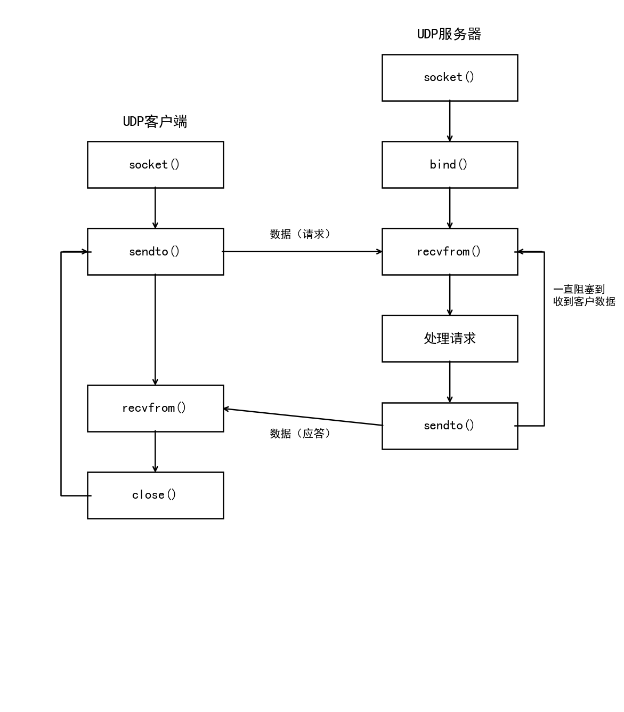
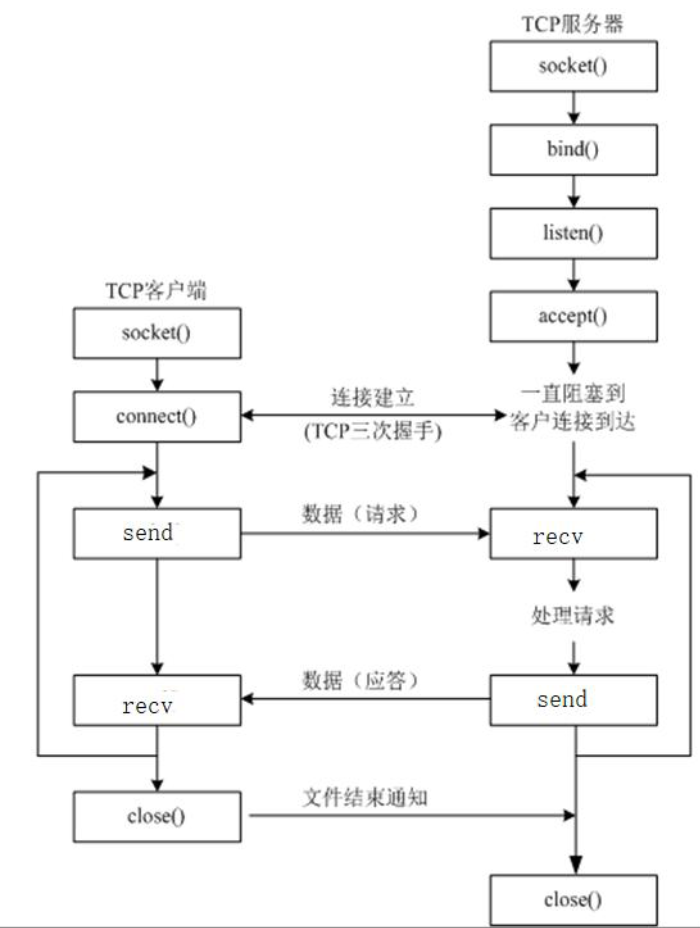

# Python 笔记

Python 是一门简洁、优雅的高级编程语言，由吉多·范·罗苏姆（Guido van Rossum）于 1989 年圣诞节期间创建，1991 年发布第一个公开版本。
本笔记以 **Python 3** 为基准，涵盖基础语法、运算符、数据类型、流程控制、容器、函数、迭代器与生成器、面向对象、异常处理、模块与包、文件操作、正则表达式、常用标准库、网络编程（UDP 与 TCP）等核心内容，适合系统性学习与日常查阅。

> **核心理念**：**一切皆对象、一切皆引用、一切皆模块**——数字、字符串、函数、类乃至模块，全部都是对象；所有变量都是引用（指针），指向内存中的对象。
> Python 是**动态强类型**语言：变量无需声明类型（弱类型写法），但类型不匹配时会报错而非隐式转换（强类型语义）。
> **内置函数**：无需导包即可使用的函数，如 `print()`、`len()`、`type()` 等。


| 章节  | 内容                                                    |
| --- | ----------------------------------------------------- |
| 一   | Python 概述：历史、特点、应用场景、编译型 vs 解释型                       |
| 二   | 环境配置：conda/venv 虚拟环境、pip 包管理、换源、SSH 远程配置              |
| 三   | 基础语法：变量、命名规范、注释、输入输出、格式化字符串                           |
| 四   | 运算符：算术、赋值、比较、逻辑、位运算、三目运算符                             |
| 五   | 数据类型：数字型（int/float/bool）与类型转换                         |
| 六   | 流程控制：顺序、选择（if/elif/else）、循环（while/for）、break/continue |
| 七   | 容器：字符串、列表、元组、字典、集合的增删改查及公共操作                          |
| 八   | 函数：定义、参数种类、返回值、作用域、高阶函数与 lambda                       |
| 九   | 迭代器与生成器：iter/next、yield、生成器函数                         |
| 十   | 面向对象：类与对象、封装、继承、多态、装饰器、魔法方法                           |
| 十一  | 异常处理：try/except/else/finally、主动抛出异常                   |
| 十二  | 模块与包：import 语法、搜索路径、`__name__`、包结构、pip 管理             |
| 十三  | 文件操作：打开/读写/关闭、文本与二进制模式、with 语句                        |
| 十四  | 正则表达式：re 模块、常用语法、match/search/findall/sub             |
| 十五  | 常用标准库：os、sys、time、datetime、random、json、copy、tqdm      |
| 十六  | 网络编程：协议、IP、端口、UDP 通信、TCP 通信、socket 编程                 |
| 十七  | 速查表：关键字、命名规范、推导式、常用内置函数、Jupyter 命令                    |


---


## 一、Python 概述


### 1.1 语言特点


| 特点   | 说明                                          |
| ---- | ------------------------------------------- |
| 简单易学 | 语法接近自然语言，33 个关键字，7 种基本数据类型，入门门槛极低           |
| 弱类型  | 定义变量时无需声明类型，解释器自动推断                         |
| 开源免费 | 完全开源，可自由阅读和修改源码                             |
| 可移植性 | 跨平台运行，代码无需修改即可在 Windows / Linux / macOS 上运行 |
| 解释执行 | 由解释器逐行翻译执行，无需预先编译；代码少，精确表达需求逻辑              |
| 丰富的库 | 标准库 + 第三方生态极其丰富，覆盖 IT 行业 70% 以上技术领域         |


> **编译型 vs 解释型**：
>
> - **编译型**（如 C/C++）：源代码先由编译器生成可执行文件，后续直接执行，效率高
> - **解释型**（如 Python）：解释器在运行时逐行翻译执行，每次运行都需要解释，速度相对慢；但 Python 的速度劣势随硬件性能提升逐渐被弥补
> Python 唯一的缺点是**执行效率慢**，这是解释型语言的通性


### 1.2 应用场景


| 方向        | 代表技术/框架                                           |
| --------- | ------------------------------------------------- |
| Web 开发    | Django、Flask、FastAPI                              |
| 数据分析      | NumPy、Pandas、Matplotlib                           |
| 人工智能/机器学习 | TensorFlow（Google）、PyTorch（Facebook）、Scikit-learn |
| 深度学习      | Paddle（百度）、MindSpore（华为）                          |
| 网络爬虫      | Requests、BeautifulSoup、Scrapy                     |
| 运维自动化     | Ansible、SaltStack                                 |
| 桌面软件      | PyQt、Tkinter                                      |


---


## 二、环境配置


### 2.1 conda 虚拟环境

conda 是 Anaconda 提供的包与环境管理工具，可以为不同项目创建相互隔离的 Python 环境。

```bash
# 创建虚拟环境
# -n 按名称管理，存在 conda 默认目录；-p 按路径管理，存在指定目录；两者互斥
$conda create -n 环境名 python=3.11
$conda create -p /path/to/env python=3.11

# 删除虚拟环境（--all 删除整个环境目录）
$conda env remove -n 环境名 --all
$conda env remove -p /path/to/env --all
```

```bash
# 列出所有已创建的虚拟环境
$conda env list

# 激活虚拟环境（-n 激活按名称创建的，-p 激活按路径创建的）
$conda activate 环境名
$conda activate /path/to/env

# 退出当前虚拟环境
$conda deactivate
```

```bash
# 将 conda 写入配置到 ~/.bashrc，使其在新终端中自动生效
$conda init

# 重新加载当前用户的 bash 配置文件，使其立即生效，无需重启终端
$source ~/.bashrc
```

> **conda 特点**：conda 中的包都是**编译后的包**（后缀 `.whl`），可以管理不同版本的 Python 本身；
> `venv` 只能在现有 Python 版本下创建环境，无法管理 Python 本身的版本


### 2.2 venv 虚拟环境（轻量级方案）

```bash
# 创建虚拟环境（.venv 是惯例名称，PyCharm 会自动识别）
# 必须使用 Git Bash 创建，否则虚拟环境不完整
$python -m venv 虚拟环境名

# 进入虚拟环境（先进入虚拟环境后 pip 安装包，才能把包安装到虚拟环境中）
$source ./虚拟环境名/Scripts/activate

# 退出虚拟环境
$deactivate
```

> **注意**：
>
> - 进入虚拟环境**后**再 pip 安装包，才能把包安装到虚拟环境中
> - 虚拟环境中有一套独立的 `python.exe` 和 `pip`
> - 不同的虚拟环境，可以安装不同版本的同一个库（如 transformers），互不影响
> - Python 版本一致才能通过 `requirements.txt` 安装依赖

```bash
# PyCharm 中为已有项目设置虚拟环境：
# 设置 → 项目 → Python 解释器 → 添加解释器 → 虚拟环境 → 选择虚拟环境文件夹中的 python.exe
```


### 2.3 pip 包管理

```bash
# 安装包（推荐先换源，速度更快）
pip install 包名
pip install 包名==版本号           # 安装指定版本
pip install -U 包名                # 安装或升级到最新版本（-U 即 --upgrade）
conda install 包名==版本号         # conda 安装（会自动检测并安装包的依赖）

# 卸载包
pip uninstall 包名

# 查看已安装的包
pip list                           # 列出所有已安装的包
pip show 包名                      # 查看某个包的详细信息
pip freeze                         # 快速查看当前环境安装了哪些包及其版本

# 导出/安装依赖清单（团队协作常用）
pip freeze > requirements.txt      # 导出当前环境所有依赖
pip install -r requirements.txt    # 根据清单安装依赖（python 版本需一致）
```


#### 2.3.1 pip 换源（国内加速）

```bash
# 永久设置阿里云镜像源（一次配置，永久生效）
pip config set global.index-url https://mirrors.aliyun.com/pypi/simple/

# 查看当前下载源
pip config get global.index-url

# 临时使用指定源（仅本次安装生效）
pip install 包名 -i https://mirrors.aliyun.com/pypi/simple/
```


| 常用镜像源 | 地址                                          |
| ----- | ------------------------------------------- |
| 阿里云   | `https://mirrors.aliyun.com/pypi/simple/`   |
| 清华大学  | `https://pypi.tuna.tsinghua.edu.cn/simple/` |
| 豆瓣    | `https://pypi.doubanio.com/simple/`         |


### 2.4 SSH 远程连接

```bash
# 拷贝公钥到远程主机（实现无密钥登录）
# -p 指定端口号
$ssh-copy-id -p 端口号 用户名@远程主机IP
```

在 `~/.ssh/config` 中配置 SSH 快捷别名，避免每次输入完整信息：

```
Host 远程主机名
    HostName 远程主机域名
    User     登录用户名
    Port     登录端口号
    IdentityFile 本机私钥路径
```

```bash
# 配置完成后，直接使用别名登录
$ssh 远程主机名
```


### 2.5 常用 IDE 与快捷键


| IDE                     | 特点                                |
| ----------------------- | --------------------------------- |
| **PyCharm**             | 专业 Python IDE，功能强大，适合大型项目开发       |
| **VS Code + Python 插件** | 轻量灵活，适合多语言开发                      |
| **Jupyter Notebook**    | 交互式执行，数据分析首选，支持可视化内联显示；依赖 IPython |
| **IPython**             | 增强型交互式 Shell，支持自动补全、语法高亮          |


```bash
# PyCharm 常用快捷键
Ctrl+Alt+L      # 按 PEP8 规范格式化代码
Ctrl+/          # 添加或解除注释（注释选中部分）
Ctrl+左键        # 跳转到函数/变量定义处
Alt+← 或 Alt+→  # 跳转回上一个/下一个位置
Shift+Tab       # 向前缩进（减少缩进）
Tab             # 向后缩进（增加缩进）
```

---


## 三、基础语法


### 3.1 变量

变量是存储数据的容器。Python 是**弱类型**（动态类型）语言，定义变量时无需声明类型。

```python
# 变量定义语法：变量名 = 变量值（= 两边各保留一个空格）
name = 'zhangsan'    # 字符串类型
age = 20             # 整型
height = 180.5       # 浮点型
is_student = True    # 布尔型

# 多变量同时赋值
i, j, k = 3, 4, 5

# 交换两个变量的值（Python 独有写法）
a, b = b, a

# 查看变量类型
print(type(name))    # <class 'str'>

# 判断变量类型（推荐，支持继承关系判断）
isinstance(name, str)           # True
isinstance(name, (str, int))    # True（判断是否是其中一种类型）
```

> **变量内存原理（一切皆引用）**：
>
> - 变量名是**指针**，指向内存中的数据对象；执行结束后，释放的是变量名（指针），而非数据本身
> - **不可变类型**（int/float/str/tuple）：相同值的对象可能共享同一地址（`id` 相同）；修改会导致变量指向一个新对象
> - **可变类型**（list/dict/set）：相同内容的列表是不同对象（`id` 不同）；修改不改变变量的指向

```python
a = 10
b = a             # b 和 a 指向同一个整数对象
print(id(a) == id(b))   # True

t1 = [1, 2, 3]
t2 = [1, 2, 3]
print(id(t1) == id(t2))  # False（可变类型，独立对象）
t3 = t2
t3.append(4)
print(t2)   # [1, 2, 3, 4]（t3 和 t2 指向同一对象，都被修改！）

del t3       # 释放变量名 t3，引用计数减1；引用计数为0时对象才被销毁
```


### 3.2 命名规范（PEP8）


| 类型        | 命名方式                     | 示例                      |
| --------- | ------------------------ | ----------------------- |
| 变量、函数、模块名 | 蛇形命名法（单词间下划线分隔）          | `my_name`, `get_age()`  |
| 类名、异常名    | 大驼峰命名法（每个单词首字母大写）        | `MyClass`, `ValueError` |
| 全局常量      | 全大写 + 下划线（没有常量关键字，靠命名识别） | `MAX_SIZE`, `PI`        |


**标识符命名规则**：

1. 由字母、数字、下划线组成，**不能以数字开头**
2. 区分大小写：`name` 和 `Name` 是不同变量
3. 不能与 Python 关键字重名（注意避免关键字覆盖）

```python
# 查看 Python 所有关键字（共 33 个）
import keyword
print(keyword.kwlist)

# 检查某个名称是否是关键字
keyword.iskeyword('for')   # True
```


### 3.3 注释

```python
# 这是单行注释，以 # 开头；注释与代码同行时，在代码右侧写

def my_func():
    # 这是在代码上方的注释
    pass

"""
这是多行注释（文档字符串）
单引号和双引号都可以，效果相同
"""

'''这也是多行注释，去掉双引号会进行类型转换，作为字符串类型在 IDE 内联想查看函数的注释'''
```


### 3.4 输出（print 函数）

```python
# 基本输出，默认自带换行（\n）
print("Hello World")

# 指定结束符（end 参数，消除默认换行）
print("Hello", end='')        # 末尾不换行
print("Hello", end=' ')       # 末尾用空格结束
print("Hello", end='@@')      # 末尾用自定义字符结束

# 格式化输出
name = '张三'
age = 20
score = 88.36

# 方式一：f-string（推荐，Python 3.6+，语法简洁、性能最高）
print(f'我叫{name}, 今年{age}岁, 成绩{score:.2f}')   # 带精度控制：.2f 保留2位小数

# 方式二：format 方法（兼容性好）
print('我叫{}, 今年{}岁'.format(name, age))
print("...{}，...{:.2f}".format(name, score))         # 带精度控制

# 方式三：% 占位符（旧式，了解即可）
print('我叫%s, 今年%d岁, 成绩%.2f' % (name, age, score))
# %s=字符串, %d=整型, %f=浮点型, %05d=5位整数不足补0

# 查看变量类型（输出前需知类型，必须先转换为原生类型）
print(type(name))     # <class 'str'>；类型本身是对象
```


| 格式符      | 含义            | 示例                            |
| -------- | ------------- | ----------------------------- |
| `%s`     | 字符串           | `'%s' % 'hello'`              |
| `%d`     | 整型            | `'%05d' % 12` → `'00012'`     |
| `%f`     | 浮点型           | `'%.2f' % 3.14159` → `'3.14'` |
| `{:.kf}` | f-string 精度控制 | `f'{pi:.4f}'`                 |


### 3.5 输入（input 函数）

```python
# input 函数从键盘读取输入，始终返回字符串类型（input 都按照字符串返回）
name = input('请输入您的姓名：')   # 返回 str

# 若需要数字类型，必须进行类型转换
age = int(input('请输入您的年龄：'))

# 注意：两行代码不能连写在一起（invalid syntax）
# print('hello')print('world')   # 报错
```

> **阻塞说明**：`input()` 本质上是从**标准输入缓冲区**（`stdin`）读取一行数据。
> - **缓冲区为空**：`input()` 阻塞，程序挂起，等待用户键盘输入并按下回车
> - **缓冲区有数据**：`input()` 直接读取，**不阻塞**，立即返回（例如通过管道或重定向提前写入数据时）
>
> ```python
> # 示例：通过管道向 stdin 传入数据，input() 不会阻塞
> # echo "Alice" | python script.py
> name = input()   # 直接读取管道中的 "Alice"，无需等待键盘
> print(name)      # 输出：Alice
> ```

---


## 四、运算符


### 4.1 算术运算符


| 运算符  | 描述               | 示例（a=10, b=3）                |
| ---- | ---------------- | ---------------------------- |
| `+`  | 加法               | `a+b = 13`                   |
| `-`  | 减法               | `a-b = 7`                    |
| `*`  | 乘法（也可用于字符串/列表重复） | `a*b = 30`；`'ab'*3='ababab'` |
| `/`  | 除法（结果为浮点型）       | `a/b ≈ 3.333`                |
| `//` | 取整除（返回商的整数部分）    | `a//b = 3`                   |
| `%`  | 取余（取模），非百分号      | `a%b = 1`                    |
| `**` | 指数（优先级最高）        | `a**b = 1000`（a 的 b 次方）      |


> **注意**：Python 中**没有** `++` 和 `--` 运算符；`*`* 优先级最高


### 4.2 赋值运算符

```python
a = 10
a += 5    # a = a + 5  → 15
a -= 3    # a = a - 3  → 12
a *= 2    # a = a * 2  → 24
a /= 4    # a = a / 4  → 6.0
a //= 2   # a = a // 2 → 3
a %= 2    # a = a % 2  → 1
a **= 3   # a = a ** 3 → 1
```


### 4.3 比较运算符

比较运算符的结果为 `True` 或 `False`。


| 运算符         | 描述          |
| ----------- | ----------- |
| `==`        | 等于          |
| `!=`        | 不等于         |
| `>` / `<`   | 大于 / 小于     |
| `>=` / `<=` | 大于等于 / 小于等于 |


```python
# Python 支持连续比较（其他语言少见）
a = 5
print(0 < a < 10)    # True，等价于 0 < a and a < 10
```


### 4.4 逻辑运算符

> **逻辑运算符不一定返回 True/False，返回的是操作数本身**（0 以及非 0 值相当于 1）：


| 运算符        | 两边都真时               | 有假时         |
| ---------- | ------------------- | ----------- |
| `and`（逻辑与） | 返回**右边**的值          | 返回**第一个假**值 |
| `or`（逻辑或）  | 返回**左边**的值          | 返回**第一个真**值 |
| `not`（逻辑非） | 返回 `True` 或 `False` | —           |


```python
print(3 and 5)    # 5（两边都真，返回右边）
print(0 and 5)    # 0（左边为假，返回左边）
print(3 or 5)     # 3（两边都真，返回左边）
print(0 or 5)     # 5（左边为假，返回右边）
print(not 0)      # True
print(not 3)      # False

# 空容器为 False，非 0 数为 True
print(bool([]))   # False（空列表）
print(bool({}))   # False（空字典）
print(bool(1))    # True
```

> **短路求值**：`and` 左边为假时不再计算右边；`or` 左边为真时不再计算右边


### 4.5 位运算符（只能对整数类型运算）


| 运算符         | 描述                                                    |
| ----------- | ----------------------------------------------------- |
| `&`         | 按位与                                                   |
| `           | `                                                     |
| `~`         | 按位取反                                                  |
| `<<` / `>>` | 按位左移 / 右移（每移一位相当于 ×2 / ÷2）                            |
| `^`         | 按位异或：相同为0，不同为1；满足**交换律**；一个数与自身异或结果为 0；一个数与 0 异或结果为自身 |


### 4.6 三目运算符

```python
# 语法：表达式1 if 条件表达式 else 表达式2
# 条件为真时返回表达式1，否则返回表达式2
a, b = 10, 20
max_val = a if a > b else b    # 20
```

---


## 五、数据类型


### 5.1 数字型

```python
# 整型（int）：无溢出，可表示任意大整数
num = 100
big = 10 ** 100     # Python 整型无溢出

# 浮点型（float）：双精度，约 17 位精度（有效数字）
pi = 3.14159

# 布尔型（bool）：True/False 必须大写；True=1，False=0
is_ok = True        # 不能写 true（小写报错）

# 复数型（complex）：了解即可，主要用于科学计算
c = complex(2, 3)   # 2+3j
```

> **布尔值的真假规则**：
>
> - **假（False）**：`0`、`0.0`、`''`（空字符串）、`[]`（空列表）、`()`（空元组）、`{}`（空字典）、`None`
> - **真（True）**：任何非零数、任何非空容器


### 5.2 类型转换

```python
int('100')         # str → int：'100' → 100
int(3.14)          # float → int：截断小数部分，3.14 → 3
float('3.14')      # str → float：'3.14' → 3.14
float(100)         # int → float：100 → 100.0
str(100)           # int → str：100 → '100'
bool(0)            # 任意类型 → bool：0 → False
eval('10 + 5')     # 字符串作为代码执行：'10 + 5' → 15（去掉引号，是什么类型就是什么）
eval('[1,2,3]')    # '[1,2,3]' → [1, 2, 3]
```

> **类型转换注意事项**：类型转换**不能跨级**，如 `'3.14'` 不能直接转为 `int`，需先转 `float` 再转 `int`：
> `int(float('3.14'))` → `3`；原生类型才能转换，必须一步步转，不能跳跃

---


## 六、流程控制


### 6.1 选择结构

```python
# 单分支
if 判断条件:
    执行代码     # 必须缩进（4个空格或1个Tab，不能混用）

# 双分支
if 判断条件:
    ...
else:            # else 必须和 if 对齐
    ...

# 多分支（elif 不能写成 else if）
score = int(input("请输入成绩："))
if score >= 90:
    grade = 'A'
elif score >= 80:    # 当判断条件1和条件2都成立时，只执行第一个成立的分支
    grade = 'B'
elif score >= 70:
    grade = 'C'
else:
    grade = 'D'
```

> **注意**：顶格书写的代码（与 if 同级）总会执行，与 if 无关；
> Python 使用**缩进**（而非大括号）表示代码层级


### 6.2 循环结构


#### 6.2.1 while 循环

```python
# 基本格式（必须更新循环变量，否则死循环）
i = 0
while i < 5:
    print(i)
    i += 1

# while...else：循环正常结束（未被 break 中断）时执行 else 块
i = 0
while i < 3:
    print(i)
    i += 1
else:
    print("循环正常结束")
```


#### 6.2.2 for 循环（增强 for）

```python
# for 遍历数据结构（增强 for 循环）
for i in 容器:
    函数体       # 对容器中的每一个元素做操作

# 遍历字符串
for ch in 'hello':
    print(ch)

# range() 返回一个包含元素的对象，左闭右开，类似列表
for i in range(5):            # 0,1,2,3,4
    print(i)
for i in range(1, 6):         # 1,2,3,4,5
    print(i)
for i in range(0, 10, 2):     # 0,2,4,6,8（步长为2）
    print(i)

# for...else：循环正常结束（未被 break 中断）时执行 else 块
for i in range(3):
    print(i)
else:
    print("for 循环结束")
```


#### 6.2.3 循环控制

```python
# break：立即跳出整个循环（同时跳过 while-else/for-else 的 else 块）
for i in range(10):
    if i == 5:
        break
    print(i)   # 输出 0 1 2 3 4

# continue：跳过当次循环，继续下一次
for i in range(5):
    if i == 2:
        continue
    print(i)   # 输出 0 1 3 4
```

---


## 七、容器

Python 中有五大内置（无需导包）容器：**字符串** `''`、**列表** `[]`、**元组** `()`、**字典** `{}`、**集合** `{}`。


| 容器         | 有序      | 可变  | 可重复 | 支持切片 | 下标   | 底层实现 |
| ---------- | ------- | --- | --- | ---- | ---- | ---- |
| 字符串 `str`  | ✅       | ❌   | ✅   | ✅    | ✅    | 连续内存 |
| 列表 `list`  | ✅       | ✅   | ✅   | ✅    | ✅    | 动态数组 |
| 元组 `tuple` | ✅       | ❌   | ✅   | ✅    | ✅    | 静态数组 |
| 字典 `dict`  | ✅（3.7+） | ✅   | 键唯一 | ❌    | ✅（键） | 哈希表  |
| 集合 `set`   | ❌       | ✅   | ❌   | ❌    | ❌    | 哈希表  |


> **合并+、复制、切片** `[:]`：都**不支持**字典和集合


### 7.1 字符串（str，不可变）


#### 7.1.1 定义与下标

```python
s1 = 'hello'            # 单引号
s2 = "world"            # 双引号（与单引号等价）
s3 = """多行
字符串"""                # 三引号，保留原有格式
s4 = 'I\'m a singer'    # 转义字符 \'；转义字符用 \

# ── 特殊前缀字符串 ──────────────────────────────────────────
# f 字符串（f-string）：格式化字符串，{} 内可直接嵌入变量或表达式，Python 3.6+
name, age = 'Tom', 18
s = f'我叫 {name}，今年 {age} 岁'       # '我叫 Tom，今年 18 岁'
s = f'{1 + 2}'                          # '3'，{} 内可写表达式
s = f'{3.14:.2f}'                       # '3.14'，支持格式规格说明符

# r 字符串（raw string）：原始字符串，反斜杠 \ 不转义，常用于正则表达式和路径
s = r'C:\Users\name\Desktop'            # 'C:\\Users\\name\\Desktop'，\ 不被转义
s = r'\n\t'                             # 字面量 '\n\t'，而非换行+制表符

# b 字符串（bytes literal）：字节串字面量，类型为 bytes 而非 str，用于网络/文件 IO
b = b'hello'                            # b'hello'，类型 bytes，只能包含 ASCII 字符
b = b'\xe4\xbd\xa0'                     # 十六进制字节值，表示 UTF-8 编码的 '你'
# b 字符串不能直接包含中文，需用 encode：'你好'.encode('utf-8') → bytes

# 下标（索引）：正向从 0 开始，逆向从 -1 开始
s = 'hello'
print(s[0])    # 'h'
print(s[-1])   # 'o'
print(len(s))  # 5（获取长度）

# 步长为负时，代表从右往左切，且起始位置在右边是负索引，结束位置在左边是负索引
```


#### 7.1.2 切片（非常重要）

```python
# 语法：字符串[起始位置:结束位置:步长]，左闭右开，不改变原字符串，返回临时对象
s = 'cskaoyan2025'
print(s[0:3])       # 'csk'（取索引 0,1,2）
print(s[:5])        # 'cskao'（从头开始，默认 0）
print(s[5:])        # 'yan2025'（到末尾）
print(s[-4:])       # '2025'（逆向索引）
print(s[::2])       # 隔一个取一个
print(s[::-1])      # '5202nayoaksc'（反转字符串，步长为-1从右往左）
print(s[-4:-12:-1]) # 逆序取：步长为负时，起始在右（负索引），结束在左（负索引）
```


#### 7.1.3 常用方法

```python
s = 'Hello, World, Python'

# 查找（find 未找到返回 -1，index 未找到报 ValueError）
s.find('World', 起始位置, 结束位置)   # 返回子串起始下标；未找到返回 -1
s.index('World')                     # 同 find，但未找到时报错
s.count('l')                         # 统计子串出现次数
s.startswith('Hello')                # 是否以指定字符串开头，返回 bool
s.endswith('.py')                    # 是否以指定字符串结尾，返回 bool

# 替换（num 是替换次数，返回替换后的临时字符串对象，原字符串不变）
s.replace(old_str, new_str, num)

# 分割与拼接
s.split(' ')                         # 按空格分割，返回 list；默认按空格分割
s.splitlines()                       # 按行分割字符串，返回列表
','.join(['a', 'b', 'c'])            # 用字符串连接可迭代对象 → 'a,b,c'
                                     # join 要求可迭代对象中每个元素都是字符串

# 大小写转换
s.upper()       # 全部大写
s.lower()       # 全部小写
s.capitalize()  # 首字母大写，其余小写
s.title()       # 每个单词首字母大写
s.swapcase()    # 大小写互换

# 去除空白（strip 默认去除空格、换行在内的"空白字符"）
s.strip()       # 去除两端空白（含 \n \t）
s.lstrip()      # 去除左端
s.rstrip()      # 去除右端

# 判断类型（is 系列，判断字符串中内容的类型，返回 True 或 False）
s.isdigit()     # 是否全是数字
s.isalpha()     # 是否全是字母
s.isalnum()     # 是否全是字母或数字
s.islower()     # 是否全是小写
s.isupper()     # 是否全是大写
s.isspace()     # 是否全是空白字符

# 对齐填充
s.ljust(width)   # 左对齐，用空格填充至宽度 width
s.rjust(width)   # 右对齐
s.center(width)  # 居中

# int 整型转为字符串，使得可以快速按位访问
str_num = str(12345)
print(str_num[2])   # '3'

# 编码与解码（网络传输必须用 bytes，不能直接传 str）
# encode(编码格式)：str → bytes；编码格式默认 'utf-8'
b = 'hello'.encode('utf-8')          # b'hello'，类型为 bytes
b = '你好'.encode('utf-8')           # b'\xe4\xbd\xa0\xe5\xa5\xbd'，中文每字 3 字节

# decode(编码格式)：bytes → str；编码格式须与 encode 一致，否则报 UnicodeDecodeError
s = b'\xe4\xbd\xa0\xe5\xa5\xbd'.decode('utf-8')  # '你好'
s = b'hello'.decode('utf-8')         # 'hello'
```


### 7.2 列表（list，可变）

```python
# 定义（可放不同类型元素）
name_list = ['tom', 'jerry', 'bob']
mixed = [1, 'hello', True, 3.14, [1, 2]]

# 切片与字符串相同
# 列表为空时不能使用下标赋值

# ── 增 ──────────────────────────────
name_list.append(元素)                    # 尾部追加单个元素，无返回值
name_list.insert(下标, 元素)              # 在指定下标前插入（传入的是插入后的下标）
name_list.extend([元素1, 元素2])          # 扩展（必须传入可迭代对象）
name_list[i:i] = [元素1]                  # 切片插入（单个）：起始=结束时为插入操作，传入的起始位置是插入后的第一个元素的下标（和 insert 的机制相同）；右边必须用[]包裹来赋值
name_list[i:i] = [元素1, 元素2, ...]     # 切片插入（多个）：同上，右边必须用[]包裹来赋值

# ── 删 ──────────────────────────────
name_list.pop()                           # 删除并返回最后一个元素
name_list.pop(i)                          # 删除并返回指定索引的元素
del name_list[i]                          # 按索引删除（无返回值）
del name_list[i:j:k]                      # 切片删除
name_list.remove(元素)                    # 删除第一个匹配的元素，不存在时报错
name_list.clear()                         # 清空列表

# 循环删除注意：迭代器失效问题，删除后 i 不需要自增（避免跳过元素）

# ── 查 ──────────────────────────────
name_list.index(元素)                     # 查找元素的下标，不存在时报错
元素 in name_list                         # 判断元素是否在列表中：True/False
name_list.count(元素)                     # 统计元素出现次数

# ── 改 ──────────────────────────────
name_list[i] = 元素                       # 按下标修改
name_list[i:j] = [元素1, 元素2]          # 切片修改：右边必须用[]包裹；自动适配长度
                                          # 赋值为空列表会删除元素

# ── 排序 ──────────────────────────────
name_list.sort()                          # 原地升序排序（list 的 sort 改变原列表，不返回新列表）
name_list.sort(reverse=True)              # 原地降序排序
name_list.reverse()                       # 原地反转
sorted(name_list)                         # 返回新的排序列表，不修改原列表

# ── 拷贝 ──────────────────────────────
new_list = name_list.copy()               # 浅拷贝，指向不同空间（copy 方法）
new_list = name_list[:]                   # 浅拷贝（切片方式）
```

> **字符串转为列表**：可用于按字符访问，`list('hello')` → `['h', 'e', 'l', 'l', 'o']`


### 7.3 元组（tuple，不可变）

```python
t1 = (1, 2, 3)
t2 = ('a', 'b')

# 注意：只有一个元素的"元组"不是元组，类型是元素的类型
# 只有一个元素且有逗号，才是元组
t_wrong = (1)     # int，类型是 int
t_right = (1,)    # tuple，单元素元组必须加逗号

# 下标与切片（与列表/字符串相同）
print(t1[0])      # 1
print(t1[1:])     # (2, 3)

# 元组拆包
a, b, c = t1      # a=1, b=2, c=3（字典的键值对是元组，可以元组拆包）
for key, value in {'a': 1, 'b': 2}.items():  # 元组拆包遍历
    print(key, value)
```


### 7.4 字典（dict）

```python
# 定义（键必须是不可变类型，键必须唯一，推荐字符串键）
person = {'name': '张三', 'age': 20}

# ── 增改 ──────────────────────────────
person['gender'] = 'male'       # 键不存在时添加，键存在时修改
person.setdefault('age', 25)    # 有键值的键值对不修改，无键值的键值对才添加（选择性插入）

# ── 删 ──────────────────────────────
del person['age']               # 删除指定键值对
person.pop('height')            # 删除并返回值；键不存在时若未提供默认值则报错
person.pop('xxx', None)         # 键不存在时返回 None，不报错
person.popitem()                # 随机删除并返回 (key, value)
person.clear()                  # 清空字典

# ── 查 ──────────────────────────────
person['name']                  # 直接访问，键不存在时报 KeyError
person.get('name')              # 安全访问，键不存在时返回 None
person.get('xxx', '默认值')     # 键不存在时返回指定默认值

person.keys()                   # 返回所有键的可迭代对象
person.values()                 # 返回所有值的可迭代对象
person.items()                  # 返回所有键值对（元组）的可迭代对象

# ── 遍历 ──────────────────────────────
for key in person:              # 默认遍历键（取出的是 key）
    print(key, person[key])

for key, value in person.items():
    print(f'{key}: {value}')
```

> **字典特性**：
>
> - Python 3.7+ 字典**有序**（按插入顺序），3.7 以前无序
> - 键必须是**不可变类型**（可哈希）；底层是**哈希表**
> - 尽量不用字典存储有重复键名的信息，否则会有丢失覆盖问题


### 7.5 集合（set）

```python
# 定义（无序、不重复；创建空集合必须用 set()，不能用 {}）
my_set = {1, 2, 3, 4}
empty_set = set()              # 正确（空集合）
empty_dict = {}                # 这是空字典！不是空集合

# 通过序列创建集合（自动去重，不保留原有顺序）
s = set([1, 2, 2, 3, 3])      # {1, 2, 3}

# ── 增 ──────────────────────────────
my_set.add(5)                  # 添加单个元素
my_set.update([6, 7, 8])       # 添加多个元素（传入可迭代对象）

# ── 删 ──────────────────────────────
my_set.remove(元素)            # 删除指定元素，不存在时报错
my_set.discard(元素)           # 删除指定元素，不存在时不报错（推荐）
my_set.pop()                   # 随机删除并返回一个元素

# ── 集合运算 ──────────────────────────
set1 = {1, 2, 3, 4}
set2 = {3, 4, 5, 6}
set1 | set2    # 并集：{1, 2, 3, 4, 5, 6}
set1 & set2    # 交集：{3, 4}
set1 - set2    # 差集：{1, 2}（在set1中但不在set2中）
set1 ^ set2    # 对称差集：{1, 2, 5, 6}

# 集合比较（比较的是子集关系）
{1, 2} < {1, 2, 3}    # True（是子集）

# 常见用途：列表去重（集合不支持下标，故不支持 del）
unique_list = list(set([1, 2, 2, 3, 3, 4]))
```


### 7.6 公共操作


#### 7.6.1 公共运算符

```python
# + 合并（字符串、列表、元组）
[1, 2] + [3, 4]         # [1, 2, 3, 4]

# * 复制（字符串、列表、元组）
[1, 2] * 3              # [1, 2, 1, 2, 1, 2]

# in / not in 判断元素是否存在（字典判断的是键）
3 in [1, 2, 3]          # True
'name' in {'name': 'zs'}  # True

# 字符串/列表的比较：按元素比较，取决于第一个不同的元素的大小
# 集合的比较：是否是子集
[1, 2, 3] > [1, 2]      # True（前缀更短的更小）
```


#### 7.6.2 公共函数


| 函数                        | 说明                                     | 支持容器                |
| ------------------------- | -------------------------------------- | ------------------- |
| `len(x)`                  | 获取元素数量                                 | 全部                  |
| `max(x)`                  | 获取最大值                                  | 全部                  |
| `min(x)`                  | 获取最小值                                  | 全部                  |
| `sum(x)`                  | 求和（元素须为数字）                             | list/tuple/set      |
| `sorted(x, key, reverse)` | 返回新排序列表，不修改原容器（无论传入的是可变还是不可变容器，都返回新列表） | 全部                  |
| `reversed(x)`             | 返回反转迭代器                                | str/list/tuple/dict |
| `enumerate(x, start=0)`   | 返回（下标, 元素）迭代器，下标从 start 开始             | 全部                  |
| `zip(a, b, ...)`          | 将多个可迭代对象对应元素组成元组，返回迭代器                 | 全部                  |


```python
# enumerate：把每个元素的位置取出来，返回 (pos, value) 元组
for i, val in enumerate(['a', 'b', 'c']):
    print(i, val)   # 0 a, 1 b, 2 c

# zip：返回的是迭代器（只能遍历一次，可转换为 list 接收）
# 迭代器中的每个元素是一个元组，每个元组是传入的多个可迭代对象对应下标的元素组成的
names = ['Alice', 'Bob']
scores = [88, 95]
for name, score in zip(names, scores):
    print(f'{name}: {score}')
```


#### 7.6.3 sorted 函数详解

```python
# sorted 基于归并排序，是稳定的（相同的元素的相对顺序不变）
nums = [3, 1, 4, 1, 5]
sorted(nums)                      # [1, 1, 3, 4, 5]，不修改原列表
sorted(nums, reverse=True)        # [5, 4, 3, 1, 1]

# 传入字符串：返回的是列表
sorted('hello')                   # ['e', 'h', 'l', 'l', 'o']

# 传入字典：默认传入字典相当于传入 keys，排序返回列表（键的排序）
d = {'b': 2, 'a': 1, 'c': 3}
sorted(d)                         # ['a', 'b', 'c']（按 key 排序）

# 传入 items 时（按 value 排序），排序返回的是元组列表
sorted(d.items(), key=lambda x: x[1])   # [('a',1),('b',2),('c',3)]

# 传入 values 时，排序返回值的列表
sorted(d.values())                # [1, 2, 3]

# key 参数：key 的函数对象的传入实参是可迭代对象的每一个元素
# key 绑定 lambda 时，手写的参数是形参，调用时机在比较环节
students = [('Alice', 88), ('Bob', 95), ('Charlie', 70)]
sorted(students, key=lambda s: s[1])        # 按成绩升序
sorted(students, key=lambda s: s[1], reverse=True)  # 按成绩降序

# 元组的比较规则：取决于第一个不同的元素
```


### 7.7 推导式（生成式）

```python
# 列表推导式（[]）
squares = [x**2 for x in range(1, 6)]

# 带过滤条件（过滤时 if 在循环的后面）
evens = [x for x in range(10) if x % 2 == 0]

# 带三目表达式（三目时 if 在循环的前面）
result = [x if x > 0 else -x for x in [-3, -1, 2, 4]]

# 字典推导式（{}）
d = {k: v**2 for k, v in {'a': 1, 'b': 2}.items()}

# 集合推导式（{}）
s = {x**2 for x in [1, 2, 2, 3]}    # {1, 4, 9}

# 生成器表达式（()，惰性求值，节省内存，只能遍历一遍）
gen = (x**2 for x in range(10))
```

---


## 八、函数


### 8.1 函数定义与调用

```python
# 函数定义（空函数的函数体为 pass）
def 函数名(形参列表):
    """
    函数说明文档（文档字符串，写在函数第一行）
    :param 形参1: 参数说明
    :return: 返回值说明
    """
    函数体
    return 返回值      # return 可省略（返回 None）

# 函数调用（必须先定义后调用；但函数的实现先后顺序可以任意，与调用顺序无关）
# 先预加载（放入内存），再执行
# 从上到下是：导包 → 全局变量 → 类 → 函数 → 调用执行
结果 = 函数名(实参列表)

# 注解函数返回值类型（仅用于提示，解释器不强制检查）
def 函数名() -> None:    # 无返回值注解
    pass
def 函数名() -> int:     # 返回 int 注解
    return 1
```

```python
# 函数说明文档的查看
help(函数名)          # 查看说明文档（ctrl+Q 在 PyCharm 中更常用）
```

> **关键要点**：
>
> - `return` 可以返回多个值（以元组形式）：`return a, b` → `(a, b)`
> - 函数也是对象，**函数名可以像变量名一样传递**（作为参数传入其他函数）
> - 匿名函数需要调用才能执行


### 8.2 参数种类

```python
# 1. 位置参数：按位置顺序一一对应（传实参时，位置参数必须在关键字参数前面）
def greet(name, age):
    print(f'{name}, {age}岁')

greet('张三', 20)            # 正确

# 2. 关键字参数：通过参数名传递，顺序可以不固定
greet(age=20, name='张三')   # 关键字参数可以乱序

# 3. 缺省参数（默认参数）：必须放在形参列表的最后，多个缺省参数时必须相邻
#    给缺省参数传实参时，需要使用关键字参数来传参
def greet2(name, age=18, city='北京'):
    print(f'{name}, {age}岁, {city}')

greet2('李四')                  # 使用默认值：李四, 18岁, 北京
greet2('李四', city='上海')     # 给缺省参数传实参

# 4. 不定长参数
# *args：接收任意数量的位置参数（打包为元组；顺序固定，使用有序容器元组访问）
def sum_all(*args):
    print(type(args))     # <class 'tuple'>
    return sum(args)

# **kwargs：接收任意数量的关键字参数（打包为字典；不固定顺序，使用字典访问）
def print_info(**kwargs):
    print(type(kwargs))   # <class 'dict'>
    for k, v in kwargs.items():
        print(f'{k}: {v}')

# 混合使用：形参列表中 *args 必须在 **kwargs 之前；形参不可以有重名
# 顺序：位置参数 → *args → 缺省参数 → **kwargs
def func(a, b, *args, key='default', **kwargs):
    pass
```


#### 8.2.1 参数的拆包与打包

```python
# 在传递实参时，*args 和 **kwargs 是拆包进行传递
# 元组实参传递 *args（加 * 后元组变为位置参数）
# 字典实参传递 **kwargs（加 ** 后字典变为关键字参数）
# 打包只能放在实参位置

def add(a, b, c):
    return a + b + c

nums = [1, 2, 3]
print(add(*nums))        # 等价于 add(1, 2, 3)

params = {'a': 1, 'b': 2, 'c': 3}
print(add(**params))     # 等价于 add(a=1, b=2, c=3)
```


### 8.3 变量作用域

```python
# 全局变量：定义在函数外，或用 global 关键字修饰；在堆中存储
gl_num = 100

def test_b():
    # 在函数内修改全局变量需要加 global，相当于声明修改全局变量而非定义局部变量，避免歧义
    global gl_num
    gl_num = 200

test_b()
print(gl_num)   # 200
```


| 类型   | 定义位置               | 内存  | 生命周期            | 规则      |
| ---- | ------------------ | --- | --------------- | ------- |
| 局部变量 | 函数内部 / 形参          | 栈帧  | 随函数调用创建，随函数返回销毁 | 函数外不可访问 |
| 全局变量 | 函数外部 / `global` 声明 | 堆   | 随 `.py` 加载而存在   | 全局可访问   |


> **就近原则（LEGB）**：查找变量时，先找局部（Local） → 闭包（Enclosing） → 全局（Global） → 内置（Built-in）；
> 全局变量和函数内定义的局部变量同名时，函数内优先使用函数内的局部变量，而非改变全局变量


### 8.4 高阶函数与 lambda

```python
# 函数作为参数传递（高阶函数）
def calculate(a, b, fn):
    """fn 是回调函数，传递函数名（不加括号）"""
    return fn(a, b)

print(calculate(10, 20, lambda a, b: a + b))   # 30

# lambda 匿名函数（适合简单逻辑；匿名函数需要调用才能执行）
# 语法：lambda 形参列表: 函数体（只能有一个表达式）
square = lambda x: x ** 2
add = lambda a, b: a + b

my_func = lambda 形参列表: 函数体    # 定义匿名函数
my_func(实参)                         # 调用匿名函数

# map（返回迭代器，只能遍历一遍；转为 list 后接收使得能重复遍历）
squared = list(map(lambda x: x**2, [1, 2, 3, 4, 5]))   # [1, 4, 9, 16, 25]

# filter（过滤）
evens = list(filter(lambda x: x % 2 == 0, [1, 2, 3, 4, 5]))  # [2, 4]
```


### 8.5 一切皆引用

```python
# 实际是传递指针，指向同一个对象
# 相同的不可变类型数据对象（如同一个整数）赋给两个变量名，两个变量名的 id 相同
a = 10
b = a
print(id(a) == id(b))   # True

# 相同的可变类型数据对象（如同一个列表）赋给两个变量名，两个变量名的 id 不同
t1 = [1, 2, 3]
t2 = [1, 2, 3]
print(id(t1) == id(t2))  # False

# 对不可变类型数据对象的修改会导致变量名指向修改后的一个新的数据对象
# 对可变类型数据对象的修改不改变指向该数据对象的变量名的指向

# id() 查看变量指向的对象的内存逻辑地址
print(id(a))

# 引用计数为 0，对应的对象就会被释放
del b   # 释放变量名 b 指向的数据对象的堆空间
```


### 8.6 拆包（Unpacking）

拆包：对于函数中的多个返回数据，去掉元组、列表或字典，直接获取里面数据的过程。

```python
# 对元组拆包
my_tup = ('张三', 20, 88.5, '湖北武汉')
name, age, score, addr = my_tup    # 元素数必须一一对应

# 对函数的多个返回值拆包（return a, b 默认返回元组）
def sum_subtract(a, b):
    return a + b, a - b            # 返回元组

total, result = sum_subtract(10, 20)   # 直接对返回的元组拆包

# 对列表拆包
my_list = [1, 3.14, 'hello', True]
num, pi, s, flag = my_list

# 对字典拆包（获取到的是 key 值，不是 value）
dict1 = {'name': '李云龙', 'age': 20, 'gender': '男'}
key1, key2, key3 = dict1    # key1='name', key2='age', key3='gender'

# 利用拆包交换两个变量的值（Python 独有简洁写法）
a, b = 10, 20
a, b = b, a    # 原理：右边先打包为元组 (b, a)，再拆包同时赋值给左边，无需临时变量
```


### 8.7 递归（Recursion）

递归：函数在运行时调用自身，称为递归调用。

**递归的两要素**：

1. **递归体**：函数调用自身的代码
2. **递归出口**：终止递归的条件（必须有，否则无限递归导致栈溢出）

```python
# 案例1：自然数求和 1+2+...+n
def sum1(n):
    if n == 1:           # 递归出口
        return 1
    return n + sum1(n - 1)   # 递归体

print(sum1(100))    # 5050

# 案例2：n 的阶乘 n!
def factorial(n):
    if n == 1:           # 递归出口
        return 1
    return n * factorial(n - 1)   # 递归体

print(factorial(5))    # 120
```

> **注意**：
>
> - 递归深度不能超过栈空间大小，否则报 `RecursionError`（默认约 1000 层）
> - 可用 `sys.setrecursionlimit(调用次数 + 余量)` 提高递归深度限制
> - 有出口的递归也要注意深度限制

---


## 九、迭代器与生成器


### 9.1 迭代器（Iterator）

```python
# 可迭代对象：实现了 __iter__ 方法的对象，可用于 for 循环
# 迭代器：实现了 __iter__ 和 __next__ 方法的对象

# iter() 返回可迭代对象的迭代器
# 遍历可迭代对象相当于每次遍历时初始化一个迭代器进行遍历
a = iter([1, 2, 3])           # 返回指向第一个元素的迭代器

# next() 传入迭代器对象，返回迭代器指向的元素，然后偏移迭代器
print(next(a))                # 1（迭代器偏移）
print(next(a))                # 2
print(next(a))                # 3
# print(next(a))              # StopIteration（迭代器已到达末尾）

# 迭代器最远指向可迭代对象的最后一个元素的后一个位置
# iter(迭代器) 返回自身，还是迭代器

for i in a:                   # 相当于遍历可迭代对象
    print(i)

# 实现了 __iter__ 方法的类实例化的对象是可迭代对象
# __iter__ 使得对象可迭代，每次遍历返回的是 __iter__ 的返回值
```


### 9.2 生成器（Generator）

```python
# 生成器是含有 yield 的函数；生成器对象属于迭代器对象
# 通过函数创建生成器对象

def my_generator(n):
    """生成器函数"""
    i = 0
    while i < n:
        yield i              # yield 暂停并返回值，下次 next() 时继续执行
        i += 1

gen = my_generator(3)        # gen 是生成器对象（迭代器对象）
print(next(gen))             # 0
print(next(gen))             # 1
print(next(gen))             # 2

# 生成器表达式（()，惰性求值，只能遍历一遍）
gen_expr = (x**2 for x in range(10))
print(next(gen_expr))        # 0
for val in gen_expr:         # 继续遍历剩余值
    print(val)
```

> **生成器 vs 列表**：生成器惰性计算，每次只产生一个值，节省内存；列表一次性计算所有值，可重复遍历

---


## 十、面向对象


### 10.1 类与对象

```python
# 定义类
class Dog:
    """
    狗类，描述狗的属性和行为
    """
    species = '犬科动物'      # 类属性（所有对象共享，在内存中只有一份）
                               # 通过类名.的方式访问，避免与对象属性重名的二义性

    def __init__(self, name, age):
        """
        构造方法：对象实例化后自动调用
        self 相当于 this 指针，在方法内部访问数据成员或方法要通过 self. 的方式
        :param name: 狗的名字
        :param age: 狗的年龄
        """
        self.name = name    # 对象属性（每个对象独有，一个对象一份，不共享）
        self.age = age      # self.数据成员=形参：在构造函数中定义数据成员及初始化

    def bark(self):
        """对象方法：第一个参数必须是 self"""
        print(f'{self.name} 汪汪汪！')

    def __str__(self):
        """print(对象) 时调用，返回对象的字符串描述"""
        return f'Dog(name={self.name}, age={self.age})'

# 创建对象（实例化）：类名() 创建对象时，解释器首先调用 __new__ 分配内存，再调用 __init__ 初始化
dog = Dog('旺财', 3)             # 对象名=类名(实参)
print(dog.name)                  # '旺财'（数据成员可以直接访问）
print(Dog.species)               # '犬科动物'（类属性通过类名访问）
dog.bark()                       # 旺财 汪汪汪！
print(dog)                       # Dog(name=旺财, age=3)（调用 __str__）
print(dog)                       # print(self) 输出的是对象的地址（无 __str__ 时）

# 自定义对象都是可变数据类型
# 类之间的关系只有依赖和被依赖
```


### 10.2 封装

```python
# 访问权限控制（Python 通过命名约定实现）
class BankAccount:
    def __init__(self, owner, balance):
        self.owner = owner            # 公开属性：可被外部直接访问
        self._account_type = '储蓄'  # 受保护属性：约定内部使用（非强制）
        self.__balance = balance      # 私有属性：被解释器重命名为 _BankAccount__balance，强制隐藏
                                      # 即使在派生类中定义了同名的私有属性，两个私有属性仍是独立的

    def get_balance(self):            # getter：获取私有属性
        return self.__balance

    def set_balance(self, amount):    # setter：修改私有属性（通过公开接口，读写分离）
        if amount > 0:
            self.__balance = amount
```

> **私有属性访问规则**：
>
> - 私有方法无法直接调用，通过公共方法调用
> - 私有类属性的访问通过类方法
> - 在派生类中访问基类的私有属性：通过继承的基类公开方法（getter）访问，不能通过 `self.__基类属性名` 访问
> - **子类中必须实现抽象类中的各种抽象方法**；类之间的关系只有**依赖**和**被依赖**，先实现被依赖的类，再实现依赖的类


### 10.3 继承

```python
# 单继承
class Animal:
    def __init__(self, name):
        self.name = name

    def eat(self):
        print(f'{self.name} 在吃东西')

# 子类继承父类所有公开方法（包括 __init__），但不继承私有方法
# 可以继承私有属性，但不能通过 self.__继承的基类属性名 的形式访问
class Dog(Animal):
    def bark(self):
        print(f'{self.name} 汪汪叫')

    # 方法重写（覆盖基类同名方法；函数名相同、参数列表不同，也会重写覆盖，不是重载）
    def eat(self):
        print(f'{self.name} 啃骨头')

# super()：匿名父类对象；不实际创建对象，只是调用父类的方法，传入的 self 仍是派生类对象
# 菱形继承的 __init__ 方法需要使用 super；super 只是执行代码（代码复用），不继承私有方法
class Poodle(Dog):
    def __init__(self, name, color):
        super().__init__(name)         # 调用父类 __init__
        self.color = color

    def eat(self):
        super().eat()                  # 调用父类 eat（复制基类代码，提高编程效率）
        print('还要喝牛奶')
```

```python
# 多继承（优先使用单继承，必要时才用多继承）
class Duck(Flyable, Swimmable):
    pass

# 查看方法解析顺序（MRO，处理菱形继承问题）
print(Duck.__mro__)
# 从左到右，从继承图的下到上进行查找（C3算法）
# 子类优先于父类；同层级按继承顺序；祖父类只访问一次
```


### 10.4 多态（Polymorphism）

多态：不同子类对象调用同一方法时，表现出不同的行为。即**同一接口，多种实现**。

**多态实现的三个条件**：

1. 存在继承关系
2. 子类重写父类方法
3. 父类引用指向子类对象（用父类类型的变量接收子类对象）

```python
class Animal:
    def make_sound(self):
        pass    # 父类定义接口标准（抽象方法）

class Dog(Animal):
    def make_sound(self):
        print("汪汪叫")

class Cat(Animal):
    def make_sound(self):
        print("喵喵叫")

class Duck(Animal):
    def make_sound(self):
        print("嘎嘎叫")

# 统一调用（父类引用指向子类对象）—— 无需区分具体类型
def animal_sound(animal: Animal):    # 参数注解为父类类型
    animal.make_sound()

animal_sound(Dog())    # 汪汪叫
animal_sound(Cat())    # 喵喵叫
animal_sound(Duck())   # 嘎嘎叫
```

> **鸭子类型（Duck Typing）**：Python 是动态类型语言，多态更灵活。
> 不需要显式继承，只要对象有对应的方法就能调用——"如果一个东西走起来像鸭子，叫起来像鸭子，那它就是鸭子"

**多态的好处**：

- 提高代码**灵活性**：同一函数可处理不同类型对象
- 增强代码**扩展性**：新增子类无需修改原有调用代码（开闭原则）
- 降低**耦合度**：调用者只关注方法接口


#### 10.4.1 抽象类与接口

```python
# 抽象方法：方法体是空实现（pass）的方法
# 抽象类：含有抽象方法的类；子类中必须实现抽象类中的各种抽象方法
# 接口：仅包含抽象方法（无具体方法）的类，本质是"纯抽象类"

# Python 中通过 abc 模块实现标准抽象类
from abc import ABC, abstractmethod

class Shape(ABC):    # 继承 ABC 标记为抽象类
    @abstractmethod
    def area(self):    # 抽象方法：用 @abstractmethod 修饰
        pass

    @abstractmethod
    def perimeter(self):
        pass

class Circle(Shape):
    def __init__(self, r):
        self.r = r

    def area(self):                # 必须实现所有抽象方法，否则实例化时报错
        return 3.14 * self.r ** 2

    def perimeter(self):
        return 2 * 3.14 * self.r

# Shape()    # TypeError: Can't instantiate abstract class
c = Circle(5)
print(c.area())   # 78.5
```


### 10.5 装饰器

```python
# @ 开头的是装饰器
# @property：将方法变为属性访问（getter）
# @方法名.setter：定义 setter
class Circle:
    def __init__(self, radius):
        self._radius = radius

    @property
    def radius(self):
        return self._radius

    @radius.setter
    def radius(self, value):
        if value > 0:
            self._radius = value

c = Circle(5)
print(c.radius)    # 像属性一样访问（不加括号）
c.radius = 10      # 像属性一样赋值

# @classmethod：类方法（通过类名调用，第一个参数是 cls）
# 私有类属性的访问通过类方法
class Dog:
    _count = 0      # 私有类属性

    @classmethod
    def get_count(cls):
        return cls._count

# @staticmethod：静态方法（不依赖实例或类，相当于普通函数）
class MathUtils:
    @staticmethod
    def add(a, b):
        return a + b

print(MathUtils.add(1, 2))   # 3

```


### 10.6 单例模式（Singleton）

单例：保证一个类只有一个实例对象，每次 `类名()` 创建的对象内存地址相同。

```python
# __new__：使用 类名() 创建对象时，Python 解释器首先调用 __new__ 为对象分配空间
# __new__ 是由 object 基类提供的内置静态方法，返回对象的引用
# 然后使用 __init__ 方法初始化对象属性

class Singleton:
    """单例模式：通过重写 __new__ 实现"""
    _instance = None    # 类属性：保存唯一实例

    def __new__(cls):
        if cls._instance is None:       # 首次创建：分配空间
            cls._instance = super().__new__(cls)
        return cls._instance            # 后续创建：直接返回已有实例

    def __init__(self):
        pass

a = Singleton()
b = Singleton()
print(id(a) == id(b))    # True（同一个对象）
```


### 10.7 魔法方法


| 方法                       | 触发时机                                                               |
| ------------------------ | ------------------------------------------------------------------ |
| `__init__(self, ...)`    | 对象实例化后，分配空间后自动调用，用于初始化属性                                           |
| `__new__(cls)`           | 类名() 创建对象时首先调用，分配内存，返回对象的引用（源码中是静态方法）                              |
| `__str__(self)`          | `print(obj)` 或 `str(obj)` 时调用，返回字符串；有了 `__str__` 后，print 对象时打印数据成员 |
| `__del__(self)`          | 对象被销毁时调用                                                           |
| `__call__(self, ...)`    | `obj()` 将对象当函数调用时触发（对象可以和函数一样调用）                                   |
| `__len__(self)`          | `len(obj)` 时调用                                                     |
| `__getitem__(self, key)` | `obj[key]` 下标访问时调用，得到 `__getitem__` 的返回值                           |
| `__enter__(self)`        | 进入 `with` 语句块时调用（有返回值需用 `as` 后的变量名接收）                              |
| `__exit__(self, ...)`    | 退出 `with` 语句块时调用                                                   |
| `__iter__(self)`         | 使对象可迭代（用于 `for` 循环），每次遍历返回的是 `__iter__` 的返回值                       |


> `str` **方法不具备嵌套结构**；对象方法内可以直接访问其他对象的数据成员

---


## 十一、异常处理


### 11.1 基本语法

```python
# try-except-else-finally
try:
    num = int(input('请输入数字：'))
    result = 10 / num
except ValueError:
    print('输入格式错误！')
except ZeroDivisionError:
    print('除数不能为零！')
except Exception as e:               # 不知道异常名时，给异常名取别名
    print(f'发生未知错误：{e}')
    print(e.__traceback__.tb_lineno)  # 获取当前文件异常发生的行数
    print(e.__traceback__.tb_frame.f_globals['__file__'])  # 获取文件名
else:
    # 没有发生异常时执行（可选）
    print(f'计算结果：{result}')
finally:
    # 无论是否发生异常都会执行（常用于资源清理）
    # finally 会在 else 的 return 执行之前执行
    print('程序执行完毕')
```

> **异常处理机制**：异常也是对象；异常会打断程序正常的执行流；有 `except`，一定有 `try`，必须成对出现；
> `print(e)` 时如果自定义异常的 `__init__` 中调用了基类的 `__init__`，可以实现 `__str__` 的效果


### 11.2 常见异常类型


| 异常类型                | 触发场景                        |
| ------------------- | --------------------------- |
| `ValueError`        | 传入正确类型但值不合法（如 `int('abc')`） |
| `TypeError`         | 操作数类型不匹配（如 `1 + '2'`）       |
| `IndexError`        | 下标越界                        |
| `KeyError`          | 字典中键不存在                     |
| `AttributeError`    | 对象没有该属性或方法                  |
| `ZeroDivisionError` | 除数为零                        |
| `FileNotFoundError` | 文件不存在                       |
| `ImportError`       | 导入模块失败                      |
| `NameError`         | 变量或函数名未定义                   |
| `RecursionError`    | 递归超出最大深度                    |
| `StopIteration`     | 迭代器耗尽                       |


### 11.3 主动抛出异常

```python
# raise：需要抛出异常对象
def set_age(age):
    if not isinstance(age, int):
        raise TypeError('年龄必须是整数')
    if age < 0 or age > 150:
        raise ValueError('年龄必须在 0~150 之间')

# assert：需要抛出字符串的错误信息；表达式为假时才会抛出；不需要写 if 判断，代码更简短
def divide(a, b):
    assert b != 0, '除数不能为零'    # 条件为假时才抛出，逗号后是错误信息
    return a / b
```


### 11.4 自定义异常

自定义异常：让异常类继承 `Exception`（直接或间接），即可定义符合业务需求的异常类型。

```python
# 自定义异常类（继承 Exception）
class UsernameError(Exception):
    def __init__(self):
        super().__init__('用户名长度不合法，必须在3-8位之间')

class PasswordError(Exception):
    def __init__(self, length, min_len=8, max_len=10):
        self.length = length
        # 调用父类 __init__ 设置异常描述信息（print(e) 时可以正常显示）
        super().__init__(f'密码长度不合法，长度必须在{min_len}~{max_len}之间，当前{length}位')

# 使用自定义异常
def login():
    username = input("请输入用户名：")
    password = input("请输入密码：")
    if len(username) < 3 or len(username) > 8:
        raise UsernameError()
    if len(password) < 8 or len(password) > 10:
        raise PasswordError(len(password))

if __name__ == '__main__':
    try:
        login()
    except UsernameError as e:
        print(e)    # 用户名长度不合法，必须在3-8位之间
    except PasswordError as e:
        print(e)    # 密码长度不合法，长度必须在8~10之间
    except Exception as e:
        print(e)    # 兜底：捕获其他所有异常
    else:
        print("校验通过！")
```

> **说明**：在 `except` 中，针对不同异常类型执行针对性处理；自定义异常的 `__init__` 中调用 `super().__init__()` 可以实现 `__str__` 的效果，使 `print(e)` 正常显示错误信息

---


## 十二、模块与包


### 12.1 模块（Module）

每个 `.py` 文件是一个**模块**，模块名即文件名（不含 `.py`）。

```python
# ── 导入方式 ──────────────────────────

# 方式一：import 模块名（使用时需加前缀；无命名冲突）
import math
print(math.pi)

# 方式二：import 模块名 as 别名（给模块起别名时，使用大驼峰命名法）
import datetime as Dt

# 方式三：from 模块名 import 功能名（直接使用，有 from 时无需加前缀；可能命名冲突）
from math import pi, sqrt

# 方式四：from 模块名 import 功能名 as 别名
from math import sqrt as sq

# 方式五：from 模块名 import *（导入所有公开功能，不推荐）
# 当导入不同模块中有同名功能时，后导入的会覆盖先导入的
```

> **导入规范**：
>
> 1. 导入语句放在文件**最顶部**（放在所有代码的最上面）
> 2. 每个导入语句**占一行**
> 3. 当前文件夹下的模块会覆盖解释器中的同名模块（同名模块的覆盖），注意起别名避免


#### 12.1.1 `__name__` 属性

```python
# 模块的 __name__ 属性：
# - 被导入的模块的 __name__ 是模块名
# - 被运行的当前模块的 __name__ 是 '__main__'
# 用于本模块的测试代码（防止模块中的测试代码被引用的模块执行）
if __name__ == '__main__':
    # 只有直接运行该文件时才执行，测试代码中定义的变量也是全局变量，但对引用的模块不可见
    print('测试代码...')

# __file__：查看模块的路径
# __all__：限制本模块被导入时能访问的实体（只会限制 from 模块 import * 的形式）
__all__ = ['func_a', 'ClassA']
```


### 12.2 包（Package）

包是包含 `__init__.py` 文件的文件夹（只要有一个 `__init__.py` 文件，就是包）。

```
my_package/                  ← 包目录
├── __init__.py              ← 包的初始化文件，控制对外暴露的模块
├── module_a.py
└── sub_package/
    ├── __init__.py
    └── module_c.py
```

```python
# __init__.py 中控制对外暴露（使用相对导入对外暴露模块或模块中的实体）
# . 代表当前目录，是不可或缺的，指定了模块的搜索路径（包内搜索）
from . import module_a                         # 暴露模块
from .module_a import func_a                   # 暴露模块中的实体（使依赖包的 py 文件可以直接从包导入）
from .. import module_b                        # 上级目录

__all__ = ['module_a']                         # 配合 from 包名 import * 使用
```

```python
# 包内的模块支持相对导入指定搜索路径
# 普通文件内的模块不支持相对导入，只能通过修改 sys.path 修改搜索路径

import my_package.module_a                     # 使用：my_package.module_a.func_a()
from my_package import module_a                # 使用：module_a.func_a()
from my_package.module_a import func_a         # 直接使用：func_a()
```

---


## 十三、文件操作


### 13.1 文件分类与路径

```
文本文件：存储字符流（.txt, .py, .csv 等）
二进制文件：存储字节流（图片、音视频、Excel 等；内存中是什么，磁盘中就是什么）；使用 rb 打开二进制文件进行复制粘贴、上传等；通信使用字节流

编码：UTF-8 编码中，一个汉字占 3B，一个英文字母占 1B

路径写法：
  - Windows：\ 分隔且绝对路径从盘符出发
  - Linux：/ 分隔；win 风格路径在 Python 接口中使用需要双转义（\\ 作为分隔符）
  - Python 中 win 风格路径也可以使用 / 分隔（推荐）
  - . 代表当前目录；相对路径相对于当前进程/当前 py 文件的路径
  - win 系统中换行在磁盘中是 \r\n，占两个字节
```


### 13.2 打开与关闭

```python
# open(文件路径, 模式, encoding=编码)
# open 函数返回的是文件对象，且是上下文管理器对象（文件对象有 __enter__ 与 __exit__ 魔法方法）
# 文件对象的 __enter__ 魔法方法返回自身，__exit__ 魔法方法执行 close 方法

# 推荐使用 with 语句（自动关闭，安全）
with open('data.txt', 'r', encoding='utf-8') as f:
    content = f.read()
# with 块结束后自动调用 f.close()，释放资源
```


### 13.3 文件模式


| 模式     | 含义                                  |
| ------ | ----------------------------------- |
| `'r'`  | 只读（默认），文件不存在时报错                     |
| `'w'`  | 只写，文件存在时**覆盖**，不存在时创建               |
| `'a'`  | 追加写入，文件不存在时创建                       |
| `'r+'` | 读写（从文件头）                            |
| `'r+'` | 文本读写（从文件头开始）；文件不存在则报错；写操作从文件开头覆盖    |
| `'w+'` | 文本读写；文件不存在则创建，存在则清空；先清空再读写，慎用       |
| `'a+'` | 文本读写；写在末尾；默认指针在末尾，读前需先 `seek(0)` 归位 |
| `'rb'` | 二进制只读（图片、音视频等）；b 模式可以打开一切文件         |
| `'wb'` | 二进制只写                               |
| `'ab'` | 二进制追加写                              |


```python
# a+ 模式：默认指针在文件末尾，直接读会读不到内容，需先 seek(0) 归位
with open('test.txt', 'a+', encoding='utf-8') as f:
    f.write('追加一行\n')
    f.seek(0)           # 移动指针到文件开头（0=开头基准，偏移0字节）
    content = f.read()  # 读取全部内容
    print(content)
```

> **文本模式 vs 二进制模式**：
>
> - 文本模式：Windows 下 `\r\n` 自动转为 `\n`；`seek` 的 `offset` 只能为 0 或正值
> - 二进制模式：不做任何转换；`offset` 才能是负值


### 13.4 读写操作

```python
# 读操作
with open('data.txt', 'r', encoding='utf-8') as f:
    content = f.read()                   # 读取全部内容（一次性读入内存，适合小文件）
    line = f.readline()                  # 读取一行（含 \n）
    lines = f.readlines()                # 读取所有行，返回列表（每行含 \n）
    # 文本文件读和写的 line 一般都带换行 \n；文本文件的 read 方法返回的是字符串

    # 光标在文件末尾时，读取会得到空字符串，空字符串是假
    # 推荐：逐行迭代（大文件内存友好）
    f.seek(0)                            # 读写前注意先用 seek 归位读写指针
    for line in f:
        print(line.strip())              # strip() 去除换行符

# 写操作
with open('output.txt', 'w', encoding='utf-8') as f:
    f.write('Hello World\n')
    f.writelines(['line1\n', 'line2\n'])

# 使用 rb 打开二进制文件（图片、音乐、视频）进行复制粘贴、上传等
with open('source.png', 'rb') as src:
    data = src.read()                    # 读取字节流对象（bytes 类型）
with open('copy.png', 'wb') as dst:
    dst.write(data)

# bytes 字节流对象（内置类）
b_data = b'hello'          # b'' 前缀转换为字节流（字节流字面量）
file_bytes = src.read()    # 二进制读取得到 bytes 对象

# seek 与 tell
# seek(offset, whence)：offset=偏移量（字节），whence=基准位置（0=开头，1=当前，2=末尾）
# 注意：偏移量是字节量；UTF-8下一个中文占3字节，汉字偏移要是3的倍数
with open('data.txt', 'r+', encoding='utf-8') as f:
    f.seek(0, 0)       # 移到文件开头（基准0=开头，偏移0）
    f.seek(0, 2)       # 移到文件末尾（基准2=末尾）
    pos = f.tell()     # 获取当前读写指针位置（字节数）
```


### 13.5 乱码问题

**核心原则**：读文件的编码必须和写文件的编码一致，否则会出现乱码。

```python
# 常用编码：utf-8（通用，支持中文）、gbk（Windows 默认中文编码）

# 错误示范：用 gbk 写、用 utf-8 读 → 乱码
with open('gbk_file.txt', 'w', encoding='gbk') as f:
    f.write('这是GBK编码的文件')
with open('gbk_file.txt', 'r', encoding='utf-8') as f:
    # print(f.read())  # 报错或乱码

# 正确示范：编码保持一致
with open('gbk_file.txt', 'r', encoding='gbk') as f:
    print(f.read())    # 正确输出：这是GBK编码的文件
```

---


## 十四、正则表达式


### 14.1 re 模块

```python
import re

text = 'email: abc@example.com, phone: 13812345678'

# re.search：搜索第一个匹配，不强制从开头开始；成功返回 match 对象，失败返回 None
match = re.search(r'\d{11}', text)
if match:
    print(match.group())    # '13812345678'（提取匹配到的字符串）
    print(match.span())     # 起始和结束位置元组

# re.match：强制从字符串开头匹配（不强制则用 search）
m = re.match(r'\d+', '123abc')    # 成功

# re.findall：找到所有匹配，返回字符串列表；匹配失败返回空列表
# 有 () 分组时返回分组内容，group(1) 为不含包围字符的且被包围的字符串
emails = re.findall(r'[\w.]+@[\w.]+', text)

# re.finditer：返回迭代器，每个元素是 match 对象（指向 matches 对象的第一个）
for m in re.finditer(r'\d+', text):
    print(m.group(), m.span())

# re.sub：替换匹配内容，返回字符串；sub 返回的是字符串
# repl 字符串支持正则分组选择以及函数（回调函数）
result = re.sub(r'\d{11}', '***', text)

# re.split：按正则分割，返回字符串列表；split 返回字符串列表
parts = re.split(r'[,\s]+', 'one, two,  three')

# re.escape(str)：告知正则引擎按普通字符处理，不按正则表达式翻译
```


#### 14.1.1 match 对象的方法

```python
m = re.search(r'(\d{4})-(\d{2})-(\d{2})', '2025-10-21')
m.group(0)    # '2025-10-21'（完整匹配，group(0) 即 pattern 中完整的字符串）
m.group(1)    # '2025'（第1组，即 pattern 中第一个()分组；k 从0开始）
m.group(2)    # '10'
m.span()      # 返回元组，子串的起始与结束位置
```


### 14.2 常用正则语法


| 符号             | 含义                       | 备注                          |
| -------------- | ------------------------ | --------------------------- |
| `.`            | 匹配任意单个字符（除换行符）           | 固定字符可以直接打，`.` 可能要转义：`r'\.'` |
| `\d`           | 匹配数字（`[0-9]`）            | **d**=decimal（十进制数字）        |
| `\w`           | 匹配字母/数字/下划线（可匹配汉字）       | **w**=word（单词字符）            |
| `\s`           | 匹配空白字符（空格/`\t`/`\n`）     | **s**=space（空白）             |
| `\D` `\W` `\S` | 对应的非匹配                   |                             |
| `\b`           | 单词边界                     |                             |
| `^`            | 匹配字符串开头（用于严格匹配）          |                             |
| `$`            | 匹配字符串结尾（用于严格匹配）          |                             |
| `[abc]`        | 匹配 a、b 或 c 之一            |                             |
| `[^abc]`       | 匹配不是 a、b、c 的字符           |                             |
| `[a-zA-Z]`     | 匹配字母范围                   |                             |
| `*`            | 前一项重复 0 或多次（**贪婪**）      | 前面必须有基本单位                   |
| `+`            | 前一项重复 1 或多次（贪婪）          |                             |
| `?`            | 前一项重复 0 或 1 次            |                             |
| `{n,m}`        | 前一项重复 n 到 m 次            |                             |
| `*?` `+?`      | **非贪婪**匹配（量词后加 `?`，尽可能短） | 默认是贪婪匹配                     |
| `(...)`        | 分组，`group(1)` 提取         |                             |
| `a             | b`                       | 匹配 a 或 b                    |


```python
# 使用原始字符串 r'' 作为 pattern（正则字符串用 r''，不转义，推荐）
# r 字符串：'\'没有转义的含义，作为普通字符；用于正则表达式的 pattern
pattern = r'\d{3}-\d{4}-\d{4}'    # 匹配电话号码如 010-1234-5678

# 贪婪 vs 非贪婪
text = '<div>内容1</div><div>内容2</div>'
re.findall(r'<div>.*</div>', text)    # 贪婪：整个字符串
re.findall(r'<div>.*?</div>', text)   # 非贪婪：['<div>内容1</div>', '<div>内容2</div>']

# sub 配合回调函数实现复杂替换
def add_prefix(ret):       # 参数 ret 是 match 对象，由 re.sub 自动传入
    num = ret.group()
    new_num = int(num) + 8
    return ' ' + str(new_num)     # 返回值为 repl

re.sub(r'\d+', add_prefix, '价格 10 和 20')  # 函数不可加()，传递的是回调函数名
```


### 14.3 re 进阶


#### 14.3.1 re.compile 预编译

```python
import re

# re.compile(pattern)：预编译正则规则为 Pattern 对象
# 适用场景：同一正则规则需要匹配多次（避免重复解析，提升效率）
pattern = re.compile(r'1[34578]\d{9}')   # 只编译一次

texts = ['文本1：13812345678', '文本2：13987654321', '文本3：abc123']
for text in texts:
    result = pattern.search(text)          # 直接用 Pattern 对象调用方法
    if result:
        print(f'{text}：提取到手机号：{result.group()}')
```


#### 14.3.2 flags 匹配模式控制


| flags           | 简写     | 说明                                 |
| --------------- | ------ | ---------------------------------- |
| `re.IGNORECASE` | `re.I` | 忽略大小写匹配                            |
| `re.DOTALL`     | `re.S` | 让 `.` 匹配换行符 `\n`（默认 `.` 不匹配 `\n`）  |
| `re.MULTILINE`  | `re.M` | 让 `^` 和 `$` 匹配每行的开头和结尾（默认只匹配整个字符串） |


```python
text = 'Hello HELLO hello'
pattern = r'hello'

re.findall(pattern, text)         # ['hello']（区分大小写）
re.findall(pattern, text, re.I)   # ['Hello', 'HELLO', 'hello']（忽略大小写）

# 使用 | 组合多个 flags
re.findall(pattern, text, re.I | re.M)
```


#### 14.3.3 查找第二个匹配（finditer + next）

```python
# search 只能查找第一个；查找第二个需要 finditer + next 组合
def find_second(pattern, text):
    matches = re.finditer(pattern, text)
    try:
        next(matches)              # 跳过第一个
        return next(matches).group()   # 获取第二个
    except StopIteration:
        return None

text = 'abc123def456ghi789'
print(find_second(r'\d+', text))   # '456'
```

---


## 十五、常用标准库


### 15.1 os 模块

```python
import os

os.getcwd()                           # 获取当前工作目录（Python 进程的工作目录）
os.chdir('/path/to/dir')              # 修改当前工作目录（修改的是当前进程，不修改 shell 的工作目录）
os.listdir('.')                       # 列出目录内容，返回列表；listdir 针对的是工作目录
os.mkdir('new_dir')                   # 创建单层目录
os.makedirs('a/b/c')                  # 递归创建多层目录
os.remove('file.txt')                 # 删除文件
os.rmdir('empty_dir')                 # 删除空目录
os.rename('old.txt', 'new.txt')       # 重命名

# os.path 路径操作（isdir 需要完整的路径）
os.path.exists('path')                # 路径是否存在，返回 bool
os.path.isfile('path')                # 是否是文件
os.path.isdir('path')                 # 是否是目录
os.path.join('dir', 'file')           # 跨平台拼接路径
os.path.basename('/a/b/c.txt')        # 'c.txt'
os.path.dirname('/a/b/c.txt')         # '/a/b'
os.path.splitext('a.txt')             # ('a', '.txt')
os.path.getsize('file.txt')           # 文件大小（字节）

# eval 是把配置文件中的字符串（file.read()）变为代码，把配置文件中的字符串变为字典
```


### 15.2 sys 模块

```python
import sys

sys.path                              # 模块搜索路径列表（前面的优先级高；可插入自定义路径）
sys.path.insert(0, '...')             # 设置优先搜索的路径；默认第一位是当前进程的所在目录；只对当前进程生效
sys.argv                              # 命令行传递的参数列表；第一个元素是进程的目录，后续是参数
                                      # 用于 python 文件名 来传递参数
sys.stdin                             # 标准输入（可迭代对象，读取输入）
sys.setrecursionlimit(调用次数+余量)   # 提高递归栈深度（默认约 1000）

# sys.argv 在 shell 中通过 python 文件名 参数 传递
# python 进程是子进程，shell 进程是父进程
```

**`sys.exit()` / `exit()` 结束进程**：

```python
import sys

# ── sys.exit(status) ──────────────────────────────────────────
# 功能：立即终止当前 Python 进程
# 参数 status : int 或 str
#   0          → 正常退出（表示程序运行成功，shell 中 $? 为 0）
#   非 0 整数  → 异常退出（表示程序出错，约定 1 表示通用错误）
#   字符串     → 将字符串打印到 stderr，然后以退出码 1 退出
# 原理：sys.exit() 实际上是抛出 SystemExit 异常；
#       若外层有 try/except Exception 则不会被拦截（SystemExit 继承自 BaseException）
#       若外层有 try/except BaseException 或 try/except SystemExit 则会被拦截
sys.exit(0)    # 正常退出
sys.exit(1)    # 异常退出（通用错误码）
sys.exit('发生致命错误，程序终止')   # 打印错误信息到 stderr 并以退出码 1 退出

# ── exit() / quit() ──────────────────────────────────────────
# exit() 和 quit() 是交互式解释器（REPL）的便捷函数，
# 本质上也是抛出 SystemExit，效果与 sys.exit() 相同，
# 但不推荐在正式脚本中使用（依赖 site 模块，部分精简环境不可用）
exit(0)    # 等价于 sys.exit(0)，但仅建议在交互式环境中使用

# ── os._exit(status) ──────────────────────────────────────────
# 功能：直接调用底层 C 函数 _exit()，立即终止进程，不抛出异常
# 与 sys.exit() 的区别：
#   sys.exit() → 抛出 SystemExit → 会执行 finally 块、with __exit__、atexit 注册的回调
#   os._exit() → 直接杀进程   → 跳过所有清理操作，缓冲区也不会刷新
# 使用场景：多进程编程中子进程退出时使用，避免子进程执行父进程的清理逻辑
import os
os._exit(0)   # 子进程中使用；慎用，不做任何清理
```

> **退出码约定（Exit Code）**：
> - `0` → 成功
> - `1` → 通用错误
> - `2` → 命令行参数错误
> - `非 0` → 失败（Shell 脚本可通过 `$?` 获取退出码判断程序是否成功）


### 15.3 time 模块

```python
import time

now = time.time()              # 获取当前时间戳（浮点数，从 1970-01-01 至今的秒数）

cur = time.ctime(now)          # 将时间戳转换为年月日周时分秒字符串；秒只有两位；需要自行处理格式，原始格式是乱的

gm_now = time.gmtime(now)      # 转换为 UTC 时间的 struct_time 对象
mon = gm_now.tm_mon            # 从 UTC 时间的 struct_time 访问成员获得月份
# struct_time 成员：tm_year, tm_mon, tm_mday, tm_hour, tm_min, tm_sec, tm_wday

time.sleep(1)                  # 休眠 1 秒
```


### 15.4 datetime 模块

```python
import datetime

cur = datetime.datetime.now()         # 获得年月日时分秒微秒时间（datetime 对象）
print(cur)                            # 2025-10-21 10:30:00.123456
print(cur.year, cur.month, cur.day)   # 年月日

# 格式化输出
print(cur.strftime('%Y-%m-%d %H:%M:%S'))

# 字符串解析为 datetime
dt = datetime.datetime.strptime('2025-10-21', '%Y-%m-%d')

# 时间差
delta = datetime.timedelta(days=7)
next_week = cur + delta
```


### 15.5 random 模块

```python
import random

random.randint(a, b)             # 得到一个 [a,b] 范围内的随机整数（左闭右闭）
random.random()                  # [0.0, 1.0) 范围内的随机浮点数
random.uniform(1.0, 5.0)         # [a, b] 范围内的随机浮点数
random.choice([1, 2, 3, 4])      # 从序列中随机取一个元素
random.choices([1,2,3], k=3)     # 随机取 k 个（有放回）
random.sample([1,2,3,4,5], 3)    # 随机取 3 个（无放回）
random.shuffle(lst)              # 原地随机打乱列表
```


### 15.6 json 模块

```python
import json

# Python 对象 → JSON 字符串（序列化）
data = {'name': '张三', 'age': 20}
json_str = json.dumps(data, ensure_ascii=False)    # ensure_ascii=False 保留中文

# JSON 字符串 → Python 对象（反序列化）
obj = json.loads(json_str)

# 写入/读取 JSON 文件
with open('data.json', 'w', encoding='utf-8') as f:
    json.dump(data, f, ensure_ascii=False, indent=2)
with open('data.json', 'r', encoding='utf-8') as f:
    loaded = json.load(f)
```

> **序列化说明**：序列化是将内存中的对象转换为可存储或传输格式的过程；
> Python 对象变为 JSON 对象是序列化，反之是反序列化；JSON 格式和字典几乎相同，web 前端语言使用 JSON


### 15.7 copy 模块

```python
import copy

original = [[1, 2], [3, 4], 5]

# 浅拷贝：外层容器是新对象，但内层可变元素仍共享引用（深拷贝和浅拷贝只用于可变数据类型）
shallow = copy.copy(original)
shallow[0].append(99)
print(original[0])    # [1, 2, 99]（内层列表被修改，浅拷贝未完全隔离）

# 深拷贝：完全独立的副本，所有嵌套对象都新建（对象一般深拷贝）
# 可变类型中嵌套可变类型时，分离需要深拷贝
deep = copy.deepcopy(original)
deep[0].append(100)
print(original[0])    # [1, 2, 99]（不受影响）
```


### 15.8 tqdm 进度条

```python
# pip install tqdm
from tqdm import tqdm

# 第一种方法：使用 tqdm 包裹可迭代对象，每次循环进度条前进一格
for elem in tqdm(可迭代对象):
    ...

# 第二种方法：自定义进度条前进的时机
with tqdm(total=总步数) as pbar:
    ...
    pbar.update(前进步数)    # 手动更新进度
```

---


## 十六、网络编程

网络编程的目的是让运行在**不同电脑**上的程序能够互相传递数据，即**进程间通信**。
核心三要素：`协议 + IP地址 + 端口号`，三者共同唯一标识网络中的一个进程。

> **通信模型类比**：
>
> - **UDP** 类似写信——无需建立连接，直接发送，速度快但不保证可达
> - **TCP** 类似打电话——必须先建立连接，可靠传输，但有额外开销


### 16.1 网络通信基础


#### 16.1.1 IP 地址


| 类别    | 范围                                       | 说明           |
| ----- | ---------------------------------------- | ------------ |
| A 类   | `1.0.0.1` ~ `126.255.255.254`            | 网络位 1 字节     |
| B 类   | `128.1.0.1` ~ `191.255.255.254`          | 网络位 2 字节     |
| C 类   | `192.0.1.1` ~ `223.255.255.254`          | 网络位 3 字节     |
| 私有 IP | `10.x.x.x`、`172.16-31.x.x`、`192.168.x.x` | 局域网使用，不在公网路由 |
| 回环地址  | `127.0.0.1` ~ `127.255.255.255`          | 代表本机，用于本地测试  |


```bash
$ifconfig          # 查看网卡信息（Linux/macOS）
$ping 192.168.1.1  # 测试目标主机连通性
$netstat -an       # 查看端口占用状态
$route -n          # 查看内核 IP 路由表（-n 以数字形式显示，不做 DNS 解析）
```

**Ubuntu 固定 IP 设置（netplan）**：

```bash
$sudo vim /etc/netplan/01-network-manager-all.yaml   # 编辑网络配置文件
```

```yaml
network:
  version: 2
  # renderer: NetworkManager   # GUI 环境（桌面版）使用
  renderer: networkd            # 服务器/命令行环境使用
  ethernets:
    ens33:                      # 网卡名称（用 ifconfig 查看实际名称）
      dhcp4: no                 # 关闭 DHCP 动态分配，改为静态 IP
      addresses:
        - 192.168.19.128/24     # 本机静态 IP 地址/子网掩码前缀长度（24 = 255.255.255.0）
      routes:
        - to: default           # 默认路由（所有流量）
          via: 192.168.19.2     # 网关地址
      nameservers:
        addresses:
          - 192.168.19.2        # DNS 服务器地址（通常与网关相同）
```

```bash
$sudo netplan apply   # 使配置立即生效（无需重启）
```

> **IP 地址的作用**：在网络中**唯一标识一台主机**；`IP地址 + 端口号` 唯一标识该主机上的一个进程


#### 16.1.2 端口（Port）

端口是进程与外界通信的"门"，每个需要收发网络数据的程序都需要一个端口。

- 端口号范围：`0` ~ `65535`（共 2¹⁶ 个）
- **知名端口**（Well Known Ports）：`0` ~ `1023`，使用需要 root 权限


| 端口号 | 对应服务   |
| --- | ------ |
| 80  | HTTP   |
| 443 | HTTPS  |
| 21  | FTP    |
| 22  | SSH    |
| 23  | Telnet |


- **动态端口**（Dynamic Ports）：`1024` ~ `65535`，程序向系统申请，关闭后自动释放；自定义端口号通常要大于 1024

```bash
# 查看端口占用
$netstat -an                    # 查看所有端口状态
$sudo lsof -i [tcp/udp]:端口号  # 查看占用指定端口的进程；tcp/udp 二选一，需 root 权限
$sudo lsof -i tcp:22            # 示例：查看哪个进程占用了 tcp 22 端口（SSH） 
$ps -elf | grep udp_server      # 查看某进程是否还在运行

# 端口被占用时，先查出进程 PID 再杀掉
$ps -elf                        # 查看所有进程及其 PID
$kill -9 进程id                 # 强制杀掉占用端口的进程
```

---


### 16.2 Socket 简介

**Socket**（套接字）是进程间通信的一种方式，能够实现**不同主机**之间的进程通信。
浏览网页、QQ 聊天、收发邮件等网络服务，底层都是基于 Socket 完成的。

```python
import socket

# 创建 TCP 套接字（流式套接字，面向连接）
tcp_socket = socket.socket(socket.AF_INET,   # AF_INET：IPv4 网络通信（常用）
                            socket.SOCK_STREAM)  # SOCK_STREAM：TCP 协议

# 创建 UDP 套接字（数据报套接字，无连接）
udp_socket = socket.socket(socket.AF_INET,   # AF_INET：IPv4 网络通信（常用）
                            socket.SOCK_DGRAM)   # SOCK_DGRAM：UDP 协议

# 套接字使用流程（与文件使用流程类似）
# 1. 创建套接字
# 2. 使用套接字收/发数据
# 3. 关闭套接字（关闭后端口会释放）
udp_socket.close()
tcp_socket.close()
```

---


### 16.3 UDP 编程（User Datagram Protocol）

UDP 是**无连接、不可靠**的传输协议，发送前不需要建立连接，速度快，适合实时性要求高的场景。

创建一个基于 UDP 的网络程序流程很简单，具体步骤如下：

1. 创建客户端套接字
2. 发送 / 接收数据
3. 关闭套接字



> **提示**：UDP 中客户端和服务器**都可以调用 `sendto()` 发送数据**，但两者的顺序有本质区别：
>
> - **客户端**：知道服务器的固定地址，可以随时主动 `sendto()`
> - **服务器**：必须**先 `recvfrom()`**，才能从返回的 `addr` 中得到客户端的地址，然后才能 `sendto()` 回传应答——如果服务器先发，它根本不知道要发给谁
>
> 因此"客户端先发、服务器先收再发"是协议逻辑上的**强制约束**，而非惯例。与 TCP 的区别仅在于：UDP 每次 `sendto()` 都需要显式指定目标地址，而 TCP 建立连接后无需重复指定。

#### 16.3.1 UDP 发送与接收数据

```python
import socket

# ── 客户端（发送方）──────────────────────────────
client = socket.socket(socket.AF_INET, socket.SOCK_DGRAM)  # 创建 UDP 套接字

dest_addr = ('192.168.5.7', 7788)                          # 目标 IP 和端口号（元组）；必须与服务器 bind() 的端口一致

# sendto(数据, 目标地址)：发送数据；数据必须是 bytes 类型，字符串需 encode
client.sendto('hello'.encode('utf-8'), dest_addr)          # 发送编码后的字节串

# recvfrom(缓冲大小)：接收数据，返回 (data_bytes, sender_addr) 元组
data, addr = client.recvfrom(1024)   # 1024 = 本次最大接收字节数；addr 是发送方地址
print(data.decode('utf-8'))          # bytes → str：decode 解码
print(addr)                          # ('192.168.3.28', 51404)：发送方的 IP 和端口

client.close()                       # 关闭套接字，释放端口
```

> **注意**：UDP 是**数据报协议**，每次 `sendto()` 发出一个独立数据包，每次 `recvfrom()` 只读取一个数据包。因此**同一传输方向上**，发送方调用 `sendto()` n 次，接收方就必须调用 `recvfrom()` n 次才能完整收到所有数据——少调一次就永久丢一个包（两个传输方向各自独立计数，互不影响）。此外，`recvfrom` 缓冲大小若小于发送字节数，Windows 会报错，Linux 会丢弃多余数据。

**`sendto()` 单次数据大小限制**：

受 IP 总长度字段（16 bit，最大 65535 B）约束，单次可发送的数据上限推导如下：

```
IP 总长度上限        = 65535 B
减去 IP 头（最小）   =    20 B
减去 UDP 头          =     8 B
─────────────────────────────
UDP 数据硬性上限     = 65507 B   ← 超出此值操作系统直接报错
```

但实际上还受 **MTU（最大传输单元）** 限制：

| 场景 | 限制值 | 说明 |
|------|--------|------|
| 硬性上限 | **65507 B** | IP 协议约束，超出报 `Message too long` |
| 不触发 IP 分片（以太网） | **1472 B** | MTU 1500 − IP 头 20 − UDP 头 8 |
| 安全推荐值 | **512 \~ 1472 B** | 超过 MTU 会被 IP 层拆分，丢包概率大增 |

> 超过 MTU 时，IP 层会将大数据报**拆成多个分片**发送，接收方 IP 层重组后再交给 UDP。但任意一个分片丢失整个数据报即作废（UDP 不重传），且很多路由器/防火墙会直接丢弃分片包。因此实践中应用层需自行分包，每包控制在 **1472 B 以内**。


#### 16.3.2 UDP 绑定端口（服务器端）

客户端通常不绑定端口（系统随机分配），**服务器端需要绑定固定端口**，否则客户端无法找到它。

```python
from socket import *

udp_socket = socket(AF_INET, SOCK_DGRAM)   # 创建 UDP 套接字

# bind((ip, port))：绑定本地 IP 和端口；ip 填空字符串表示绑定本机所有 IP
local_addr = ('', 7788)                    # ip 为空 = 本机任意网卡；端口固定
udp_socket.bind(local_addr)               # 绑定；若端口已被占用则抛出 OSError

# 等待接收（recvfrom 会阻塞直到有数据到达）
recv_data = udp_socket.recvfrom(1024)      # recvfrom 返回元组
print(recv_data[0].decode('utf-8'))        # 取索引 0 = 数据内容，解码为字符串
print(recv_data[1])                        # 取索引 1 = 发送方地址元组（ip, port）

# sendto(数据, 目标地址)：向客户端回传应答
# recv_data[1] 即 recvfrom 返回的发送方地址，服务器只有先收到才能知道对方地址
udp_socket.sendto('已收到'.encode('utf-8'), recv_data[1])

udp_socket.close()
```

> **端口绑定原则**：
>
> - 客户端程序一般**不绑定**，系统随机分配；重启后端口可能变化
> - 服务器程序**必须绑定**端口
> - 端口被占用报错：`OSError: [Errno 98] Address already in use`

#### 16.3.3 UDP 通信模型：多对多与接收缓冲区

**UDP 是多对多通信模型**：一个 UDP 套接字可以同时与**任意多个**不同地址的对端收发数据，不像 TCP 那样一条连接只对应一对端点。

```
客户端 A ──┐
客户端 B ──┼──► UDP 服务器套接字（单个端口）
客户端 C ──┘
```

**接收缓冲区是 UDP 的关键缓冲区**，每一方只有一个：

- 操作系统为每个 UDP 套接字维护**一个**接收缓冲区（FIFO 队列）。
- 无论来自多少个不同的发送方，所有到达的数据报都**混入同一个缓冲区**排队等待读取。
- `recvfrom()` 每次从队头取出**一个**完整数据报，同时返回该数据报的发送方地址，由应用层自行区分来源。

UDP 也存在发送缓冲区，但意义很小——数据写入后**立即交给 IP 层发出并丢弃副本**（无需等待 ACK），对应用层几乎透明；而 TCP 的发送缓冲区需要保留未确认数据以备重传，是影响吞吐量的关键。

| | TCP 发送缓冲区 | UDP 发送缓冲区 | TCP/UDP 接收缓冲区 |
|--|--|--|--|
| 是否存在 | ✅ 存在且重要 | ✅ 存在但瞬间清空 | ✅ 存在且重要 |
| 作用 | 保留未确认数据，用于重传 | 仅作临时中转，发完即丢 | 缓存到达但未被读取的数据 |
| 积压风险 | 有（对端窗口小时积压） | 几乎无 | 有（读取慢时积压，满了丢包） |

> **注意事项**：
>
> - 缓冲区满后，新到达的数据报会被**直接丢弃**（UDP 不重传）
> - 多个发送方并发写入时，数据报在缓冲区中的顺序取决于到达时间，**不保证与发送顺序一致**
> - 与 TCP 不同，UDP 没有"连接"概念，因此不存在"连接数"限制，理论上可接受无限多个来源的数据报

**如何区分不同客户端？**

`recvfrom()` 返回的 `addr`（IP + 端口）是**唯一的来源标识**，应用层需自行维护字典来区分：

```python
# recvfrom 返回值：(数据内容, 发送方地址)
data, addr = udp_socket.recvfrom(1024)
# addr = ('192.168.x.x', port)，IP + 端口共同唯一标识一个客户端
```

```python
from socket import *

server = socket(AF_INET, SOCK_DGRAM)          # 创建 UDP 套接字
server.bind(('', 7788))                       # 绑定本地端口

clients = {}  # 字典：{addr: [历史消息列表]}，用于记录各客户端状态

while True:
    data, addr = server.recvfrom(1024)        # 阻塞等待，addr 唯一标识来源客户端
    if addr not in clients:
        clients[addr] = []                    # 第一次收到该客户端消息，初始化列表
    clients[addr].append(data.decode())       # 追加消息到对应客户端的历史记录
    print(f'来自 {addr}：{data.decode()}')    # 打印来源地址和消息内容
    server.sendto('已收到'.encode(), addr)    # 按 addr 定向回复，不会发错客户端
```

与 TCP 区分客户端方式的对比：

| | TCP | UDP |
|--|--|--|
| 区分客户端的方式 | 每个连接有独立 `conn` socket，天然隔离 | 只有一个 socket，靠 `recvfrom` 返回的 `addr` 手动区分 |
| 区分层级 | 操作系统层面自动隔离 | 应用层手动维护 `{addr: 状态}` 字典 |
| 误混风险 | 无 | `addr` 相同才是同一客户端（IP + 端口均相同） |

> **注意**：UDP 客户端每次重启后系统会随机分配新端口，导致 `addr` 变化，服务器会把它当成**新客户端**。若需稳定标识客户端，要么让客户端也 `bind()` 固定端口，要么在数据包内自带业务层 ID（如用户名、token）。


---


### 16.4 TCP 编程（Transmission Control Protocol）

TCP 是**面向连接、可靠**的传输协议。通信前必须先建立连接（三次握手），通信后断开连接（四次挥手）。

**TCP 可靠性保证机制**：

- **发送应答（ACK）**：每个报文段都必须得到接收方 ACK 确认
- **超时重传**：发送后启动定时器，超时未收到 ACK 则重发
- **序列号**：保证报文按序到达，接收方可排序重组
- **错误校验**：发送和接收都计算校验和
- **流量控制**：滑动窗口机制，防止发送过快压垮接收方



#### 16.4.1 TCP 客户端

```python
import socket  # 导入 socket 标准库模块

# socket.socket(地址族, 套接字类型)：创建套接字对象
# AF_INET  = IPv4 地址族；AF_INET6 = IPv6
# SOCK_STREAM = 流式套接字（TCP）；SOCK_DGRAM = 数据报套接字（UDP）
tcp_client_socket = socket.socket(socket.AF_INET, socket.SOCK_STREAM)

server_ip   = input('请输入服务器ip:')               # 读取服务器 IP，字符串类型
server_port = int(input('请输入服务器port:'))         # 读取服务器端口，必须转为整型

# connect((ip, port))：向服务器发起 TCP 连接（三次握手在此完成，阻塞直到连接成功或超时）
# 客户端不需要 bind，操作系统会自动分配一个临时端口
tcp_client_socket.connect((server_ip, server_port))  # 参数为 (ip, port) 元组

send_data = input('请输入要发送的数据：')              # 读取要发送的字符串
# send(bytes)：发送数据；TCP 已建立连接，无需每次指定目标地址
# encode('utf-8')：将 str 编码为 bytes，网络传输只能传 bytes
tcp_client_socket.send(send_data.encode('utf-8'))

# recv(bufsize)：从连接的对端接收数据，返回 bytes 类型
# bufsize = 1024：本次最多接收 1024 字节；TCP 是流式协议，大数据可能需多次 recv
recv_data = tcp_client_socket.recv(1024)
print('接收到的数据为:', recv_data.decode('utf-8'))    # decode：bytes → str

# close()：关闭连接，触发 TCP 四次挥手，释放端口和资源
tcp_client_socket.close()
```

> **TCP 客户端 vs UDP 客户端**：
>
> - TCP 用 `connect` 建立连接，之后用 `send`/`recv`（无需每次指定地址）
> - UDP 用 `sendto`/`recvfrom`（每次都需指定目标地址，无需建立连接）


#### 16.4.2 TCP 服务器

```python
import socket  # 导入 socket 标准库模块

# 1. 创建 TCP 套接字
# SOCK_STREAM = 流式套接字（TCP）；刚创建时默认是"主动套接字"（可主动发起连接）
tcp_server_socket = socket.socket(socket.AF_INET, socket.SOCK_STREAM)

# 2. bind((ip, port))：绑定本地地址和端口
# ip 为空字符串 '' 表示监听本机所有网卡（0.0.0.0）；服务器必须绑定固定端口
address = ('', 7788)                         # 绑定地址元组：(ip, port)
tcp_server_socket.bind(address)

# 3. listen(backlog)：将主动套接字转为被动套接字，开始监听连接请求
# backlog = 128：操作系统内核排队等待的最大全连接数（ESTABLISHED 状态、等待 accept() 取走的连接数）
# listen 之后服务器才能接受客户端的 connect 请求
tcp_server_socket.listen(128)

# 4. accept()：从全连接队列中取出一个已完成三次握手的连接，返回新套接字和客户端地址
# TCP 服务器内核维护两个队列：
#   半连接队列（SYN_RECV）：收到客户端 SYN 但握手未完成的连接
#   全连接队列（ESTABLISHED）：三次握手已完成、等待 accept() 取走的连接
# accept() 每次从全连接队列取走一个连接，队列随即腾出一个槽位供新连接进入
# 若全连接队列为空，调用 accept() 的进程进入阻塞状态，直到有客户端完成三次握手才被唤醒
# 若全连接队列已满，新连接会被内核丢弃（客户端触发超时重传）
# listen(backlog) 中的 backlog 影响全连接队列的最大容量
# 返回值：(client_socket, client_addr)
#   client_socket：专为该客户端创建的新套接字，用于后续收发数据
#   client_addr  ：客户端的 (ip, port) 元组
# tcp_server_socket 只负责"接电话"（等待新连接），不直接传输数据
client_socket, client_addr = tcp_server_socket.accept()
print(f'客户端 {client_addr} 已连接')         # client_addr 格式：('ip字符串', port整型)，如 ('10.0.0.5', 52341)

# 5. recv(bufsize)：通过 client_socket 接收该客户端发来的数据，返回 bytes
# TCP 是流式协议：数据是连续字节流，内核不保留发送时的消息边界
# 例：对方 send("hello") + send("world")，recv(3) 可能只拿到 "hel"，下次才拿 "low"/"orld"
# 因此若数据量大于 bufsize，需多次调用 recv 才能读完；若需区分消息边界须在应用层自定义协议
recv_data = client_socket.recv(1024)
print('接收到的数据为:', recv_data.decode('utf-8'))  # bytes → str

# send(bytes)：通过 client_socket 向该客户端回复数据
# 只有先 recv 拿到 client_socket 后才能 send，否则不知道发给谁
client_socket.send('thank you !'.encode('utf-8'))

# 6. close()：关闭与该客户端的连接（四次挥手），client_socket 释放
# tcp_server_socket 未关闭，仍可继续 accept() 接受下一个客户端
client_socket.close()

# 关闭监听套接字：之后新客户端无法再连接
tcp_server_socket.close()
```

> **两个套接字的分工**：
>
> - `tcp_server_socket`（监听套接字/被动套接字）：只用于接受新连接，`listen` 后不发数据
> - `client_socket`（通信套接字）：`accept` 返回，专门负责与某个客户端收发数据，关闭后该客户端服务结束


#### 16.4.3 TCP 注意事项


| 注意点                       | 说明                                              |
| ------------------------- | ----------------------------------------------- |
| 服务器必须绑定端口                 | 否则客户端找不到它                                       |
| 客户端不需要绑定端口                | 系统自动随机分配                                        |
| `listen` 必须在 `accept` 前调用 | 将主动套接字变为被动套接字                                   |
| 客户端必须 `connect`           | TCP 必须先建立连接才能通信                                 |
| `accept` 返回的是新套接字         | 每个客户端对应一个独立的通信套接字                               |
| 关闭监听套接字                   | 新客户端无法再连接，已连接的客户端不受影响                           |
| 关闭 `accept` 返回的套接字        | 表示该客户端服务结束                                      |
| 客户端 `close` 后             | 服务端 `recv` 解除阻塞，返回长度为 **0** 的数据；服务端可借此判断客户端是否下线 |


---


### 16.5 编码转换（bytes 与 str）

网络传输的数据必须是**字节流（bytes）**，Python 字符串需要编码后才能发送，接收到的字节流需要解码还原。

```python
text = '我是文本'           # str 类型（Python 内部用 Unicode 存储）

# str → bytes：encode 编码（发送前）
bytes_text = text.encode('utf-8')   # 返回 bytes 对象：b'\xe6\x88\x91...'
bytes_text = text.encode()          # 默认 utf-8

# bytes → str：decode 解码（接收后）
text_back = bytes_text.decode('utf-8')  # 返回 str 对象：'我是文本'
text_back = bytes_text.decode()         # 默认 utf-8

# 编码方案说明
# encode(encoding='utf-8', errors='strict')：errors 指定错误处理方案
# decode(encoding='utf-8', errors='strict')：编解码方案必须一致，否则乱码
```

> **编码规则**：编码方案必须**收发两端一致**；常用 `utf-8`（支持中文），旧代码常见 `gbk`（Windows 默认中文编码）

---


### 16.6 TCP 连接原理


#### 16.6.1 三次握手（建立连接）

三次握手**必须由客户端主动发起**，服务器被动等待。三次握手确保双方的发送和接收能力正常，并同步初始序列号（ISN）。

```
客户端 (A)                          服务器 (B)
   |                                    |
   |── SYN(SEQ=x) ──────────────────→  |  第1次：A 请求连接，发送同步序号 x
   |                                    |
   |  ← SYN+ACK(SEQ=y, ACK=x+1) ──── |  第2次：B 同意，回复自己的序号 y 和确认号 x+1
   |                                    |
   |── ACK(ACK=y+1) ─────────────────→ |  第3次：A 确认，连接建立
   |                                    |
```

> **为什么需要三次而不是两次**：两次握手无法确认客户端的**接收能力**正常；
> 且两次握手下服务器发出 `SYN+ACK` 后即直接进入 `ESTABLISHED` 状态——若一个旧的延迟 SYN 到达，服务器回复 `SYN+ACK` 后便进入 `ESTABLISHED`，等待客户端发数据；而客户端处于 `CLOSED` 状态，根本不知道这条连接的存在，永远不会发数据。双方状态无法自行推进：服务器等客户端发数据，客户端不知道要发，形成**死锁**（连接僵死，只能靠超时强制回收资源）


#### 16.6.2 四次挥手（断开连接）

断开连接**客户端或服务器端均可主动发起**，主动发起方称为"主动关闭方"，另一方称为"被动关闭方"。TCP 是**全双工**（双向独立）通道，每个方向需要单独关闭，因此需要四次。

每两次挥手关闭的是**一个方向**的通道：主动关闭方的发送缓冲区 + 被动关闭方的接收缓冲区（第1、2次）；被动关闭方的发送缓冲区 + 主动关闭方的接收缓冲区（第3、4次）。

```
主动关闭方                          被动关闭方
   |                                    |
   |── FIN ───────────────────────────→ |  第1次：我发完了，请求关闭【主动方发送缓冲区 → 被动方接收缓冲区】
   |  ← ACK ──────────────────────────  |  第2次：收到，你可以关了（但我可能还有数据要发）
   |                                    |  ↑ 前两次：关闭"主动→被动"方向的通道
   |  ← FIN ──────────────────────────  |  第3次：我也发完了，请求关闭【被动方发送缓冲区 → 主动方接收缓冲区】
   |── ACK ───────────────────────────→ |  第4次：收到，连接正式关闭
   |（等待 2MSL 后进入 CLOSED 状态）     |  ↑ 后两次：关闭"被动→主动"方向的通道
```

#### 16.6.3 TCP 连接状态汇总

| 状态             | 阶段   | 说明                           |
| -------------- | ---- | ---------------------------- |
| `LISTEN`       | 建立连接 | 服务器等待新连接（`listen` 后进入）       |
| `SYN_SENT`     | 建立连接 | 客户端已发 SYN，等待服务器响应            |
| `SYN_RCVD`     | 建立连接 | 服务器收到 SYN，等待客户端最终确认          |
| `ESTABLISHED`  | 数据传输 | 连接建立，可以传输数据                  |
| `FIN_WAIT_1/2` | 断开连接 | 主动关闭方已发 FIN，等待对方响应           |
| `TIME_WAIT`    | 断开连接 | 收到对方 FIN 并回复 ACK，等待 2MSL 后关闭 |
| `CLOSE_WAIT`   | 断开连接 | 收到对方 FIN，等待本方应用层关闭           |
| `LAST_ACK`     | 断开连接 | 被动关闭方已发 FIN，等待最后的 ACK        |
| `CLOSED`       | 断开连接 | 连接已关闭                        |

> `TIME_WAIT` **状态**：等待 2MSL（MSL = 最大报文生存时间；Linux 中 MSL ≈ 30 秒，故 2MSL ≈ 60 秒）是为了确保对方能收到最后的 ACK——
> 最后一个 ACK 最多经 1 MSL 到达被动方；若 ACK 丢失，被动方会重传 FIN，该 FIN 最多再经 1 MSL 回到主动方，两段合计恰好 2 MSL，覆盖了"ACK 丢失 → 被动方重传 FIN → 主动方收到并补发 ACK"的最坏往返；
> 若补发的 ACK 仍丢失，被动方会按指数退避继续重传 FIN，主动方每收到一次重传 FIN 就重置 2MSL 计时器并再发 ACK；若被动方重传次数耗尽（Linux 默认约 15 次）仍未收到 ACK，则强制进入 `CLOSED`，连接依然会被释放，只是不够优雅；
> 此状态下端口不能被再次绑定（添加 `SO_REUSEADDR` 选项可解决）


#### 16.6.4 长连接与短连接


| 对比项  | 短连接                    | 长连接                 |
| ---- | ---------------------- | ------------------- |
| 操作步骤 | 建立连接 → 传输 → 关闭连接（循环）   | 建立连接 → 传输…传输 → 关闭连接 |
| 优点   | 服务器管理简单，连接都是有效连接       | 省去重复握手开销，适合频繁通信     |
| 缺点   | 频繁握手浪费时间和带宽            | 长期占用连接，服务器资源消耗大     |
| 适用场景 | HTTP（高并发、低频操作的 Web 服务） | 数据库连接、游戏、即时通信       |


---


### 16.7 TCP/IP 协议族


#### 16.7.1 协议分层模型


| TCP/IP 四层模型 | 主要协议                     | 功能                  |
| ----------- | ------------------------ | ------------------- |
| **应用层**     | HTTP、FTP、SSH、SMTP、Telnet | 应用程序的网络访问，通过端口号区分进程 |
| **传输层**     | TCP、UDP                  | 端对端通信，连接管理与数据传输     |
| **网络层**     | IP、ICMP、IGMP、ARP、RARP    | 主机寻址与路由，数据包转发       |
| **网络接口层**   | 以太网、MPLS                 | 将二进制流转换为数据帧，物理传输    |


```
发送数据时：应用层数据 → 加传输层头 → 加网络层头（IP包）→ 加链路层头（以太网帧）→ 物理传输
接收数据时：逐层剥离头部，最终将数据交给对应应用程序
```

> **关键区分**：
>
> - **IP**：负责**点到点**（主机/路由器之间）的传输
> - **TCP/UDP**：负责**端到端**（源主机进程到目标主机进程）的传输
> - **端口号**：同一主机上区分不同进程；`IP地址 + 端口号` = 网络中唯一进程


#### 16.7.2 TCP 与 UDP 对比


| 特性     | TCP                  | UDP         |
| ------ | -------------------- | ----------- |
| 连接方式   | 面向连接（三次握手）           | 无连接         |
| 可靠性    | 可靠（ACK + 超时重传 + 序列号） | 不可靠（可能丢包）   |
| 速度     | 较慢（有握手/确认开销）         | 快           |
| 数据顺序   | 有序（序列号保证）            | 无序          |
| 流量控制   | 有（滑动窗口）              | 无           |
| 通信模式   | 一对一                  | 支持广播/多播     |
| 适用场景   | 文件传输、网页、邮件           | 视频直播、游戏、DNS |
| 数据报头大小 | 20\~60 字节            | 固定 8 字节     |
| 单次发送上限 | 无协议上限（字节流无消息边界）      | **65507 B**（IP 协议硬性约束） |
| 超出限制行为 | 阻塞等待 / 部分写入（需 `sendall()`） | 直接报错 `Message too long` |
| 内核分段   | 自动按 MSS（1460 B）分段    | 无，需应用层自行分包（建议 ≤ 1472 B）|
| 接收缓冲区大小限制 | 无限制（`recv(n)` 只取走 n 字节，剩余数据仍在缓冲区供下次读取） | 必须 ≥ 发送方单次发送字节数，否则数据被截断/报错 |
| 收发次数对等 | 不要求对等（发 1 次可分 3 次收，发 3 次可合 1 次收） | 必须严格对等（发 n 次必须收 n 次，少收一次丢一包） |
| 接收次数 | 可多次 `recv()` 拼接（字节流可分批读） | 必须一次 `recvfrom()` 读完一个完整数据报 |


> **协议选择原则**：
>
> - 对数据**可靠性**要求高（如密码、验证）→ 选 TCP
> - 对**实时性**要求高（如 VOIP、视频监控）→ 选 UDP
> - 网络状况**不稳定**（广域网）→ 选 TCP；**局域网**环境好 → 可选 UDP

**为什么 UDP 比 TCP 节省带宽？**

核心原因是 **UDP 头部更小、没有连接管理开销**，本质是"用可靠性换效率"。

**① 头部大小对比**

| 协议 | 头部大小 | 字段组成 |
|------|---------|---------|
| UDP | **8 字节**（固定） | 源端口、目的端口、长度、校验和 |
| TCP | **20\~60 字节** | 序列号、确认号、窗口大小、标志位等大量控制字段 |

**② TCP 的额外开销（UDP 全部省掉）**

| TCP 的机制 | 产生的带宽开销 | UDP 有吗？ |
|-----------|-------------|----------|
| 三次握手建立连接 | 3 个控制包（`SYN`、`SYN-ACK`、`ACK`）| ❌ 无 |
| 四次挥手断开连接 | 4 个控制包（`FIN`、`ACK`、`FIN`、`ACK`）| ❌ 无 |
| ACK 确认应答 | 每个数据包都需要对方回 `ACK` | ❌ 无 |
| 重传机制 | 丢包时重新发送数据 | ❌ 无 |
| 心跳/保活包 | 长连接定期发送 `keep-alive` | ❌ 无 |
| 滑动窗口通告 | 头部携带窗口大小信息 | ❌ 无 |

**③ 直观计算示例**

假设发送 **1000 个小数据包，每包有效数据 10 字节**：

```
UDP：每包开销 = 8B（UDP头）+ 20B（IP头）= 28B
     总流量 = (10 + 28) × 1000 = 38,000 B

TCP：每包开销 = 20B（TCP头）+ 20B（IP头）= 40B
     ACK回包 = 40B × 1000 = 40,000 B（纯确认包）
     握手/挥手 ≈ 7 个控制包
     总流量 ≈ (10 + 40) × 1000 + 40,000 + 握手开销 = 90,000+ B
```

> UDP 流量约为 TCP 的 **42%**，节省超过一半带宽。DNS、视频直播、在线游戏、QUIC 等对实时性要求高、能容忍少量丢包的场景优先选择 UDP。


#### 16.7.3 各层协议常用命令

```bash
# ── 网络层（IP / ICMP / ARP）────────────────────────────────
$ arp -a              # 查看本机 ARP 缓存表（IP → MAC 地址映射），跨平台
$ arp -d 192.168.1.1  # 删除指定 IP 的 ARP 缓存条目（Windows 需管理员权限）
$ ping 192.168.1.1          # 发送 ICMP Echo 请求，测试目标主机连通性，跨平台
$ ping -c 4 192.168.1.1     # -c：指定发送次数（Linux/macOS；Windows 用 -n）
$ traceroute 8.8.8.8        # 追踪数据包到目标的逐跳路由路径（Linux/macOS）
$ tracert 8.8.8.8           # 同上，Windows 命令
$ netstat -r                # 查看本机路由表，跨平台（与 route print/ip route 功能相同）
$ route print               # 查看路由表（Windows）
$ ip route                  # 查看路由表（Linux）

# ── 传输层（TCP / UDP 端口）─────────────────────────────────
$ netstat -an               # 查看所有网络连接及监听端口（含 TCP/UDP 状态），跨平台
$ netstat -anp              # 同上，额外显示占用端口的进程 PID（Linux，需 sudo）
$ ss -tnlp                  # 替代 netstat，查看 TCP 监听端口及进程（Linux）
$ lsof -i :7788             # 查看占用指定端口的进程（Linux/macOS）

# ── 应用层（DNS）────────────────────────────────────────────
$ nslookup www.baidu.com          # 查询域名对应的 IP 地址（DNS 解析），跨平台
$ nslookup www.baidu.com 8.8.8.8  # 指定使用 8.8.8.8 作为 DNS 服务器查询

# ── 网络接口信息（OS 工具，不属于某一协议层）───────────────────
$ ifconfig                  # 查看本机所有网卡的 IP、MAC 地址等信息（Linux/macOS）
$ ipconfig                  # 同上，Windows 命令
$ ipconfig /all             # 显示详细信息（含 MAC 地址、子网掩码、DNS 等）
$ ipconfig /flushdns        # 清空本机 DNS 缓存（Windows）
```

---


### 16.8 高级网络编程


#### 16.8.1 同步 I/O 多路复用：epoll（Linux）

**多路复用**（Multiplexing）：**"多路"** 指多个 I/O 通道（多个 socket/fd），**"复用"** 指复用同一个线程/调用来监听它们。

```
没有多路复用（每个连接独占一个线程，各自阻塞等待）：
连接A ── 线程1（阻塞等A的数据）
连接B ── 线程2（阻塞等B的数据）
连接C ── 线程3（阻塞等C的数据）

有多路复用（所有连接共享一个调用）：
连接A ─┐
连接B ─┼── epoll.poll()（一个调用监听所有 fd）── 有就绪的才返回
连接C ─┘
```

> **一句话**：多路复用 = 用一个监控者（`epoll`）同时盯着多个 fd，谁有动静就报告谁，而不是为每个 fd 单独派一个线程去守着。

`epoll` 是 Linux 下高效的 I/O 多路复用机制，解决了"同时监听多个 socket"的问题，广泛用于高并发服务器。

> **⚠️ 平台限制**：`epoll` 是 **Linux 专有**的系统调用，**Windows 不支持**，macOS 也不支持。
> 各平台对应的 I/O 多路复用机制如下：
>
> | 平台 | 机制 | Python 接口 |
> |---|---|---|
> | Linux | `epoll` | `select.epoll()` |
> | macOS / BSD | `kqueue` | `select.kqueue()` |
> | Windows | `IOCP`（完成端口） | 无原生封装，需借助第三方库 |
> | 全平台通用（性能较低） | `select` | `select.select()` |
>
> 如需编写跨平台高并发服务器，推荐使用封装了底层差异的框架，如 `asyncio`（Python 标准库）或 `Twisted`、`Tornado` 等。

**epoll 是阻塞还是非阻塞？**

epoll 两层含义不同，需要分开看：

| 层面 | 是否阻塞 | 说明 |
|---|---|---|
| `epoll.poll()` 调用本身 | **阻塞**（默认） | `timeout=-1` 时永久阻塞，直到有 fd 就绪才返回；`timeout=0` 可改为非阻塞立即返回 |
| 返回后调用 `recv()` | **等价于非阻塞** | epoll 已保证该 fd 缓冲区有数据，`recv()` 必然立即返回，不会等待 |

与其他模式的本质区别：

```
纯阻塞 recv()          ：没数据 → 线程挂起等待 → 数据来了才返回（一次只等一个 fd）
非阻塞轮询             ：没数据 → 立即抛异常 → CPU 空转继续问（效率低）
epoll（同步多路复用）  ：epoll.poll() 阻塞等待 → 有 fd 就绪才返回 → recv() 立即取数据
                        （以一个阻塞点换取对所有 fd 的监控，有数据才工作）
```

```python
import socket   # 提供 BSD socket 接口，用于创建 TCP/UDP 套接字
import select   # 提供 I/O 多路复用接口，epoll/select/poll 均在此模块

# ── epoll 常用 API ──────────────────────────────

# select.epoll()：创建一个 epoll 实例，返回 epoll 对象
# 底层调用 Linux 系统调用 epoll_create1()，内核为其分配事件监听表
epoll = select.epoll()

# epoll.register(fd, eventmask)：向内核注册需要监控的文件描述符及感兴趣的事件
# 参数 fd        : int，文件描述符；epoll 不限于 socket，凡是支持 poll 的 fd 均可注册，例如：
#                  socket.fileno()  → 网络套接字（最常用）
#                  sys.stdin.fileno() = 0  → 标准输入（监听键盘输入，无输入时不阻塞主循环）
#                  sys.stdout.fileno() = 1 → 标准输出（监听是否可写，较少用）
#                  os.pipe() 返回的管道 fd  → 进程间通信的管道
# 参数 eventmask : int，事件掩码，可用 | 组合多个事件
# 常用事件类型（均为 int 常量）：
#   select.EPOLLIN   = 1   可读事件：有数据可读，或新连接到来（对服务器 socket）
#   select.EPOLLOUT  = 4   可写事件：发送缓冲区有空间，可以写数据
#   select.EPOLLERR  = 8   错误事件：fd 发生错误（无需主动注册，内核自动上报）
#   select.EPOLLHUP  = 16  挂起事件：连接被重置（RST）或发生异常挂起（无需主动注册，内核自动上报）
#                          注意：对端正常关闭（FIN）不会触发 EPOLLHUP，
#                          而是触发 EPOLLIN，此时 recv() 返回 b'' 来表示连接已断开
#   select.EPOLLRDHUP = 8192  对端关闭写端事件（Linux ≥ 2.6.17）：
#                             对端调用 close() 或 shutdown(SHUT_WR) 时触发，
#                             可直接检测"对端关闭连接"，无需再调用 recv() 判断
epoll.register(server_fd, select.EPOLLIN)

# epoll.unregister(fd)：从内核的监听表中移除该 fd，之后不再收到该 fd 的事件通知
# 参数 fd : int，要注销的文件描述符
# 注意：必须先 unregister 再 close(fd)，顺序不能颠倒
#       若先 close(fd)，OS 可能将该 fd 号复用给新的 socket，
#       导致 epoll 意外监听到新 socket 的事件（fd 复用问题）
epoll.unregister(fd)

# epoll.modify(fd, eventmask)：修改已注册 fd 的监听事件类型
# 等价于先 unregister 再 register，但效率更高（底层调用 epoll_ctl EPOLL_CTL_MOD）
# 参数 fd        : int，已注册的文件描述符
# 参数 eventmask : int，新的事件掩码，替换原有事件
epoll.modify(fd, select.EPOLLOUT)

# epoll.poll(timeout=-1, maxevents=-1)：等待已注册 fd 上的事件发生
# 参数 timeout   : float，超时秒数；-1 表示永久阻塞直到有事件；0 表示立即返回（非阻塞轮询）
# 参数 maxevents : int，本次最多返回的事件数量；-1 表示不限制
# 返回值         : list[tuple[int, int]]，每个元素为 (fd, event) 二元组
#                  fd    - 发生事件的文件描述符
#                  event - 发生的事件类型（EPOLLIN / EPOLLOUT / EPOLLERR 等）
events = epoll.poll(timeout=10)   # 最多阻塞 10 秒，超时无事件则返回空列表 []

# epoll.close()：关闭 epoll 实例，释放内核资源
# 使用完毕后必须调用，避免文件描述符泄漏
epoll.close()
```

**epoll 实现聊天室服务端**：

```python
# 聊天室服务端（epoll 版）核心逻辑
# 依赖：顶部已导入 socket、select；此处补充导入 sys（用于获取 stdin 的文件描述符）
import sys

# socket.AF_INET     : 使用 IPv4 地址族
# socket.SOCK_STREAM : 使用 TCP 协议（面向连接、可靠传输）
tcp_server_socket = socket.socket(socket.AF_INET, socket.SOCK_STREAM)

# setsockopt(level, optname, value)：设置 socket 选项
# socket.SOL_SOCKET  : 选项作用于 socket 层本身（而非 TCP/IP 层）
# socket.SO_REUSEADDR: 允许地址复用——服务器重启时可立即绑定同一端口，
#                      避免因 TIME_WAIT 状态导致 "Address already in use" 错误
tcp_server_socket.setsockopt(socket.SOL_SOCKET, socket.SO_REUSEADDR, 1)

# bind((host, port))：将 socket 绑定到指定 IP 和端口
# host : str，本机 IP 地址；填 '' 或 '0.0.0.0' 表示监听所有网卡
# port : int，端口号（1024~65535 为用户端口，避免占用系统端口）
tcp_server_socket.bind(('192.168.1.111', 2000))

# listen(backlog)：开始监听，将 socket 置为被动连接模式
# backlog : int，全连接队列（已完成三次握手、等待 accept 取走）的最大长度
#           注意：backlog 仅控制全连接队列；半连接队列（SYN_RCVD 状态）
#           由内核参数 tcp_max_syn_backlog 单独控制，两者相互独立（Linux ≥ 2.2）
tcp_server_socket.listen(100)

# 创建 epoll 实例，用于同时监听多个 fd 的 I/O 事件
epoll = select.epoll()

# 将服务器监听 socket 注册到 epoll，监听 EPOLLIN（可读）事件
# fileno() 返回 socket 的底层文件描述符（int），内核通过 fd 识别 socket
# 服务器 socket 可读 = 有新客户端发起了连接请求
epoll.register(tcp_server_socket.fileno(), select.EPOLLIN)

# 将标准输入（fd=0）也注册到 epoll，监听键盘输入
# 有输入时触发 EPOLLIN，无输入时不阻塞主循环
epoll.register(sys.stdin.fileno(), select.EPOLLIN)

# 用字典存储 fd → socket 的映射，替代列表，实现 O(1) 查找
# 类型：dict[int, socket.socket]；key 为 fileno()，value 为对应的 socket 对象
fd_to_socket = {}

while True:
    # epoll.poll()：阻塞等待，直到至少一个已注册 fd 上有事件发生
    # 返回值 epoll_list : list[tuple[int, int]]，每项为 (fd, event)
    epoll_list = epoll.poll()

    # 遍历所有就绪事件
    # fd    : int，发生事件的文件描述符
    # event : int，事件类型（EPOLLIN / EPOLLOUT / EPOLLERR 等）
    for fd, event in epoll_list:

        # ── 分支一：接受新连接 ──────────────────────────────────────────
        # 触发条件：服务器监听 socket 可读，即有新客户端发起了 TCP 连接请求
        # 行为：accept() 接入新客户端，将其 fd 加入字典并注册到 epoll，开始监听其消息
        if fd == tcp_server_socket.fileno():
            # accept()：从全连接队列中取出一个已完成三次握手的连接
            # 返回值 client_socket : socket.socket，与该客户端通信的新 socket
            # 返回值 client_addr   : tuple[str, int]，客户端的 (IP, 端口)
            client_socket, client_addr = tcp_server_socket.accept()
            print('{} 已连接'.format(client_addr))

            # 将新客户端的 fd → socket 映射存入字典，后续 O(1) 查找
            fd_to_socket[client_socket.fileno()] = client_socket

            # 向 epoll 注册新客户端 socket，监听其可读事件（即客户端发来消息）
            epoll.register(client_socket.fileno(), select.EPOLLIN)

        # ── 分支二：服务器群发 ──────────────────────────────────────────
        # 触发条件：stdin 可读，即服务器在终端输入了一行消息并按下回车
        # 行为：读取服务器输入的消息，群发给所有已连接的客户端
        elif fd == sys.stdin.fileno():
            # readline()：从 stdin 缓冲区读取一行（含末尾 \n），不阻塞（epoll 已确认有数据）
            # 返回值 msg : str，服务器在终端输入的消息字符串
            msg = sys.stdin.readline().strip()        # strip() 去除首尾空白和换行符
            # encode()：将 str 编码为 bytes，才能通过 socket.send() 发送
            msg_bytes = ('[服务器] ' + msg).encode('utf-8')
            # 将服务器消息群发给所有已连接的客户端
            for client in fd_to_socket.values():
                client.send(msg_bytes)                # 原样转发字节数据

        # ── 分支三：群转发 ──────────────────────────────────────────────
        # 触发条件：某个客户端 socket 可读，即该客户端发来了消息，或已断开连接
        # 行为：收到消息则转发给除发送者以外的所有其他客户端；收到空字节则处理断开
        else:
            # 通过字典 O(1) 直接找到对应的客户端 socket，无需遍历
            client = fd_to_socket[fd]

            # recv(bufsize)：从缓冲区读取最多 bufsize 字节的数据
            # 返回值 recv_data : bytes；对端正常断开时返回 b''（空字节串）
            recv_data = client.recv(1024)

            # recv 返回 b'' 表示客户端已关闭连接（TCP 四次挥手完成）
            if not recv_data:
                # 先从 epoll 注销，再关闭 socket，顺序不能颠倒（避免 fd 复用问题）
                epoll.unregister(fd)              # 从内核监听表移除该 fd
                del fd_to_socket[fd]              # 从字典中移除映射
                client.close()                    # 释放 socket 资源，发送 FIN

            else:
                # 将收到的消息群发给除发送者以外的所有在线客户端
                for other_fd, other_client in fd_to_socket.items():
                    # 排除发送者自身（通过 fd 比较，比 is not 更明确）
                    if other_fd != fd:
                        other_client.send(recv_data)   # 原样转发字节数据
```

> **TCP 断开检测**：对方断开时，内核将对应 socket 标记为可读；`recv` 读取返回**空字节串**（`b''`），通过 `if not recv_data` 判断断开

---

**epoll 为何能解决 TCP 两端对话阻塞等待的问题**：

在朴素的 TCP 通信中，`recv()` 是**阻塞调用**，数据未到达时线程会被挂起，无法处理其他连接。若要同时处理多个连接，就需要为每个连接开一个线程，线程数量激增会导致内存耗尽与频繁上下文切换。

epoll 的核心思想是**事件通知而非主动等待**，将"监视谁有数据"的工作交给内核：

```
┌─────────────────────────────────────────────────────────┐
│  朴素阻塞模型（每连接一线程）                              │
│                                                         │
│  线程1: [══════等A数据══════][处理A]                     │
│  线程2: [══等B数据══][处理B]                             │
│  线程3: [══════════等C数据══════════][处理C]             │
│         大量线程在"等"，浪费资源                          │
└─────────────────────────────────────────────────────────┘

┌──────────────────────────────────────────────────────────────────┐
│  epoll 模型（单线程，while True 循环）                             │
│                                                                  │
│  A有数据  B有数据              C有数据       D有数据  ...          │
│     ↓       ↓                    ↓              ↓                │
│  ┌──────────────────────────────────────────────────────── ···   │
│  [处理A][处理B][══wait══][处理C][══wait══][处理D] ···  ↺循环      │
│  └──────────────────────────────────────────────────────── ···   │
│     有活就干，没活就 wait；wait 返回后继续下一轮处理               │
└──────────────────────────────────────────────────────────────────┘
```

epoll 三个关键步骤：

| 步骤 | API | 作用 |
|---|---|---|
| 注册事件 | `epoll.register(fd, EPOLLIN)` | 告诉内核：帮我监视该 fd，有数据可读时通知我 |
| 统一等待 | `events = epoll.poll()` | 只有这里阻塞；一次可返回多个就绪 fd |
| 处理就绪 | `recv()`/`accept()` | 只对已就绪的 fd 操作，必然立即返回，不阻塞 |

触发模式对比：

| 模式 | 触发时机 | 特点 |
|---|---|---|
| `LT` 水平触发（默认） | 只要 fd 还有数据就持续通知 | 编程简单，不怕漏读 |
| `ET` 边缘触发 | 仅在数据**新到达**时通知一次 | 效率更高，需一次性读完所有数据 |

> **本质**：epoll 将"等待"从用户程序转移到内核，程序只在有实际工作时才运行，一个线程即可管理成千上万个连接，彻底消除无意义的阻塞。

---

#### 16.8.2 套接字的同步阻塞与同步非阻塞模式

```python
import socket   # 提供套接字接口

# ── 1. 同步阻塞（默认模式）──────────────────────────────
# socket 默认处于阻塞模式，所有可能需要等待的操作都会挂起线程：
#   recv / recvfrom ：接收缓冲区为空时挂起，直到数据到来才返回
#   send / sendto   ：发送缓冲区满时挂起，直到缓冲区有空间才返回
#   connect()       ：发起连接后挂起，直到 TCP 三次握手完成（或超时）才返回
#   accept()        ：全连接队列为空时挂起，直到有新客户端完成握手才返回
# socket.AF_INET     : IPv4 地址族
# socket.SOCK_STREAM : TCP 协议
sock = socket.socket(socket.AF_INET, socket.SOCK_STREAM)

# ── 2. 同步非阻塞（轮询模式）──────────────────────────────
# setblocking(flag)：设置 socket 的阻塞模式（影响该 socket 上所有 I/O 操作）
# flag=False：切换为非阻塞模式；flag=True（默认）：阻塞模式
# 非阻塞模式下，以上所有操作若无法立即完成，不等待，直接抛出 BlockingIOError：
#   recv()    → 接收缓冲区无数据时立即抛出 BlockingIOError
#   send()    → 发送缓冲区已满时立即抛出 BlockingIOError
#   connect() → 握手未完成时立即抛出 BlockingIOError（EINPROGRESS），
#               需配合 epoll/select 等待 EPOLLOUT 事件确认连接建立
#   accept()  → 全连接队列为空时立即抛出 BlockingIOError
sock.setblocking(False)

# 非阻塞轮询的完整结构必须配合 while 循环使用：
# 无数据时捕获异常后继续循环，直到数据到来才跳出
while True:
    try:
        # recv(bufsize)：非阻塞模式下，接收缓冲区无数据时立即抛出 BlockingIOError
        # 而非阻塞等待；有数据时正常返回 bytes，最多 bufsize 字节
        data = sock.recv(1024)
        break                   # 成功收到数据，跳出轮询循环
    except BlockingIOError:
        # 缓冲区暂无数据（BlockingIOError 含义是"现在没数据，自行决定是否重试"）
        # pass 后继续下一轮循环，再次尝试 recv()
        # 缺点：CPU 持续空转轮询，效率极低（不推荐高并发场景使用，应改用 epoll）
        pass

# ── 3. 单次非阻塞 send（MSG_DONTWAIT 标志）──────────────────────────────
# send(data, flags)：发送数据
# 参数 data           : bytes，要发送的字节数据
# 参数 socket.MSG_DONTWAIT : int，标志位；仅对本次调用生效，不改变 socket 全局阻塞模式
#                       发送缓冲区有空间 → 将数据写入缓冲区，返回实际写入字节数（int）
#                       发送缓冲区已满  → 立即抛出 BlockingIOError，不等待
# 注意：send 返回值可能小于 len(data)，需循环发送确保全部数据发出
send_size = sock.send(data, socket.MSG_DONTWAIT)  # 返回值：int，实际发送的字节数
```

> **写（send）也会阻塞**：当发送缓冲区满时，`send` 也会阻塞；对方断开时 `send` 会抛出异常，需加 `try/except` 处理


#### 16.8.3 粘包问题与 struct 模块

**粘包**：TCP 是字节流协议，多次 `send` 的数据可能被合并成一个包发出，接收方无法分辨边界。

**解决方案**：在数据前加固定长度的**报文头**，声明数据的字节长度，接收方先读头部再按长度读数据。

```python
import struct   # 提供 C 语言结构体与 Python bytes 之间的互转，常用于网络协议报文头的打包/解包

# struct.pack(fmt, v1, v2, ...)：按格式字符串将 Python 数值打包为 bytes
# 参数 fmt : str，格式字符串，决定字节序和数据类型
#   常用格式字符：
#     'I'  → unsigned int，无符号 32 位整数，4 字节
#     'i'  → int，有符号 32 位整数，4 字节
#     'H'  → unsigned short，无符号 16 位整数，2 字节
#     'B'  → unsigned char，无符号 8 位整数，1 字节
#   字节序前缀（放在格式字符串最前面）：
#     无前缀  → 本机字节序 + 本机原生大小（由 C 编译器决定，可能含对齐 padding）
#     '='     → 本机字节序 + 标准大小（无 padding，'I' 固定 4 字节）
#     '>'     → 大端序 + 标准大小（网络字节序，跨平台通信推荐）
#     '<'     → 小端序 + 标准大小
#     实用建议：网络传输统一用 '>'，本机序列化可用 '='；
#              对 'I' 而言，在 x86/ARM 主流平台上无前缀与 '=' 结果相同（均 4 字节）
# 参数 v1 : int，要打包的数值（与格式字符一一对应）
# 返回值  : bytes，固定长度的字节串（'I' 固定返回 4 字节）
length_bytes = struct.pack('I', 100)    # 将整数 100 打包为 4 字节小端序 bytes

# len() 验证：'I' 格式固定生成 4 字节，接收方也按 4 字节读取头部
print(len(length_bytes))               # 输出：4

# struct.unpack(fmt, buffer)：按格式字符串将 bytes 解包还原为 Python 数值
# 参数 fmt    : str，格式字符串（必须与 pack 时相同，否则解析出错）
# 参数 buffer : bytes，待解包的字节串（长度必须与格式字符串要求的字节数完全匹配）
# 返回值      : tuple，数值元组（即使只有一个值也是元组形式）
length_tuple = struct.unpack('I', length_bytes)   # 返回 (100,)，类型为 tuple[int]
length = length_tuple[0]               # 取第 0 个元素，还原为整数 100

# 大端序（网络字节序）打包示例：跨平台通信时确保双端解析一致
# '>' 前缀指定大端序，'I' 仍为无符号 32 位整数
big_endian_bytes = struct.pack('>I', 100)   # 大端序 4 字节 bytes

# ── 发送文件（解决粘包：先发长度头，再发内容）──────────────────────────────
import struct   # 重复导入仅为示例完整性，实际项目顶部统一导入一次即可

file_name = 'Readme'   # str，要发送的文件名

# str.encode(encoding)：将字符串编码为 bytes
# 参数 encoding : str，编码方式；'utf-8' 支持中文，每个汉字占 3 字节
# 返回值        : bytes，编码后的字节串
b_file_name = file_name.encode('utf-8')   # bytes，文件名的 UTF-8 编码

# 协议：先发 4 字节的"文件名长度"，接收方据此知道接下来要读多少字节的文件名
# struct.pack('I', len(b_file_name)) 返回 bytes（4 字节），表示文件名的字节数
client_socket.send(struct.pack('I', len(b_file_name)))  # 发送 4 字节报文头（文件名长度）
client_socket.send(b_file_name)                          # 发送文件名内容（字节数 = 上面头部的值）

# 以二进制模式读取文件全部内容
# 'rb'：r=只读，b=二进制模式（不做换行符转换，适合所有文件类型）
with open(file_name, 'rb') as f:
    text_bytes = f.read()   # bytes，文件的全部二进制内容

# 先发 4 字节的"文件内容长度"，再发文件内容，防止粘包
client_socket.send(struct.pack('I', len(text_bytes)))    # 发送 4 字节报文头（文件大小，单位：字节）
client_socket.send(text_bytes)                           # 发送文件的全部二进制内容

# ── 接收文件（按协议严格解析，防止粘包）──────────────────────────────

# 第一步：精确读取 4 字节头部，解出文件名的字节长度
# recv(4) 精确读 4 字节（与发送端 struct.pack('I', ...) 对应）
name_len_bytes = tcp_client_socket.recv(4)                    # bytes，4 字节，文件名长度的编码

# struct.unpack 解包，[0] 取元组第一个元素，得到文件名的字节数（int）
name_len = struct.unpack('I', name_len_bytes)[0]              # int，文件名占用的字节数

# 第二步：按解出的长度精确读取文件名字节串
file_name_bytes = tcp_client_socket.recv(name_len)            # bytes，文件名的 UTF-8 编码

# 第三步：精确读取 4 字节头部，解出文件内容的字节长度
text_len_bytes = tcp_client_socket.recv(4)                    # bytes，4 字节，文件大小的编码
text_len = struct.unpack('I', text_len_bytes)[0]              # int，文件内容占用的字节数

# 第四步：按解出的长度精确读取文件内容
text_bytes = tcp_client_socket.recv(text_len)                 # bytes，文件的全部二进制内容
```

> `struct` **与大小端**：x86、ARM 架构为**小端**（低字节在低地址），网络标准为**大端**；
> 跨平台通信时使用 `>I`（大端序）确保一致；整型、浮点数在网络传输时都需考虑大小端问题


#### 16.8.4 C/S 与 B/S 模式

**C/S 模式（Client/Server，客户端/服务器）**

- 客户端是**专用程序**，需要单独安装在用户设备上（如 QQ、网易云、游戏客户端）。
- 客户端与服务器之间**不依赖 HTTP**，可以使用 TCP 长连接、UDP、自定义二进制协议等，协议完全由开发者控制，灵活性高、性能强。
- 典型架构：客户端程序 ↔ TCP/UDP 自定义协议 ↔ 服务器

**B/S 模式（Browser/Server，浏览器/服务器）**

- 客户端就是**浏览器**（Chrome、Firefox 等），无需额外安装专用程序。
- 浏览器与服务器之间**必须通过 `HTTP` / `HTTPS` 协议**通信，服务器返回 HTML/CSS/JS，由浏览器渲染展示。
- 典型架构：浏览器 ↔ HTTP/HTTPS ↔ Web 服务器（Django、Flask、Nginx 等）

> **关键区分**：B/S 是建立在 `HTTP` 协议之上的特殊 C/S 模式；C/S 则泛指所有客户端-服务器架构，不限协议。可以说 **B/S ⊂ C/S**。

| 对比项   | C/S（Client/Server） | B/S（Browser/Server） |
| ----- | ------------------ | ------------------- |
| 客户端   | 独立客户端程序（需安装）       | 浏览器（无需额外安装）         |
| 底层协议  | 自定义协议、TCP/UDP 等    | 必须遵循 `HTTP/HTTPS`   |
| 开发成本  | 高（需开发客户端 + 服务端）    | 低（只需开发服务端）          |
| 性能    | 高（可本地缓存大量数据）       | 较低（受浏览器限制）          |
| 协议灵活性 | 高（可自定义协议）          | 低（必须遵循 HTTP）        |
| 移植性   | 差（依赖平台）            | 好（浏览器跨平台）           |
| 适用场景  | 游戏、金融、直播、即时通信      | 电商、政企网站、管理后台        |


---

#### 16.8.5 同步 I/O 多路复用 vs 异步 I/O

任何网络 I/O 都分为两个阶段：

- **第一阶段**：等待数据就绪（网卡收到数据，放入内核缓冲区）
- **第二阶段**：将数据从内核缓冲区复制到用户程序的内存

两者的本质区别在于：**这两个阶段由谁来完成**。

---

**同步 I/O 多路复用（epoll）**：

```
程序                              内核
  │                                │
  ├── epoll.poll() ───────────────→│ 【第一阶段】程序在此阻塞，内核监视所有 fd
  │   ←── 返回就绪 fd 列表 ──────  │ 有 fd 就绪，epoll 立即返回
  │                                │
  ├── recv() ────────────────────→ │ 【第二阶段】程序自己调用 recv() 取数据
  │   ←── 内核将数据复制到程序 ───  │ 内核将缓冲区数据复制到用户内存
  │                                │
  │   拿到数据，继续处理
```

- 第一阶段：epoll 统一等待，有就绪 fd 才返回（比逐个阻塞高效）
- 第二阶段：**程序仍需自己调用 `recv()` 来读取数据**，这一步是同步的
- 特点：程序知道"哪个 fd 可以读了"，但数据还在内核，需要自己去取

---

**异步 I/O（AIO / io_uring）**：

```
程序                              内核
  │                                │
  ├── aio_read() ────────────────→ │ 发起请求后立即返回，程序去干别的事
  │                                │ 【第一阶段】内核自己等待数据就绪
  │   干其他事情...                │ 【第二阶段】内核自己把数据复制到程序内存
  │                                │
  │   ←── 信号 / 回调通知 ──────── │ 两个阶段全部完成后，内核主动通知程序
  │                                │
  │   数据已经在用户内存中，直接用
```

- 两个阶段**全部由内核完成**，程序不阻塞、不参与读取
- 程序收到通知时，数据已经复制好，直接使用即可
- Linux 现代实现：`io_uring`（内核 5.1+）/ `libaio`（旧）；Python 标准库目前暂无完整的 OS 级真正 AIO 封装

---

**对比总结**：

| | 同步 I/O 多路复用（epoll） | 异步 I/O（AIO / io_uring） |
|---|---|---|
| 第一阶段（等就绪） | epoll 阻塞等待 | 内核自己等，程序不阻塞 |
| 第二阶段（复制数据） | **程序自己调用 `recv()`** | **内核自动完成** |
| 收到通知时数据在哪 | 还在内核缓冲区，需调用 `recv()` 取 | 已经在用户内存，直接用 |
| Linux 实现 | `epoll` | `io_uring`（现代）/ `libaio`（旧） |
| Python 中的体现 | `select.epoll()` 手动调用；`asyncio`（底层封装 epoll，提供异步编程模型） | 目前 Python 标准库暂无完整的 OS 级真正 AIO 封装 |
| 编程复杂度 | 中等 | 较高（通常借助框架） |
| 适用场景 | 高并发服务器、自定义网络框架 | 极高性能 I/O、数据库存储引擎 |

> **一句话区别**：
> - epoll：**"数据来了我告诉你，但你自己去取"**（同步）
> - 异步 AIO：**"你告诉我放哪，我取好了再通知你"**（异步）

---


### 16.9 DDoS（Distributed Denial of Service，分布式拒绝服务）攻击简介（SYN Flooding）

**攻击原理**：攻击者伪造大量随机源 IP，向服务器发送 SYN 请求；服务器回复 SYN+ACK 后，因源 IP 是假的，永远收不到第三次握手的 ACK，导致大量**半连接**堆积在队列中，耗尽资源，正常连接无法响应。

**防护手段**：

```bash
# Linux 内核参数（路径：/proc/sys/net/ipv4/）
tcp_max_syn_backlog    # 半连接队列长度（增大以容纳更多合法半连接）
tcp_synack_retries     # SYN+ACK 重传次数（减小以加速清理僵尸半连接）
tcp_syncookies         # 启用 SYN Cookie（最有效）：在完成三次握手前不分配资源，
                       # 通过带签名的序号屏蔽伪造请求，是防御 SYN Flood 的核心手段
```

---


### 16.10 网络编程速查


| 方法                                        | 所属协议    | 说明                           |
| ----------------------------------------- | ------- | ---------------------------- |
| `socket(AF_INET, SOCK_DGRAM)`             | UDP     | 创建 UDP 套接字                   |
| `socket(AF_INET, SOCK_STREAM)`            | TCP     | 创建 TCP 套接字                   |
| `bind((ip, port))`                        | UDP/TCP | 绑定本地地址和端口                    |
| `sendto(data, addr)`                      | UDP     | 发送数据（含目标地址）                  |
| `recvfrom(buf_size)`                      | UDP     | 接收数据（返回数据+来源地址）              |
| `connect((ip, port))`                     | TCP     | 客户端发起连接（三次握手）                |
| `listen(backlog)`                         | TCP     | 开启监听，变为被动套接字                 |
| `accept()`                                | TCP     | 阻塞等待客户端连接，返回新套接字             |
| `send(data)`                              | TCP     | 发送数据（bytes）                  |
| `recv(buf_size)`                          | TCP     | 接收数据（返回 bytes，空则表示对方断开）      |
| `close()`                                 | UDP/TCP | 关闭套接字，释放资源                   |
| `setblocking(False)`                      | UDP/TCP | 设置非阻塞模式                      |
| `setsockopt(SOL_SOCKET, SO_REUSEADDR, 1)` | TCP     | 允许地址复用（解决 TIME_WAIT 不能绑定的问题） |


```python
# 最简 TCP 服务器模板（循环接受多个客户端）
import socket

server = socket.socket(socket.AF_INET, socket.SOCK_STREAM)
server.setsockopt(socket.SOL_SOCKET, socket.SO_REUSEADDR, 1)  # 允许地址复用
server.bind(('', 8888))
server.listen(128)

while True:                              # 循环接受新连接
    client, addr = server.accept()      # 阻塞等待
    data = client.recv(1024)            # 接收数据
    if data:
        client.send(data)               # 回显（echo server）
    client.close()

server.close()
```
